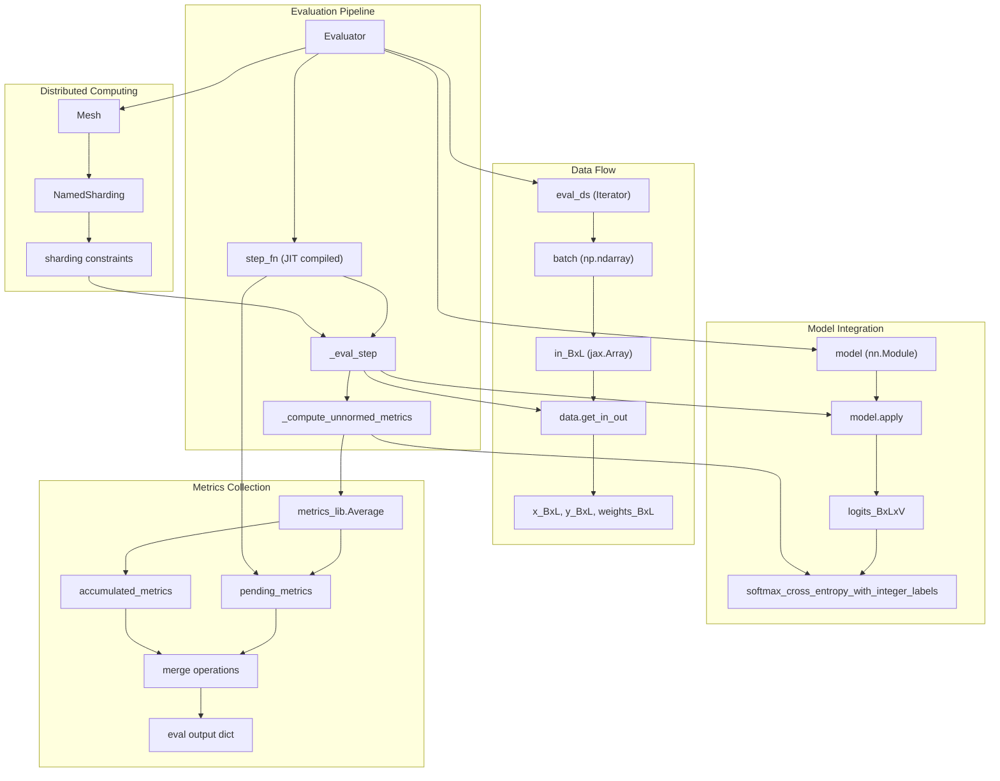
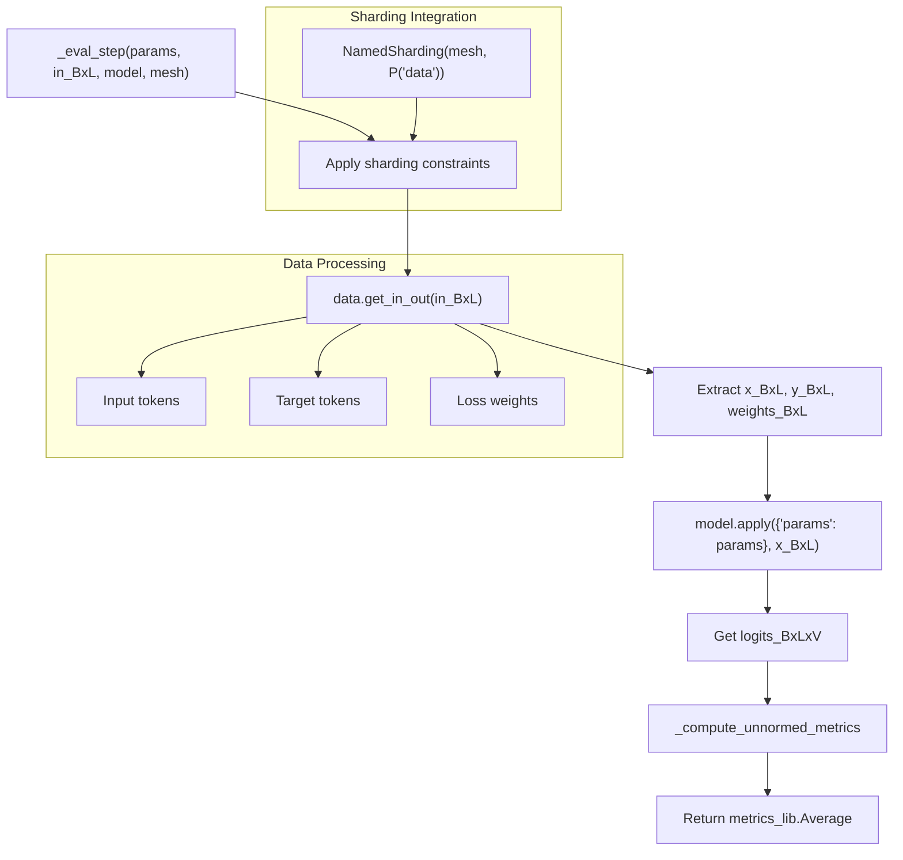
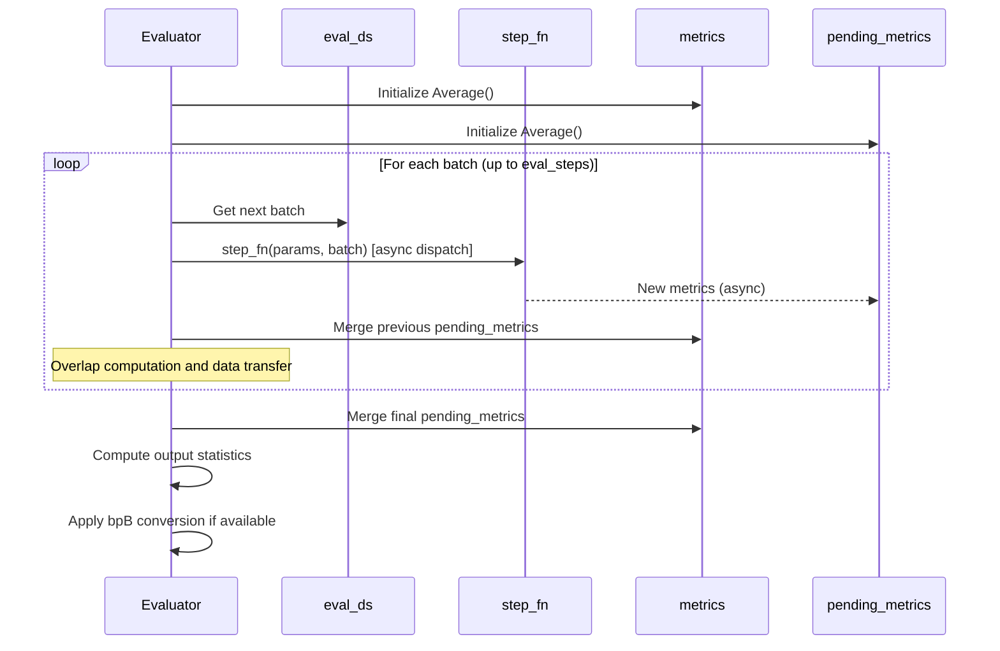

<!-- source: DeepWiki mcp.deepwiki.com · repo google-deepmind/nanodo · page 3.4 Evaluation System · fetched 2026-10-26 -->

# Evaluation System

<details>
<summary>Relevant source files</summary>

The following files were used as context for generating this wiki page:

- [nanodo/evaluate.py](nanodo/evaluate.py)
- [tests/evaluate_test.py](tests/evaluate_test.py)

</details>


## Purpose and Scope

The Evaluation System provides model performance assessment capabilities during and after training in the nanodo framework. It handles metric computation, evaluation loop orchestration, and integration with the training pipeline to provide periodic model validation.

This document covers the evaluation infrastructure, metrics computation, and evaluation loop mechanics. For information about metrics collection and aggregation patterns, see [Metrics and Monitoring](#3.5). For training system integration, see [Training System](#3.1).

## Architecture Overview

The evaluation system is built around the `Evaluator` class, which orchestrates evaluation runs and integrates with JAX's distributed computing capabilities.

### Evaluation System Components



Sources: [nanodo/evaluate.py:68-154]()

## Core Components

### Evaluator Class

The `Evaluator` class serves as the main interface for model evaluation, handling JIT compilation, sharding, and metrics aggregation.

| Component | Type | Purpose |
|-----------|------|---------|
| `step_fn` | JIT-compiled function | Performs single evaluation step with optimal performance |
| `c` | ConfigDict | Configuration parameters including `eval_steps` |
| `ds` | Iterator | Evaluation dataset iterator |
| `bpB` | float | Bits per byte conversion factor for specific datasets |

#### Initialization and JIT Compilation

The evaluator sets up JIT compilation with appropriate sharding specifications:

```python
self.step_fn = jax.jit(
    functools.partial(_eval_step, model=model, mesh=mesh),
    in_shardings=(shardings.params, NamedSharding(mesh, P())),
    out_shardings=(NamedSharding(mesh, P())),
    donate_argnames=("params", "in_BxL"),
)
```

The function uses `donate_argnames` to optimize memory usage by allowing JAX to reuse input buffers.

Sources: [nanodo/evaluate.py:71-92]()

### Evaluation Step Function

The `_eval_step` function performs the core evaluation computation on a single batch.



Sources: [nanodo/evaluate.py:128-141]()

### Metrics Computation

The `_compute_unnormed_metrics` function calculates loss values using softmax cross-entropy and returns structured metrics.

| Function | Input | Output | Purpose |
|----------|-------|--------|---------|
| `softmax_cross_entropy_with_integer_labels` | `logits_BxLxV`, `labels_BxL` | `losses_BxL` | Compute per-token losses |
| `Average.from_array` | `losses_BxL`, `mask=weights_BxL` | `metrics_lib.Average` | Aggregate losses with masking |

Sources: [nanodo/evaluate.py:144-153]()

## Evaluation Flow

### Main Evaluation Loop

The `eval` method orchestrates the complete evaluation process with asynchronous metric collection:



#### Asynchronous Metrics Collection

The evaluation loop uses an asynchronous pattern to overlap computation with data transfer:

1. Dispatch new evaluation step asynchronously
2. Collect results from previous step while new step executes
3. Merge collected metrics with running totals
4. Repeat until `eval_steps` reached or data exhausted

Sources: [nanodo/evaluate.py:93-125]()

### Output Metrics

The evaluation system produces a comprehensive set of metrics:

| Metric | Description | Formula |
|--------|-------------|---------|
| `eval_loss` | Mean loss across all tokens | `metrics.mean` |
| `eval_loss_std` | Standard error of mean | `metrics.sem` |
| `eval_loss_uc` | Upper confidence bound | `mean + 3 * sem` |
| `eval_loss_bpB` | Loss in bits per byte | `loss * bpB` (if available) |
| `_eval_loss` | Duplicate for XM measurements | Same as `eval_loss` |

### Bits per Byte Conversion

The system includes predefined conversion factors for common datasets:

| Dataset | Vocab Path | Conversion Factor |
|---------|------------|------------------|
| `lm1b:1.1.0` | `cc_all.32000.100extra.bos.model` | 0.361 |
| `c4:3.1.0` | `cc_all.32000.100extra.bos.model` | 0.336 |
| `huggingface:cerebras__slimpajama_627b` | `cc_all.32000.100extra.bos.model` | 0.371 |

These factors convert from nats per token to bits per byte for standardized comparison across datasets.

Sources: [nanodo/evaluate.py:42-65](), [nanodo/evaluate.py:115-121]()

## Distributed Evaluation

### Sharding Integration

The evaluation system integrates with JAX's sharding system for distributed computation:

```python
# Apply data sharding constraint
in_BxL = jax.lax.with_sharding_constraint(
    in_BxL, NamedSharding(mesh, P("data"))
)
```

This ensures that evaluation batches are properly distributed across devices in multi-device setups.

### Memory Optimization

The JIT compilation uses `donate_argnames` to optimize memory usage:
- `params`: Model parameters can be donated since they're not modified
- `in_BxL`: Input batch can be donated after processing

Sources: [nanodo/evaluate.py:86-87](), [nanodo/evaluate.py:135-138]()

## Integration with Training System

The evaluation system is designed to integrate seamlessly with the training loop:

1. **Shared Model**: Uses the same model instance as training
2. **Parameter Sharing**: Evaluates using current training parameters
3. **Sharding Consistency**: Uses same mesh and sharding strategy as training
4. **Metrics Integration**: Outputs metrics in format compatible with training monitoring

The evaluator is typically instantiated once and reused throughout training, with the `eval` method called periodically to assess model performance.

Sources: [nanodo/evaluate.py:71-78]()

## Testing and Validation

The evaluation system includes comprehensive tests that verify:

- Correct metric computation for known inputs
- Proper integration with model architecture
- Metrics aggregation accuracy
- Statistical properties of computed metrics

The test suite uses a small `TransformerDo` model to validate the complete evaluation pipeline.

Sources: [tests/evaluate_test.py:29-48]()

---

