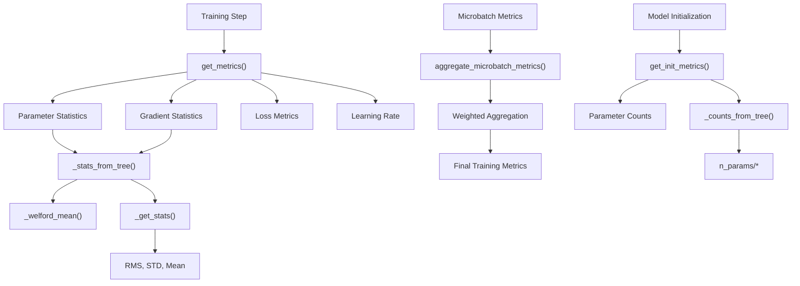
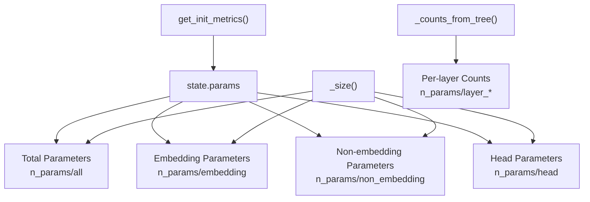
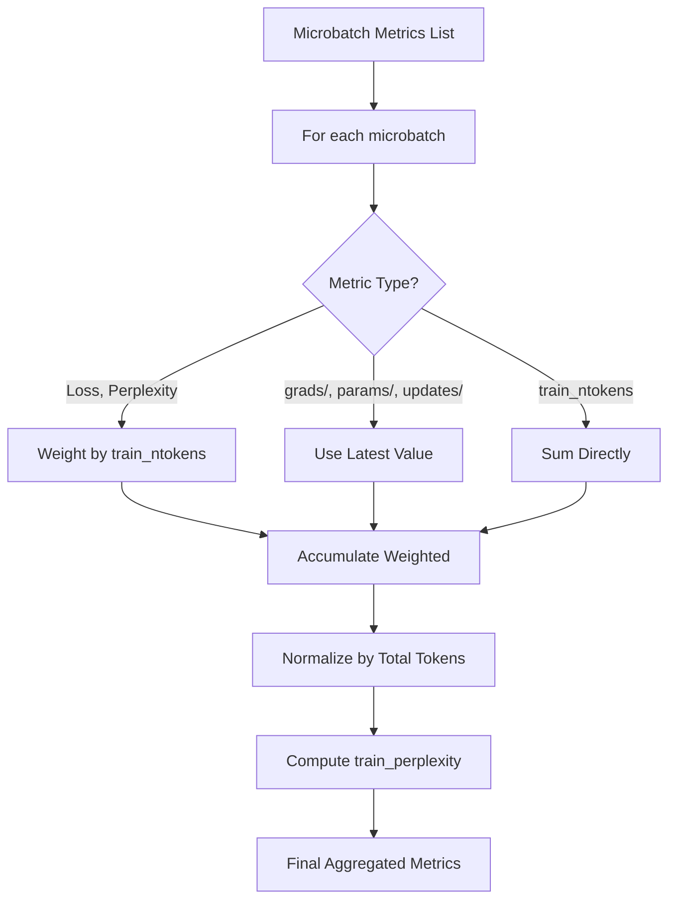
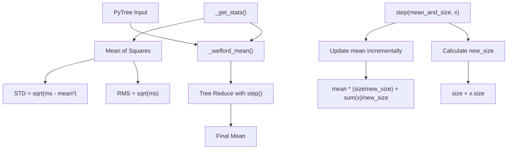
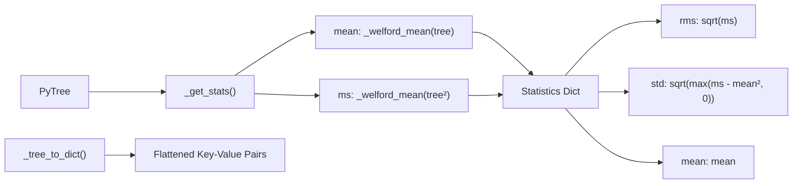
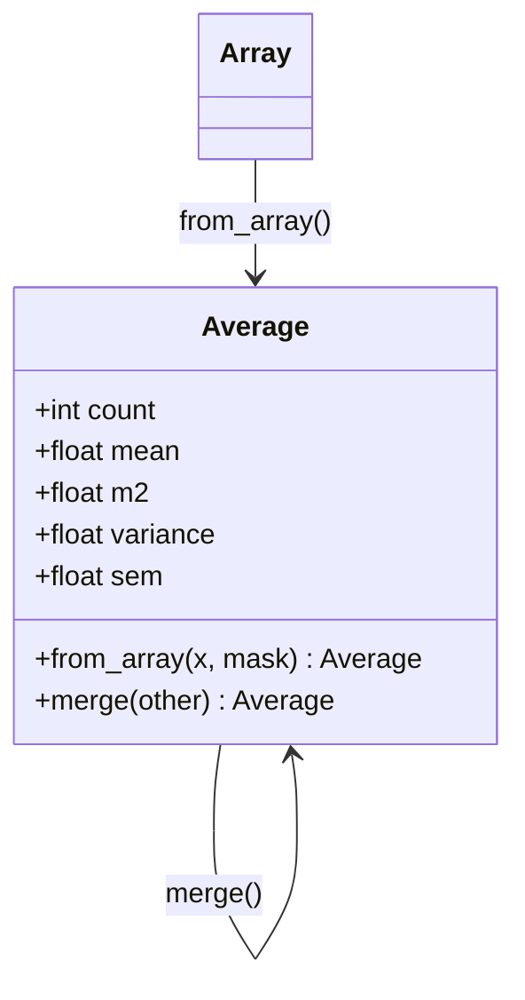
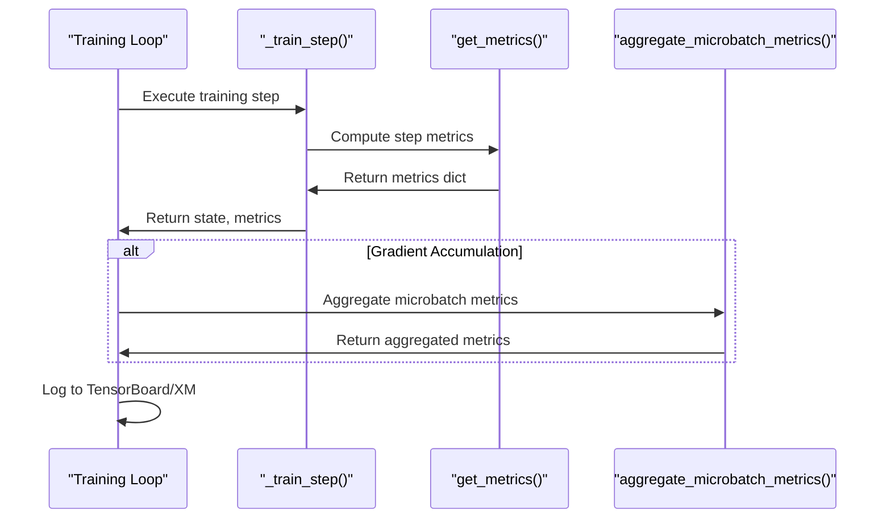

<!-- source: DeepWiki mcp.deepwiki.com · repo google-deepmind/nanodo · page 3.5 Metrics and Monitoring · fetched 2026-10-26 -->

# Metrics and Monitoring

<details>
<summary>Relevant source files</summary>

The following files were used as context for generating this wiki page:

- [nanodo/metrics.py](nanodo/metrics.py)
- [tests/metrics_test.py](tests/metrics_test.py)

</details>


This document covers the metrics collection and monitoring system in nanodo, which tracks training progress, model statistics, and optimization dynamics. The system provides comprehensive monitoring of parameter counts, gradient statistics, loss values, and training metrics throughout the training process.

For information about the training loop integration, see [Training System](#3.1). For evaluation metrics, see [Evaluation System](#3.4).

## Overview

The metrics system in nanodo serves several key purposes:

- **Training Monitoring**: Track loss, perplexity, learning rates, and training progress
- **Parameter Analysis**: Count and analyze model parameters across different components  
- **Gradient Statistics**: Monitor gradient norms, distributions, and optimization dynamics
- **Microbatch Aggregation**: Correctly aggregate metrics across gradient accumulation steps
- **Numerical Stability**: Use robust algorithms like Welford's method for stable statistics computation

The system is designed to work seamlessly with JAX's functional programming model and supports distributed training scenarios.

## Core Metrics Collection

### Metrics Collection Flow



**Sources**: [nanodo/metrics.py:71-116](), [nanodo/metrics.py:36-68]()

### Initial Metrics Computation

The `get_init_metrics` function computes static metrics about the model structure that remain constant throughout training:



The function distinguishes between different parameter categories:
- **Embedding parameters**: Token embeddings (`embed`) and positional embeddings (`pos_embed`)
- **Non-embedding parameters**: All other model parameters excluding embeddings
- **Head parameters**: Output projection layer parameters (if present)

**Sources**: [nanodo/metrics.py:36-68](), [nanodo/metrics.py:210-212](), [nanodo/metrics.py:220-221]()

### Training Step Metrics

The `get_metrics` function computes comprehensive metrics at each training step:

| Metric Category | Key Metrics | Description |
|-----------------|-------------|-------------|
| **Loss & Perplexity** | `train_loss`, `log_perplexity` | Cross-entropy loss and log perplexity |
| **Training Progress** | `train_fraction`, `train_tokens_seen` | Training completion and token count |
| **Optimization** | `learning_rate` | Current learning rate from schedule |
| **Gradient Stats** | `grads/all/*` | Global gradient statistics (RMS, mean, std) |
| **Parameter Stats** | `params/all/*` | Global parameter statistics |
| **Update Stats** | `updates/all/*` | Optimizer update statistics |

**Sources**: [nanodo/metrics.py:71-116]()

## Microbatch Metrics Aggregation

### Aggregation Strategy

The `aggregate_microbatch_metrics` function handles the complex task of correctly combining metrics across gradient accumulation steps:



The aggregation logic handles three types of metrics differently:

1. **Averaging Metrics**: Loss, perplexity, and other quality metrics are weighted by `train_ntokens`
2. **Non-accumulating Metrics**: Gradient, parameter, and update statistics use the latest values
3. **Summing Metrics**: Token counts are summed directly

**Sources**: [nanodo/metrics.py:118-167]()

### Token-Weighted Aggregation

```python
# Pseudocode showing the aggregation logic
def aggregate_logic(microbatch_metrics):
    for metric_dict in microbatch_metrics:
        train_ntokens = metric_dict["train_ntokens"]
        for key, value in metric_dict.items():
            if is_non_accumulating_metric(key):
                # Use latest value for grad/param/update stats
                final_metrics[key] = value
            elif key == "train_ntokens":
                # Sum token counts
                final_metrics[key] += value
            else:
                # Weight by tokens for loss/perplexity
                final_metrics[key] += train_ntokens * value
```

**Sources**: [nanodo/metrics.py:134-161]()

## Statistical Computations

### Welford Algorithm Implementation

The metrics system uses Welford's algorithm for numerically stable computation of means and variances, especially important for large arrays that exceed int32 limits:



The algorithm handles:
- **Large Arrays**: Arrays larger than int32 limits (tested with >2³¹ elements)
- **PyTree Structures**: Nested parameter structures with mixed shapes
- **Numerical Stability**: Avoids catastrophic cancellation in variance computation

**Sources**: [nanodo/metrics.py:186-207](), [tests/metrics_test.py:60-96]()

### Statistics Dictionary Generation

The `_stats_from_tree` and `_global_stats_from_tree` functions generate comprehensive statistics:



**Sources**: [nanodo/metrics.py:178-183](), [nanodo/metrics.py:198-207]()

## Running Average Class

### Average Dataclass

The `Average` class implements a robust running average computation using the parallel Welford algorithm:



Key capabilities:
- **Incremental Updates**: Merge statistics from different data chunks
- **Masked Computation**: Support for masked arrays
- **Standard Error**: Computes standard error of the mean (SEM)
- **Numerical Stability**: Uses Chan et al. parallel algorithm

**Sources**: [nanodo/metrics.py:253-317]()

### Usage Pattern

```python
# Typical usage pattern for running averages
average = None
for data_chunk in data_stream:
    update = Average.from_array(data_chunk)
    average = update if average is None else average.merge(update)
    
print(f"Mean: {average.mean} ± {average.sem}")
```

**Sources**: [tests/metrics_test.py:145-176]()

## Integration with Training Loop

### Metrics Flow in Training



The metrics system integrates tightly with the training loop:

1. **Step Metrics**: Computed after each forward/backward pass
2. **Microbatch Aggregation**: Applied when using gradient accumulation
3. **Logging**: Metrics are logged to monitoring systems
4. **Progress Tracking**: Used for training progress and convergence monitoring

**Sources**: [tests/metrics_test.py:98-143](), [nanodo/metrics.py:71-116]()

### Internal Metrics Logging

When `log_internal_metrics` is enabled in the configuration, the system logs detailed internal statistics:

- **Layer-wise Statistics**: Per-layer parameter and gradient statistics
- **Attention States**: Internal attention mechanism statistics
- **Activation Statistics**: Statistics from intermediate activations

This provides deep visibility into model behavior but increases logging overhead.

**Sources**: [nanodo/metrics.py:108-114]()

---

