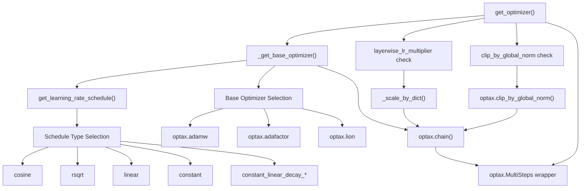
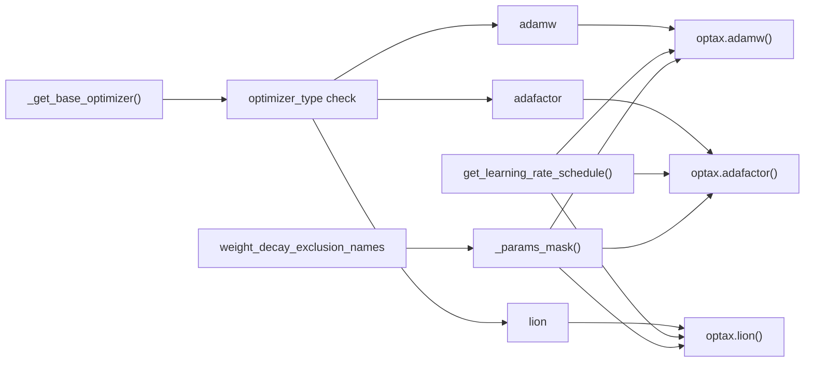
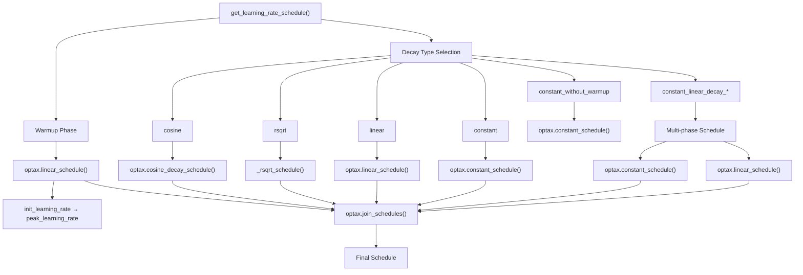
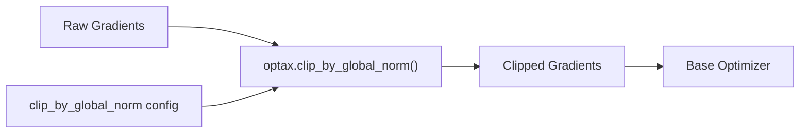
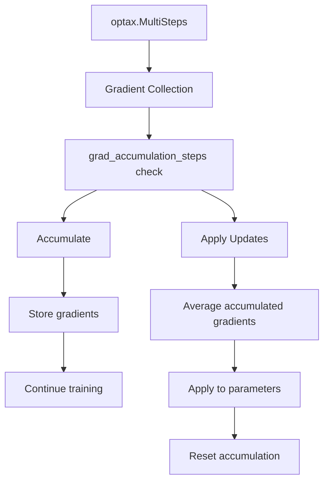
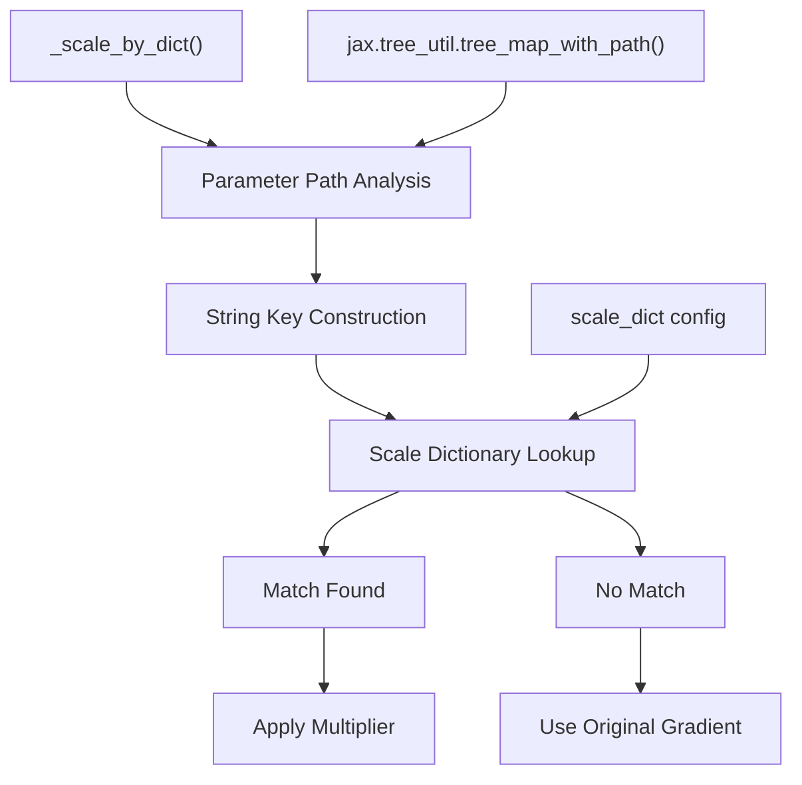
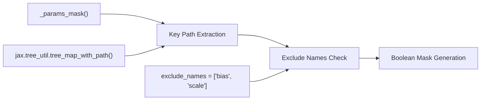

<!-- source: DeepWiki mcp.deepwiki.com · repo google-deepmind/nanodo · page 3.6 Optimization · fetched 2026-10-26 -->

# Optimization

<details>
<summary>Relevant source files</summary>

The following files were used as context for generating this wiki page:

- [nanodo/model_factory.py](nanodo/model_factory.py)
- [nanodo/optimizer.py](nanodo/optimizer.py)
- [tests/model_test.py](tests/model_test.py)
- [tests/optimizer_test.py](tests/optimizer_test.py)

</details>


This document covers the optimization system in nanodo, which handles optimizer creation, learning rate scheduling, and gradient processing strategies. The optimization system is built on top of Optax and provides a flexible factory pattern for configuring various optimization algorithms and schedules.

For information about the training loop that uses these optimizers, see [Training System](#3.1). For details about model architecture and parameter structure, see [Model Architecture](#3.2).

## Overview

The optimization system provides a unified interface for creating and configuring optimizers through the `get_optimizer()` function in [nanodo/optimizer.py](). The system supports multiple base optimizers, sophisticated learning rate schedules, gradient processing techniques, and advanced features like layerwise learning rate scaling.

## Optimizer Factory System

The optimization system uses a factory pattern to create complex optimizer chains based on configuration parameters. The main entry point is `get_optimizer()`, which orchestrates multiple optimization components into a single `optax.MultiSteps` instance.



**Optimizer Chain Construction**

The optimizer construction follows this sequence:

1. **Base Optimizer Creation**: Selects and configures one of three supported optimizers
2. **Layerwise Scaling**: Optionally applies parameter-specific learning rate multipliers
3. **Gradient Clipping**: Optionally clips gradients by global norm
4. **Multi-step Wrapping**: Wraps the optimizer chain for gradient accumulation

Sources: [nanodo/optimizer.py:28-44]()

## Base Optimizers

The system supports three base optimizers, each with specific configuration options:

| Optimizer | Key Parameters | Use Case |
|-----------|---------------|----------|
| `adamw` | `b1`, `b2`, `eps`, `weight_decay` | General purpose, memory efficient |
| `adafactor` | `multiply_by_parameter_scale`, `decay_rate`, `momentum`, `factored` | Large models, adaptive scaling |
| `lion` | `b1`, `b2`, `weight_decay` | Sign-based updates, memory efficient |



**Weight Decay Configuration**

All base optimizers support weight decay with parameter exclusions through `_params_mask()`. By default, bias and scale parameters are excluded from weight decay. The system also supports independent weight decay scaling when `independent_weight_decay` is enabled.

Sources: [nanodo/optimizer.py:150-199](), [nanodo/optimizer.py:133-148]()

## Learning Rate Schedules

The learning rate scheduling system supports multiple schedule types with a consistent warmup phase followed by various decay strategies.



**Schedule Types**

| Schedule Type | Behavior | Configuration |
|---------------|----------|---------------|
| `cosine` | Cosine decay after warmup | `decay_steps`, `final_learning_rate` |
| `rsqrt` | Reciprocal square root decay | Automatic based on warmup |
| `linear` | Linear decay after warmup | `final_learning_rate` |
| `constant` | Constant rate after warmup | `peak_learning_rate` only |
| `constant_linear_decay_*` | Constant then linear decay | Supports percentage or step-based |

**Custom RSQRT Schedule**

The `_rsqrt_schedule()` implements a reciprocal square root decay commonly used in Transformer training:

```
learning_rate = init_value * (step + shift)^(-0.5) * shift^0.5
```

Sources: [nanodo/optimizer.py:47-122](), [nanodo/optimizer.py:124-131]()

## Gradient Processing

The optimization system provides several gradient processing features that wrap around the base optimizer.

### Gradient Clipping

Global gradient norm clipping is applied when `clip_by_global_norm` is specified in the configuration:



### Multi-step Gradient Accumulation

All optimizers are wrapped with `optax.MultiSteps` to support gradient accumulation across multiple microbatches:



Sources: [nanodo/optimizer.py:36-44]()

## Advanced Features

### Layerwise Learning Rate Scaling

The `_scale_by_dict()` function provides parameter-specific learning rate multipliers based on parameter names:



**Example Configuration**:
```python
layerwise_lr_multiplier = {"kernel": 3.0, "embedding": 0.1}
```

This applies 3x learning rate to all parameters containing "kernel" in their path and 0.1x to embedding parameters.

### Parameter Masking

The `_params_mask()` function creates boolean masks for excluding specific parameters from weight decay or other transformations:



Default exclusions are bias and scale parameters, which typically should not have weight decay applied.

Sources: [nanodo/optimizer.py:202-233](), [nanodo/optimizer.py:133-148]()

## Configuration Integration

The optimization system integrates with the broader configuration system through `ml_collections.ConfigDict`. Key configuration parameters include:

| Parameter | Type | Purpose |
|-----------|------|---------|
| `optimizer` | str | Base optimizer type |
| `peak_learning_rate` | float | Maximum learning rate |
| `warmup_steps` | int | Warmup duration |
| `decay_type` | str | Learning rate decay strategy |
| `weight_decay` | float | L2 regularization strength |
| `grad_accumulation_steps` | int | Gradient accumulation factor |
| `clip_by_global_norm` | float | Gradient clipping threshold |

The configuration is passed through the training system and used by `get_optimizer()` to construct the complete optimization pipeline.

Sources: [nanodo/optimizer.py:28-29](), [tests/optimizer_test.py:31-42]()

---

