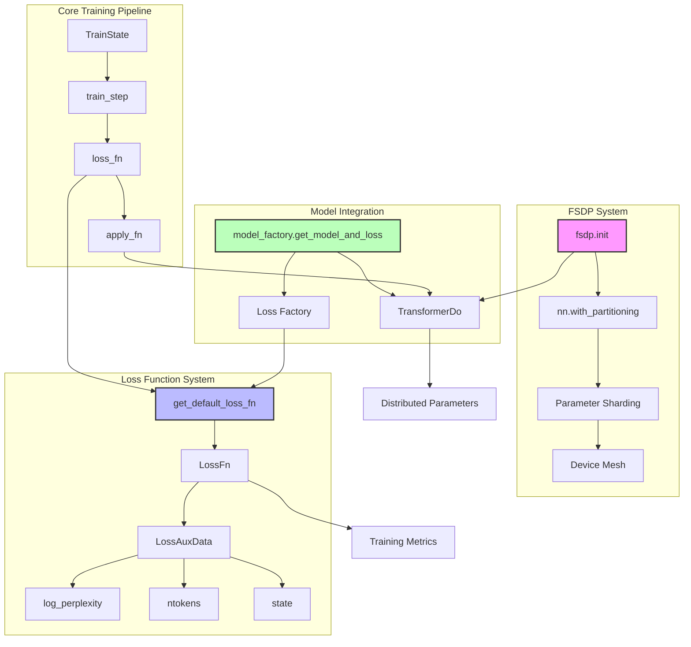
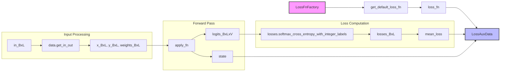
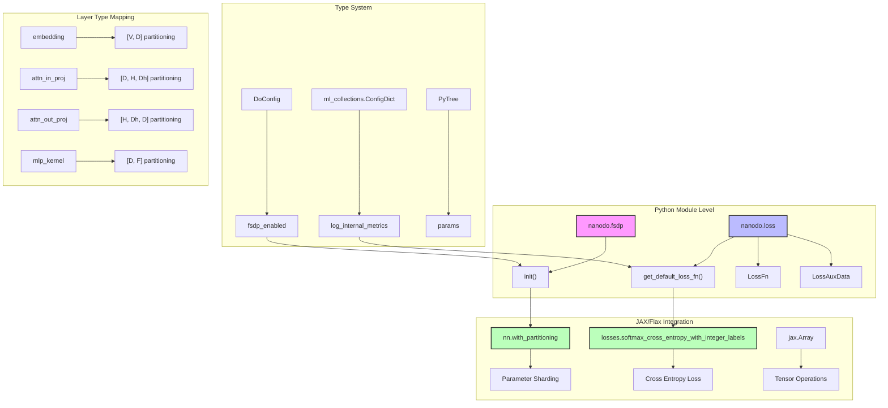

<!-- source: DeepWiki mcp.deepwiki.com · repo google-deepmind/nanodo · page 4 Advanced Features · fetched 2026-10-26 -->

# Advanced Features

<details>
<summary>Relevant source files</summary>

The following files were used as context for generating this wiki page:

- [nanodo/fsdp.py](nanodo/fsdp.py)
- [nanodo/loss.py](nanodo/loss.py)

</details>


This document covers the specialized features in nanodo designed for advanced users and production deployments. These features enable scaling to larger models and distributed training scenarios while maintaining the framework's simplicity and hackability.

For core system fundamentals, see [Core Systems](#3). For detailed implementation of specific advanced features, see [Distributed Training (FSDP)](#4.1) and [Loss Functions](#4.2).

## Overview

Nanodo provides two primary advanced features that distinguish it from basic transformer implementations:

1. **Fully Sharded Data Parallel (FSDP)** - Enables training large models across multiple devices by sharding parameters
2. **Flexible Loss Function System** - Provides extensible loss computation with auxiliary data support

These features integrate seamlessly with the core training pipeline while adding minimal complexity to the user interface.

## Advanced Features Architecture



Sources: [nanodo/fsdp.py:1-52](), [nanodo/loss.py:1-74]()

## FSDP Integration

The FSDP system provides parameter sharding capabilities for distributed training. The implementation centers around the `fsdp.init` function which determines how different layer types should be partitioned across devices.

### Key Components

| Component | Purpose | Implementation |
|-----------|---------|----------------|
| `fsdp.init` | Parameter partitioning strategy | [nanodo/fsdp.py:34-51]() |
| `nn.with_partitioning` | Flax partitioning wrapper | [nanodo/fsdp.py:36]() |
| Layer-specific partitioning | Optimized sharding per layer type | [nanodo/fsdp.py:37-51]() |

The system supports partitioning for:
- **Embedding layers** `[V, D]` - Partitioned on model dimension
- **Attention projections** `[D, H, Dh]` and `[H, Dh, D]` - Partitioned on input/output dimensions
- **MLPs** `[D, F]` - Partitioned on input dimension
- **Output heads** `[D, V]` - Partitioned on model dimension

For comprehensive FSDP documentation, see [Distributed Training (FSDP)](#4.1).

## Loss Function System

The loss function system provides a flexible framework for implementing custom loss computations with auxiliary data collection. The core abstraction is the `LossFn` type which returns both loss values and auxiliary data.

### Loss Function Factory Pattern



Sources: [nanodo/loss.py:42-45](), [nanodo/loss.py:48-73]()

### LossAuxData Structure

The `LossAuxData` dataclass provides structured auxiliary information from loss computation:

```python
@dataclass
class LossAuxData:
  ntokens: jax.Array        # Number of valid tokens
  state: PyTree             # Model state (e.g., intermediate activations)
  log_perplexity: jax.Array # Log perplexity for monitoring
```

This structure enables:
- **Token counting** for proper loss normalization
- **State tracking** for debugging and analysis
- **Perplexity monitoring** for training diagnostics

For detailed loss function customization, see [Loss Functions](#4.2).

## Code Entity Mapping



Sources: [nanodo/fsdp.py:22](), [nanodo/fsdp.py:34-51](), [nanodo/loss.py:30](), [nanodo/loss.py:33-37](), [nanodo/loss.py:40-45]()

## Integration Considerations

### Configuration Requirements

Both advanced features are controlled through configuration:
- **FSDP**: Enabled via `DoConfig.fsdp_enabled` flag
- **Loss Functions**: Controlled via `log_internal_metrics` configuration

### Performance Implications

- **FSDP**: Reduces memory usage per device but adds communication overhead
- **Loss Functions**: Auxiliary data collection adds minimal computational cost

### Compatibility

Both features maintain full compatibility with the core training pipeline and require no changes to existing training scripts when disabled.

Sources: [nanodo/fsdp.py:36](), [nanodo/loss.py:58]()

---

