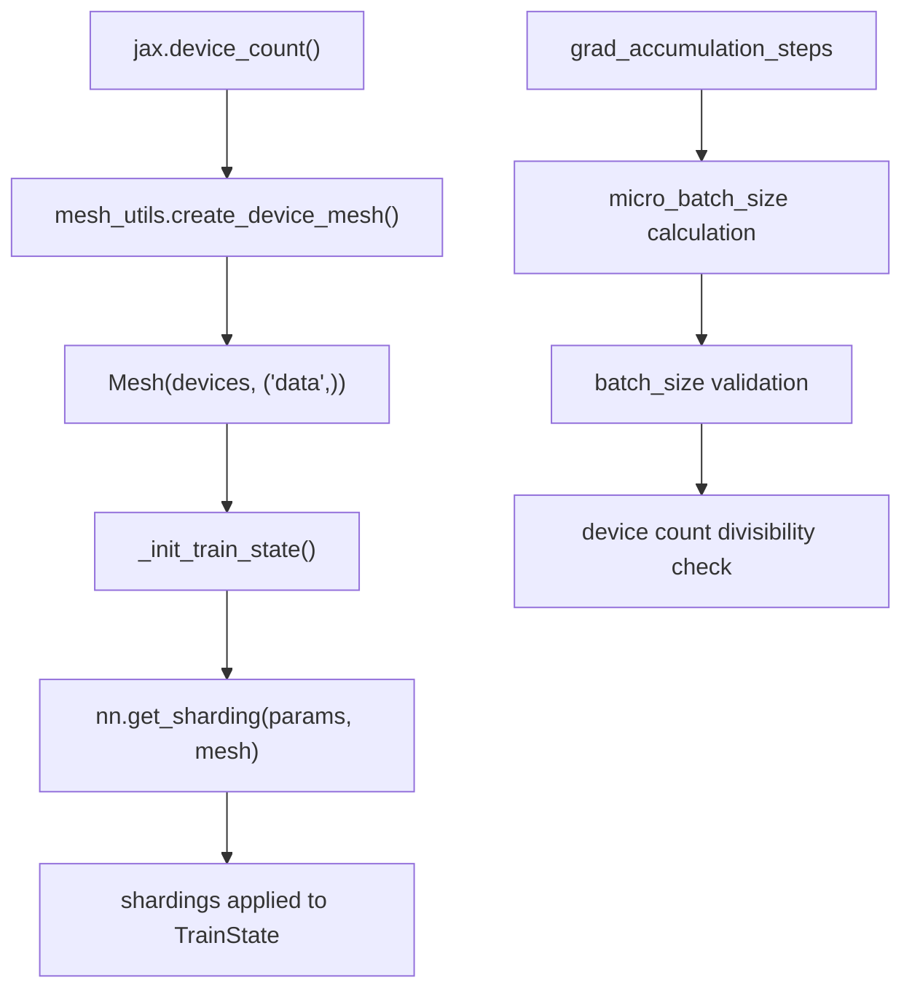
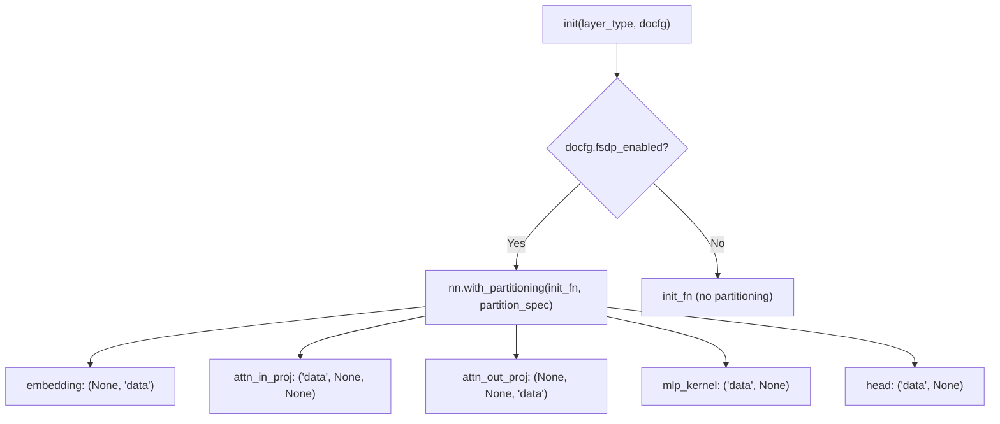
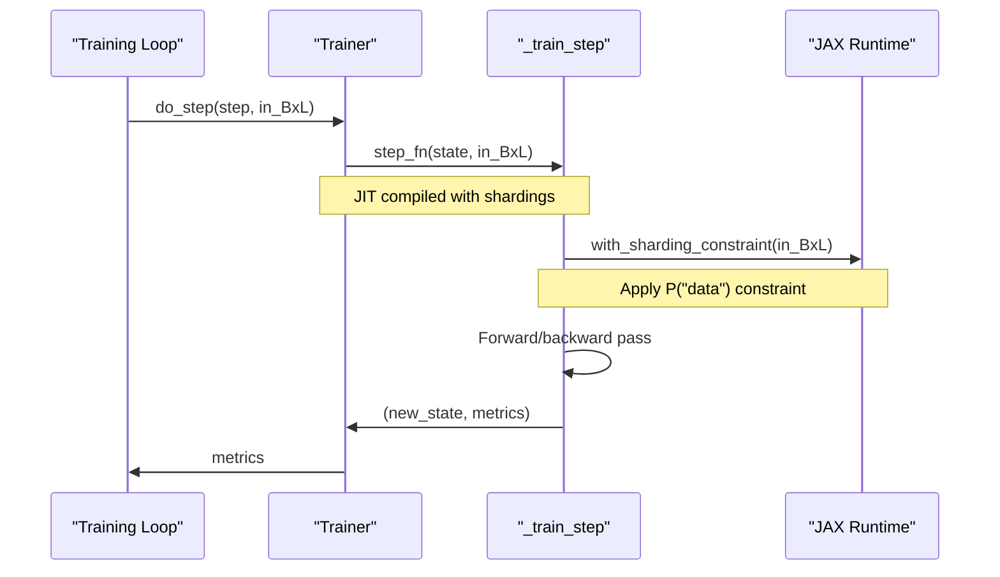
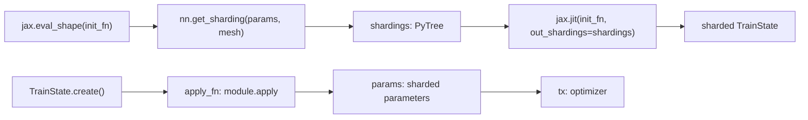
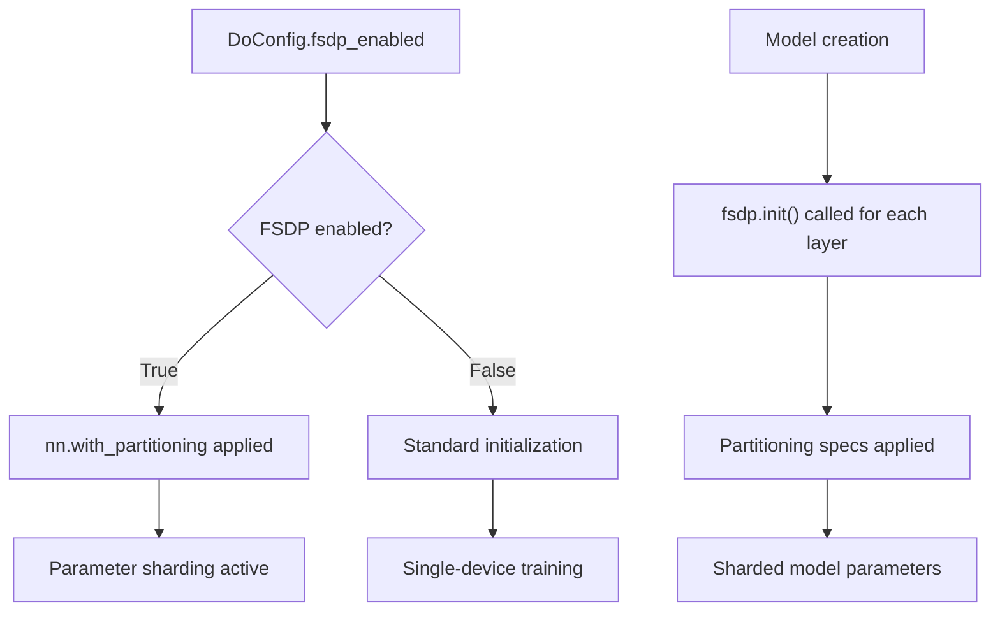

<!-- source: DeepWiki mcp.deepwiki.com · repo google-deepmind/nanodo · page 4.1 Distributed Training (FSDP) · fetched 2026-10-26 -->

# Distributed Training (FSDP)

Relevant source files

The following files were used as context for generating this wiki page:

- [nanodo/fsdp.py](nanodo/fsdp.py)
- [nanodo/train.py](nanodo/train.py)

This document covers Fully Sharded Data Parallel (FSDP) training in nanodo, including parameter sharding strategies, mesh configuration, and distributed training coordination across multiple devices. FSDP enables training large models by sharding parameters across devices while maintaining data parallelism.

For information about the core training system architecture, see [Training System](#3.1). For optimizer configuration in distributed settings, see [Optimization](#3.6).

## Overview

The nanodo framework implements FSDP through JAX's native sharding capabilities, using a mesh-based approach to distribute model parameters across devices. The system automatically handles parameter sharding, gradient synchronization, and checkpoint management in distributed environments.

**Key Components:**
- `fsdp.py`: Parameter sharding specification utilities
- `train.py`: Mesh setup and distributed training orchestration
- Automatic sharding constraint application during training

Sources: [nanodo/fsdp.py:1-52](), [nanodo/train.py:57-83]()

## Device Mesh Configuration

The distributed training system creates a device mesh that defines how computation is distributed across available devices. The mesh uses a single "data" axis for parameter sharding.

### Mesh Creation Flow

The system performs several validation checks:
- Batch size must be divisible by gradient accumulation steps
- Micro batch size must be divisible by device count
- Ensures proper data distribution across the mesh

Sources: [nanodo/train.py:57-72]()

## Parameter Sharding Strategy

The `fsdp.py` module defines how different transformer components are sharded across devices. Each layer type has a specific partitioning strategy optimized for memory efficiency and communication patterns.

### Layer-Specific Partitioning

**Partitioning Rules:**
- Only one dimension per tensor is partitioned along the "data" axis
- Partitioned dimension must be divisible by device count
- Model dimension (D) is typically chosen as it's usually divisible by device count

| Layer Type | Tensor Shape | Partition Spec | Partitioned Dimension |
|------------|--------------|----------------|----------------------|
| `embedding` | `[V, D]` | `(None, "data")` | Model dimension |
| `attn_in_proj` | `[D, H, Dh]` | `("data", None, None)` | Model dimension |
| `attn_out_proj` | `[H, Dh, D]` | `(None, None, "data")` | Model dimension |
| `mlp_kernel` | `[D, F]` | `("data", None)` | Model dimension |
| `head` | `[D, V]` | `("data", None)` | Model dimension |

Sources: [nanodo/fsdp.py:25-52]()

## Training Step Integration

The distributed training step applies sharding constraints and coordinates computation across devices. The `Trainer` class handles JIT compilation with explicit sharding specifications.

### Sharding in Training Step

**JIT Compilation with Shardings:**
- `in_shardings`: Specifies input sharding (state uses computed shardings, data uses `P("data")`)
- `out_shardings`: Specifies output sharding (same pattern as inputs)
- `donate_argnames`: Optimizes memory by donating input buffers

Sources: [nanodo/train.py:257-270](), [nanodo/train.py:304-307]()

## TrainState Initialization

The distributed training state initialization creates parameter shardings and applies them during JIT compilation.

### Sharding Creation Process

**Key Functions:**
- `_init_train_state()`: Orchestrates sharding creation and state initialization
- `nn.get_sharding()`: Automatically determines optimal shardings based on mesh
- `jax.jit(..., out_shardings=...)`: Ensures output conforms to sharding specification

Sources: [nanodo/train.py:327-347]()

## Configuration and Enabling

FSDP is controlled through the model configuration's `fsdp_enabled` flag. When enabled, all parameter initializers are wrapped with partitioning specifications.

### Configuration Flow

**Configuration Requirements:**
- Set `docfg.fsdp_enabled = True` in model configuration
- Ensure model dimensions are divisible by device count
- Validate batch size compatibility with device mesh

The system automatically handles the complexity of distributed parameter management, allowing users to enable FSDP with minimal configuration changes while maintaining training loop compatibility.

Sources: [nanodo/fsdp.py:36-49]()

---

