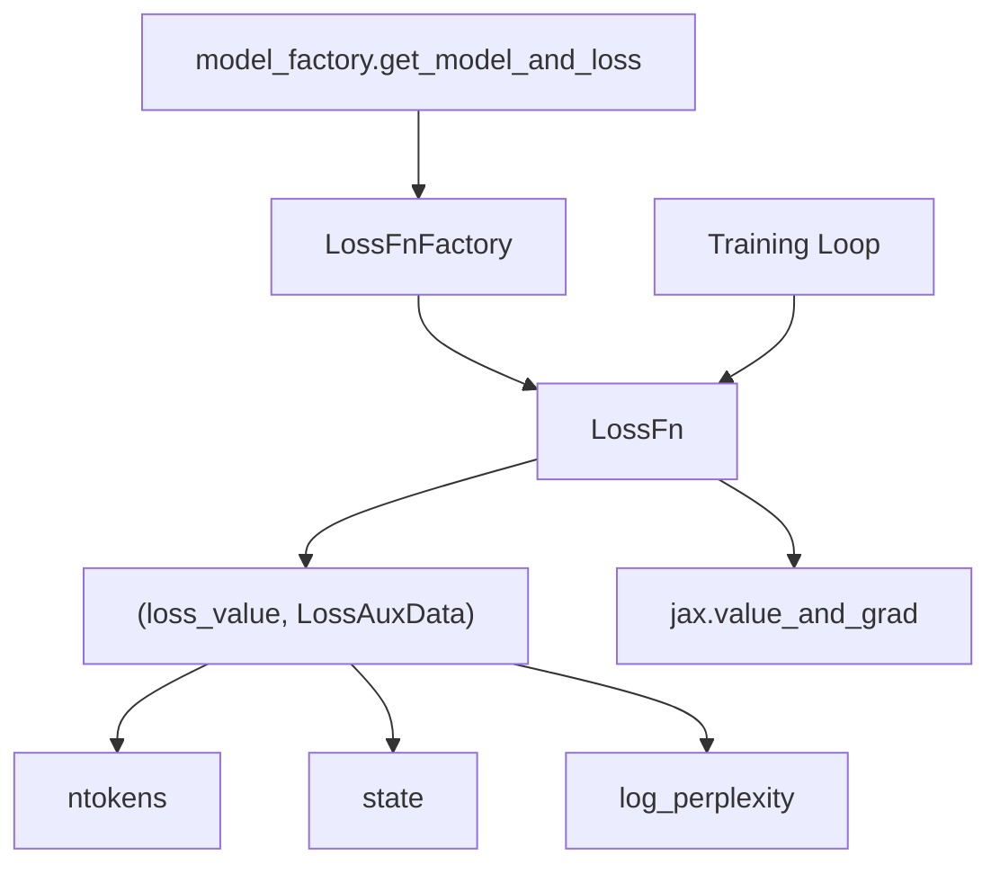
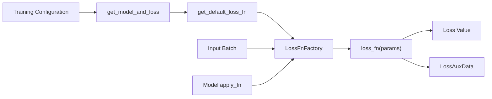
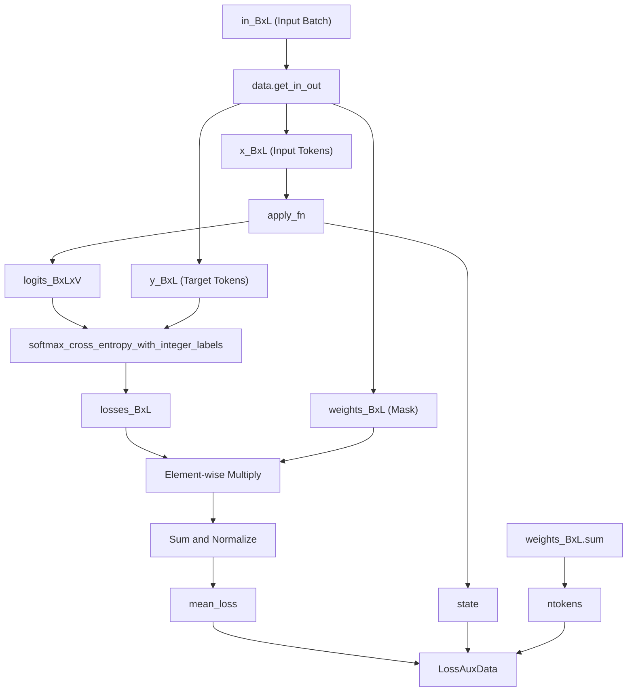
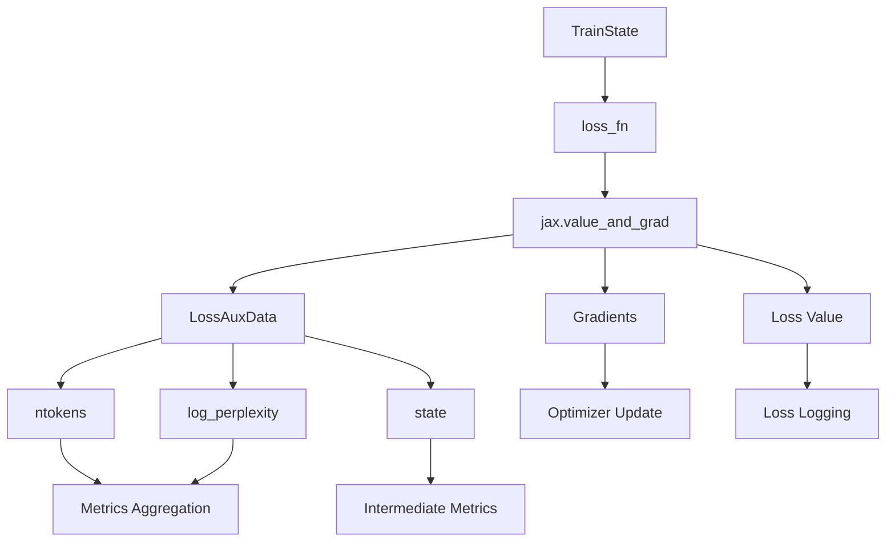
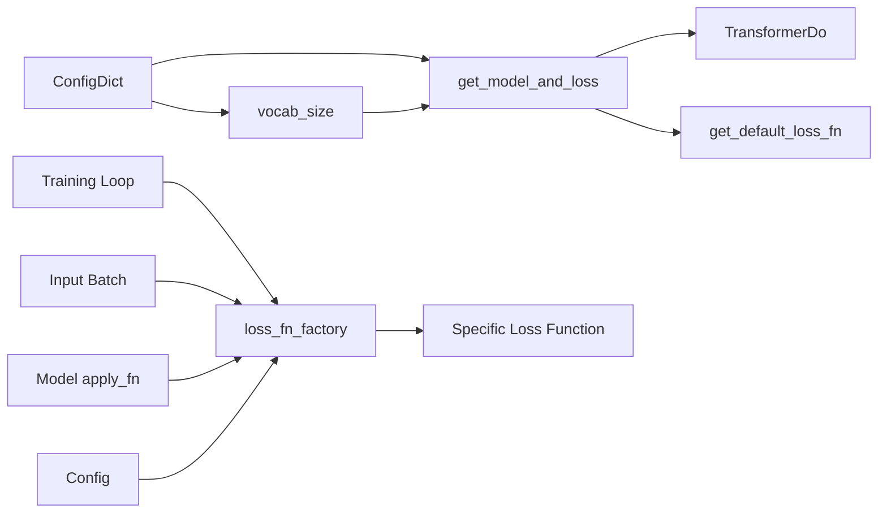
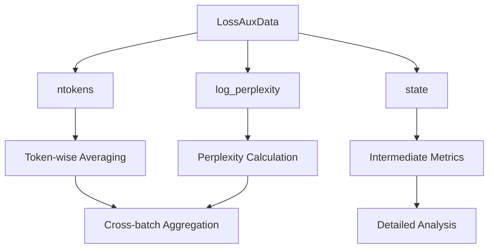
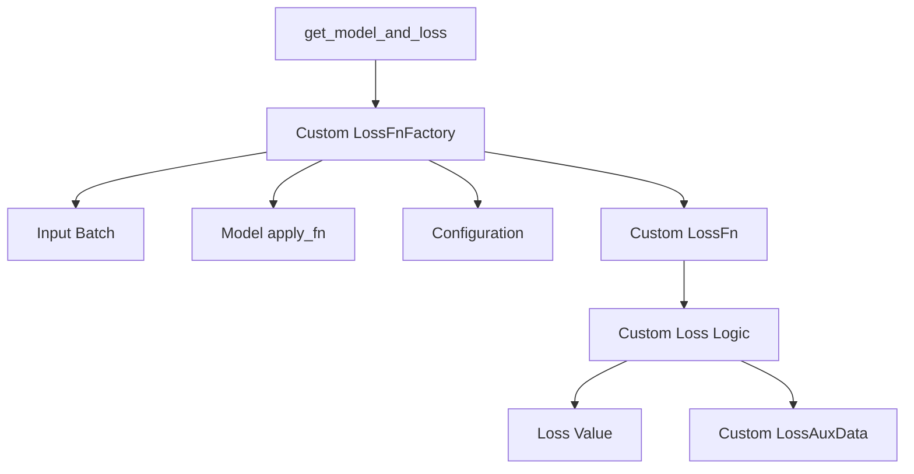

<!-- source: DeepWiki mcp.deepwiki.com · repo google-deepmind/nanodo · page 4.2 Loss Functions · fetched 2026-10-26 -->

# Loss Functions

Relevant source files

The following files were used as context for generating this wiki page:

- [nanodo/loss.py](nanodo/loss.py)
- [nanodo/model_factory.py](nanodo/model_factory.py)
- [nanodo/optimizer.py](nanodo/optimizer.py)

This document covers the loss function system in nanodo, including loss computation, auxiliary data handling, and the factory pattern used for creating loss functions. The loss system is specifically designed for language modeling tasks and integrates tightly with the training pipeline.

For information about the broader training system integration, see [Training System](#3.1). For details about model architecture that produces the logits consumed by loss functions, see [Model Architecture](#3.2).

## Overview

The nanodo loss system implements a factory pattern to create loss functions for language modeling tasks. The primary loss function is cross-entropy loss for next-token prediction, with support for proper masking and auxiliary data collection. Loss functions return both the computed loss value and auxiliary metadata that can be used for metrics and monitoring.

## Loss Function Architecture

### Core Types and Interfaces

The loss system defines several key types that establish the interface between loss computation and the training system:

| Type | Purpose | Location |
|------|---------|----------|
| `LossFn` | Function signature for loss computation | [nanodo/loss.py:40]() |
| `LossFnFactory` | Factory function that creates loss functions | [nanodo/loss.py:42-45]() |
| `LossAuxData` | Auxiliary data returned with loss | [nanodo/loss.py:33-37]() |

**Loss Function Type System**
Sources: [nanodo/loss.py:30-45]()

The `LossAuxData` dataclass encapsulates metadata from loss computation:
- `ntokens`: Number of valid tokens processed (accounting for padding masks)
- `state`: Model state from forward pass (used for intermediate activations if enabled)
- `log_perplexity`: Loss value used for perplexity calculation

### Factory Pattern Implementation

The loss system uses a factory pattern to decouple loss function creation from the training loop:

**Loss Function Factory Pattern**
Sources: [nanodo/model_factory.py:28-40](), [nanodo/loss.py:48-73]()

## Default Language Modeling Loss

### Implementation Details

The default loss function implements standard next-token prediction for language modeling:

**Default Loss Computation Flow**
Sources: [nanodo/loss.py:54-71]()

The loss computation follows these steps:

1. **Input Processing**: Extract input tokens, target tokens, and attention weights from the batch using `data.get_in_out`
2. **Forward Pass**: Apply the model to get logits and optional intermediate state
3. **Loss Calculation**: Compute cross-entropy loss between logits and targets
4. **Masking**: Apply attention weights to exclude padding tokens from loss
5. **Normalization**: Divide total loss by number of valid tokens
6. **Auxiliary Data**: Package metadata for metrics collection

### Configuration Integration

Loss functions integrate with the training configuration system to support optional features:

| Configuration Key | Effect | Default |
|-------------------|--------|---------|
| `log_internal_metrics` | Enables intermediate activation logging | `False` |

When `log_internal_metrics` is enabled, the forward pass includes mutable state collection for detailed metrics.

Sources: [nanodo/loss.py:57-62]()

## Integration with Training System

### Training Loop Integration

Loss functions integrate with the training system through the standard JAX optimization pattern:

**Loss Function Training Integration**
Sources: [nanodo/loss.py:40](), [nanodo/model_factory.py:31]()

The loss function is designed to work with `jax.value_and_grad`, which automatically computes both the loss value and gradients with respect to model parameters.

### Model Factory Integration

The model factory coordinates loss function creation with model instantiation:

**Model and Loss Factory Coordination**
Sources: [nanodo/model_factory.py:28-40]()

## Auxiliary Data System

### Data Structure

The `LossAuxData` structure provides essential metadata for training monitoring:

- **Token Counting**: `ntokens` field enables proper averaging across variable-length sequences
- **State Tracking**: `state` field captures intermediate activations when metrics logging is enabled  
- **Perplexity**: `log_perplexity` provides the loss value in a form suitable for perplexity calculation

### Usage in Metrics

The auxiliary data flows into the metrics system for comprehensive training monitoring:

**Auxiliary Data Flow in Metrics**
Sources: [nanodo/loss.py:33-37](), [nanodo/loss.py:68-71]()

## Custom Loss Function Development

### Interface Requirements

Custom loss functions must conform to the established interface:

1. **Function Signature**: Must match the `LossFn` type signature
2. **Return Structure**: Must return `(loss_value, LossAuxData)` tuple
3. **Gradient Compatibility**: Must be compatible with `jax.value_and_grad`

### Factory Pattern Usage

Custom loss functions should be implemented through the factory pattern:

**Custom Loss Function Architecture**
Sources: [nanodo/loss.py:42-45](), [nanodo/model_factory.py:36]()

Custom implementations can extend the default loss function or implement entirely different loss computation strategies while maintaining compatibility with the training system.

---

