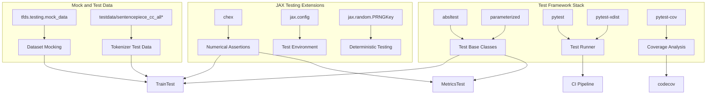
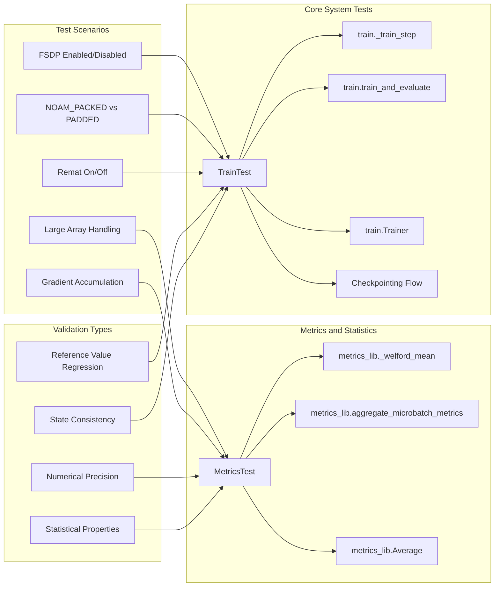
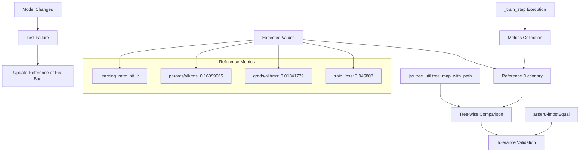
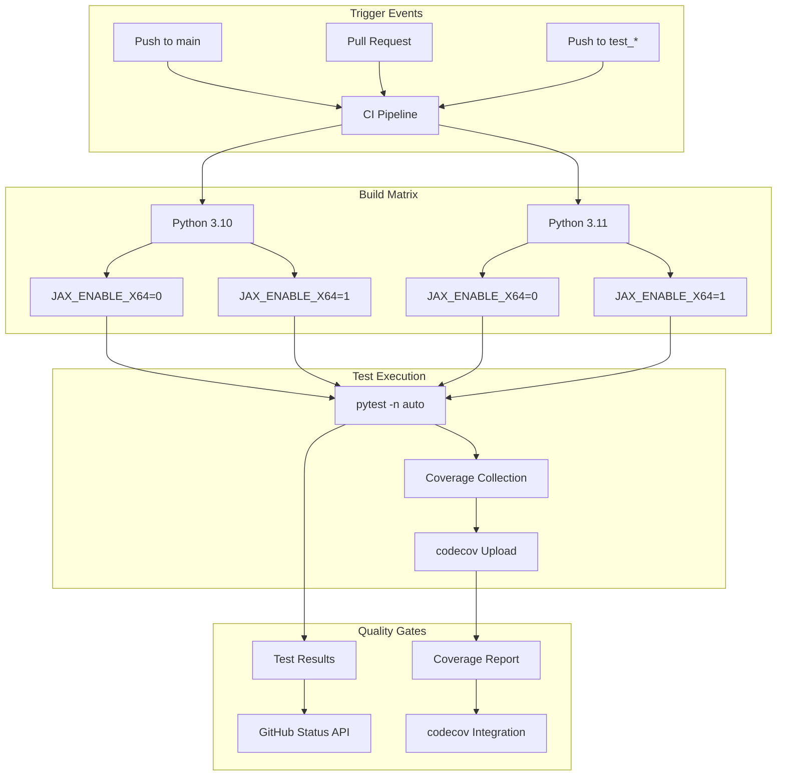

<!-- source: DeepWiki mcp.deepwiki.com · repo google-deepmind/nanodo · page 5 Testing and Quality Assurance · fetched 2026-10-26 -->

# Testing and Quality Assurance

<details>
<summary>Relevant source files</summary>

The following files were used as context for generating this wiki page:

- [.github/workflows/linux.yml](.github/workflows/linux.yml)
- [tests/metrics_test.py](tests/metrics_test.py)
- [tests/train_test.py](tests/train_test.py)

</details>


This document provides an overview of nanodo's testing framework, quality assurance practices, and continuous integration processes. It covers the testing philosophy, key test categories, and automated quality gates that ensure code reliability and maintainability.

For detailed information about the test suite organization and specific test patterns, see [Test Suite Structure](#5.1). For CI/CD pipeline configuration and automated testing workflows, see [Continuous Integration](#5.2).

## Testing Framework Architecture

The nanodo testing framework is built on Python's standard testing ecosystem with JAX-specific extensions for numerical computing validation.



**Core Testing Components**

| Component | Purpose | Key Features |
|-----------|---------|--------------|
| `absltest.TestCase` | Base test class | Integrates with JAX configuration |
| `parameterized.TestCase` | Parameterized testing | Multiple test scenarios from single definition |
| `chex` assertions | Numerical validation | Tree structure comparison with tolerances |
| `tfds.testing.mock_data` | Dataset mocking | Lightweight test data generation |

Sources: [tests/train_test.py:23-37](), [tests/metrics_test.py:20-32](), [.github/workflows/linux.yml:47-49]()

## Test Categories and Coverage

The test suite is organized around major system components with comprehensive coverage of both unit and integration scenarios.



**Training System Tests**

The `TrainTest` class in [tests/train_test.py:83]() provides comprehensive validation of the training pipeline:

- **Single Step Validation**: `test_train_step` verifies that a single training step produces expected metrics and parameter updates with reference values
- **End-to-End Training**: `test_train_and_evaluate` validates the complete training loop with checkpointing
- **FSDP Compatibility**: Tests both sharded and non-sharded training modes
- **Preprocessing Variants**: Validates both `data.Preprocess.NOAM_PACKED` and `data.Preprocess.PADDED` data formats
- **Recomputation Testing**: `test_train_step_remat` ensures gradient recomputation produces identical results

**Metrics System Tests**

The `MetricsTest` class in [tests/metrics_test.py:58]() focuses on statistical computation accuracy:

- **Large Array Handling**: Tests Welford mean computation on arrays exceeding `int32` limits
- **Microbatch Aggregation**: Validates that gradient accumulation produces equivalent results to single-batch training
- **Statistical Accuracy**: Verifies statistical properties of running averages and standard error calculations

Sources: [tests/train_test.py:83-247](), [tests/metrics_test.py:58-176]()

## Quality Assurance Processes

### Regression Testing Strategy

The test suite implements a reference value regression testing approach to detect unintended behavioral changes:



The regression test in [tests/train_test.py:121-162]() maintains a reference dictionary of expected metric values and provides clear guidance when values change unexpectedly.

### Mock Data and Deterministic Testing

Testing uses controlled, deterministic environments to ensure reproducible results:

- **TFDS Mocking**: `tfds.testing.mock_data(num_examples=100)` provides lightweight dataset simulation
- **Fixed Random Seeds**: `jax.random.PRNGKey(42)` ensures deterministic initialization
- **Controlled Configurations**: `_get_config()` provides minimal but complete test configurations

### Numerical Precision Validation

The framework uses `chex.assert_trees_all_close` for robust numerical comparisons with appropriate tolerances:

```python
chex.assert_trees_all_close(
    metrics_single, metrics_multistep, 
    rtol=1e-2, atol=1e-1
)
```

This handles floating-point precision issues while detecting genuine algorithmic differences.

Sources: [tests/train_test.py:50-80](), [tests/train_test.py:145-152](), [tests/metrics_test.py:134-143]()

## Continuous Integration Pipeline

The CI system runs comprehensive validation across multiple environments and configurations to ensure cross-platform compatibility and robustness.



**CI Configuration Details**

| Setting | Value | Purpose |
|---------|-------|---------|
| `timeout-minutes` | 120 | Prevents hung test runs |
| `python-version` | `['3.10', 3.11]` | Multi-version compatibility |
| `JAX_ENABLE_X64` | `[0, 1]` | Both 32-bit and 64-bit precision modes |
| `PYTHONHASHSEED` | `0` | Deterministic Python hash behavior |
| `pytest -n auto` | Parallel execution | Faster test completion |

**Quality Reporting**

The CI pipeline integrates with external quality monitoring:

- **Coverage Tracking**: `pytest-cov` generates XML coverage reports uploaded to codecov
- **Status Reporting**: Results are posted to GitHub's status API for pull request integration
- **Parallel Execution**: `pytest-xdist` enables concurrent test execution for faster feedback

Sources: [.github/workflows/linux.yml:1-77]()

## Test Data Management

The testing framework uses minimal, controlled test data to ensure fast execution and reliable results:

- **Vocabulary File**: `testdata/sentencepiece_cc_all.32000.100extra-sentencepiece.model` provides a complete tokenizer for integration tests
- **Synthetic Data**: Random tensors generated with fixed seeds for unit tests
- **Mock Datasets**: TFDS mocking eliminates external dependencies during testing

This approach ensures tests run quickly in CI environments while maintaining coverage of real-world data handling scenarios.

Sources: [tests/train_test.py:47](), [tests/train_test.py:176-186]()

---

