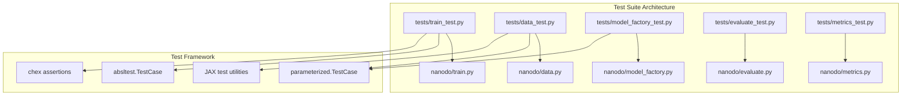
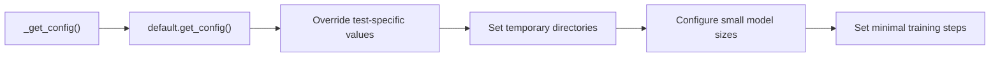
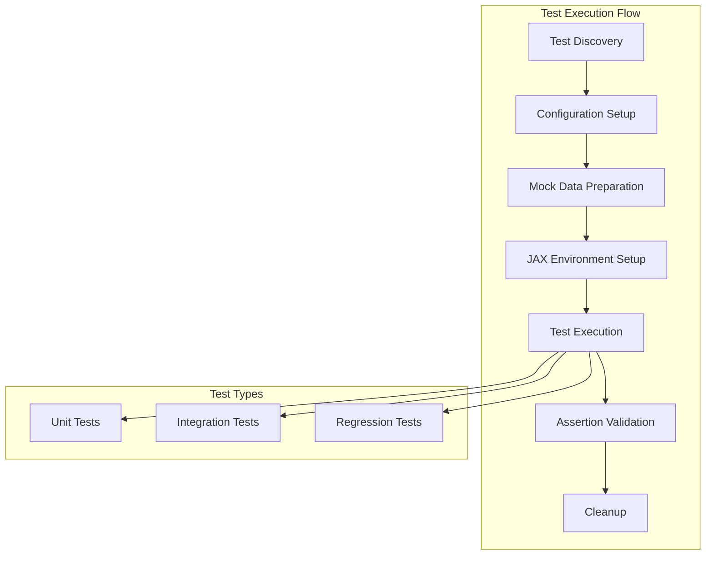

<!-- source: DeepWiki mcp.deepwiki.com · repo google-deepmind/nanodo · page 5.1 Test Suite Structure · fetched 2026-10-26 -->

# Test Suite Structure

<details>
<summary>Relevant source files</summary>

The following files were used as context for generating this wiki page:

- [tests/data_test.py](tests/data_test.py)
- [tests/model_factory_test.py](tests/model_factory_test.py)
- [tests/train_test.py](tests/train_test.py)

</details>


This document describes the organization, patterns, and structure of the nanodo test suite. It covers test file organization, testing frameworks, common test patterns, and how to run the tests effectively.

For information about the continuous integration pipeline and automated testing infrastructure, see [Continuous Integration](#5.2).

## Test Organization

The nanodo test suite follows a modular structure that mirrors the main codebase organization. Each core system has dedicated test files that validate its functionality in isolation and integration scenarios.

### Test File Structure

The test suite is organized into focused test modules that correspond to major system components:

| Test File | Primary Target | Test Focus |
|-----------|---------------|------------|
| `tests/train_test.py` | `nanodo/train.py` | Training orchestration, training loops, checkpointing |
| `tests/data_test.py` | `nanodo/data.py` | Data pipeline, preprocessing, tokenization |
| `tests/model_factory_test.py` | `nanodo/model_factory.py` | Model creation and factory patterns |
| `tests/evaluate_test.py` | `nanodo/evaluate.py` | Evaluation loops and metrics computation |
| `tests/metrics_test.py` | `nanodo/metrics.py` | Metrics aggregation and reporting |



Sources: [tests/train_test.py:1-251](), [tests/data_test.py:1-150](), [tests/model_factory_test.py:1-68]()

## Test Framework and Dependencies

### Core Testing Framework

The test suite is built on Google's `absltest` framework with extensions for parameterized testing and JAX-specific utilities:

- **Base Framework**: `absltest.TestCase` provides the foundation for all test classes
- **Parameterized Testing**: `parameterized.TestCase` enables testing multiple scenarios with different parameters
- **JAX Integration**: JAX configuration and utilities for numerical testing
- **Assertion Libraries**: `chex` for tree-based assertions and `numpy.testing` for array comparisons

### JAX Configuration

All test files establish consistent JAX behavior with standard configuration:

```python
jax.config.parse_flags_with_absl()
jax.config.update("jax_numpy_rank_promotion", "raise")
```

This configuration ensures deterministic behavior and catches potential numerical issues during testing.

Sources: [tests/train_test.py:43-44](), [tests/data_test.py:31-32](), [tests/model_factory_test.py:29-30]()

## Key Test Patterns

### Configuration Helpers

Each test module provides configuration helper functions that create minimal, test-appropriate configurations:



The `_get_config()` helper in `TrainTest` demonstrates this pattern by creating a minimal configuration suitable for fast test execution while maintaining functional correctness.

Sources: [tests/train_test.py:50-80]()

### Reference Value Testing

Critical functionality is protected by reference value tests that detect unintended behavioral changes:

```python
reference = {
    "__train_loss": 3.945808,
    "train_loss": 3.945808,
    "train_ntokens": 124,
    "grads/all/rms": 0.01341779,
    # ... more reference values
}
```

This pattern ensures that model behavior remains consistent across code changes, with explicit updates required when intentional changes are made.

Sources: [tests/train_test.py:121-162]()

### Parameterized Testing

The test suite extensively uses parameterized tests to validate functionality across different configurations:

- **FSDP Testing**: `@parameterized.parameters(True, False)` tests both regular and FSDP-enabled training
- **Preprocessing Methods**: Tests both `NOAM_PACKED` and `PADDED` preprocessing strategies
- **Model Configurations**: Validates different model architectures and settings

Sources: [tests/train_test.py:85-86](), [tests/data_test.py:164]()

### Mock Data Integration

Tests use TensorFlow Datasets mock data to avoid dependencies on large external datasets:

```python
with tfds.testing.mock_data(num_examples=100):
    train_ds = data.py_batched_tfds(...)
```

This approach enables fast, isolated testing while maintaining realistic data pipeline behavior.

Sources: [tests/train_test.py:176](), [tests/data_test.py:51]()

## Test Categories

### Unit Tests

Unit tests validate individual components in isolation:

- **Data Pipeline Components**: `test_py_tokenize`, `test_get_in_out`
- **Model Architecture**: Individual layer and component testing
- **Utility Functions**: Helper functions and data transformations

### Integration Tests  

Integration tests validate end-to-end system behavior:

- **Training Integration**: `test_train_and_evaluate` validates complete training workflows
- **Checkpoint Integration**: Tests checkpoint saving and restoration
- **Data Pipeline Integration**: Tests complete data loading and preprocessing

### Regression Tests

Regression tests protect against unintended behavioral changes:

- **Training Step Regression**: Validates consistent training step behavior
- **Model Output Regression**: Ensures model outputs remain stable
- **Metrics Regression**: Protects metric computation consistency



Sources: [tests/train_test.py:98-119](), [tests/data_test.py:122-146]()

## Running Tests

### Basic Test Execution

Tests can be executed using standard Python testing commands:

```bash
# Run all tests
python -m pytest tests/

# Run specific test file
python -m pytest tests/train_test.py

# Run specific test method
python -m pytest tests/train_test.py::TrainTest::test_trainer
```

### Test Dependencies

The test suite requires several key dependencies:

- **Test Data**: Vocabulary file at `testdata/sentencepiece_cc_all.32000.100extra-sentencepiece.model`
- **Mock Datasets**: TensorFlow Datasets testing utilities
- **JAX Environment**: Proper JAX installation with device access

### Test Configuration

Tests automatically create temporary directories for checkpoints and outputs, ensuring isolation between test runs. The `_get_config()` helpers establish appropriate test-specific configurations that balance execution speed with functional coverage.

Sources: [tests/train_test.py:47-48](), [tests/data_test.py:35-39]()

---

