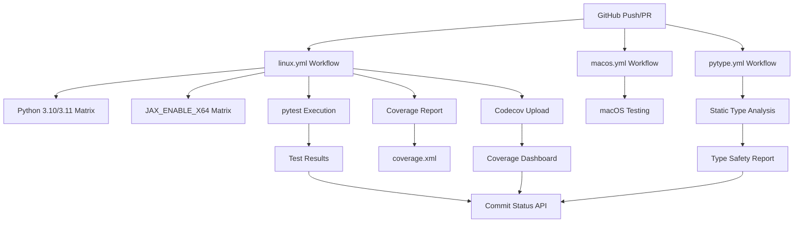
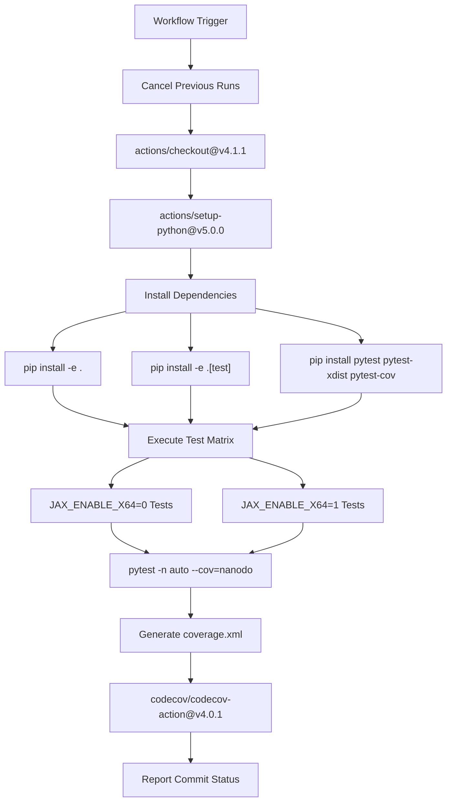
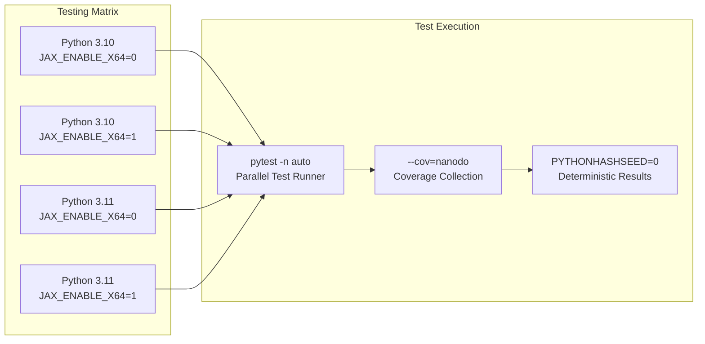
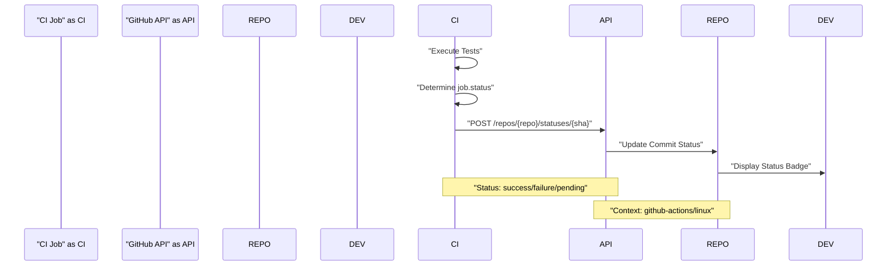
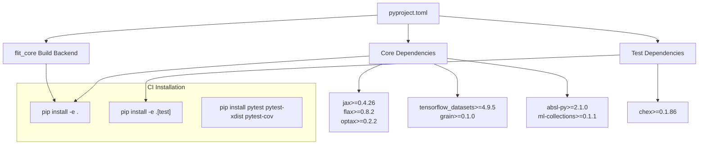

<!-- source: DeepWiki mcp.deepwiki.com · repo google-deepmind/nanodo · page 5.2 Continuous Integration · fetched 2026-10-26 -->

# Continuous Integration

Relevant source files

The following files were used as context for generating this wiki page:

- [.github/workflows/linux.yml](.github/workflows/linux.yml)
- [pyproject.toml](pyproject.toml)

This document covers the automated testing and quality assurance pipeline for the nanodo repository. The CI system ensures code quality, compatibility across multiple environments, and provides continuous feedback on code changes through automated testing, coverage reporting, and quality gates.

For information about the actual test suite structure and test patterns, see [Test Suite Structure](#5.1). For general development practices and contribution guidelines, see [Development and Contributing](#6).

## Overview

The nanodo CI system is built on GitHub Actions and provides comprehensive automated testing across multiple Python versions and JAX configurations. The pipeline includes unit testing, code coverage analysis, type checking, and multi-platform compatibility verification.

**CI/CD Pipeline Architecture**

Sources: [.github/workflows/linux.yml:1-78](), [pyproject.toml:72-75]()

## Workflow Configuration

The primary CI workflow is defined in `linux.yml` and orchestrates the complete testing pipeline. The workflow triggers on pushes to `main`, branches matching `test_*`, and all pull requests targeting `main`.

| Workflow Component | Configuration | Purpose |
|-------------------|---------------|---------|
| **Trigger Events** | `push` to `main`, `test_*` branches; `pull_request` to `main` | Automated testing on code changes |
| **Timeout** | 120 minutes | Prevents hanging jobs |
| **Concurrency** | Cancel previous runs | Resource optimization |
| **Python Versions** | 3.10, 3.11 | Multi-version compatibility |
| **JAX Configuration** | `JAX_ENABLE_X64=[0,1]` | Both 32-bit and 64-bit precision testing |

**Dependency Installation and Test Execution Flow**

Sources: [.github/workflows/linux.yml:42-53](), [pyproject.toml:51-65]()

## Testing Matrix

The CI system employs a comprehensive testing matrix to ensure compatibility across different configurations:

### Python Version Matrix
- **Python 3.10**: Minimum supported version
- **Python 3.11**: Latest supported version  

### JAX Configuration Matrix
- **JAX_ENABLE_X64=0**: Standard 32-bit precision mode
- **JAX_ENABLE_X64=1**: High precision 64-bit mode

This creates a 2×2 testing matrix (4 total configurations) that validates the codebase across all supported combinations.

**Test Matrix Configuration**

Sources: [.github/workflows/linux.yml:22-26](), [.github/workflows/linux.yml:52-53]()

## Quality Gates and Reporting

The CI pipeline implements several quality gates to ensure code quality and provide comprehensive feedback:

### Test Execution
- **Parallel Testing**: Uses `pytest-xdist` with `-n auto` for concurrent test execution
- **Deterministic Results**: `PYTHONHASHSEED=0` ensures reproducible test outcomes
- **Coverage Threshold**: Generates both XML and terminal coverage reports

### Coverage Integration
- **Provider**: Codecov integration via `codecov-action@v4.0.1`
- **Report Format**: XML coverage reports uploaded to external dashboard
- **File Location**: `./coverage.xml` generated by pytest-cov

### Status Reporting
The pipeline includes sophisticated status reporting that integrates with GitHub's commit status API:

**Status Reporting Workflow**

Sources: [.github/workflows/linux.yml:62-77](), [.github/workflows/linux.yml:55-58]()

## Dependencies and Build Configuration

The CI system relies on the project's dependency specification in `pyproject.toml` for consistent environment setup:

### Core Dependencies
- **JAX Ecosystem**: `jax>=0.4.26`, `jaxlib>=0.4.26`, `flax>=0.8.2`, `optax>=0.2.2`
- **Data Pipeline**: `tensorflow_datasets>=4.9.5`, `grain>=0.1.0`
- **Utilities**: `absl-py>=2.1.0`, `ml-collections>=0.1.1`

### Test Dependencies
- **Testing Framework**: `chex>=0.1.86` (optional test dependency)
- **CI Tools**: `pytest`, `pytest-xdist`, `pytest-cov` (installed during CI)

### Build System
- **Backend**: `flit_core>=3.9.0` for package building
- **Installation**: Editable installation with `pip install -e .` and `pip install -e .[test]`

**Dependency Management and Installation**

Sources: [pyproject.toml:1-3](), [pyproject.toml:51-65](), [pyproject.toml:72-75](), [.github/workflows/linux.yml:42-49]()

## Integration Points

The CI system integrates with several external services and internal components:

### External Integrations
- **GitHub Actions**: Workflow orchestration and execution environment
- **Codecov**: Code coverage reporting and analysis
- **GitHub Commit Status API**: Real-time status updates on commits and PRs

### Internal Integration
- **Test Suite**: Executes all tests defined in the `tests/` directory (see [Test Suite Structure](#5.1))
- **Project Configuration**: Respects settings from `pyproject.toml` for dependencies and metadata
- **Package Installation**: Tests the actual package installation process using editable installs

The CI pipeline serves as the quality gateway for all code changes, ensuring that modifications meet the project's standards for functionality, compatibility, and test coverage before integration into the main branch.

Sources: [.github/workflows/linux.yml:1-78](), [pyproject.toml:1-81]()

---

