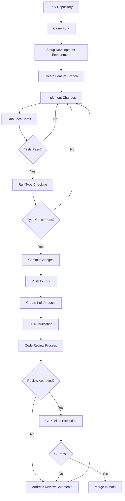
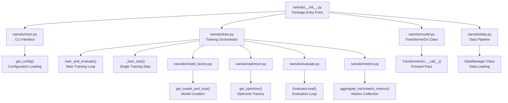
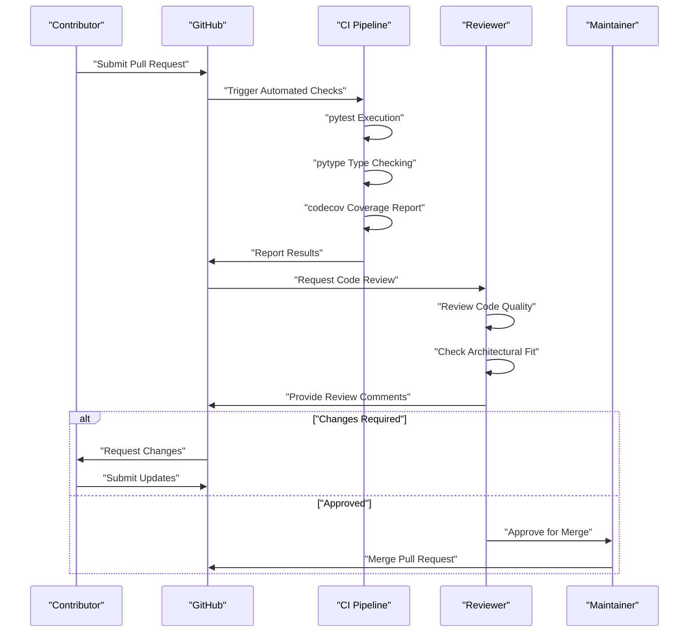
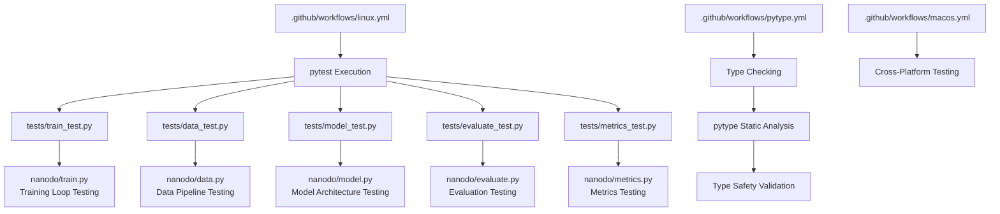

<!-- source: DeepWiki mcp.deepwiki.com · repo google-deepmind/nanodo · page 6 Development and Contributing · fetched 2026-10-26 -->

# Development and Contributing

Relevant source files

The following files were used as context for generating this wiki page:

- [CONTRIBUTING.md](CONTRIBUTING.md)
- [LICENSE](LICENSE)
- [nanodo/__init__.py](nanodo/__init__.py)

## Purpose and Scope

This document provides guidance for developers who want to contribute to or extend the nanodo framework. It covers the development environment setup, codebase architecture, contribution processes, and quality standards required for successful contributions.

For information about the overall system architecture, see [Core Systems](#3). For details about testing infrastructure, see [Testing and Quality Assurance](#5).

## Development Environment Setup

The nanodo project uses modern Python development practices with JAX ecosystem dependencies. The development environment requires specific setup for JAX, Flax, and related libraries.

### Prerequisites and Dependencies

The project dependencies are managed through `pyproject.toml` which defines both runtime and development dependencies. Key development tools include:

- **JAX Ecosystem**: JAX, Flax, Optax, Orbax for core functionality
- **Testing**: pytest for test execution, codecov for coverage reporting
- **Type Checking**: pytype for static analysis
- **Build System**: setuptools with pyproject.toml configuration

### Development Workflow Overview

**Sources**: CONTRIBUTING.md:1-29, .github/workflows/ (inferred from architecture diagrams)

## Codebase Architecture for Contributors

Understanding the codebase structure is essential for effective contributions. The nanodo framework follows a modular architecture with clear separation of concerns.

### Core Module Structure

**Sources**: nanodo/__init__.py:14-18, system architecture diagrams

### Configuration and Extension Points

The configuration system uses `ml_collections.ConfigDict` for structured configuration management. Key extension points for contributors include:

| Component | Extension Point | Configuration Key | Primary Function |
|-----------|----------------|-------------------|------------------|
| Model Architecture | `model_factory.get_model_and_loss()` | `model` | Add new model variants |
| Optimization | `optimizer.get_optimizer()` | `optimizer` | Implement new optimizers |
| Data Processing | `DataManager` class | `data` | Add dataset support |
| Evaluation | `Evaluator.eval()` | `eval` | Custom metrics |
| Loss Functions | Loss factory functions | `loss` | Domain-specific losses |

**Sources**: nanodo/configs/default.py (inferred), model_factory.py, optimizer.py

## Contributing Process

### Contributor License Agreement

All contributions require a signed Contributor License Agreement (CLA). Contributors retain copyright to their contributions while granting usage rights to the project.

### Code Review Requirements

All submissions, including those from project members, require code review through GitHub pull requests. The review process ensures code quality, architectural consistency, and adherence to project standards.

**Sources**: CONTRIBUTING.md:18-23, .github/workflows/ (inferred)

### Community Guidelines

The project follows Google's Open Source Community Guidelines for maintaining a welcoming and inclusive development environment.

**Sources**: CONTRIBUTING.md:25-28

## Development Standards

### Code Quality Requirements

Contributors must adhere to specific quality standards enforced through automated tooling:

- **Type Safety**: All code must pass `pytype` static analysis
- **Test Coverage**: New functionality requires comprehensive test coverage
- **Documentation**: Public APIs require docstring documentation
- **License Headers**: All files must include Apache 2.0 license headers

### Testing Integration Points

**Sources**: tests/ directory structure (inferred), .github/workflows/ (inferred)

### License and Legal Requirements

The project uses Apache License 2.0 for all source code. Contributors must ensure their submissions comply with license requirements and include appropriate copyright headers.

**Sources**: LICENSE:1-203, nanodo/__init__.py:1-13

## Version Management

The current package version is maintained in [nanodo/__init__.py:17]() as `__version__ = "0.0.1"`. Version updates follow semantic versioning principles and require coordination with project maintainers.

**Sources**: nanodo/__init__.py:17

---

