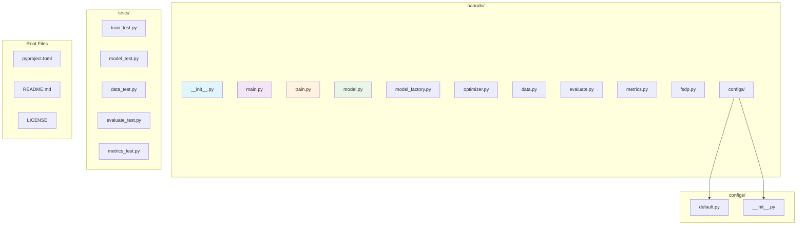
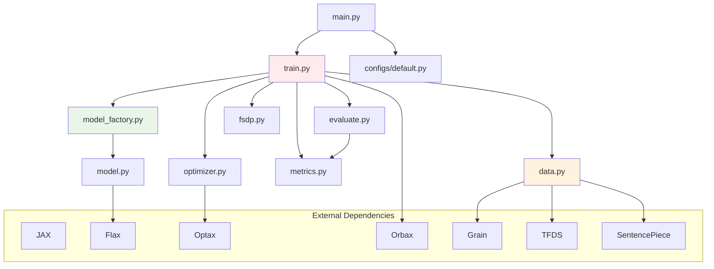
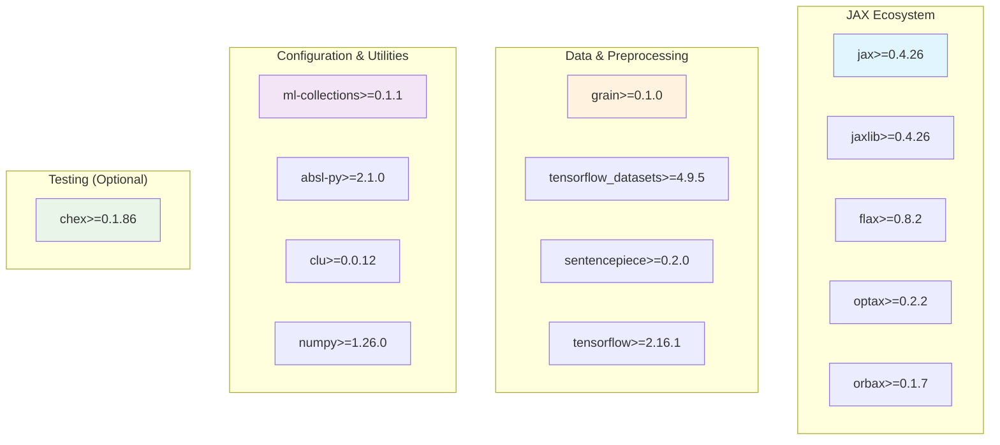
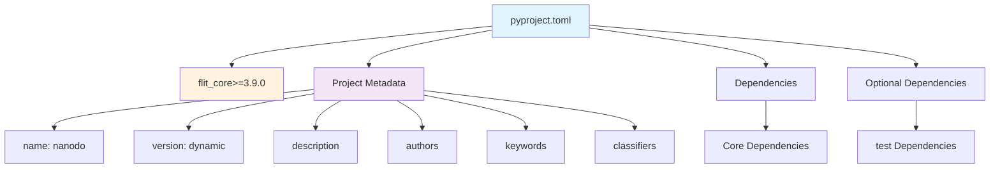
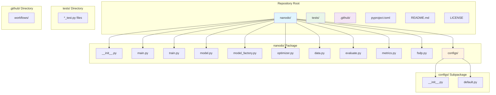

<!-- source: DeepWiki mcp.deepwiki.com · repo google-deepmind/nanodo · page 6.1 Project Structure · fetched 2026-10-26 -->

# Project Structure

Relevant source files

The following files were used as context for generating this wiki page:

- [nanodo/__init__.py](nanodo/__init__.py)
- [pyproject.toml](pyproject.toml)

This document provides an overview of the nanodo codebase organization, package structure, and key architectural decisions. It covers the physical layout of the repository, module relationships, and build configuration.

For information about the runtime behavior of these systems, see [Core Systems](#3). For development workflow and contribution guidelines, see [Contributing Guidelines](#6.2).

## Package Overview

The nanodo project is organized as a single Python package with a flat module structure that prioritizes simplicity and hackability. The core design philosophy emphasizes minimal abstractions while maintaining production-ready features.

### High-Level Package Structure

**Package Entry Point and Versioning**

The package defines its public API through `nanodo/__init__.py`, which currently exports only the version information. The version is set to `"0.0.1"` [nanodo/__init__.py:17](), indicating the project's early development stage.

Sources: [nanodo/__init__.py:1-18]()

## Core Module Architecture

The nanodo package follows a functional architecture where each module has a clear, single responsibility. The modules are designed to be loosely coupled but work together through well-defined interfaces.

### Module Dependency Graph

### Module Responsibilities

| Module | Primary Responsibility | Key Exports |
|--------|----------------------|-------------|
| `main.py` | CLI entry point and configuration loading | Command-line interface |
| `train.py` | Training orchestration and main loop | `train_and_evaluate()` |
| `model.py` | TransformerDo architecture implementation | `TransformerDo` class |
| `model_factory.py` | Model instantiation and loss functions | `get_model_and_loss()` |
| `optimizer.py` | Optimizer configuration and scheduling | `get_optimizer()` |
| `data.py` | Data loading and preprocessing pipeline | Data iterators |
| `evaluate.py` | Model evaluation and validation | `Evaluator` class |
| `metrics.py` | Metrics collection and aggregation | Metric utilities |
| `fsdp.py` | Distributed training support | FSDP utilities |

Sources: Based on repository structure analysis and [pyproject.toml:78-80]()

## Dependency Structure

The nanodo project is built on top of the JAX ecosystem, with carefully selected dependencies that align with the project's philosophy of simplicity and performance.

### Core Dependencies

### Dependency Categories

**Core JAX Stack**: The foundation for numerical computing and neural network training
- `jax`/`jaxlib`: Core numerical computing framework
- `flax`: Neural network library built on JAX
- `optax`: Gradient-based optimization library
- `orbax`: Checkpointing and serialization utilities

**Data Processing**: Tools for loading and preprocessing training data
- `grain`: Efficient data loading and batching
- `tensorflow_datasets`: Access to standard ML datasets
- `sentencepiece`: Subword tokenization
- `tensorflow`: Backend for TFDS (minimal usage)

**Configuration Management**: Libraries for managing experiment configurations
- `ml-collections`: Structured configuration objects
- `absl-py`: Google's application utilities
- `clu`: Common utilities for ML experiments

Sources: [pyproject.toml:51-65](), [pyproject.toml:73-75]()

## Build and Distribution Configuration

The project uses modern Python packaging standards with `flit` as the build backend, emphasizing simplicity and standards compliance.

### Build System Configuration

### Project Metadata

The project defines comprehensive metadata for distribution:

- **Name**: `nanodo` - reflecting the "nano" (minimal) "do" (decoder-only) philosophy
- **Version**: Dynamically determined from source code
- **Description**: "A minimal ('nano') Transformer decoder-only ('do') library in JAX"
- **Python Compatibility**: Requires Python 3.10+ (3.12 support pending upstream fixes)
- **Platform Support**: Linux and macOS

### Classification and Keywords

The project is classified for multiple audiences:
- **Intended Audience**: Science/Research, Developers, Education
- **Topic Areas**: Software Development, Scientific/Engineering, Artificial Intelligence
- **Keywords**: Focus on JAX, Flax, LLM, decoder-only, language modeling

Sources: [pyproject.toml:1-81]()

## Directory Layout and File Organization

The nanodo repository follows a conventional Python package structure with additional directories for testing and CI/CD.

### Complete Directory Structure

### Key Organizational Principles

1. **Flat Module Structure**: All core modules are at the top level of the `nanodo` package to minimize import complexity
2. **Single Responsibility**: Each module has a clear, focused purpose
3. **Test Mirroring**: Test files mirror the structure of the main package with `*_test.py` naming
4. **Configuration Isolation**: Configuration files are organized in a separate `configs/` subpackage
5. **CI/CD Separation**: GitHub Actions workflows are contained in `.github/workflows/`

### Package Discovery and Exclusions

The build system is configured to:
- **Include**: All files in the `nanodo/` directory
- **Exclude**: Test files (`*_test.py`) from the distributed package
- **Include Metadata**: `README.md` and `LICENSE` files in the package

Sources: [pyproject.toml:77-81]()

## Architectural Design Decisions

Several key architectural decisions shape the project structure:

### Design Philosophy

1. **Minimalism**: The flat module structure avoids unnecessary nesting and abstraction layers
2. **Hackability**: Direct imports and simple interfaces make the code easy to modify and extend
3. **JAX-First**: Deep integration with the JAX ecosystem rather than framework-agnostic abstractions
4. **Production-Ready**: Despite simplicity, includes essential features like distributed training and checkpointing

### Import Strategy

The package uses a minimalist public API approach:
- Only version information is exported from the main package
- Users are expected to import specific modules directly
- This design encourages understanding of the codebase structure

### Configuration Management

The centralized configuration system in `configs/` allows for:
- Reproducible experiments
- Easy hyperparameter management
- Separation of configuration from implementation

Sources: [nanodo/__init__.py:14-18](), [pyproject.toml:5-49]()

---

