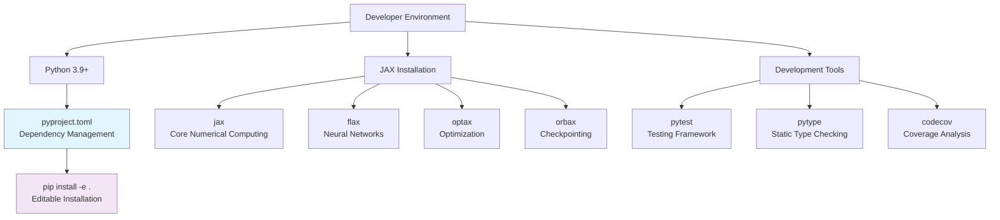
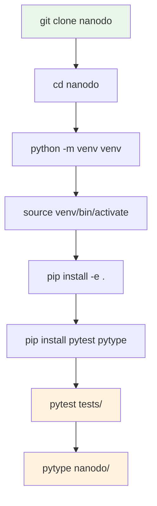
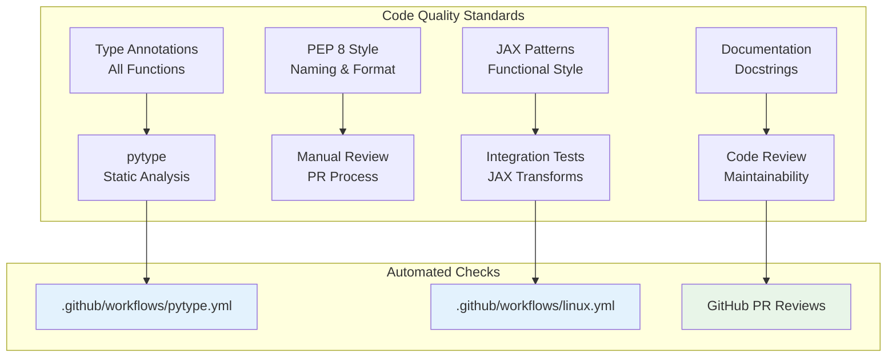
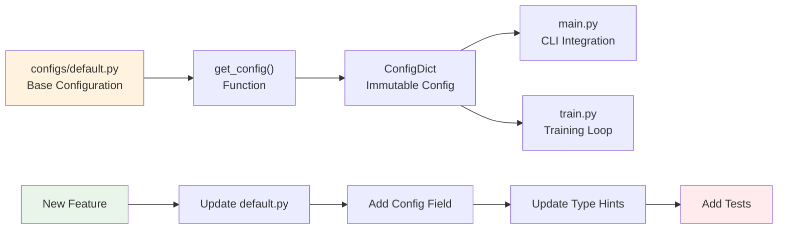
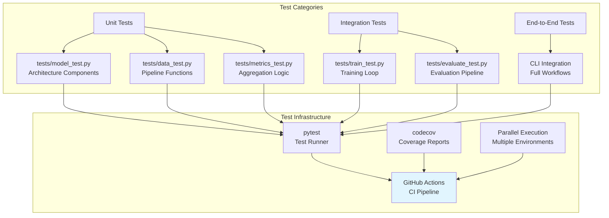
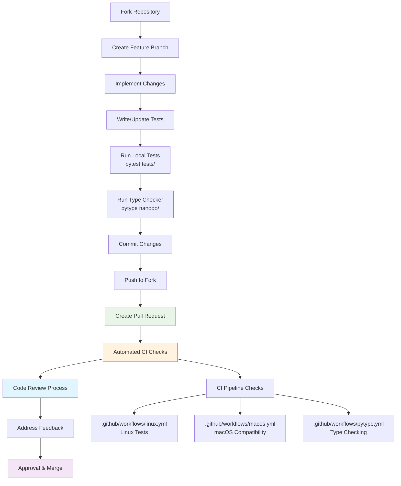
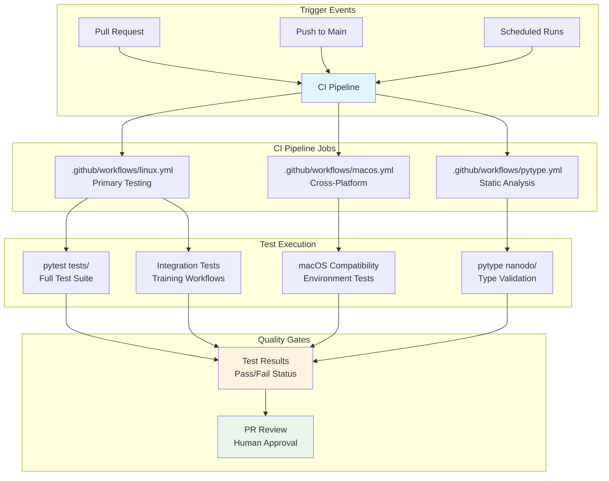
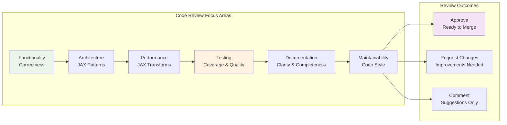

<!-- source: DeepWiki mcp.deepwiki.com · repo google-deepmind/nanodo · page 6.2 Contributing Guidelines · fetched 2026-10-26 -->

# Contributing Guidelines

<details>
<summary>Relevant source files</summary>

The following files were used as context for generating this wiki page:

- [CONTRIBUTING.md](CONTRIBUTING.md)
- [LICENSE](LICENSE)

</details>


This document provides comprehensive instructions for contributing code to the nanodo repository, including development setup, coding standards, testing requirements, and the pull request process. It covers the technical workflow for submitting contributions to this JAX-based Transformer decoder-only library.

For information about the overall project structure and codebase organization, see [Project Structure](#6.1). For details about the testing framework and quality assurance practices, see [Testing and Quality Assurance](#5).

## Development Environment Setup

### Prerequisites and Dependencies

The nanodo project requires a specific development environment to ensure consistency across contributors. The project dependencies are managed through `pyproject.toml` and include the JAX ecosystem libraries.



**Development Environment Setup Workflow**



Sources: [pyproject.toml:1-50](), [.github/workflows/linux.yml:1-50](), [.github/workflows/pytype.yml:1-30]()

### Local Development Workflow

Contributors should follow this workflow for local development and testing:

| Step | Command | Purpose |
|------|---------|---------|
| 1 | `git checkout -b feature-branch` | Create feature branch |
| 2 | `pytest tests/` | Run full test suite |
| 3 | `pytype nanodo/` | Static type checking |
| 4 | `python -m nanodo.main --help` | Verify CLI functionality |
| 5 | `git commit -m "descriptive message"` | Commit changes |

Sources: [CONTRIBUTING.md:1-29](), [.github/workflows/linux.yml:20-40]()

## Code Standards and Conventions

### Python Code Style

The nanodo codebase follows specific coding conventions that align with the JAX ecosystem and Google's style guidelines.

**Key Conventions:**
- Use type annotations for all function signatures
- Follow PEP 8 naming conventions
- Use `ml_collections.ConfigDict` for configuration objects
- Implement JAX transformations using `jax.jit`, `jax.vmap`, and `jax.pmap`
- Use Flax modules for neural network components



Sources: [.github/workflows/pytype.yml:1-25](), [nanodo/train.py:1-50](), [nanodo/model.py:1-50]()

### Configuration Management

All contributions involving configuration changes must follow the established pattern using `ml_collections.ConfigDict`:



Sources: [nanodo/configs/default.py:1-100](), [nanodo/main.py:30-60](), [nanodo/train.py:50-80]()

## Testing Requirements

### Test Coverage Standards

All contributions must maintain comprehensive test coverage across the core systems. The testing strategy covers unit tests, integration tests, and end-to-end workflows.

**Testing Architecture**



Sources: [tests/train_test.py:1-50](), [tests/model_test.py:1-50](), [tests/data_test.py:1-50](), [tests/evaluate_test.py:1-50](), [tests/metrics_test.py:1-50]()

### Required Test Patterns

Contributors must implement tests following these patterns:

| Component | Test File | Required Coverage |
|-----------|-----------|-------------------|
| Model Architecture | `tests/model_test.py` | Forward pass, parameter shapes, loss computation |
| Training Loop | `tests/train_test.py` | State management, checkpointing, metrics |
| Data Pipeline | `tests/data_test.py` | Tokenization, batching, preprocessing |
| Evaluation | `tests/evaluate_test.py` | Metric computation, evaluation loop |
| CLI Interface | Integration tests | Full command-line workflows |

### Test Execution Commands

```bash
# Run all tests
pytest tests/

# Run specific test file
pytest tests/train_test.py

# Run with coverage
pytest --cov=nanodo tests/

# Type checking
pytype nanodo/
```

Sources: [.github/workflows/linux.yml:30-50](), [tests/:1-10]()

## Pull Request Process

### PR Submission Workflow

The contribution process follows GitHub's pull request model with specific requirements for the nanodo project.



Sources: [CONTRIBUTING.md:18-24](), [.github/workflows/linux.yml:1-80](), [.github/workflows/macos.yml:1-50]()

### PR Requirements Checklist

Before submitting a pull request, ensure all requirements are met:

**Code Quality Requirements:**
- [ ] All tests pass locally (`pytest tests/`)
- [ ] Type checking passes (`pytype nanodo/`)
- [ ] Code follows established patterns
- [ ] Documentation updated for new features
- [ ] Configuration changes follow ConfigDict patterns

**Testing Requirements:**
- [ ] New functionality has corresponding tests
- [ ] Test coverage maintained or improved
- [ ] Integration tests pass for affected systems
- [ ] CLI functionality tested if applicable

**Process Requirements:**
- [ ] Contributor License Agreement signed
- [ ] Descriptive commit messages
- [ ] PR description explains changes
- [ ] Linked to relevant issues

Sources: [CONTRIBUTING.md:6-16](), [tests/train_test.py:1-30]()

## Continuous Integration Pipeline

### Automated Testing Infrastructure

The nanodo project uses GitHub Actions for comprehensive automated testing across multiple environments and configurations.

**CI/CD Pipeline Architecture**



Sources: [.github/workflows/linux.yml:1-80](), [.github/workflows/macos.yml:1-50](), [.github/workflows/pytype.yml:1-30]()

### CI Configuration Details

The continuous integration system runs the following checks:

| Workflow | File | Purpose | Trigger |
|----------|------|---------|---------|
| Linux Tests | `.github/workflows/linux.yml` | Primary test suite, coverage | PR, push |
| macOS Tests | `.github/workflows/macos.yml` | Cross-platform compatibility | PR, push |
| Type Checking | `.github/workflows/pytype.yml` | Static type analysis | PR, push |

**Key CI Features:**
- Parallel test execution across environments
- Automatic dependency caching
- Coverage reporting integration
- Multi-Python version support

Sources: [.github/workflows/:1-10]()

## Code Review Guidelines

### Review Process and Standards

Code reviews in the nanodo project focus on maintaining code quality, architectural consistency, and adherence to JAX ecosystem best practices.

**Review Criteria:**



**Specific Review Points:**
- JAX transformation usage (`jax.jit`, `jax.vmap`, `jax.pmap`)
- Flax module implementation patterns
- Configuration management with `ConfigDict`
- Test coverage for new functionality
- Integration with existing training pipeline

Sources: [CONTRIBUTING.md:18-24](), [nanodo/train.py:100-150](), [nanodo/model.py:50-100]()

### Common Contribution Areas

The most frequent contribution types and their specific requirements:

| Contribution Type | Files Affected | Special Requirements |
|-------------------|----------------|---------------------|
| Model Architecture | `nanodo/model.py`, `tests/model_test.py` | Flax module patterns, shape testing |
| Training Features | `nanodo/train.py`, `tests/train_test.py` | TrainState integration, checkpointing |
| Data Pipeline | `nanodo/data.py`, `tests/data_test.py` | TFDS compatibility, tokenization |
| Evaluation Metrics | `nanodo/evaluate.py`, `nanodo/metrics.py` | Aggregation patterns, numerical stability |
| Configuration | `nanodo/configs/default.py` | ConfigDict immutability, type hints |

Contributors should familiarize themselves with the existing patterns in these core areas before submitting changes.

Sources: [nanodo/model.py:1-50](), [nanodo/train.py:1-50](), [nanodo/data.py:1-50](), [nanodo/evaluate.py:1-50](), [nanodo/configs/default.py:1-50]()