# Page: Overview

# Overview

<details>
<summary>Relevant source files</summary>

The following files were used as context for generating this wiki page:

- [README.md](README.md)
- [pyproject.toml](pyproject.toml)

</details>


This document provides a comprehensive overview of the NanoDO repository, a minimal Transformer decoder-only language model implementation in JAX designed for research purposes. It covers the core architecture, design philosophy, and key systems that comprise the framework.

For detailed information about specific subsystems, see the Core Systems documentation ([section 3](#3)). For installation and basic usage instructions, see Getting Started ([section 2](#2)).

## Purpose and Design Philosophy

NanoDO is a minimal ("nano-sized") Transformer decoder-only language model implementation built in JAX, specifically designed to be maximally hackable, forkable, and readable for researchers conducting exploratory research. The framework prioritizes code transparency over abstraction, following the principle that "magic is great for products, but harmful for research."

The core design opinions include:

- **Minimal Abstraction**: Code is designed to be self-documenting with minimal magic
- **Readable Tensor Operations**: Tensors use short mathematical names with shapes encoded in variable names rather than comments
- **Research-First**: Optimized for hackability and exploration rather than production deployment
- **JAX Ecosystem Integration**: Built entirely on JAX and its associated libraries for performance and scalability

Sources: [README.md:1-27](), [pyproject.toml:6-8]()

## Core Architecture

### High-Level System Components

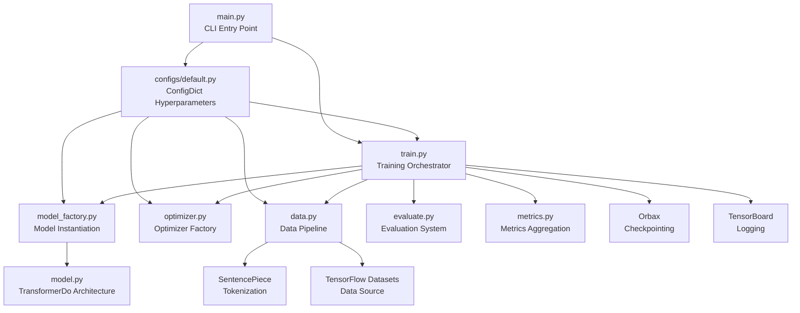

The architecture follows a centralized orchestration pattern where `train.py` coordinates all major subsystems. The `main.py` CLI interface loads configuration and delegates to the training orchestrator, which manages the model, optimizer, data pipeline, and evaluation systems.

Sources: [README.md:10-17](), [pyproject.toml:51-65]()

### Data Flow and Training Pipeline

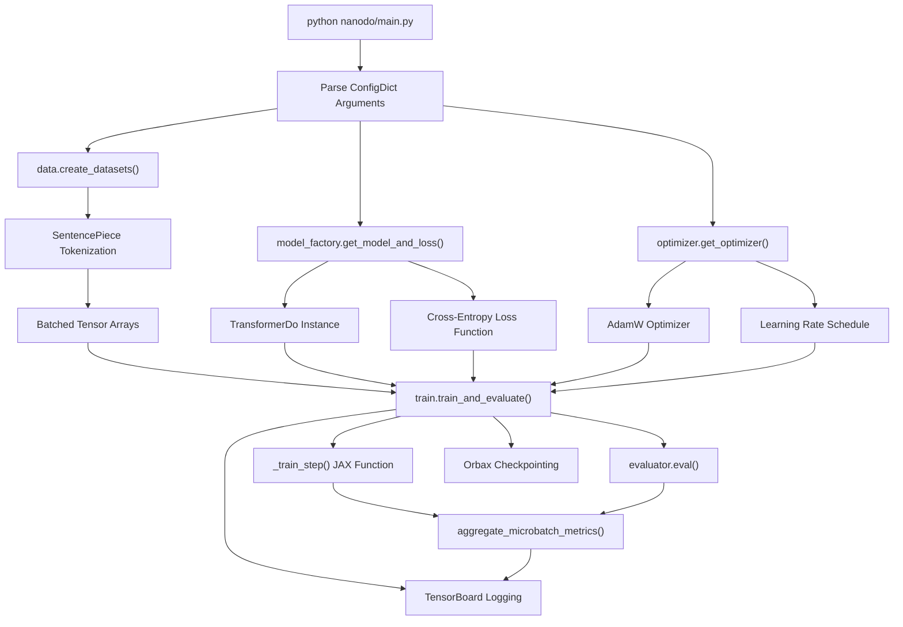

The training pipeline follows a functional programming approach using JAX's compilation and transformation capabilities. Data flows through tokenization, batching, and into compiled training/evaluation steps that update model parameters and collect metrics.

Sources: [README.md:58-66](), [nanodo/main.py](), [nanodo/train.py]()

## JAX Ecosystem Integration

NanoDO is built entirely on the JAX ecosystem, leveraging specialized libraries for each major functionality:

| Library | Purpose | Usage in NanoDO |
|---------|---------|-----------------|
| **JAX** | Numerical computing, compilation | Core tensor operations, JIT compilation |
| **Flax** | Neural network modules | `TransformerDo` model architecture |
| **Optax** | Optimization algorithms | AdamW optimizer, learning rate schedules |
| **Orbax** | Model checkpointing | Saving/loading training state |
| **Grain** | Data loading pipeline | Efficient batch processing |
| **TFDS** | Dataset access | Pre-processed language modeling datasets |
| **SentencePiece** | Tokenization | Text to token ID conversion |
| **ML Collections** | Configuration management | Hyperparameter specification via `ConfigDict` |

The integration follows JAX's functional programming paradigms, with pure functions, immutable data structures, and explicit state management through `TrainState` objects.

Sources: [README.md:10-17](), [pyproject.toml:51-65]()

## Model Architecture Specification

The `TransformerDo` architecture implements a standard decoder-only Transformer with the following key characteristics:

- **Pre-LayerNorm Architecture**: Layer normalization applied before attention and MLP blocks
- **Shared Input/Output Embeddings**: Token embeddings are tied between input and output layers
- **Learned Position Embeddings**: Positional information encoded through learnable parameters
- **GELU Activation**: Gaussian Error Linear Units in MLP layers
- **No Biases**: Follows PaLM architecture decisions for improved stability

The model is instantiated through `model_factory.get_model_and_loss()` using a `DoConfig` object that specifies layer count, hidden dimensions, attention heads, and other architectural parameters.

Sources: [README.md:29-37](), [nanodo/model.py](), [nanodo/model_factory.py]()

## Distributed Training Support

NanoDO implements Fully Sharded Data Parallel (FSDP) for scalable training across multiple devices. Model parameters and optimizer state are sharded among available devices, with JAX's compilation system handling the necessary communication patterns for parameter synchronization.

The FSDP implementation enables training of large models that exceed single-device memory capacity while maintaining the framework's simplicity and hackability principles.

Sources: [README.md:39-44](), [nanodo/fsdp.py]()

## Entry Points and Usage

The primary entry point is `main.py`, which provides a command-line interface for configuring and launching training jobs:

```bash
python nanodo/main.py \
  --config=nanodo/configs/default.py \
  --config.workdir=/tmp/nanodo_workdir \
  --config.vocab_path=path/to/sentencepiece.model
```

The CLI accepts configuration overrides through command-line flags, allowing researchers to easily modify hyperparameters without editing configuration files. All training artifacts, including checkpoints and TensorBoard logs, are written to the specified `workdir`.

Sources: [README.md:58-76](), [nanodo/main.py](), [nanodo/configs/default.py]()

---

# Page: Getting Started

# Getting Started

<details>
<summary>Relevant source files</summary>

The following files were used as context for generating this wiki page:

- [README.md](README.md)
- [nanodo/configs/default.py](nanodo/configs/default.py)
- [nanodo/main.py](nanodo/main.py)

</details>


This guide provides step-by-step instructions for installing nanodo and running your first Transformer language model training job. It covers the basic setup process, configuration, and initial usage patterns to get you productive quickly.

For detailed information about the training system architecture, see [Training System](#3.1). For comprehensive configuration options, see [Model Architecture](#3.2) and [Optimization](#3.6).

## Prerequisites

Before installing nanodo, ensure you have the following:

- **Python 3.11 or higher**: The codebase requires modern Python features
- **JAX ecosystem compatibility**: Your system should support JAX installation
- **Hardware considerations**: While nanodo runs on CPU, GPU/TPU acceleration is recommended for serious training

## Installation Process

The installation follows a standard Python package setup using pip in a virtual environment:

```bash
# Create and activate virtual environment
python3.11 -m venv /tmp/nanodo_test_env
source /tmp/nanodo_test_env/bin/activate

# Install nanodo in development mode
cd [path_to_repo]
pip install -e .
```

### Hardware-Specific JAX Installation

For GPU/TPU acceleration, install the appropriate JAX version following the [JAX installation guide](https://jax.readthedocs.io/en/latest/installation.html) before running training jobs.

Sources: [README.md:46-56]()

## Getting Started Workflow

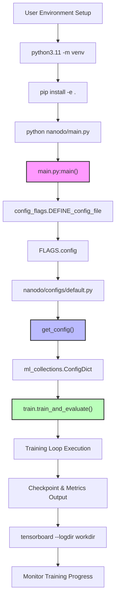

Sources: [README.md:48-66](), [nanodo/main.py:39-50](), [nanodo/configs/default.py:23-24]()

## Basic Usage

### Running Your First Training Job

Execute the following command to start a minimal training job:

```bash
python nanodo/main.py \
  --config=nanodo/configs/default.py \
  --config.workdir=/tmp/nanodo_workdir \
  --config.vocab_path=tests/testdata/sentencepiece_cc_all.32000.100extra-sentencepiece.model \
  --config.model.L=128 \
  --config.batch_size=2 \
  --config.pygrain_worker_count=0 \
  2> stderr.log
```

### Command Line Interface Structure

The CLI is built using `absl.flags` and `ml_collections.config_flags`, providing a hierarchical configuration system:

| Parameter | Purpose | Example Value |
|-----------|---------|---------------|
| `--config` | Base configuration file | `nanodo/configs/default.py` |
| `--config.workdir` | Output directory for checkpoints/logs | `/tmp/nanodo_workdir` |
| `--config.vocab_path` | SentencePiece tokenizer model | Path to `.model` file |
| `--config.model.L` | Maximum sequence length | `128` (reduced for testing) |
| `--config.batch_size` | Global batch size | `2` (reduced for testing) |
| `--config.pygrain_worker_count` | Data loading workers | `0` (single-threaded) |

### Configuration Override Pattern

The configuration system allows dot-notation overrides of any parameter defined in the base config:

```bash
# Override model architecture
--config.model.D=256          # embedding dimension
--config.model.H=4            # attention heads
--config.model.N=4            # transformer layers

# Override optimization
--config.opt.peak_learning_rate=0.001
--config.opt.num_train_steps=10000
```

Sources: [nanodo/main.py:30-36](), [README.md:58-66](), [nanodo/configs/default.py:35-57]()

## Key Components and Code Locations

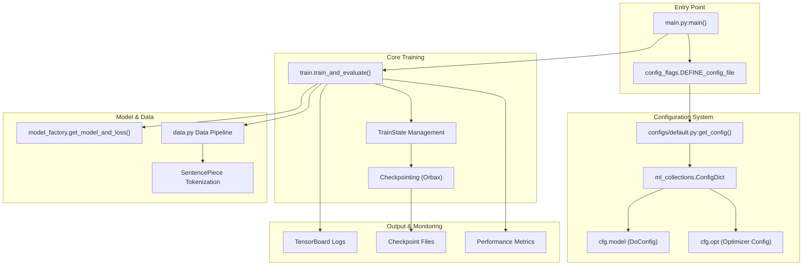

Sources: [nanodo/main.py:26-50](), [nanodo/configs/default.py:23-90]()

## Understanding Training Output

### Monitoring with TensorBoard

Start TensorBoard to monitor training progress:

```bash
tensorboard --logdir /tmp/nanodo_workdir
```

### Key Metrics to Watch

The training system logs several important metrics:

| Metric Category | Key Metrics | Purpose |
|----------------|-------------|---------|
| **Training Loss** | `train/loss` | Primary optimization target |
| **Learning Rate** | `train/learning_rate` | Current LR from schedule |
| **Performance** | `train/steps_per_sec` | Training throughput |
| **Evaluation** | `eval/loss` | Validation performance |
| **Gradients** | `train/grad_norm` | Training stability indicator |

### Checkpoint Management

Checkpoints are saved to `workdir` every `checkpoint_every_steps` (default: 2000 steps). The system maintains `max_to_keep` checkpoints (default: 100) and uses Orbax for efficient checkpoint storage.

Sources: [README.md:69-73](), [nanodo/configs/default.py:59-76]()

## Performance Optimization

### Data Loading Optimization

If training is input-bound, increase the number of pygrain workers:

```bash
--config.pygrain_worker_count=16  # Increase from 0 for multi-processing
```

### Memory and Compute Optimization

For larger models or limited memory:

```bash
--config.model.remat=True         # Enable gradient checkpointing
--config.model.fsdp_enabled=True  # Enable parameter sharding
```

Sources: [README.md:75-76](), [nanodo/configs/default.py:42-43](), [nanodo/configs/default.py:85-88]()

## Next Steps

After successfully running your first training job:

1. **Explore Model Architecture**: Learn about the `TransformerDo` implementation in [Model Architecture](#3.2)
2. **Understand Data Pipeline**: Deep dive into data loading and preprocessing in [Data Pipeline](#3.3)
3. **Scale Up Training**: Learn about distributed training with [Distributed Training (FSDP)](#4.1)
4. **Custom Configurations**: Create custom config files following the patterns in [nanodo/configs/default.py:23-90]()
5. **Evaluation and Metrics**: Understand the evaluation system in [Evaluation System](#3.4)

For production deployments and advanced features, see [Advanced Features](#4).

Sources: [README.md:1-98]()

---

# Page: Core Systems

# Core Systems

<details>
<summary>Relevant source files</summary>

The following files were used as context for generating this wiki page:

- [nanodo/data.py](nanodo/data.py)
- [nanodo/model.py](nanodo/model.py)
- [nanodo/train.py](nanodo/train.py)

</details>


This document provides an overview of the main architectural components that comprise the nanodo framework. It covers the six primary systems that orchestrate model training: the training orchestrator, model architecture, data pipeline, evaluation system, metrics collection, and optimization components. Each system is implemented as a focused module with clear interfaces and responsibilities.

For detailed implementation guides on each system, see the individual subsections: [Training System](#3.1), [Model Architecture](#3.2), [Data Pipeline](#3.3), [Evaluation System](#3.4), [Metrics and Monitoring](#3.5), and [Optimization](#3.6).

## System Architecture Overview

The nanodo framework follows a modular design where each core system has distinct responsibilities. The training system acts as the central orchestrator, coordinating all other components through well-defined interfaces.

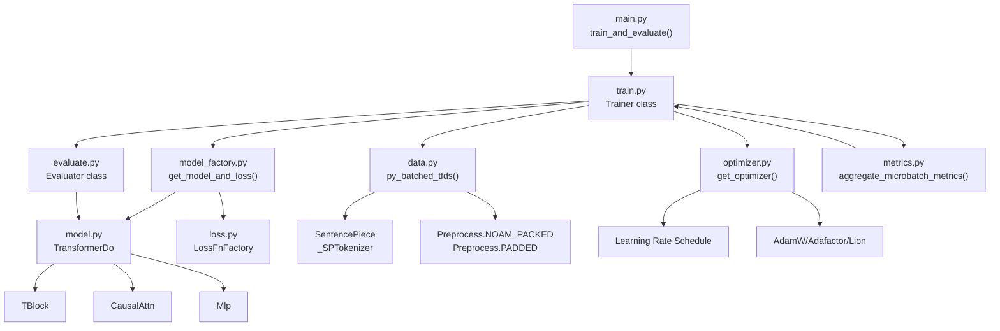

**Sources:** [nanodo/train.py:54-234](), [nanodo/model_factory.py](), [nanodo/data.py:39-89](), [nanodo/evaluate.py](), [nanodo/metrics.py](), [nanodo/optimizer.py]()

## Training System Core

The training system is built around the `Trainer` class and the `train_and_evaluate` function, which coordinates all training activities including gradient computation, parameter updates, and distributed execution.

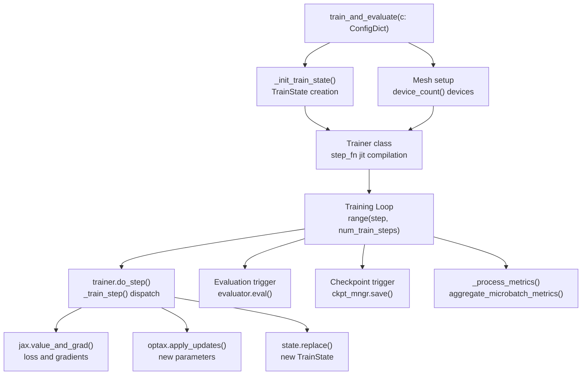

**Sources:** [nanodo/train.py:54-234](), [nanodo/train.py:236-294](), [nanodo/train.py:296-324]()

## Model Architecture System

The model architecture centers on the `TransformerDo` class, which implements a decoder-only transformer using the configuration specified in `DoConfig`. The architecture follows a pre-LayerNorm design with standard transformer components.

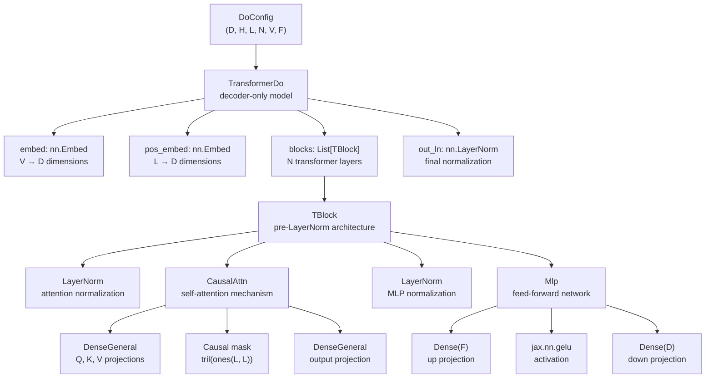

**Sources:** [nanodo/model.py:29-46](), [nanodo/model.py:48-78](), [nanodo/model.py:97-114](), [nanodo/model.py:116-165](), [nanodo/model.py:80-94]()

## Data Pipeline System

The data pipeline is built around the `py_batched_tfds` function, which creates `grain.DataLoader` instances with configurable preprocessing strategies. The system supports both NOAM packing for training efficiency and padding for evaluation consistency.

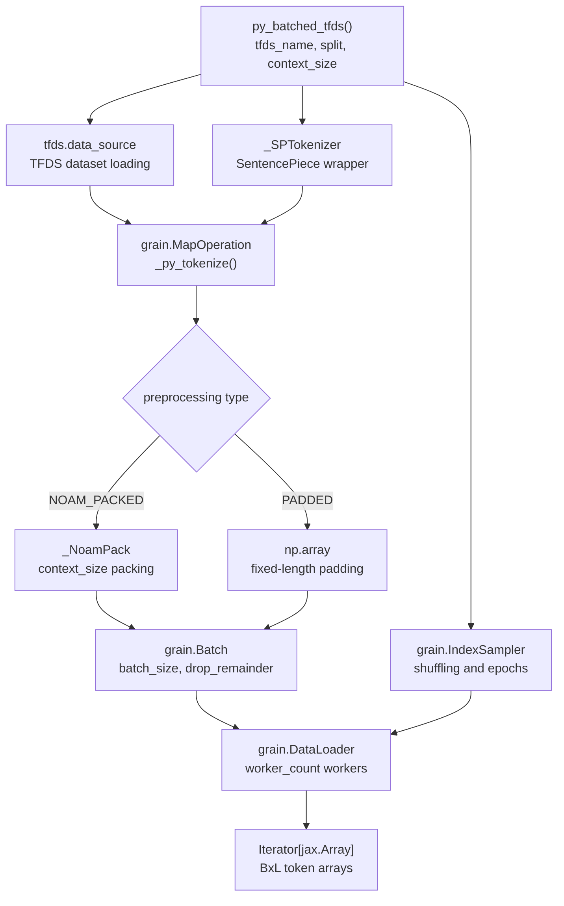

**Sources:** [nanodo/data.py:39-89](), [nanodo/data.py:102-113](), [nanodo/data.py:115-136](), [nanodo/data.py:138-166]()

## System Integration Flow

The integration between systems follows a clear data flow pattern, with the training system coordinating all components through standardized interfaces and shared state management.

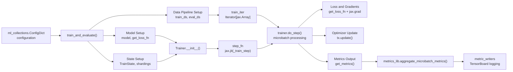

**Sources:** [nanodo/train.py:54-85](), [nanodo/train.py:112-118](), [nanodo/train.py:236-294](), [nanodo/train.py:296-324](), [nanodo/metrics.py]()

## Configuration and State Management

The framework uses `ml_collections.ConfigDict` for centralized configuration management and `flax.training.TrainState` for maintaining training state across distributed devices. The configuration system enables reproducible experiments through structured hyperparameter management.

| Component | Configuration Source | State Management |
|-----------|---------------------|------------------|
| Model Architecture | `c.model` (DoConfig fields) | `state.params` |
| Optimization | `c.opt` | `state.opt_state` |
| Data Pipeline | `c.ds_name`, `c.vocab_path` | `train_iter` checkpointing |
| Training Loop | `c.opt.num_train_steps` | `state.step` |
| Evaluation | `c.eval_every_steps` | Stateless evaluation |
| Checkpointing | `c.checkpoint_every_steps` | `orbax.CheckpointManager` |

**Sources:** [nanodo/train.py:74-85](), [nanodo/train.py:327-347](), [nanodo/train.py:350-376]()

---

# Page: Training System

# Training System

<details>
<summary>Relevant source files</summary>

The following files were used as context for generating this wiki page:

- [nanodo/train.py](nanodo/train.py)
- [tests/train_test.py](tests/train_test.py)

</details>


## Purpose and Scope

The Training System is the central orchestrator for model training in nanodo. It coordinates all aspects of the training process including data loading, model forward/backward passes, optimization, evaluation, metrics collection, and checkpointing. The system is built around JAX and supports distributed training through Fully Sharded Data Parallel (FSDP).

For information about the model architecture being trained, see [Model Architecture](#3.2). For details about the data pipeline, see [Data Pipeline](#3.3). For evaluation specifics, see [Evaluation System](#3.4).

## Core Components

The training system consists of three main components:

| Component | Location | Purpose |
|-----------|----------|---------|
| `train_and_evaluate` | [nanodo/train.py:54]() | Main training orchestration function |
| `Trainer` | [nanodo/train.py:236-294]() | Executes individual training steps |
| `_train_step` | [nanodo/train.py:296-324]() | Core forward/backward pass implementation |

### Training Orchestration Flow

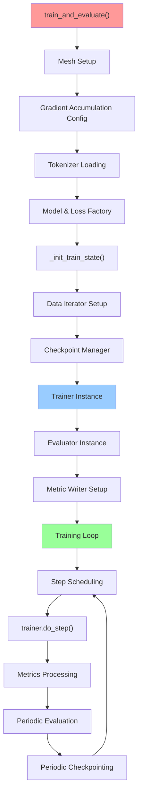

Sources: [nanodo/train.py:54-234]()

## Training State Management

The training system uses Flax's `TrainState` to manage model parameters, optimizer state, and training progress. State initialization and sharding are handled by the `_init_train_state` function.

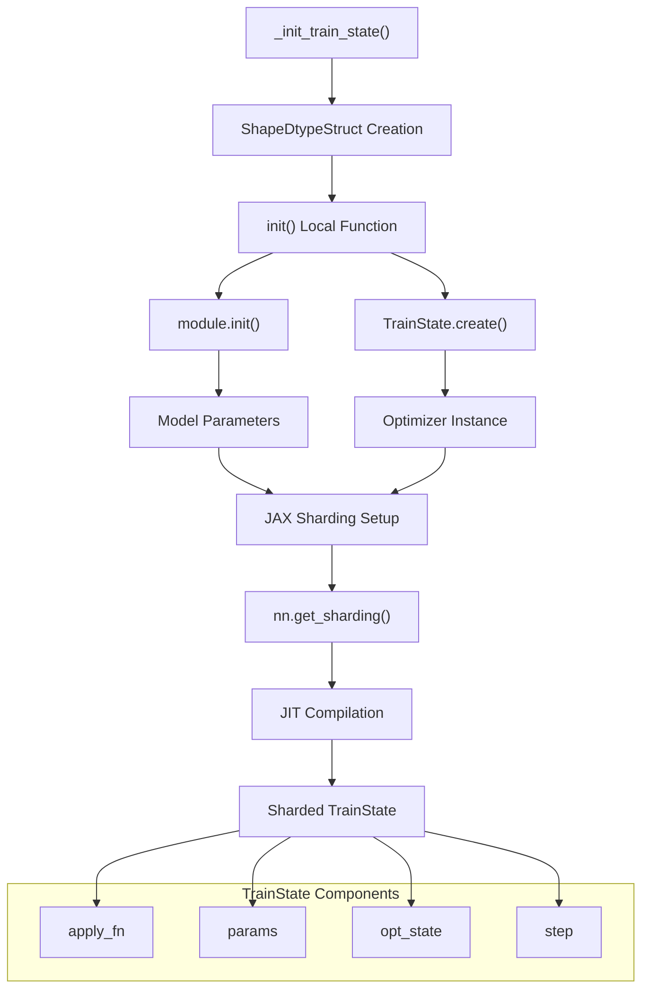

Sources: [nanodo/train.py:327-347]()

## Trainer Class Architecture

The `Trainer` class encapsulates the training step execution and provides asynchronous step dispatching:

| Method | Purpose |
|--------|---------|
| `__init__` | Sets up JIT-compiled step function with proper shardings |
| `do_step` | Asynchronously dispatches training step and returns metrics |
| `get_metrics` | Downloads metrics from device to host |
| `step` | Property returning current training step |

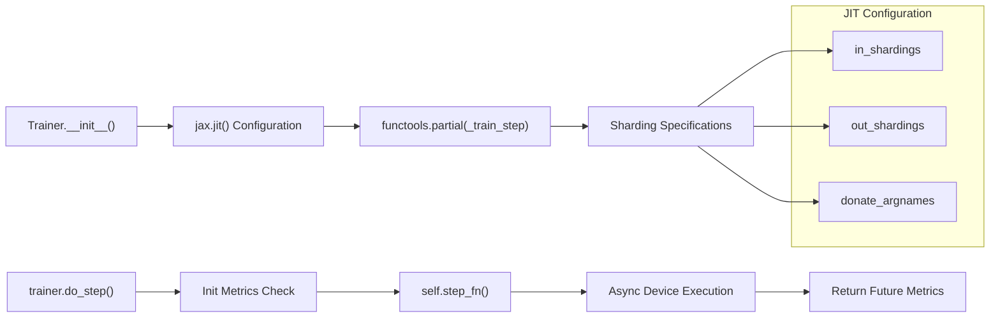

Sources: [nanodo/train.py:236-294]()

## Core Training Step Implementation

The `_train_step` function implements the fundamental forward and backward pass:

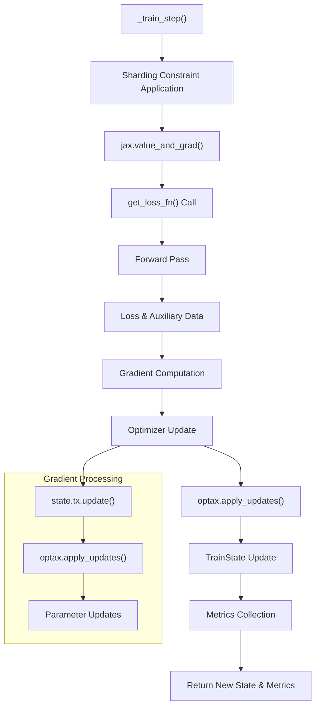

Sources: [nanodo/train.py:296-324]()

## Gradient Accumulation Support

The training system supports gradient accumulation to simulate larger batch sizes:

| Configuration | Purpose |
|---------------|---------|
| `grad_accumulation_steps` | Number of microbatches to accumulate |
| `micro_batch_size` | Size of each microbatch |
| `batch_size` | Total effective batch size |

The training loop processes multiple microbatches per step when gradient accumulation is enabled:

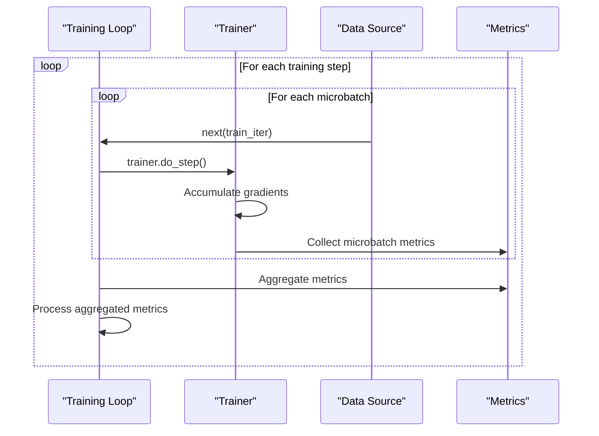

Sources: [nanodo/train.py:58-66](), [nanodo/train.py:214-226]()

## Distributed Training Coordination

The training system integrates with JAX's distributed training capabilities:

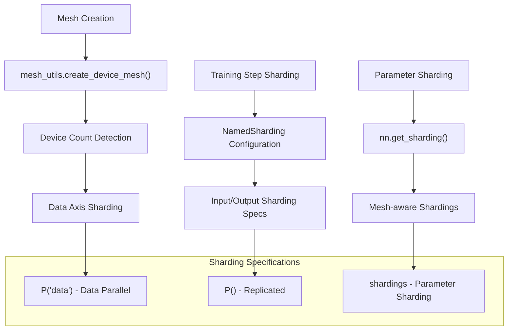

Sources: [nanodo/train.py:57](), [nanodo/train.py:251-270](), [nanodo/train.py:304-307]()

## Checkpointing System

The training system provides comprehensive checkpointing support through Orbax:

| Component | Purpose |
|-----------|---------|
| `_get_ckpt_manager` | Creates checkpoint manager with state and data handlers |
| `_restore_ckpt` | Restores training state and data iterator from checkpoint |
| Automatic checkpointing | Saves checkpoints at specified intervals |

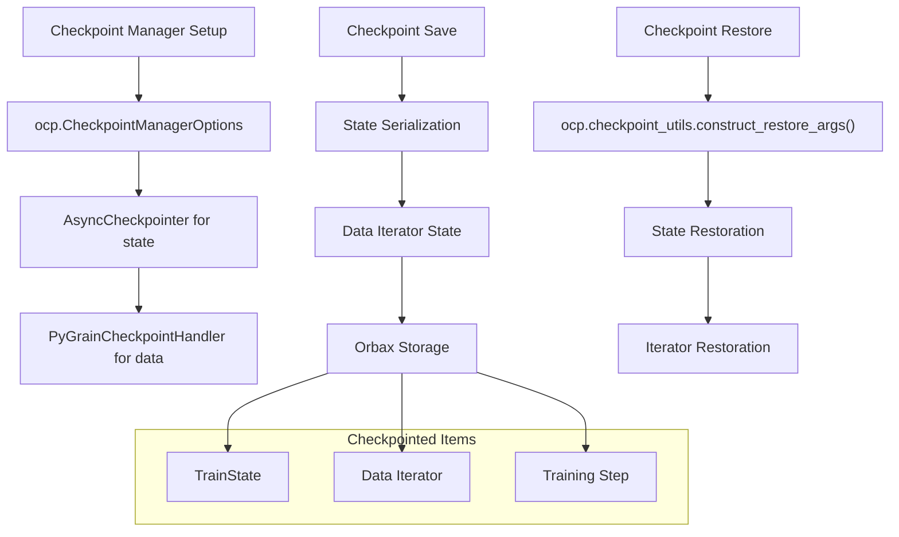

Sources: [nanodo/train.py:350-376]()

## Integration with Other Systems

The training system coordinates with multiple other nanodo components:

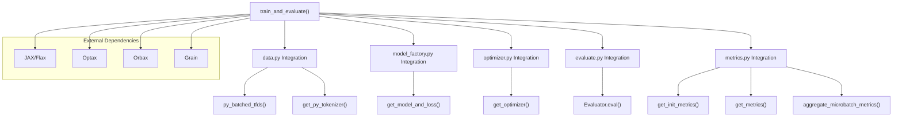

Sources: [nanodo/train.py:34-42](), [nanodo/train.py:77-98](), [nanodo/train.py:112-145]()

## Error Handling and Monitoring

The training system includes robust error handling and monitoring:

- **NaN/Inf Detection**: Automatic termination when loss becomes NaN or infinite
- **Performance Monitoring**: Integration with CLU for progress reporting and profiling
- **Asynchronous Metrics**: Non-blocking metrics collection to avoid training slowdowns
- **Data Exhaustion Handling**: Graceful handling when training data is exhausted

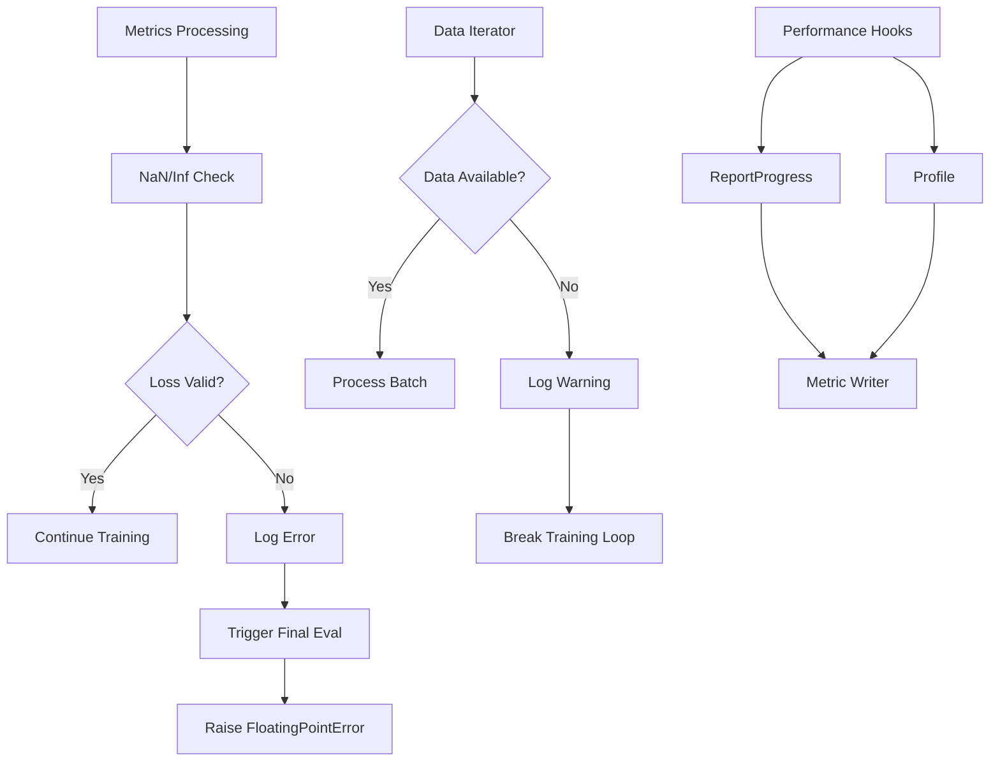

Sources: [nanodo/train.py:183-198](), [nanodo/train.py:215-220](), [nanodo/train.py:155-169]()

---

# Page: Model Architecture

# Model Architecture

<details>
<summary>Relevant source files</summary>

The following files were used as context for generating this wiki page:

- [nanodo/model.py](nanodo/model.py)
- [nanodo/model_factory.py](nanodo/model_factory.py)
- [nanodo/optimizer.py](nanodo/optimizer.py)
- [tests/model_factory_test.py](tests/model_factory_test.py)

</details>


This document covers the transformer decoder-only model architecture implementation in nanodo, including the core `TransformerDo` model, configuration system, and model factory patterns. It focuses on the architectural components, their relationships, and how models are instantiated and configured.

For information about loss computation and auxiliary data handling, see [Loss Functions](#4.2). For details about distributed training and parameter sharding, see [Distributed Training (FSDP)](#4.1).

## Overview

The nanodo framework implements a standard transformer decoder-only architecture with support for causal language modeling. The architecture follows modern transformer design patterns with pre-layer normalization, shared input/output embeddings, and multi-head causal self-attention.

### Core Architecture Flow

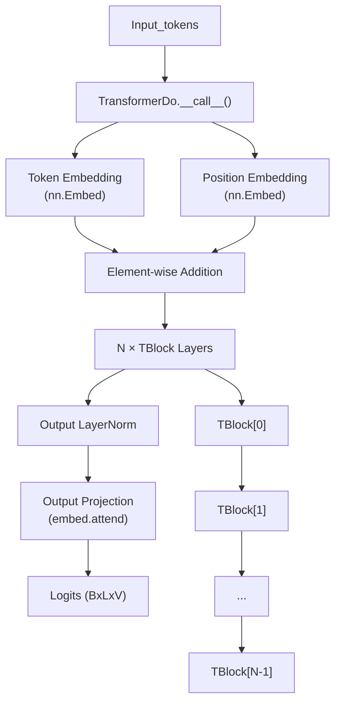

Sources: [nanodo/model.py:69-77]()

### Model Configuration System

The model architecture is controlled through the `DoConfig` dataclass, which centralizes all architectural hyperparameters:

| Parameter | Description | Type |
|-----------|-------------|------|
| `D` | Model/embedding dimension (= qkv dimension) | `int` |
| `H` | Number of attention heads | `int` |
| `L` | Maximum context/sequence length | `int` |
| `N` | Number of transformer block layers | `int` |
| `V` | Vocabulary size | `int` |
| `F` | Feed-forward inner dimension | `int` |
| `kernel_init` | Kernel parameter initializer | `nn.initializers.Initializer` |
| `embed_init` | Embedding parameter initializer | `nn.initializers.Initializer` |
| `dtype` | Model computation dtype | `jnp.dtype` |
| `fsdp_enabled` | Enable FSDP parameter sharding | `bool` |
| `remat` | Enable gradient checkpointing | `bool` |

Sources: [nanodo/model.py:29-46]()

## TransformerDo Architecture

### Model Structure

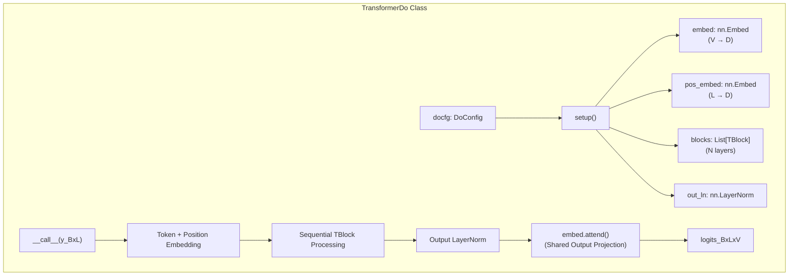

Sources: [nanodo/model.py:48-78]()

The `TransformerDo` class implements the main model architecture with the following key design decisions:

- **Shared Input/Output Embeddings**: The token embedding layer (`embed`) is reused for output projection through `embed.attend()`, reducing parameter count
- **Learned Position Embeddings**: Absolute position embeddings are learned parameters rather than sinusoidal 
- **Pre-LayerNorm Architecture**: Each transformer block applies layer normalization before the sub-layers rather than after
- **Gradient Checkpointing Support**: Optional rematerialization of transformer blocks via `nn.remat` for memory efficiency

Sources: [nanodo/model.py:52-77]()

## Transformer Block (TBlock)

### Block Internal Structure

```mermaid
graph TD
    A["Input: in_BxLxD"] --> B["LayerNorm"]
    B --> C["CausalAttn"]
    C --> D["Residual Connection"]
    A --> D
    D --> E["x_BxLxD"]
    
    E --> F["LayerNorm"]
    F --> G["Mlp"]
    G --> H["Residual Connection"]
    E --> H
    H --> I["Output: BxLxD"]
    
    subgraph "Pre-LayerNorm Pattern"
        B
        F
    end
```

Sources: [nanodo/model.py:97-113]()

Each `TBlock` follows the pre-layernorm transformer architecture:

1. **First Sub-layer**: LayerNorm → CausalAttn → Residual
2. **Second Sub-layer**: LayerNorm → MLP → Residual

This differs from the original transformer's post-layernorm design and is known to provide better training stability.

Sources: [nanodo/model.py:102-113]()

## Causal Self-Attention

### Attention Mechanism

```mermaid
flowchart TD
    A["Input: x_BxLxD"] --> B["Query Projection<br/>DenseGeneral(H, Dh)"]
    A --> C["Key Projection<br/>DenseGeneral(H, Dh)"]
    A --> D["Value Projection<br/>DenseGeneral(H, Dh)"]
    
    B --> E["q_BxLxHxDh / √Dh"]
    C --> F["k_BxLxHxDh"]
    D --> G["v_BxLxHxDh"]
    
    E --> H["Attention Scores<br/>einsum('...qhd,...khd->...hqk')"]
    F --> H
    H --> I["Cast to FP32"]
    I --> J["Causal Mask<br/>tril(ones(L,L))"]
    J --> K["Softmax"]
    K --> L["Cast back to dtype"]
    L --> M["Attention Output<br/>einsum('...hqk,...khd->...qhd')"]
    G --> M
    M --> N["Output Projection<br/>DenseGeneral(D)"]
    N --> O["Output: BxLxD"]
```

Sources: [nanodo/model.py:116-165]()

The `CausalAttn` implementation includes several important details:

- **Multi-head Structure**: Input dimension `D` is split into `H` heads of dimension `Dh = D/H`
- **Scaled Dot-Product**: Query vectors are scaled by `1/√Dh` for attention stability
- **Causal Masking**: Lower triangular mask ensures autoregressive property
- **Mixed Precision**: Attention scores computed in FP32 for numerical stability, then cast back
- **No Bias Terms**: All linear projections use `use_bias=False` following modern practice

Sources: [nanodo/model.py:121-165]()

## Multi-Layer Perceptron

The `Mlp` component implements a standard 2-layer feed-forward network:

```mermaid
graph LR
    A["Input: x_BxLxD"] --> B["Linear(D → F)"]
    B --> C["GELU Activation"]
    C --> D["Linear(F → D)"]
    D --> E["Output: x_BxLxD"]
```

Sources: [nanodo/model.py:80-94]()

Key characteristics:
- **Expansion Factor**: Inner dimension `F` is typically `4*D` 
- **GELU Activation**: Uses `jax.nn.gelu` rather than ReLU
- **No Bias Terms**: Both linear layers use `use_bias=False`

Sources: [nanodo/model.py:87-94]()

## Model Factory System

### Factory Pattern Implementation

```mermaid
graph TD
    subgraph "Model Creation Flow"
        A["ml_collections.ConfigDict"] --> B["get_model_and_loss()"]
        C["vocab_size: int"] --> B
        B --> D["DoConfig(**c.model, V=vocab_size)"]
        B --> E["TransformerDo(cfg)"]
        B --> F["get_default_loss_fn"]
        E --> G["nn.Module"]
        F --> H["LossFnFactory"]
        G --> I["Return: (module, loss_fn)"]
        H --> I
    end
    
    subgraph "Configuration Mapping"
        J["c.model.D"] --> D
        K["c.model.H"] --> D
        L["c.model.N"] --> D
        M["c.model.F"] --> D
        N["c.model.dtype"] --> D
    end
```

Sources: [nanodo/model_factory.py:28-40]()

The `get_model_and_loss` function serves as the primary entry point for model instantiation:

- **Config Integration**: Takes an `ml_collections.ConfigDict` and extracts model parameters
- **Vocabulary Binding**: Accepts `vocab_size` parameter to set the model's vocabulary dimension
- **Extensibility**: Designed to support experimental models through conditional logic
- **Loss Coupling**: Returns both the model and associated loss function factory

Sources: [nanodo/model_factory.py:28-40]()

## FSDP Integration

The model architecture includes built-in support for Fully Sharded Data Parallel training through the `fsdp` module integration:

- **Parameter Sharding**: All parameter initializers use `fsdp.init()` for proper sharding setup
- **Layer-specific Sharding**: Different layer types (`embedding`, `mlp_kernel`, `attn_in_proj`, `attn_out_proj`) have tailored sharding strategies
- **Conditional Enabling**: FSDP can be disabled via `fsdp_enabled=False` in `DoConfig`

Sources: [nanodo/model.py:57-58](), [nanodo/model.py:88](), [nanodo/model.py:132](), [nanodo/model.py:161]()

## Memory Optimization

### Gradient Checkpointing

The architecture supports gradient checkpointing (rematerialization) for memory-efficient training:

```python
block = nn.remat(TBlock) if cfg.remat else TBlock
self.blocks = [block(cfg) for _ in range(cfg.N)]
```

When `remat=True`, transformer blocks are wrapped with `nn.remat`, trading compute for memory by recomputing activations during the backward pass.

Sources: [nanodo/model.py:65-66]()

---

# Page: Data Pipeline

# Data Pipeline

<details>
<summary>Relevant source files</summary>

The following files were used as context for generating this wiki page:

- [nanodo/data.py](nanodo/data.py)
- [tests/data_test.py](tests/data_test.py)
- [tests/testdata/sentencepiece_cc_all.32000.100extra-sentencepiece.model](tests/testdata/sentencepiece_cc_all.32000.100extra-sentencepiece.model)

</details>


This document covers the data loading, preprocessing, tokenization, and batching systems in nanodo. The data pipeline is responsible for converting raw text datasets into tokenized, batched sequences ready for transformer training.

For information about how the data pipeline integrates with the training loop, see [Training System](#3.1). For details about model input processing, see [Model Architecture](#3.2).

## Overview

The nanodo data pipeline is built around the Grain library and TensorFlow Datasets (TFDS), providing efficient data loading with support for multiple preprocessing strategies. The system handles tokenization using SentencePiece, implements sequence packing for efficient training, and produces batched arrays suitable for JAX-based training.

## Core Components

### Data Loading Architecture

```mermaid
flowchart TD
    A[TFDS] --> B["tfds.data_source()"]
    B --> C["grain.IndexSampler"]
    C --> D["grain.DataLoader"]
    
    E["SentencePiece Model"] --> F["_SPTokenizer"]
    F --> G["_py_tokenize()"]
    
    H["Preprocessing Strategy"] --> I["Preprocess.NOAM_PACKED"]
    H --> J["Preprocess.PADDED"]
    
    I --> K["_NoamPack"]
    J --> L["grain.MapOperation"]
    
    D --> M["pygrain_ops pipeline"]
    G --> M
    K --> M
    L --> M
    
    M --> N["grain.Batch()"]
    N --> O["Batched DataLoader"]
    
    O --> P["get_in_out()"]
    P --> Q["Training Ready Data"]
```

**Data Loading Flow**
Sources: [nanodo/data.py:39-89]()

The pipeline starts with TFDS as the data source, uses Grain's IndexSampler for efficient sampling, and applies a series of operations through the DataLoader. The main entry point is `py_batched_tfds()` which orchestrates the entire pipeline.

### Tokenization System

```mermaid
flowchart TD
    A["vocab_path"] --> B["_SPTokenizer.__init__()"]
    B --> C["get_py_tokenizer()"]
    C --> D["spm.SentencePieceProcessor"]
    
    E["Raw Text"] --> F["_py_tokenize()"]
    D --> F
    F --> G["Token IDs"]
    
    G --> H["Add BOS token"]
    H --> I["Add EOS token"]
    I --> J["Optional Padding/Truncation"]
    
    K["PAD_ID = 0"] --> J
    L["pad_len parameter"] --> J
```

**Tokenization Process**
Sources: [nanodo/data.py:92-136]()

The tokenization system uses SentencePiece with a lazy-loading wrapper (`_SPTokenizer`) to handle pickling requirements. The `_py_tokenize()` function adds BOS and EOS tokens and handles optional padding or truncation based on the target sequence length.

## Preprocessing Strategies

### NOAM Packing vs Padding

| Strategy | Description | Memory Efficiency | Implementation |
|----------|-------------|------------------|----------------|
| `NOAM_PACKED` | Concatenates sequences to fill context window | High - no padding tokens | `_NoamPack` class |
| `PADDED` | Pads/truncates sequences to fixed length | Lower - includes padding | Standard padding |

### NOAM Packing Implementation

```mermaid
flowchart TD
    A["Token Sequences"] --> B["_NoamPack.__call__()"]
    B --> C["packed_ids = []"]
    
    D["For each sequence"] --> E["Calculate remaining space"]
    E --> F{"Fits in context?"}
    
    F -->|Yes| G["Extend packed_ids"]
    G --> H["Continue to next sequence"]
    
    F -->|No| I["Take partial sequence"]
    I --> J["Yield packed array"]
    J --> K["Reset packed_ids"]
    K --> L["Continue with remainder"]
    
    M["context_size"] --> E
    N["np.array(packed_ids, dtype=np.int32)"] --> J
```

**NOAM Packing Algorithm**
Sources: [nanodo/data.py:138-166]()

The `_NoamPack` class implements efficient sequence packing by concatenating multiple sequences until the context window is filled. This approach maximizes training efficiency by eliminating padding tokens.

## Input/Output Processing

### Training Data Format

```mermaid
flowchart TD
    A["in_BxL: Input Batch"] --> B["get_in_out()"]
    B --> C["x_BxL: Model Input"]
    B --> D["y_BxL: Target Output"]
    B --> E["weights_BxL: Loss Weights"]
    
    F["Shift Right"] --> D
    G["Pad with PAD_ID"] --> D
    H["Mask Padding"] --> E
    
    I["BOS token starts sequence"] --> C
    J["EOS token ends sequence"] --> D
    K["weights = 1 for valid tokens"] --> E
    L["weights = 0 for padding"] --> E
```

**Training Format Conversion**
Sources: [nanodo/data.py:171-186]()

The `get_in_out()` function converts raw tokenized sequences into the standard autoregressive format where:
- `x_BxL`: Input sequences starting with BOS
- `y_BxL`: Target sequences (input shifted right)
- `weights_BxL`: Binary mask for valid tokens (excludes padding)

## Configuration and Usage

### Main Pipeline Function

The `py_batched_tfds()` function serves as the primary interface with the following key parameters:

| Parameter | Type | Description |
|-----------|------|-------------|
| `tfds_name` | str | TensorFlow Datasets name |
| `split` | str | Dataset split (train/validation/test) |
| `context_size` | int | Maximum sequence length |
| `vocab_path` | str | Path to SentencePiece model |
| `batch_size` | int | Batch size for training |
| `preprocessing` | Preprocess | NOAM_PACKED or PADDED |
| `worker_count` | int | Number of parallel workers |
| `shuffle` | bool | Whether to shuffle data |

Sources: [nanodo/data.py:39-53]()

### Integration with Training

```mermaid
flowchart TD
    A["Configuration"] --> B["py_batched_tfds()"]
    B --> C["grain.DataLoader"]
    C --> D["Training Loop"]
    
    E["context_size"] --> F["Model Architecture"]
    G["vocab_path"] --> H["Tokenizer"]
    I["batch_size"] --> J["Training Batch"]
    
    K["TFDS Dataset"] --> L["Raw Text"]
    L --> M["Tokenization"]
    M --> N["Preprocessing"]
    N --> O["Batching"]
    O --> P["get_in_out()"]
    P --> Q["Training Ready"]
```

**Pipeline Integration**
Sources: [nanodo/data.py:39-89](), [nanodo/data.py:171-186]()

The data pipeline integrates seamlessly with the training system by producing batched arrays that match the expected input format for the TransformerDo model. The pipeline handles all necessary preprocessing steps automatically based on the configuration.

## Testing and Validation

The data pipeline includes comprehensive tests covering:

- **Batch Shape Validation**: Ensures correct batch and sequence dimensions
- **Tokenization Correctness**: Validates BOS/EOS token placement and padding
- **Preprocessing Strategies**: Tests both NOAM packing and padding approaches
- **Input/Output Format**: Verifies correct target generation and weight masking

Key test patterns include mock TFDS data for reproducible testing and shape validation across different preprocessing strategies.

Sources: [tests/data_test.py:47-146]()

---

# Page: Evaluation System

# Evaluation System

<details>
<summary>Relevant source files</summary>

The following files were used as context for generating this wiki page:

- [nanodo/evaluate.py](nanodo/evaluate.py)
- [tests/evaluate_test.py](tests/evaluate_test.py)

</details>


## Purpose and Scope

The Evaluation System provides model performance assessment capabilities during and after training in the nanodo framework. It handles metric computation, evaluation loop orchestration, and integration with the training pipeline to provide periodic model validation.

This document covers the evaluation infrastructure, metrics computation, and evaluation loop mechanics. For information about metrics collection and aggregation patterns, see [Metrics and Monitoring](#3.5). For training system integration, see [Training System](#3.1).

## Architecture Overview

The evaluation system is built around the `Evaluator` class, which orchestrates evaluation runs and integrates with JAX's distributed computing capabilities.

### Evaluation System Components

```mermaid
graph TD
    subgraph "Evaluation Pipeline"
        A[Evaluator] --> B["step_fn (JIT compiled)"]
        B --> C[_eval_step]
        C --> D[_compute_unnormed_metrics]
    end
    
    subgraph "Data Flow"
        E["eval_ds (Iterator)"] --> F["batch (np.ndarray)"]
        F --> G["in_BxL (jax.Array)"]
        G --> H[data.get_in_out]
        H --> I["x_BxL, y_BxL, weights_BxL"]
    end
    
    subgraph "Model Integration"
        J["model (nn.Module)"] --> K["model.apply"]
        K --> L["logits_BxLxV"]
        L --> M[softmax_cross_entropy_with_integer_labels]
    end
    
    subgraph "Metrics Collection"
        N[metrics_lib.Average] --> O[pending_metrics]
        N --> P[accumulated_metrics]
        O --> Q["merge operations"]
        P --> Q
        Q --> R["eval output dict"]
    end
    
    A --> E
    A --> J
    C --> H
    C --> K
    D --> M
    D --> N
    B --> O
    
    subgraph "Distributed Computing"
        S[Mesh] --> T[NamedSharding]
        T --> U[sharding constraints]
        U --> C
    end
    
    A --> S
```

Sources: [nanodo/evaluate.py:68-154]()

## Core Components

### Evaluator Class

The `Evaluator` class serves as the main interface for model evaluation, handling JIT compilation, sharding, and metrics aggregation.

| Component | Type | Purpose |
|-----------|------|---------|
| `step_fn` | JIT-compiled function | Performs single evaluation step with optimal performance |
| `c` | ConfigDict | Configuration parameters including `eval_steps` |
| `ds` | Iterator | Evaluation dataset iterator |
| `bpB` | float | Bits per byte conversion factor for specific datasets |

#### Initialization and JIT Compilation

The evaluator sets up JIT compilation with appropriate sharding specifications:

```python
self.step_fn = jax.jit(
    functools.partial(_eval_step, model=model, mesh=mesh),
    in_shardings=(shardings.params, NamedSharding(mesh, P())),
    out_shardings=(NamedSharding(mesh, P())),
    donate_argnames=("params", "in_BxL"),
)
```

The function uses `donate_argnames` to optimize memory usage by allowing JAX to reuse input buffers.

Sources: [nanodo/evaluate.py:71-92]()

### Evaluation Step Function

The `_eval_step` function performs the core evaluation computation on a single batch.

```mermaid
flowchart TD
    A["_eval_step(params, in_BxL, model, mesh)"] --> B["Apply sharding constraints"]
    B --> C["data.get_in_out(in_BxL)"]
    C --> D["Extract x_BxL, y_BxL, weights_BxL"]
    D --> E["model.apply({'params': params}, x_BxL)"]
    E --> F["Get logits_BxLxV"]
    F --> G["_compute_unnormed_metrics"]
    G --> H["Return metrics_lib.Average"]
    
    subgraph "Sharding Integration"
        I["NamedSharding(mesh, P('data'))"] --> B
    end
    
    subgraph "Data Processing"
        C --> J["Input tokens"]
        C --> K["Target tokens"]
        C --> L["Loss weights"]
    end
```

Sources: [nanodo/evaluate.py:128-141]()

### Metrics Computation

The `_compute_unnormed_metrics` function calculates loss values using softmax cross-entropy and returns structured metrics.

| Function | Input | Output | Purpose |
|----------|-------|--------|---------|
| `softmax_cross_entropy_with_integer_labels` | `logits_BxLxV`, `labels_BxL` | `losses_BxL` | Compute per-token losses |
| `Average.from_array` | `losses_BxL`, `mask=weights_BxL` | `metrics_lib.Average` | Aggregate losses with masking |

Sources: [nanodo/evaluate.py:144-153]()

## Evaluation Flow

### Main Evaluation Loop

The `eval` method orchestrates the complete evaluation process with asynchronous metric collection:

```mermaid
sequenceDiagram
    participant E as Evaluator
    participant DS as eval_ds
    participant SF as step_fn
    participant M as metrics
    participant PM as pending_metrics
    
    E->>M: Initialize Average()
    E->>PM: Initialize Average()
    
    loop For each batch (up to eval_steps)
        E->>DS: Get next batch
        E->>SF: step_fn(params, batch) [async dispatch]
        SF-->>PM: New metrics (async)
        E->>M: Merge previous pending_metrics
        Note over E: Overlap computation and data transfer
    end
    
    E->>M: Merge final pending_metrics
    E->>E: Compute output statistics
    E->>E: Apply bpB conversion if available
```

#### Asynchronous Metrics Collection

The evaluation loop uses an asynchronous pattern to overlap computation with data transfer:

1. Dispatch new evaluation step asynchronously
2. Collect results from previous step while new step executes
3. Merge collected metrics with running totals
4. Repeat until `eval_steps` reached or data exhausted

Sources: [nanodo/evaluate.py:93-125]()

### Output Metrics

The evaluation system produces a comprehensive set of metrics:

| Metric | Description | Formula |
|--------|-------------|---------|
| `eval_loss` | Mean loss across all tokens | `metrics.mean` |
| `eval_loss_std` | Standard error of mean | `metrics.sem` |
| `eval_loss_uc` | Upper confidence bound | `mean + 3 * sem` |
| `eval_loss_bpB` | Loss in bits per byte | `loss * bpB` (if available) |
| `_eval_loss` | Duplicate for XM measurements | Same as `eval_loss` |

### Bits per Byte Conversion

The system includes predefined conversion factors for common datasets:

| Dataset | Vocab Path | Conversion Factor |
|---------|------------|------------------|
| `lm1b:1.1.0` | `cc_all.32000.100extra.bos.model` | 0.361 |
| `c4:3.1.0` | `cc_all.32000.100extra.bos.model` | 0.336 |
| `huggingface:cerebras__slimpajama_627b` | `cc_all.32000.100extra.bos.model` | 0.371 |

These factors convert from nats per token to bits per byte for standardized comparison across datasets.

Sources: [nanodo/evaluate.py:42-65](), [nanodo/evaluate.py:115-121]()

## Distributed Evaluation

### Sharding Integration

The evaluation system integrates with JAX's sharding system for distributed computation:

```python
# Apply data sharding constraint
in_BxL = jax.lax.with_sharding_constraint(
    in_BxL, NamedSharding(mesh, P("data"))
)
```

This ensures that evaluation batches are properly distributed across devices in multi-device setups.

### Memory Optimization

The JIT compilation uses `donate_argnames` to optimize memory usage:
- `params`: Model parameters can be donated since they're not modified
- `in_BxL`: Input batch can be donated after processing

Sources: [nanodo/evaluate.py:86-87](), [nanodo/evaluate.py:135-138]()

## Integration with Training System

The evaluation system is designed to integrate seamlessly with the training loop:

1. **Shared Model**: Uses the same model instance as training
2. **Parameter Sharing**: Evaluates using current training parameters
3. **Sharding Consistency**: Uses same mesh and sharding strategy as training
4. **Metrics Integration**: Outputs metrics in format compatible with training monitoring

The evaluator is typically instantiated once and reused throughout training, with the `eval` method called periodically to assess model performance.

Sources: [nanodo/evaluate.py:71-78]()

## Testing and Validation

The evaluation system includes comprehensive tests that verify:

- Correct metric computation for known inputs
- Proper integration with model architecture
- Metrics aggregation accuracy
- Statistical properties of computed metrics

The test suite uses a small `TransformerDo` model to validate the complete evaluation pipeline.

Sources: [tests/evaluate_test.py:29-48]()

---

# Page: Metrics and Monitoring

# Metrics and Monitoring

<details>
<summary>Relevant source files</summary>

The following files were used as context for generating this wiki page:

- [nanodo/metrics.py](nanodo/metrics.py)
- [tests/metrics_test.py](tests/metrics_test.py)

</details>


This document covers the metrics collection and monitoring system in nanodo, which tracks training progress, model statistics, and optimization dynamics. The system provides comprehensive monitoring of parameter counts, gradient statistics, loss values, and training metrics throughout the training process.

For information about the training loop integration, see [Training System](#3.1). For evaluation metrics, see [Evaluation System](#3.4).

## Overview

The metrics system in nanodo serves several key purposes:

- **Training Monitoring**: Track loss, perplexity, learning rates, and training progress
- **Parameter Analysis**: Count and analyze model parameters across different components  
- **Gradient Statistics**: Monitor gradient norms, distributions, and optimization dynamics
- **Microbatch Aggregation**: Correctly aggregate metrics across gradient accumulation steps
- **Numerical Stability**: Use robust algorithms like Welford's method for stable statistics computation

The system is designed to work seamlessly with JAX's functional programming model and supports distributed training scenarios.

## Core Metrics Collection

### Metrics Collection Flow

```mermaid
flowchart TD
    A[Training Step] --> B["get_metrics()"]
    C[Model Initialization] --> D["get_init_metrics()"]
    
    B --> E["Parameter Statistics"]
    B --> F["Gradient Statistics"] 
    B --> G["Loss Metrics"]
    B --> H["Learning Rate"]
    
    E --> I["_stats_from_tree()"]
    F --> I
    
    I --> J["_welford_mean()"]
    I --> K["_get_stats()"]
    
    K --> L["RMS, STD, Mean"]
    
    M["Microbatch Metrics"] --> N["aggregate_microbatch_metrics()"]
    N --> O["Weighted Aggregation"]
    O --> P["Final Training Metrics"]
    
    D --> Q["Parameter Counts"]
    D --> R["_counts_from_tree()"]
    R --> S["n_params/*"]
```

**Sources**: [nanodo/metrics.py:71-116](), [nanodo/metrics.py:36-68]()

### Initial Metrics Computation

The `get_init_metrics` function computes static metrics about the model structure that remain constant throughout training:

```mermaid
graph TD
    A["get_init_metrics()"] --> B["state.params"]
    B --> C["Total Parameters<br/>n_params/all"]
    B --> D["Embedding Parameters<br/>n_params/embedding"]  
    B --> E["Non-embedding Parameters<br/>n_params/non_embedding"]
    B --> F["Head Parameters<br/>n_params/head"]
    
    G["_size()"] --> C
    G --> D
    G --> E
    G --> F
    
    H["_counts_from_tree()"] --> I["Per-layer Counts<br/>n_params/layer_*"]
```

The function distinguishes between different parameter categories:
- **Embedding parameters**: Token embeddings (`embed`) and positional embeddings (`pos_embed`)
- **Non-embedding parameters**: All other model parameters excluding embeddings
- **Head parameters**: Output projection layer parameters (if present)

**Sources**: [nanodo/metrics.py:36-68](), [nanodo/metrics.py:210-212](), [nanodo/metrics.py:220-221]()

### Training Step Metrics

The `get_metrics` function computes comprehensive metrics at each training step:

| Metric Category | Key Metrics | Description |
|-----------------|-------------|-------------|
| **Loss & Perplexity** | `train_loss`, `log_perplexity` | Cross-entropy loss and log perplexity |
| **Training Progress** | `train_fraction`, `train_tokens_seen` | Training completion and token count |
| **Optimization** | `learning_rate` | Current learning rate from schedule |
| **Gradient Stats** | `grads/all/*` | Global gradient statistics (RMS, mean, std) |
| **Parameter Stats** | `params/all/*` | Global parameter statistics |
| **Update Stats** | `updates/all/*` | Optimizer update statistics |

**Sources**: [nanodo/metrics.py:71-116]()

## Microbatch Metrics Aggregation

### Aggregation Strategy

The `aggregate_microbatch_metrics` function handles the complex task of correctly combining metrics across gradient accumulation steps:

```mermaid
flowchart TD
    A["Microbatch Metrics List"] --> B["For each microbatch"]
    B --> C{"Metric Type?"}
    
    C -->|"Loss, Perplexity"| D["Weight by train_ntokens"]
    C -->|"grads/, params/, updates/"| E["Use Latest Value"]
    C -->|"train_ntokens"| F["Sum Directly"]
    
    D --> G["Accumulate Weighted"]
    E --> G
    F --> G
    
    G --> H["Normalize by Total Tokens"]
    H --> I["Compute train_perplexity"]
    I --> J["Final Aggregated Metrics"]
```

The aggregation logic handles three types of metrics differently:

1. **Averaging Metrics**: Loss, perplexity, and other quality metrics are weighted by `train_ntokens`
2. **Non-accumulating Metrics**: Gradient, parameter, and update statistics use the latest values
3. **Summing Metrics**: Token counts are summed directly

**Sources**: [nanodo/metrics.py:118-167]()

### Token-Weighted Aggregation

```python
# Pseudocode showing the aggregation logic
def aggregate_logic(microbatch_metrics):
    for metric_dict in microbatch_metrics:
        train_ntokens = metric_dict["train_ntokens"]
        for key, value in metric_dict.items():
            if is_non_accumulating_metric(key):
                # Use latest value for grad/param/update stats
                final_metrics[key] = value
            elif key == "train_ntokens":
                # Sum token counts
                final_metrics[key] += value
            else:
                # Weight by tokens for loss/perplexity
                final_metrics[key] += train_ntokens * value
```

**Sources**: [nanodo/metrics.py:134-161]()

## Statistical Computations

### Welford Algorithm Implementation

The metrics system uses Welford's algorithm for numerically stable computation of means and variances, especially important for large arrays that exceed int32 limits:

```mermaid
graph TD
    A["PyTree Input"] --> B["_welford_mean()"]
    B --> C["Tree Reduce with step()"]
    
    D["step(mean_and_size, x)"] --> E["Calculate new_size"]
    D --> F["Update mean incrementally"]
    
    E --> G["size + x.size"]
    F --> H["mean * (size/new_size) + sum(x)/new_size"]
    
    C --> I["Final Mean"]
    
    J["_get_stats()"] --> B
    J --> K["Mean of Squares"]
    K --> L["RMS = sqrt(ms)"]
    K --> M["STD = sqrt(ms - mean²)"]
```

The algorithm handles:
- **Large Arrays**: Arrays larger than int32 limits (tested with >2³¹ elements)
- **PyTree Structures**: Nested parameter structures with mixed shapes
- **Numerical Stability**: Avoids catastrophic cancellation in variance computation

**Sources**: [nanodo/metrics.py:186-207](), [tests/metrics_test.py:60-96]()

### Statistics Dictionary Generation

The `_stats_from_tree` and `_global_stats_from_tree` functions generate comprehensive statistics:

```mermaid
graph LR
    A["PyTree"] --> B["_get_stats()"]
    B --> C["mean: _welford_mean(tree)"]
    B --> D["ms: _welford_mean(tree²)"]
    
    C --> E["Statistics Dict"]
    D --> E
    
    E --> F["rms: sqrt(ms)"]
    E --> G["std: sqrt(max(ms - mean², 0))"]
    E --> H["mean: mean"]
    
    I["_tree_to_dict()"] --> J["Flattened Key-Value Pairs"]
```

**Sources**: [nanodo/metrics.py:178-183](), [nanodo/metrics.py:198-207]()

## Running Average Class

### Average Dataclass

The `Average` class implements a robust running average computation using the parallel Welford algorithm:

```mermaid
classDiagram
    class Average {
        +int count
        +float mean
        +float m2
        +float variance
        +float sem
        +from_array(x, mask) Average
        +merge(other) Average
    }
    
    Average --> Average : merge()
    Array --> Average : from_array()
```

Key capabilities:
- **Incremental Updates**: Merge statistics from different data chunks
- **Masked Computation**: Support for masked arrays
- **Standard Error**: Computes standard error of the mean (SEM)
- **Numerical Stability**: Uses Chan et al. parallel algorithm

**Sources**: [nanodo/metrics.py:253-317]()

### Usage Pattern

```python
# Typical usage pattern for running averages
average = None
for data_chunk in data_stream:
    update = Average.from_array(data_chunk)
    average = update if average is None else average.merge(update)
    
print(f"Mean: {average.mean} ± {average.sem}")
```

**Sources**: [tests/metrics_test.py:145-176]()

## Integration with Training Loop

### Metrics Flow in Training

```mermaid
sequenceDiagram
    participant TL as "Training Loop"
    participant TS as "_train_step()"
    participant GM as "get_metrics()"
    participant AM as "aggregate_microbatch_metrics()"
    
    TL->>TS: Execute training step
    TS->>GM: Compute step metrics
    GM->>TS: Return metrics dict
    TS->>TL: Return state, metrics
    
    alt Gradient Accumulation
        TL->>AM: Aggregate microbatch metrics
        AM->>TL: Return aggregated metrics
    end
    
    TL->>TL: Log to TensorBoard/XM
```

The metrics system integrates tightly with the training loop:

1. **Step Metrics**: Computed after each forward/backward pass
2. **Microbatch Aggregation**: Applied when using gradient accumulation
3. **Logging**: Metrics are logged to monitoring systems
4. **Progress Tracking**: Used for training progress and convergence monitoring

**Sources**: [tests/metrics_test.py:98-143](), [nanodo/metrics.py:71-116]()

### Internal Metrics Logging

When `log_internal_metrics` is enabled in the configuration, the system logs detailed internal statistics:

- **Layer-wise Statistics**: Per-layer parameter and gradient statistics
- **Attention States**: Internal attention mechanism statistics
- **Activation Statistics**: Statistics from intermediate activations

This provides deep visibility into model behavior but increases logging overhead.

**Sources**: [nanodo/metrics.py:108-114]()

---

# Page: Optimization

# Optimization

<details>
<summary>Relevant source files</summary>

The following files were used as context for generating this wiki page:

- [nanodo/model_factory.py](nanodo/model_factory.py)
- [nanodo/optimizer.py](nanodo/optimizer.py)
- [tests/model_test.py](tests/model_test.py)
- [tests/optimizer_test.py](tests/optimizer_test.py)

</details>


This document covers the optimization system in nanodo, which handles optimizer creation, learning rate scheduling, and gradient processing strategies. The optimization system is built on top of Optax and provides a flexible factory pattern for configuring various optimization algorithms and schedules.

For information about the training loop that uses these optimizers, see [Training System](#3.1). For details about model architecture and parameter structure, see [Model Architecture](#3.2).

## Overview

The optimization system provides a unified interface for creating and configuring optimizers through the `get_optimizer()` function in [nanodo/optimizer.py](). The system supports multiple base optimizers, sophisticated learning rate schedules, gradient processing techniques, and advanced features like layerwise learning rate scaling.

## Optimizer Factory System

The optimization system uses a factory pattern to create complex optimizer chains based on configuration parameters. The main entry point is `get_optimizer()`, which orchestrates multiple optimization components into a single `optax.MultiSteps` instance.

```mermaid
graph TD
    A["get_optimizer()"] --> B["_get_base_optimizer()"]
    A --> C["layerwise_lr_multiplier check"]
    A --> D["clip_by_global_norm check"]
    A --> E["optax.MultiSteps wrapper"]
    
    B --> F["get_learning_rate_schedule()"]
    B --> G["Base Optimizer Selection"]
    
    G --> H["optax.adamw"]
    G --> I["optax.adafactor"] 
    G --> J["optax.lion"]
    
    C --> K["_scale_by_dict()"]
    D --> L["optax.clip_by_global_norm()"]
    
    F --> M["Schedule Type Selection"]
    M --> N["cosine"]
    M --> O["rsqrt"]
    M --> P["linear"]
    M --> Q["constant"]
    M --> R["constant_linear_decay_*"]
    
    K --> S["optax.chain()"]
    L --> S
    B --> S
    S --> E
```

**Optimizer Chain Construction**

The optimizer construction follows this sequence:

1. **Base Optimizer Creation**: Selects and configures one of three supported optimizers
2. **Layerwise Scaling**: Optionally applies parameter-specific learning rate multipliers
3. **Gradient Clipping**: Optionally clips gradients by global norm
4. **Multi-step Wrapping**: Wraps the optimizer chain for gradient accumulation

Sources: [nanodo/optimizer.py:28-44]()

## Base Optimizers

The system supports three base optimizers, each with specific configuration options:

| Optimizer | Key Parameters | Use Case |
|-----------|---------------|----------|
| `adamw` | `b1`, `b2`, `eps`, `weight_decay` | General purpose, memory efficient |
| `adafactor` | `multiply_by_parameter_scale`, `decay_rate`, `momentum`, `factored` | Large models, adaptive scaling |
| `lion` | `b1`, `b2`, `weight_decay` | Sign-based updates, memory efficient |

```mermaid
graph LR
    A["_get_base_optimizer()"] --> B["optimizer_type check"]
    
    B --> C["adamw"]
    B --> D["adafactor"]
    B --> E["lion"]
    
    C --> F["optax.adamw()"]
    D --> G["optax.adafactor()"]
    E --> H["optax.lion()"]
    
    I["get_learning_rate_schedule()"] --> F
    I --> G
    I --> H
    
    J["_params_mask()"] --> F
    J --> G
    J --> H
    
    K["weight_decay_exclusion_names"] --> J
```

**Weight Decay Configuration**

All base optimizers support weight decay with parameter exclusions through `_params_mask()`. By default, bias and scale parameters are excluded from weight decay. The system also supports independent weight decay scaling when `independent_weight_decay` is enabled.

Sources: [nanodo/optimizer.py:150-199](), [nanodo/optimizer.py:133-148]()

## Learning Rate Schedules

The learning rate scheduling system supports multiple schedule types with a consistent warmup phase followed by various decay strategies.

```mermaid
graph TD
    A["get_learning_rate_schedule()"] --> B["Warmup Phase"]
    A --> C["Decay Type Selection"]
    
    B --> D["optax.linear_schedule()"]
    D --> E["init_learning_rate → peak_learning_rate"]
    
    C --> F["cosine"]
    C --> G["rsqrt"]
    C --> H["linear"]
    C --> I["constant"]
    C --> J["constant_without_warmup"]
    C --> K["constant_linear_decay_*"]
    
    F --> L["optax.cosine_decay_schedule()"]
    G --> M["_rsqrt_schedule()"]
    H --> N["optax.linear_schedule()"]
    I --> O["optax.constant_schedule()"]
    J --> P["optax.constant_schedule()"]
    K --> Q["Multi-phase Schedule"]
    
    Q --> R["optax.constant_schedule()"]
    Q --> S["optax.linear_schedule()"]
    
    T["optax.join_schedules()"] --> U["Final Schedule"]
    D --> T
    L --> T
    M --> T
    N --> T
    O --> T
    R --> T
    S --> T
```

**Schedule Types**

| Schedule Type | Behavior | Configuration |
|---------------|----------|---------------|
| `cosine` | Cosine decay after warmup | `decay_steps`, `final_learning_rate` |
| `rsqrt` | Reciprocal square root decay | Automatic based on warmup |
| `linear` | Linear decay after warmup | `final_learning_rate` |
| `constant` | Constant rate after warmup | `peak_learning_rate` only |
| `constant_linear_decay_*` | Constant then linear decay | Supports percentage or step-based |

**Custom RSQRT Schedule**

The `_rsqrt_schedule()` implements a reciprocal square root decay commonly used in Transformer training:

```
learning_rate = init_value * (step + shift)^(-0.5) * shift^0.5
```

Sources: [nanodo/optimizer.py:47-122](), [nanodo/optimizer.py:124-131]()

## Gradient Processing

The optimization system provides several gradient processing features that wrap around the base optimizer.

### Gradient Clipping

Global gradient norm clipping is applied when `clip_by_global_norm` is specified in the configuration:

```mermaid
graph LR
    A["Raw Gradients"] --> B["optax.clip_by_global_norm()"]
    B --> C["Clipped Gradients"]
    C --> D["Base Optimizer"]
    
    E["clip_by_global_norm config"] --> B
```

### Multi-step Gradient Accumulation

All optimizers are wrapped with `optax.MultiSteps` to support gradient accumulation across multiple microbatches:

```mermaid
graph TD
    A["optax.MultiSteps"] --> B["Gradient Collection"]
    B --> C["grad_accumulation_steps check"]
    
    C --> D["Accumulate"]
    C --> E["Apply Updates"]
    
    D --> F["Store gradients"]
    F --> G["Continue training"]
    
    E --> H["Average accumulated gradients"]
    H --> I["Apply to parameters"]
    I --> J["Reset accumulation"]
```

Sources: [nanodo/optimizer.py:36-44]()

## Advanced Features

### Layerwise Learning Rate Scaling

The `_scale_by_dict()` function provides parameter-specific learning rate multipliers based on parameter names:

```mermaid
graph TD
    A["_scale_by_dict()"] --> B["Parameter Path Analysis"]
    B --> C["String Key Construction"]
    C --> D["Scale Dictionary Lookup"]
    
    D --> E["Match Found"]
    D --> F["No Match"]
    
    E --> G["Apply Multiplier"]
    F --> H["Use Original Gradient"]
    
    I["scale_dict config"] --> D
    J["jax.tree_util.tree_map_with_path()"] --> B
```

**Example Configuration**:
```python
layerwise_lr_multiplier = {"kernel": 3.0, "embedding": 0.1}
```

This applies 3x learning rate to all parameters containing "kernel" in their path and 0.1x to embedding parameters.

### Parameter Masking

The `_params_mask()` function creates boolean masks for excluding specific parameters from weight decay or other transformations:

```mermaid
graph LR
    A["_params_mask()"] --> B["Key Path Extraction"]
    B --> C["Exclude Names Check"]
    C --> D["Boolean Mask Generation"]
    
    E["exclude_names = ['bias', 'scale']"] --> C
    F["jax.tree_util.tree_map_with_path()"] --> B
```

Default exclusions are bias and scale parameters, which typically should not have weight decay applied.

Sources: [nanodo/optimizer.py:202-233](), [nanodo/optimizer.py:133-148]()

## Configuration Integration

The optimization system integrates with the broader configuration system through `ml_collections.ConfigDict`. Key configuration parameters include:

| Parameter | Type | Purpose |
|-----------|------|---------|
| `optimizer` | str | Base optimizer type |
| `peak_learning_rate` | float | Maximum learning rate |
| `warmup_steps` | int | Warmup duration |
| `decay_type` | str | Learning rate decay strategy |
| `weight_decay` | float | L2 regularization strength |
| `grad_accumulation_steps` | int | Gradient accumulation factor |
| `clip_by_global_norm` | float | Gradient clipping threshold |

The configuration is passed through the training system and used by `get_optimizer()` to construct the complete optimization pipeline.

Sources: [nanodo/optimizer.py:28-29](), [tests/optimizer_test.py:31-42]()

---

# Page: Advanced Features

# Advanced Features

<details>
<summary>Relevant source files</summary>

The following files were used as context for generating this wiki page:

- [nanodo/fsdp.py](nanodo/fsdp.py)
- [nanodo/loss.py](nanodo/loss.py)

</details>


This document covers the specialized features in nanodo designed for advanced users and production deployments. These features enable scaling to larger models and distributed training scenarios while maintaining the framework's simplicity and hackability.

For core system fundamentals, see [Core Systems](#3). For detailed implementation of specific advanced features, see [Distributed Training (FSDP)](#4.1) and [Loss Functions](#4.2).

## Overview

Nanodo provides two primary advanced features that distinguish it from basic transformer implementations:

1. **Fully Sharded Data Parallel (FSDP)** - Enables training large models across multiple devices by sharding parameters
2. **Flexible Loss Function System** - Provides extensible loss computation with auxiliary data support

These features integrate seamlessly with the core training pipeline while adding minimal complexity to the user interface.

## Advanced Features Architecture

```mermaid
graph TB
    subgraph "Core Training Pipeline"
        A[TrainState] --> B["train_step"]
        B --> C["loss_fn"]
        C --> D["apply_fn"]
    end
    
    subgraph "FSDP System"
        E["fsdp.init"] --> F["nn.with_partitioning"]
        F --> G["Parameter Sharding"]
        G --> H["Device Mesh"]
    end
    
    subgraph "Loss Function System"
        I["get_default_loss_fn"] --> J["LossFn"]
        J --> K["LossAuxData"]
        K --> L["log_perplexity"]
        K --> M["ntokens"]
        K --> N["state"]
    end
    
    subgraph "Model Integration"
        O["model_factory.get_model_and_loss"] --> P["TransformerDo"]
        O --> Q["Loss Factory"]
    end
    
    D --> P
    C --> I
    E --> P
    Q --> I
    
    P --> R["Distributed Parameters"]
    J --> S["Training Metrics"]
    
    style E fill:#f9f,stroke:#333,stroke-width:2px
    style I fill:#bbf,stroke:#333,stroke-width:2px
    style O fill:#bfb,stroke:#333,stroke-width:2px
```

Sources: [nanodo/fsdp.py:1-52](), [nanodo/loss.py:1-74]()

## FSDP Integration

The FSDP system provides parameter sharding capabilities for distributed training. The implementation centers around the `fsdp.init` function which determines how different layer types should be partitioned across devices.

### Key Components

| Component | Purpose | Implementation |
|-----------|---------|----------------|
| `fsdp.init` | Parameter partitioning strategy | [nanodo/fsdp.py:34-51]() |
| `nn.with_partitioning` | Flax partitioning wrapper | [nanodo/fsdp.py:36]() |
| Layer-specific partitioning | Optimized sharding per layer type | [nanodo/fsdp.py:37-51]() |

The system supports partitioning for:
- **Embedding layers** `[V, D]` - Partitioned on model dimension
- **Attention projections** `[D, H, Dh]` and `[H, Dh, D]` - Partitioned on input/output dimensions
- **MLPs** `[D, F]` - Partitioned on input dimension
- **Output heads** `[D, V]` - Partitioned on model dimension

For comprehensive FSDP documentation, see [Distributed Training (FSDP)](#4.1).

## Loss Function System

The loss function system provides a flexible framework for implementing custom loss computations with auxiliary data collection. The core abstraction is the `LossFn` type which returns both loss values and auxiliary data.

### Loss Function Factory Pattern

```mermaid
graph LR
    A["LossFnFactory"] --> B["get_default_loss_fn"]
    B --> C["loss_fn"]
    C --> D["LossAuxData"]
    
    subgraph "Input Processing"
        E["in_BxL"] --> F["data.get_in_out"]
        F --> G["x_BxL, y_BxL, weights_BxL"]
    end
    
    subgraph "Forward Pass"
        H["apply_fn"] --> I["logits_BxLxV"]
        H --> J["state"]
    end
    
    subgraph "Loss Computation"
        K["losses.softmax_cross_entropy_with_integer_labels"] --> L["losses_BxL"]
        L --> M["mean_loss"]
    end
    
    G --> H
    I --> K
    M --> D
    J --> D
    
    style A fill:#f9f,stroke:#333,stroke-width:2px
    style D fill:#bbf,stroke:#333,stroke-width:2px
```

Sources: [nanodo/loss.py:42-45](), [nanodo/loss.py:48-73]()

### LossAuxData Structure

The `LossAuxData` dataclass provides structured auxiliary information from loss computation:

```python
@dataclass
class LossAuxData:
  ntokens: jax.Array        # Number of valid tokens
  state: PyTree             # Model state (e.g., intermediate activations)
  log_perplexity: jax.Array # Log perplexity for monitoring
```

This structure enables:
- **Token counting** for proper loss normalization
- **State tracking** for debugging and analysis
- **Perplexity monitoring** for training diagnostics

For detailed loss function customization, see [Loss Functions](#4.2).

## Code Entity Mapping

```mermaid
graph TB
    subgraph "Python Module Level"
        A["nanodo.fsdp"] --> B["init()"]
        C["nanodo.loss"] --> D["get_default_loss_fn()"]
        C --> E["LossFn"]
        C --> F["LossAuxData"]
    end
    
    subgraph "Type System"
        G["DoConfig"] --> H["fsdp_enabled"]
        I["ml_collections.ConfigDict"] --> J["log_internal_metrics"]
        K["PyTree"] --> L["params"]
    end
    
    subgraph "JAX/Flax Integration"
        M["nn.with_partitioning"] --> N["Parameter Sharding"]
        O["losses.softmax_cross_entropy_with_integer_labels"] --> P["Cross Entropy Loss"]
        Q["jax.Array"] --> R["Tensor Operations"]
    end
    
    subgraph "Layer Type Mapping"
        S["embedding"] --> T["[V, D] partitioning"]
        U["attn_in_proj"] --> V["[D, H, Dh] partitioning"]
        W["attn_out_proj"] --> X["[H, Dh, D] partitioning"]
        Y["mlp_kernel"] --> Z["[D, F] partitioning"]
    end
    
    B --> M
    D --> O
    H --> B
    J --> D
    
    style A fill:#f9f,stroke:#333,stroke-width:2px
    style C fill:#bbf,stroke:#333,stroke-width:2px
    style M fill:#bfb,stroke:#333,stroke-width:2px
    style O fill:#bfb,stroke:#333,stroke-width:2px
```

Sources: [nanodo/fsdp.py:22](), [nanodo/fsdp.py:34-51](), [nanodo/loss.py:30](), [nanodo/loss.py:33-37](), [nanodo/loss.py:40-45]()

## Integration Considerations

### Configuration Requirements

Both advanced features are controlled through configuration:
- **FSDP**: Enabled via `DoConfig.fsdp_enabled` flag
- **Loss Functions**: Controlled via `log_internal_metrics` configuration

### Performance Implications

- **FSDP**: Reduces memory usage per device but adds communication overhead
- **Loss Functions**: Auxiliary data collection adds minimal computational cost

### Compatibility

Both features maintain full compatibility with the core training pipeline and require no changes to existing training scripts when disabled.

Sources: [nanodo/fsdp.py:36](), [nanodo/loss.py:58]()

---

# Page: Distributed Training (FSDP)

# Distributed Training (FSDP)

<details>
<summary>Relevant source files</summary>

The following files were used as context for generating this wiki page:

- [nanodo/fsdp.py](nanodo/fsdp.py)
- [nanodo/train.py](nanodo/train.py)

</details>


This document covers Fully Sharded Data Parallel (FSDP) training in nanodo, including parameter sharding strategies, mesh configuration, and distributed training coordination across multiple devices. FSDP enables training large models by sharding parameters across devices while maintaining data parallelism.

For information about the core training system architecture, see [Training System](#3.1). For optimizer configuration in distributed settings, see [Optimization](#3.6).

## Overview

The nanodo framework implements FSDP through JAX's native sharding capabilities, using a mesh-based approach to distribute model parameters across devices. The system automatically handles parameter sharding, gradient synchronization, and checkpoint management in distributed environments.

**Key Components:**
- `fsdp.py`: Parameter sharding specification utilities
- `train.py`: Mesh setup and distributed training orchestration
- Automatic sharding constraint application during training

Sources: [nanodo/fsdp.py:1-52](), [nanodo/train.py:57-83]()

## Device Mesh Configuration

The distributed training system creates a device mesh that defines how computation is distributed across available devices. The mesh uses a single "data" axis for parameter sharding.

### Mesh Creation Flow

```mermaid
flowchart TD
    A["jax.device_count()"] --> B["mesh_utils.create_device_mesh()"]
    B --> C["Mesh(devices, ('data',))"]
    C --> D["_init_train_state()"]
    D --> E["nn.get_sharding(params, mesh)"]
    E --> F["shardings applied to TrainState"]
    
    G["grad_accumulation_steps"] --> H["micro_batch_size calculation"]
    H --> I["batch_size validation"]
    I --> J["device count divisibility check"]
```

The system performs several validation checks:
- Batch size must be divisible by gradient accumulation steps
- Micro batch size must be divisible by device count
- Ensures proper data distribution across the mesh

Sources: [nanodo/train.py:57-72]()

## Parameter Sharding Strategy

The `fsdp.py` module defines how different transformer components are sharded across devices. Each layer type has a specific partitioning strategy optimized for memory efficiency and communication patterns.

### Layer-Specific Partitioning

```mermaid
graph TD
    A["init(layer_type, docfg)"] --> B{"docfg.fsdp_enabled?"}
    B -->|Yes| C["nn.with_partitioning(init_fn, partition_spec)"]
    B -->|No| D["init_fn (no partitioning)"]
    
    C --> E["embedding: (None, 'data')"]
    C --> F["attn_in_proj: ('data', None, None)"]
    C --> G["attn_out_proj: (None, None, 'data')"]
    C --> H["mlp_kernel: ('data', None)"]
    C --> I["head: ('data', None)"]
```

**Partitioning Rules:**
- Only one dimension per tensor is partitioned along the "data" axis
- Partitioned dimension must be divisible by device count
- Model dimension (D) is typically chosen as it's usually divisible by device count

| Layer Type | Tensor Shape | Partition Spec | Partitioned Dimension |
|------------|--------------|----------------|----------------------|
| `embedding` | `[V, D]` | `(None, "data")` | Model dimension |
| `attn_in_proj` | `[D, H, Dh]` | `("data", None, None)` | Model dimension |
| `attn_out_proj` | `[H, Dh, D]` | `(None, None, "data")` | Model dimension |
| `mlp_kernel` | `[D, F]` | `("data", None)` | Model dimension |
| `head` | `[D, V]` | `("data", None)` | Model dimension |

Sources: [nanodo/fsdp.py:25-52]()

## Training Step Integration

The distributed training step applies sharding constraints and coordinates computation across devices. The `Trainer` class handles JIT compilation with explicit sharding specifications.

### Sharding in Training Step

```mermaid
sequenceDiagram
    participant TL as "Training Loop"
    participant T as "Trainer"
    participant TS as "_train_step"
    participant JAX as "JAX Runtime"
    
    TL->>T: do_step(step, in_BxL)
    T->>TS: step_fn(state, in_BxL)
    Note over T,TS: JIT compiled with shardings
    TS->>JAX: with_sharding_constraint(in_BxL)
    Note over TS,JAX: Apply P("data") constraint
    TS->>TS: Forward/backward pass
    TS->>T: (new_state, metrics)
    T->>TL: metrics
```

**JIT Compilation with Shardings:**
- `in_shardings`: Specifies input sharding (state uses computed shardings, data uses `P("data")`)
- `out_shardings`: Specifies output sharding (same pattern as inputs)
- `donate_argnames`: Optimizes memory by donating input buffers

Sources: [nanodo/train.py:257-270](), [nanodo/train.py:304-307]()

## TrainState Initialization

The distributed training state initialization creates parameter shardings and applies them during JIT compilation.

### Sharding Creation Process

```mermaid
flowchart LR
    A["jax.eval_shape(init_fn)"] --> B["nn.get_sharding(params, mesh)"]
    B --> C["shardings: PyTree"]
    C --> D["jax.jit(init_fn, out_shardings=shardings)"]
    D --> E["sharded TrainState"]
    
    F["TrainState.create()"] --> G["apply_fn: module.apply"]
    G --> H["params: sharded parameters"]
    H --> I["tx: optimizer"]
```

**Key Functions:**
- `_init_train_state()`: Orchestrates sharding creation and state initialization
- `nn.get_sharding()`: Automatically determines optimal shardings based on mesh
- `jax.jit(..., out_shardings=...)`: Ensures output conforms to sharding specification

Sources: [nanodo/train.py:327-347]()

## Configuration and Enabling

FSDP is controlled through the model configuration's `fsdp_enabled` flag. When enabled, all parameter initializers are wrapped with partitioning specifications.

### Configuration Flow

```mermaid
graph TD
    A["DoConfig.fsdp_enabled"] --> B{"FSDP enabled?"}
    B -->|True| C["nn.with_partitioning applied"]
    B -->|False| D["Standard initialization"]
    
    C --> E["Parameter sharding active"]
    D --> F["Single-device training"]
    
    G["Model creation"] --> H["fsdp.init() called for each layer"]
    H --> I["Partitioning specs applied"]
    I --> J["Sharded model parameters"]
```

**Configuration Requirements:**
- Set `docfg.fsdp_enabled = True` in model configuration
- Ensure model dimensions are divisible by device count
- Validate batch size compatibility with device mesh

The system automatically handles the complexity of distributed parameter management, allowing users to enable FSDP with minimal configuration changes while maintaining training loop compatibility.

Sources: [nanodo/fsdp.py:36-49]()

---

# Page: Loss Functions

# Loss Functions

<details>
<summary>Relevant source files</summary>

The following files were used as context for generating this wiki page:

- [nanodo/loss.py](nanodo/loss.py)
- [nanodo/model_factory.py](nanodo/model_factory.py)
- [nanodo/optimizer.py](nanodo/optimizer.py)

</details>


This document covers the loss function system in nanodo, including loss computation, auxiliary data handling, and the factory pattern used for creating loss functions. The loss system is specifically designed for language modeling tasks and integrates tightly with the training pipeline.

For information about the broader training system integration, see [Training System](#3.1). For details about model architecture that produces the logits consumed by loss functions, see [Model Architecture](#3.2).

## Overview

The nanodo loss system implements a factory pattern to create loss functions for language modeling tasks. The primary loss function is cross-entropy loss for next-token prediction, with support for proper masking and auxiliary data collection. Loss functions return both the computed loss value and auxiliary metadata that can be used for metrics and monitoring.

## Loss Function Architecture

### Core Types and Interfaces

The loss system defines several key types that establish the interface between loss computation and the training system:

| Type | Purpose | Location |
|------|---------|----------|
| `LossFn` | Function signature for loss computation | [nanodo/loss.py:40]() |
| `LossFnFactory` | Factory function that creates loss functions | [nanodo/loss.py:42-45]() |
| `LossAuxData` | Auxiliary data returned with loss | [nanodo/loss.py:33-37]() |

```mermaid
graph TD
    A[LossFnFactory] --> B[LossFn]
    B --> C["(loss_value, LossAuxData)"]
    C --> D[ntokens]
    C --> E[state]
    C --> F[log_perplexity]
    
    G[model_factory.get_model_and_loss] --> A
    H[Training Loop] --> B
    B --> I[jax.value_and_grad]
```

**Loss Function Type System**
Sources: [nanodo/loss.py:30-45]()

The `LossAuxData` dataclass encapsulates metadata from loss computation:
- `ntokens`: Number of valid tokens processed (accounting for padding masks)
- `state`: Model state from forward pass (used for intermediate activations if enabled)
- `log_perplexity`: Loss value used for perplexity calculation

### Factory Pattern Implementation

The loss system uses a factory pattern to decouple loss function creation from the training loop:

```mermaid
graph LR
    A[get_model_and_loss] --> B[get_default_loss_fn]
    B --> C[LossFnFactory]
    C --> D["loss_fn(params)"]
    
    E[Training Configuration] --> A
    F[Input Batch] --> C
    G[Model apply_fn] --> C
    
    D --> H[Loss Value]
    D --> I[LossAuxData]
```

**Loss Function Factory Pattern**
Sources: [nanodo/model_factory.py:28-40](), [nanodo/loss.py:48-73]()

## Default Language Modeling Loss

### Implementation Details

The default loss function implements standard next-token prediction for language modeling:

```mermaid
flowchart TD
    A["in_BxL (Input Batch)"] --> B[data.get_in_out]
    B --> C["x_BxL (Input Tokens)"]
    B --> D["y_BxL (Target Tokens)"]
    B --> E["weights_BxL (Mask)"]
    
    C --> F[apply_fn]
    F --> G["logits_BxLxV"]
    F --> H["state"]
    
    G --> I[softmax_cross_entropy_with_integer_labels]
    D --> I
    I --> J["losses_BxL"]
    
    J --> K[Element-wise Multiply]
    E --> K
    K --> L[Sum and Normalize]
    L --> M["mean_loss"]
    
    N[weights_BxL.sum] --> O[ntokens]
    
    M --> P[LossAuxData]
    H --> P
    O --> P
```

**Default Loss Computation Flow**
Sources: [nanodo/loss.py:54-71]()

The loss computation follows these steps:

1. **Input Processing**: Extract input tokens, target tokens, and attention weights from the batch using `data.get_in_out`
2. **Forward Pass**: Apply the model to get logits and optional intermediate state
3. **Loss Calculation**: Compute cross-entropy loss between logits and targets
4. **Masking**: Apply attention weights to exclude padding tokens from loss
5. **Normalization**: Divide total loss by number of valid tokens
6. **Auxiliary Data**: Package metadata for metrics collection

### Configuration Integration

Loss functions integrate with the training configuration system to support optional features:

| Configuration Key | Effect | Default |
|-------------------|--------|---------|
| `log_internal_metrics` | Enables intermediate activation logging | `False` |

When `log_internal_metrics` is enabled, the forward pass includes mutable state collection for detailed metrics.

Sources: [nanodo/loss.py:57-62]()

## Integration with Training System

### Training Loop Integration

Loss functions integrate with the training system through the standard JAX optimization pattern:

```mermaid
graph TB
    A[TrainState] --> B[loss_fn]
    B --> C[jax.value_and_grad]
    C --> D[Loss Value]
    C --> E[Gradients]
    C --> F[LossAuxData]
    
    F --> G[ntokens]
    F --> H[log_perplexity]
    F --> I[state]
    
    G --> J[Metrics Aggregation]
    H --> J
    I --> K[Intermediate Metrics]
    
    E --> L[Optimizer Update]
    D --> M[Loss Logging]
```

**Loss Function Training Integration**
Sources: [nanodo/loss.py:40](), [nanodo/model_factory.py:31]()

The loss function is designed to work with `jax.value_and_grad`, which automatically computes both the loss value and gradients with respect to model parameters.

### Model Factory Integration

The model factory coordinates loss function creation with model instantiation:

```mermaid
graph LR
    A[ConfigDict] --> B[get_model_and_loss]
    A --> C[vocab_size]
    C --> B
    
    B --> D[TransformerDo]
    B --> E[get_default_loss_fn]
    
    F[Training Loop] --> G[loss_fn_factory]
    G --> H[Specific Loss Function]
    
    I[Input Batch] --> G
    J[Model apply_fn] --> G
    K[Config] --> G
```

**Model and Loss Factory Coordination**
Sources: [nanodo/model_factory.py:28-40]()

## Auxiliary Data System

### Data Structure

The `LossAuxData` structure provides essential metadata for training monitoring:

- **Token Counting**: `ntokens` field enables proper averaging across variable-length sequences
- **State Tracking**: `state` field captures intermediate activations when metrics logging is enabled  
- **Perplexity**: `log_perplexity` provides the loss value in a form suitable for perplexity calculation

### Usage in Metrics

The auxiliary data flows into the metrics system for comprehensive training monitoring:

```mermaid
graph TD
    A[LossAuxData] --> B[ntokens]
    A --> C[log_perplexity]
    A --> D[state]
    
    B --> E[Token-wise Averaging]
    C --> F[Perplexity Calculation]
    D --> G[Intermediate Metrics]
    
    E --> H[Cross-batch Aggregation]
    F --> H
    G --> I[Detailed Analysis]
```

**Auxiliary Data Flow in Metrics**
Sources: [nanodo/loss.py:33-37](), [nanodo/loss.py:68-71]()

## Custom Loss Function Development

### Interface Requirements

Custom loss functions must conform to the established interface:

1. **Function Signature**: Must match the `LossFn` type signature
2. **Return Structure**: Must return `(loss_value, LossAuxData)` tuple
3. **Gradient Compatibility**: Must be compatible with `jax.value_and_grad`

### Factory Pattern Usage

Custom loss functions should be implemented through the factory pattern:

```mermaid
graph TB
    A[Custom LossFnFactory] --> B[Input Batch]
    A --> C[Model apply_fn]
    A --> D[Configuration]
    
    A --> E[Custom LossFn]
    E --> F[Custom Loss Logic]
    F --> G[Loss Value]
    F --> H[Custom LossAuxData]
    
    I[get_model_and_loss] --> A
```

**Custom Loss Function Architecture**
Sources: [nanodo/loss.py:42-45](), [nanodo/model_factory.py:36]()

Custom implementations can extend the default loss function or implement entirely different loss computation strategies while maintaining compatibility with the training system.

---

# Page: Testing and Quality Assurance

# Testing and Quality Assurance

<details>
<summary>Relevant source files</summary>

The following files were used as context for generating this wiki page:

- [.github/workflows/linux.yml](.github/workflows/linux.yml)
- [tests/metrics_test.py](tests/metrics_test.py)
- [tests/train_test.py](tests/train_test.py)

</details>


This document provides an overview of nanodo's testing framework, quality assurance practices, and continuous integration processes. It covers the testing philosophy, key test categories, and automated quality gates that ensure code reliability and maintainability.

For detailed information about the test suite organization and specific test patterns, see [Test Suite Structure](#5.1). For CI/CD pipeline configuration and automated testing workflows, see [Continuous Integration](#5.2).

## Testing Framework Architecture

The nanodo testing framework is built on Python's standard testing ecosystem with JAX-specific extensions for numerical computing validation.

```mermaid
graph TB
    subgraph "Test Framework Stack"
        A[absltest] --> B["Test Base Classes"]
        C[parameterized] --> B
        D[pytest] --> E["Test Runner"]
        F[pytest-xdist] --> E
        G[pytest-cov] --> H["Coverage Analysis"]
    end
    
    subgraph "JAX Testing Extensions"
        I[chex] --> J["Numerical Assertions"]
        K["jax.config"] --> L["Test Environment"]
        M["jax.random.PRNGKey"] --> N["Deterministic Testing"]
    end
    
    subgraph "Mock and Test Data"
        O["tfds.testing.mock_data"] --> P["Dataset Mocking"]
        Q["testdata/sentencepiece_cc_all*"] --> R["Tokenizer Test Data"]
    end
    
    B --> S["TrainTest"]
    B --> T["MetricsTest"]
    
    J --> S
    J --> T
    P --> S
    R --> S
    
    E --> U["CI Pipeline"]
    H --> V["codecov"]
```

**Core Testing Components**

| Component | Purpose | Key Features |
|-----------|---------|--------------|
| `absltest.TestCase` | Base test class | Integrates with JAX configuration |
| `parameterized.TestCase` | Parameterized testing | Multiple test scenarios from single definition |
| `chex` assertions | Numerical validation | Tree structure comparison with tolerances |
| `tfds.testing.mock_data` | Dataset mocking | Lightweight test data generation |

Sources: [tests/train_test.py:23-37](), [tests/metrics_test.py:20-32](), [.github/workflows/linux.yml:47-49]()

## Test Categories and Coverage

The test suite is organized around major system components with comprehensive coverage of both unit and integration scenarios.

```mermaid
graph LR
    subgraph "Core System Tests"
        A["TrainTest"] --> B["train._train_step"]
        A --> C["train.train_and_evaluate"] 
        A --> D["train.Trainer"]
        A --> E["Checkpointing Flow"]
    end
    
    subgraph "Metrics and Statistics"
        F["MetricsTest"] --> G["metrics_lib._welford_mean"]
        F --> H["metrics_lib.aggregate_microbatch_metrics"]
        F --> I["metrics_lib.Average"]
    end
    
    subgraph "Test Scenarios"
        J["FSDP Enabled/Disabled"] --> A
        K["NOAM_PACKED vs PADDED"] --> A
        L["Remat On/Off"] --> A
        M["Large Array Handling"] --> F
        N["Gradient Accumulation"] --> F
    end
    
    subgraph "Validation Types"
        O["Reference Value Regression"] --> A
        P["Numerical Precision"] --> F
        Q["State Consistency"] --> A
        R["Statistical Properties"] --> F
    end
```

**Training System Tests**

The `TrainTest` class in [tests/train_test.py:83]() provides comprehensive validation of the training pipeline:

- **Single Step Validation**: `test_train_step` verifies that a single training step produces expected metrics and parameter updates with reference values
- **End-to-End Training**: `test_train_and_evaluate` validates the complete training loop with checkpointing
- **FSDP Compatibility**: Tests both sharded and non-sharded training modes
- **Preprocessing Variants**: Validates both `data.Preprocess.NOAM_PACKED` and `data.Preprocess.PADDED` data formats
- **Recomputation Testing**: `test_train_step_remat` ensures gradient recomputation produces identical results

**Metrics System Tests**

The `MetricsTest` class in [tests/metrics_test.py:58]() focuses on statistical computation accuracy:

- **Large Array Handling**: Tests Welford mean computation on arrays exceeding `int32` limits
- **Microbatch Aggregation**: Validates that gradient accumulation produces equivalent results to single-batch training
- **Statistical Accuracy**: Verifies statistical properties of running averages and standard error calculations

Sources: [tests/train_test.py:83-247](), [tests/metrics_test.py:58-176]()

## Quality Assurance Processes

### Regression Testing Strategy

The test suite implements a reference value regression testing approach to detect unintended behavioral changes:

```mermaid
graph TD
    A["_train_step Execution"] --> B["Metrics Collection"]
    B --> C["Reference Dictionary"]
    C --> D["Tree-wise Comparison"]
    D --> E["Tolerance Validation"]
    
    F["Expected Values"] --> C
    G["jax.tree_util.tree_map_with_path"] --> D
    H["assertAlmostEqual"] --> E
    
    I["Model Changes"] --> J["Test Failure"]
    J --> K["Update Reference or Fix Bug"]
    
    subgraph "Reference Metrics"
        L["train_loss: 3.945808"]
        M["grads/all/rms: 0.01341779"]
        N["params/all/rms: 0.16059065"]
        O["learning_rate: init_lr"]
    end
    
    F --> L
    F --> M
    F --> N
    F --> O
```

The regression test in [tests/train_test.py:121-162]() maintains a reference dictionary of expected metric values and provides clear guidance when values change unexpectedly.

### Mock Data and Deterministic Testing

Testing uses controlled, deterministic environments to ensure reproducible results:

- **TFDS Mocking**: `tfds.testing.mock_data(num_examples=100)` provides lightweight dataset simulation
- **Fixed Random Seeds**: `jax.random.PRNGKey(42)` ensures deterministic initialization
- **Controlled Configurations**: `_get_config()` provides minimal but complete test configurations

### Numerical Precision Validation

The framework uses `chex.assert_trees_all_close` for robust numerical comparisons with appropriate tolerances:

```python
chex.assert_trees_all_close(
    metrics_single, metrics_multistep, 
    rtol=1e-2, atol=1e-1
)
```

This handles floating-point precision issues while detecting genuine algorithmic differences.

Sources: [tests/train_test.py:50-80](), [tests/train_test.py:145-152](), [tests/metrics_test.py:134-143]()

## Continuous Integration Pipeline

The CI system runs comprehensive validation across multiple environments and configurations to ensure cross-platform compatibility and robustness.

```mermaid
graph TB
    subgraph "Trigger Events"
        A["Push to main"] --> D["CI Pipeline"]
        B["Pull Request"] --> D
        C["Push to test_*"] --> D
    end
    
    subgraph "Build Matrix"
        D --> E["Python 3.10"]
        D --> F["Python 3.11"]
        E --> G["JAX_ENABLE_X64=0"]
        E --> H["JAX_ENABLE_X64=1"]
        F --> I["JAX_ENABLE_X64=0"]
        F --> J["JAX_ENABLE_X64=1"]
    end
    
    subgraph "Test Execution"
        G --> K["pytest -n auto"]
        H --> K
        I --> K
        J --> K
        K --> L["Coverage Collection"]
        L --> M["codecov Upload"]
    end
    
    subgraph "Quality Gates"
        M --> N["Coverage Report"]
        K --> O["Test Results"]
        O --> P["GitHub Status API"]
        N --> Q["codecov Integration"]
    end
```

**CI Configuration Details**

| Setting | Value | Purpose |
|---------|-------|---------|
| `timeout-minutes` | 120 | Prevents hung test runs |
| `python-version` | `['3.10', 3.11]` | Multi-version compatibility |
| `JAX_ENABLE_X64` | `[0, 1]` | Both 32-bit and 64-bit precision modes |
| `PYTHONHASHSEED` | `0` | Deterministic Python hash behavior |
| `pytest -n auto` | Parallel execution | Faster test completion |

**Quality Reporting**

The CI pipeline integrates with external quality monitoring:

- **Coverage Tracking**: `pytest-cov` generates XML coverage reports uploaded to codecov
- **Status Reporting**: Results are posted to GitHub's status API for pull request integration
- **Parallel Execution**: `pytest-xdist` enables concurrent test execution for faster feedback

Sources: [.github/workflows/linux.yml:1-77]()

## Test Data Management

The testing framework uses minimal, controlled test data to ensure fast execution and reliable results:

- **Vocabulary File**: `testdata/sentencepiece_cc_all.32000.100extra-sentencepiece.model` provides a complete tokenizer for integration tests
- **Synthetic Data**: Random tensors generated with fixed seeds for unit tests
- **Mock Datasets**: TFDS mocking eliminates external dependencies during testing

This approach ensures tests run quickly in CI environments while maintaining coverage of real-world data handling scenarios.

Sources: [tests/train_test.py:47](), [tests/train_test.py:176-186]()

---

# Page: Test Suite Structure

# Test Suite Structure

<details>
<summary>Relevant source files</summary>

The following files were used as context for generating this wiki page:

- [tests/data_test.py](tests/data_test.py)
- [tests/model_factory_test.py](tests/model_factory_test.py)
- [tests/train_test.py](tests/train_test.py)

</details>


This document describes the organization, patterns, and structure of the nanodo test suite. It covers test file organization, testing frameworks, common test patterns, and how to run the tests effectively.

For information about the continuous integration pipeline and automated testing infrastructure, see [Continuous Integration](#5.2).

## Test Organization

The nanodo test suite follows a modular structure that mirrors the main codebase organization. Each core system has dedicated test files that validate its functionality in isolation and integration scenarios.

### Test File Structure

The test suite is organized into focused test modules that correspond to major system components:

| Test File | Primary Target | Test Focus |
|-----------|---------------|------------|
| `tests/train_test.py` | `nanodo/train.py` | Training orchestration, training loops, checkpointing |
| `tests/data_test.py` | `nanodo/data.py` | Data pipeline, preprocessing, tokenization |
| `tests/model_factory_test.py` | `nanodo/model_factory.py` | Model creation and factory patterns |
| `tests/evaluate_test.py` | `nanodo/evaluate.py` | Evaluation loops and metrics computation |
| `tests/metrics_test.py` | `nanodo/metrics.py` | Metrics aggregation and reporting |

```mermaid
graph TD
    subgraph "Test Suite Architecture"
        A["tests/train_test.py"] --> B["nanodo/train.py"]
        C["tests/data_test.py"] --> D["nanodo/data.py"]
        E["tests/model_factory_test.py"] --> F["nanodo/model_factory.py"]
        G["tests/evaluate_test.py"] --> H["nanodo/evaluate.py"]
        I["tests/metrics_test.py"] --> J["nanodo/metrics.py"]
    end
    
    subgraph "Test Framework"
        K["absltest.TestCase"]
        L["parameterized.TestCase"]
        M["chex assertions"]
        N["JAX test utilities"]
    end
    
    A --> K
    C --> L
    E --> L
    A --> M
    C --> N
```

Sources: [tests/train_test.py:1-251](), [tests/data_test.py:1-150](), [tests/model_factory_test.py:1-68]()

## Test Framework and Dependencies

### Core Testing Framework

The test suite is built on Google's `absltest` framework with extensions for parameterized testing and JAX-specific utilities:

- **Base Framework**: `absltest.TestCase` provides the foundation for all test classes
- **Parameterized Testing**: `parameterized.TestCase` enables testing multiple scenarios with different parameters
- **JAX Integration**: JAX configuration and utilities for numerical testing
- **Assertion Libraries**: `chex` for tree-based assertions and `numpy.testing` for array comparisons

### JAX Configuration

All test files establish consistent JAX behavior with standard configuration:

```python
jax.config.parse_flags_with_absl()
jax.config.update("jax_numpy_rank_promotion", "raise")
```

This configuration ensures deterministic behavior and catches potential numerical issues during testing.

Sources: [tests/train_test.py:43-44](), [tests/data_test.py:31-32](), [tests/model_factory_test.py:29-30]()

## Key Test Patterns

### Configuration Helpers

Each test module provides configuration helper functions that create minimal, test-appropriate configurations:

```mermaid
graph LR
    A["_get_config()"] --> B["default.get_config()"]
    B --> C["Override test-specific values"]
    C --> D["Set temporary directories"]
    D --> E["Configure small model sizes"]
    E --> F["Set minimal training steps"]
```

The `_get_config()` helper in `TrainTest` demonstrates this pattern by creating a minimal configuration suitable for fast test execution while maintaining functional correctness.

Sources: [tests/train_test.py:50-80]()

### Reference Value Testing

Critical functionality is protected by reference value tests that detect unintended behavioral changes:

```python
reference = {
    "__train_loss": 3.945808,
    "train_loss": 3.945808,
    "train_ntokens": 124,
    "grads/all/rms": 0.01341779,
    # ... more reference values
}
```

This pattern ensures that model behavior remains consistent across code changes, with explicit updates required when intentional changes are made.

Sources: [tests/train_test.py:121-162]()

### Parameterized Testing

The test suite extensively uses parameterized tests to validate functionality across different configurations:

- **FSDP Testing**: `@parameterized.parameters(True, False)` tests both regular and FSDP-enabled training
- **Preprocessing Methods**: Tests both `NOAM_PACKED` and `PADDED` preprocessing strategies
- **Model Configurations**: Validates different model architectures and settings

Sources: [tests/train_test.py:85-86](), [tests/data_test.py:164]()

### Mock Data Integration

Tests use TensorFlow Datasets mock data to avoid dependencies on large external datasets:

```python
with tfds.testing.mock_data(num_examples=100):
    train_ds = data.py_batched_tfds(...)
```

This approach enables fast, isolated testing while maintaining realistic data pipeline behavior.

Sources: [tests/train_test.py:176](), [tests/data_test.py:51]()

## Test Categories

### Unit Tests

Unit tests validate individual components in isolation:

- **Data Pipeline Components**: `test_py_tokenize`, `test_get_in_out`
- **Model Architecture**: Individual layer and component testing
- **Utility Functions**: Helper functions and data transformations

### Integration Tests  

Integration tests validate end-to-end system behavior:

- **Training Integration**: `test_train_and_evaluate` validates complete training workflows
- **Checkpoint Integration**: Tests checkpoint saving and restoration
- **Data Pipeline Integration**: Tests complete data loading and preprocessing

### Regression Tests

Regression tests protect against unintended behavioral changes:

- **Training Step Regression**: Validates consistent training step behavior
- **Model Output Regression**: Ensures model outputs remain stable
- **Metrics Regression**: Protects metric computation consistency

```mermaid
graph TD
    subgraph "Test Execution Flow"
        A["Test Discovery"] --> B["Configuration Setup"]
        B --> C["Mock Data Preparation"]
        C --> D["JAX Environment Setup"]
        D --> E["Test Execution"]
        E --> F["Assertion Validation"]
        F --> G["Cleanup"]
    end
    
    subgraph "Test Types"
        H["Unit Tests"]
        I["Integration Tests"]
        J["Regression Tests"]
    end
    
    E --> H
    E --> I
    E --> J
```

Sources: [tests/train_test.py:98-119](), [tests/data_test.py:122-146]()

## Running Tests

### Basic Test Execution

Tests can be executed using standard Python testing commands:

```bash
# Run all tests
python -m pytest tests/

# Run specific test file
python -m pytest tests/train_test.py

# Run specific test method
python -m pytest tests/train_test.py::TrainTest::test_trainer
```

### Test Dependencies

The test suite requires several key dependencies:

- **Test Data**: Vocabulary file at `testdata/sentencepiece_cc_all.32000.100extra-sentencepiece.model`
- **Mock Datasets**: TensorFlow Datasets testing utilities
- **JAX Environment**: Proper JAX installation with device access

### Test Configuration

Tests automatically create temporary directories for checkpoints and outputs, ensuring isolation between test runs. The `_get_config()` helpers establish appropriate test-specific configurations that balance execution speed with functional coverage.

Sources: [tests/train_test.py:47-48](), [tests/data_test.py:35-39]()

---

# Page: Continuous Integration

# Continuous Integration

<details>
<summary>Relevant source files</summary>

The following files were used as context for generating this wiki page:

- [.github/workflows/linux.yml](.github/workflows/linux.yml)
- [pyproject.toml](pyproject.toml)

</details>


This document covers the automated testing and quality assurance pipeline for the nanodo repository. The CI system ensures code quality, compatibility across multiple environments, and provides continuous feedback on code changes through automated testing, coverage reporting, and quality gates.

For information about the actual test suite structure and test patterns, see [Test Suite Structure](#5.1). For general development practices and contribution guidelines, see [Development and Contributing](#6).

## Overview

The nanodo CI system is built on GitHub Actions and provides comprehensive automated testing across multiple Python versions and JAX configurations. The pipeline includes unit testing, code coverage analysis, type checking, and multi-platform compatibility verification.

```mermaid
graph TD
    A["GitHub Push/PR"] --> B["linux.yml Workflow"]
    A --> C["macos.yml Workflow"]
    A --> D["pytype.yml Workflow"]
    
    B --> E["Python 3.10/3.11 Matrix"]
    B --> F["JAX_ENABLE_X64 Matrix"]
    B --> G["pytest Execution"]
    B --> H["Coverage Report"]
    B --> I["Codecov Upload"]
    
    C --> J["macOS Testing"]
    D --> K["Static Type Analysis"]
    
    G --> L["Test Results"]
    H --> M["coverage.xml"]
    I --> N["Coverage Dashboard"]
    K --> O["Type Safety Report"]
    
    L --> P["Commit Status API"]
    N --> P
    O --> P
```

**CI/CD Pipeline Architecture**

Sources: [.github/workflows/linux.yml:1-78](), [pyproject.toml:72-75]()

## Workflow Configuration

The primary CI workflow is defined in `linux.yml` and orchestrates the complete testing pipeline. The workflow triggers on pushes to `main`, branches matching `test_*`, and all pull requests targeting `main`.

| Workflow Component | Configuration | Purpose |
|-------------------|---------------|---------|
| **Trigger Events** | `push` to `main`, `test_*` branches; `pull_request` to `main` | Automated testing on code changes |
| **Timeout** | 120 minutes | Prevents hanging jobs |
| **Concurrency** | Cancel previous runs | Resource optimization |
| **Python Versions** | 3.10, 3.11 | Multi-version compatibility |
| **JAX Configuration** | `JAX_ENABLE_X64=[0,1]` | Both 32-bit and 64-bit precision testing |

```mermaid
flowchart TD
    A["Workflow Trigger"] --> B["Cancel Previous Runs"]
    B --> C["actions/checkout@v4.1.1"]
    C --> D["actions/setup-python@v5.0.0"]
    D --> E["Install Dependencies"]
    E --> F["pip install -e ."]
    E --> G["pip install -e .[test]"]
    E --> H["pip install pytest pytest-xdist pytest-cov"]
    
    F --> I["Execute Test Matrix"]
    G --> I
    H --> I
    
    I --> J["JAX_ENABLE_X64=0 Tests"]
    I --> K["JAX_ENABLE_X64=1 Tests"]
    
    J --> L["pytest -n auto --cov=nanodo"]
    K --> L
    
    L --> M["Generate coverage.xml"]
    M --> N["codecov/codecov-action@v4.0.1"]
    N --> O["Report Commit Status"]
```

**Dependency Installation and Test Execution Flow**

Sources: [.github/workflows/linux.yml:42-53](), [pyproject.toml:51-65]()

## Testing Matrix

The CI system employs a comprehensive testing matrix to ensure compatibility across different configurations:

### Python Version Matrix
- **Python 3.10**: Minimum supported version
- **Python 3.11**: Latest supported version  

### JAX Configuration Matrix
- **JAX_ENABLE_X64=0**: Standard 32-bit precision mode
- **JAX_ENABLE_X64=1**: High precision 64-bit mode

This creates a 2×2 testing matrix (4 total configurations) that validates the codebase across all supported combinations.

```mermaid
graph LR
    subgraph "Testing Matrix"
        A["Python 3.10<br/>JAX_ENABLE_X64=0"] 
        B["Python 3.10<br/>JAX_ENABLE_X64=1"]
        C["Python 3.11<br/>JAX_ENABLE_X64=0"]
        D["Python 3.11<br/>JAX_ENABLE_X64=1"]
    end
    
    subgraph "Test Execution"
        E["pytest -n auto<br/>Parallel Test Runner"]
        F["--cov=nanodo<br/>Coverage Collection"]
        G["PYTHONHASHSEED=0<br/>Deterministic Results"]
    end
    
    A --> E
    B --> E  
    C --> E
    D --> E
    
    E --> F
    F --> G
```

**Test Matrix Configuration**

Sources: [.github/workflows/linux.yml:22-26](), [.github/workflows/linux.yml:52-53]()

## Quality Gates and Reporting

The CI pipeline implements several quality gates to ensure code quality and provide comprehensive feedback:

### Test Execution
- **Parallel Testing**: Uses `pytest-xdist` with `-n auto` for concurrent test execution
- **Deterministic Results**: `PYTHONHASHSEED=0` ensures reproducible test outcomes
- **Coverage Threshold**: Generates both XML and terminal coverage reports

### Coverage Integration
- **Provider**: Codecov integration via `codecov-action@v4.0.1`
- **Report Format**: XML coverage reports uploaded to external dashboard
- **File Location**: `./coverage.xml` generated by pytest-cov

### Status Reporting
The pipeline includes sophisticated status reporting that integrates with GitHub's commit status API:

```mermaid
sequenceDiagram
    participant "CI Job" as CI
    participant "GitHub API" as API
    participant "Repository" as REPO
    participant "Developer" as DEV
    
    CI->>CI: "Execute Tests"
    CI->>CI: "Determine job.status"
    CI->>API: "POST /repos/{repo}/statuses/{sha}"
    API->>REPO: "Update Commit Status"
    REPO->>DEV: "Display Status Badge"
    
    Note over CI,API: "Status: success/failure/pending"
    Note over API,REPO: "Context: github-actions/linux"
```

**Status Reporting Workflow**

Sources: [.github/workflows/linux.yml:62-77](), [.github/workflows/linux.yml:55-58]()

## Dependencies and Build Configuration

The CI system relies on the project's dependency specification in `pyproject.toml` for consistent environment setup:

### Core Dependencies
- **JAX Ecosystem**: `jax>=0.4.26`, `jaxlib>=0.4.26`, `flax>=0.8.2`, `optax>=0.2.2`
- **Data Pipeline**: `tensorflow_datasets>=4.9.5`, `grain>=0.1.0`
- **Utilities**: `absl-py>=2.1.0`, `ml-collections>=0.1.1`

### Test Dependencies
- **Testing Framework**: `chex>=0.1.86` (optional test dependency)
- **CI Tools**: `pytest`, `pytest-xdist`, `pytest-cov` (installed during CI)

### Build System
- **Backend**: `flit_core>=3.9.0` for package building
- **Installation**: Editable installation with `pip install -e .` and `pip install -e .[test]`

```mermaid
graph TD
    A["pyproject.toml"] --> B["flit_core Build Backend"]
    A --> C["Core Dependencies"]
    A --> D["Test Dependencies"]
    
    C --> E["jax>=0.4.26<br/>flax>=0.8.2<br/>optax>=0.2.2"]
    C --> F["tensorflow_datasets>=4.9.5<br/>grain>=0.1.0"]
    C --> G["absl-py>=2.1.0<br/>ml-collections>=0.1.1"]
    
    D --> H["chex>=0.1.86"]
    
    subgraph "CI Installation"
        I["pip install -e ."]
        J["pip install -e .[test]"]
        K["pip install pytest pytest-xdist pytest-cov"]
    end
    
    B --> I
    C --> I
    D --> J
```

**Dependency Management and Installation**

Sources: [pyproject.toml:1-3](), [pyproject.toml:51-65](), [pyproject.toml:72-75](), [.github/workflows/linux.yml:42-49]()

## Integration Points

The CI system integrates with several external services and internal components:

### External Integrations
- **GitHub Actions**: Workflow orchestration and execution environment
- **Codecov**: Code coverage reporting and analysis
- **GitHub Commit Status API**: Real-time status updates on commits and PRs

### Internal Integration
- **Test Suite**: Executes all tests defined in the `tests/` directory (see [Test Suite Structure](#5.1))
- **Project Configuration**: Respects settings from `pyproject.toml` for dependencies and metadata
- **Package Installation**: Tests the actual package installation process using editable installs

The CI pipeline serves as the quality gateway for all code changes, ensuring that modifications meet the project's standards for functionality, compatibility, and test coverage before integration into the main branch.

Sources: [.github/workflows/linux.yml:1-78](), [pyproject.toml:1-81]()

---

# Page: Development and Contributing

# Development and Contributing

<details>
<summary>Relevant source files</summary>

The following files were used as context for generating this wiki page:

- [CONTRIBUTING.md](CONTRIBUTING.md)
- [LICENSE](LICENSE)
- [nanodo/__init__.py](nanodo/__init__.py)

</details>


## Purpose and Scope

This document provides guidance for developers who want to contribute to or extend the nanodo framework. It covers the development environment setup, codebase architecture, contribution processes, and quality standards required for successful contributions.

For information about the overall system architecture, see [Core Systems](#3). For details about testing infrastructure, see [Testing and Quality Assurance](#5).

## Development Environment Setup

The nanodo project uses modern Python development practices with JAX ecosystem dependencies. The development environment requires specific setup for JAX, Flax, and related libraries.

### Prerequisites and Dependencies

The project dependencies are managed through `pyproject.toml` which defines both runtime and development dependencies. Key development tools include:

- **JAX Ecosystem**: JAX, Flax, Optax, Orbax for core functionality
- **Testing**: pytest for test execution, codecov for coverage reporting
- **Type Checking**: pytype for static analysis
- **Build System**: setuptools with pyproject.toml configuration

### Development Workflow Overview

```mermaid
flowchart TD
    A["Fork Repository"] --> B["Clone Fork"]
    B --> C["Setup Development Environment"]
    C --> D["Create Feature Branch"]
    D --> E["Implement Changes"]
    E --> F["Run Local Tests"]
    F --> G{"Tests Pass?"}
    G -->|No| E
    G -->|Yes| H["Run Type Checking"]
    H --> I{"Type Check Pass?"}
    I -->|No| E
    I -->|Yes| J["Commit Changes"]
    J --> K["Push to Fork"]
    K --> L["Create Pull Request"]
    L --> M["CLA Verification"]
    M --> N["Code Review Process"]
    N --> O{"Review Approved?"}
    O -->|No| P["Address Review Comments"]
    P --> E
    O -->|Yes| Q["CI Pipeline Execution"]
    Q --> R{"CI Pass?"}
    R -->|No| P
    R -->|Yes| S["Merge to Main"]
```

**Sources**: CONTRIBUTING.md:1-29, .github/workflows/ (inferred from architecture diagrams)

## Codebase Architecture for Contributors

Understanding the codebase structure is essential for effective contributions. The nanodo framework follows a modular architecture with clear separation of concerns.

### Core Module Structure

```mermaid
graph TD
    A["nanodo/__init__.py<br/>Package Entry Point"] --> B["nanodo/main.py<br/>CLI Interface"]
    A --> C["nanodo/train.py<br/>Training Orchestrator"]
    A --> D["nanodo/model.py<br/>TransformerDo Class"]
    A --> E["nanodo/data.py<br/>Data Pipeline"]
    
    B --> F["get_config()<br/>Configuration Loading"]
    C --> G["train_and_evaluate()<br/>Main Training Loop"]
    C --> H["_train_step()<br/>Single Training Step"]
    D --> I["TransformerDo.__call__()<br/>Forward Pass"]
    E --> J["DataManager Class<br/>Data Loading"]
    
    K["nanodo/model_factory.py"] --> L["get_model_and_loss()<br/>Model Creation"]
    M["nanodo/optimizer.py"] --> N["get_optimizer()<br/>Optimizer Factory"]
    O["nanodo/evaluate.py"] --> P["Evaluator.eval()<br/>Evaluation Loop"]
    Q["nanodo/metrics.py"] --> R["aggregate_microbatch_metrics()<br/>Metrics Collection"]
    
    C --> K
    C --> M
    C --> O
    C --> Q
```

**Sources**: nanodo/__init__.py:14-18, system architecture diagrams

### Configuration and Extension Points

The configuration system uses `ml_collections.ConfigDict` for structured configuration management. Key extension points for contributors include:

| Component | Extension Point | Configuration Key | Primary Function |
|-----------|----------------|-------------------|------------------|
| Model Architecture | `model_factory.get_model_and_loss()` | `model` | Add new model variants |
| Optimization | `optimizer.get_optimizer()` | `optimizer` | Implement new optimizers |
| Data Processing | `DataManager` class | `data` | Add dataset support |
| Evaluation | `Evaluator.eval()` | `eval` | Custom metrics |
| Loss Functions | Loss factory functions | `loss` | Domain-specific losses |

**Sources**: nanodo/configs/default.py (inferred), model_factory.py, optimizer.py

## Contributing Process

### Contributor License Agreement

All contributions require a signed Contributor License Agreement (CLA). Contributors retain copyright to their contributions while granting usage rights to the project.

### Code Review Requirements

All submissions, including those from project members, require code review through GitHub pull requests. The review process ensures code quality, architectural consistency, and adherence to project standards.

```mermaid
sequenceDiagram
    participant C as "Contributor"
    participant GH as "GitHub"
    participant CI as "CI Pipeline"
    participant R as "Reviewer"
    participant M as "Maintainer"
    
    C->>GH: "Submit Pull Request"
    GH->>CI: "Trigger Automated Checks"
    CI->>CI: "pytest Execution"
    CI->>CI: "pytype Type Checking"
    CI->>CI: "codecov Coverage Report"
    CI->>GH: "Report Results"
    
    GH->>R: "Request Code Review"
    R->>R: "Review Code Quality"
    R->>R: "Check Architectural Fit"
    R->>GH: "Provide Review Comments"
    
    alt "Changes Required"
        GH->>C: "Request Changes"
        C->>GH: "Submit Updates"
    else "Approved"
        R->>M: "Approve for Merge"
        M->>GH: "Merge Pull Request"
    end
```

**Sources**: CONTRIBUTING.md:18-23, .github/workflows/ (inferred)

### Community Guidelines

The project follows Google's Open Source Community Guidelines for maintaining a welcoming and inclusive development environment.

**Sources**: CONTRIBUTING.md:25-28

## Development Standards

### Code Quality Requirements

Contributors must adhere to specific quality standards enforced through automated tooling:

- **Type Safety**: All code must pass `pytype` static analysis
- **Test Coverage**: New functionality requires comprehensive test coverage
- **Documentation**: Public APIs require docstring documentation
- **License Headers**: All files must include Apache 2.0 license headers

### Testing Integration Points

```mermaid
graph TD
    A["tests/train_test.py"] --> B["nanodo/train.py<br/>Training Loop Testing"]
    C["tests/data_test.py"] --> D["nanodo/data.py<br/>Data Pipeline Testing"]
    E["tests/model_test.py"] --> F["nanodo/model.py<br/>Model Architecture Testing"]
    G["tests/evaluate_test.py"] --> H["nanodo/evaluate.py<br/>Evaluation Testing"]
    I["tests/metrics_test.py"] --> J["nanodo/metrics.py<br/>Metrics Testing"]
    
    K[".github/workflows/linux.yml"] --> L["pytest Execution"]
    M[".github/workflows/pytype.yml"] --> N["Type Checking"]
    O[".github/workflows/macos.yml"] --> P["Cross-Platform Testing"]
    
    L --> A
    L --> C
    L --> E
    L --> G
    L --> I
    
    N --> Q["pytype Static Analysis"]
    Q --> R["Type Safety Validation"]
```

**Sources**: tests/ directory structure (inferred), .github/workflows/ (inferred)

### License and Legal Requirements

The project uses Apache License 2.0 for all source code. Contributors must ensure their submissions comply with license requirements and include appropriate copyright headers.

**Sources**: LICENSE:1-203, nanodo/__init__.py:1-13

## Version Management

The current package version is maintained in [nanodo/__init__.py:17]() as `__version__ = "0.0.1"`. Version updates follow semantic versioning principles and require coordination with project maintainers.

**Sources**: nanodo/__init__.py:17

---

# Page: Project Structure

# Project Structure

<details>
<summary>Relevant source files</summary>

The following files were used as context for generating this wiki page:

- [nanodo/__init__.py](nanodo/__init__.py)
- [pyproject.toml](pyproject.toml)

</details>


This document provides an overview of the nanodo codebase organization, package structure, and key architectural decisions. It covers the physical layout of the repository, module relationships, and build configuration.

For information about the runtime behavior of these systems, see [Core Systems](#3). For development workflow and contribution guidelines, see [Contributing Guidelines](#6.2).

## Package Overview

The nanodo project is organized as a single Python package with a flat module structure that prioritizes simplicity and hackability. The core design philosophy emphasizes minimal abstractions while maintaining production-ready features.

### High-Level Package Structure

```mermaid
graph TB
    subgraph "nanodo/"
        A["__init__.py"]
        B["main.py"]
        C["train.py"]
        D["model.py"]
        E["model_factory.py"]
        F["optimizer.py"]
        G["data.py"]
        H["evaluate.py"]
        I["metrics.py"]
        J["fsdp.py"]
        K["configs/"]
    end
    
    subgraph "configs/"
        L["default.py"]
        M["__init__.py"]
    end
    
    subgraph "tests/"
        N["train_test.py"]
        O["model_test.py"]
        P["data_test.py"]
        Q["evaluate_test.py"]
        R["metrics_test.py"]
    end
    
    subgraph "Root Files"
        S["pyproject.toml"]
        T["README.md"]
        U["LICENSE"]
    end
    
    K --> L
    K --> M
    
    style A fill:#e1f5fe
    style B fill:#f3e5f5
    style C fill:#fff3e0
    style D fill:#e8f5e8
```

**Package Entry Point and Versioning**

The package defines its public API through `nanodo/__init__.py`, which currently exports only the version information. The version is set to `"0.0.1"` [nanodo/__init__.py:17](), indicating the project's early development stage.

Sources: [nanodo/__init__.py:1-18]()

## Core Module Architecture

The nanodo package follows a functional architecture where each module has a clear, single responsibility. The modules are designed to be loosely coupled but work together through well-defined interfaces.

### Module Dependency Graph

```mermaid
graph TD
    A["main.py"] --> B["train.py"]
    A --> C["configs/default.py"]
    
    B --> D["model_factory.py"]
    B --> E["optimizer.py"]
    B --> F["data.py"]
    B --> G["evaluate.py"]
    B --> H["metrics.py"]
    B --> I["fsdp.py"]
    
    D --> J["model.py"]
    G --> H
    
    subgraph "External Dependencies"
        K["JAX"]
        L["Flax"]
        M["Optax"]
        N["Orbax"]
        O["Grain"]
        P["TFDS"]
        Q["SentencePiece"]
    end
    
    J --> L
    E --> M
    B --> N
    F --> O
    F --> P
    F --> Q
    
    style B fill:#ffebee
    style D fill:#e8f5e8
    style F fill:#fff3e0
```

### Module Responsibilities

| Module | Primary Responsibility | Key Exports |
|--------|----------------------|-------------|
| `main.py` | CLI entry point and configuration loading | Command-line interface |
| `train.py` | Training orchestration and main loop | `train_and_evaluate()` |
| `model.py` | TransformerDo architecture implementation | `TransformerDo` class |
| `model_factory.py` | Model instantiation and loss functions | `get_model_and_loss()` |
| `optimizer.py` | Optimizer configuration and scheduling | `get_optimizer()` |
| `data.py` | Data loading and preprocessing pipeline | Data iterators |
| `evaluate.py` | Model evaluation and validation | `Evaluator` class |
| `metrics.py` | Metrics collection and aggregation | Metric utilities |
| `fsdp.py` | Distributed training support | FSDP utilities |

Sources: Based on repository structure analysis and [pyproject.toml:78-80]()

## Dependency Structure

The nanodo project is built on top of the JAX ecosystem, with carefully selected dependencies that align with the project's philosophy of simplicity and performance.

### Core Dependencies

```mermaid
graph TB
    subgraph "JAX Ecosystem"
        A["jax>=0.4.26"]
        B["jaxlib>=0.4.26"]
        C["flax>=0.8.2"]
        D["optax>=0.2.2"]
        E["orbax>=0.1.7"]
    end
    
    subgraph "Data & Preprocessing"
        F["grain>=0.1.0"]
        G["tensorflow_datasets>=4.9.5"]
        H["sentencepiece>=0.2.0"]
        I["tensorflow>=2.16.1"]
    end
    
    subgraph "Configuration & Utilities"
        J["ml-collections>=0.1.1"]
        K["absl-py>=2.1.0"]
        L["clu>=0.0.12"]
        M["numpy>=1.26.0"]
    end
    
    subgraph "Testing (Optional)"
        N["chex>=0.1.86"]
    end
    
    style A fill:#e1f5fe
    style F fill:#fff3e0
    style J fill:#f3e5f5
    style N fill:#e8f5e8
```

### Dependency Categories

**Core JAX Stack**: The foundation for numerical computing and neural network training
- `jax`/`jaxlib`: Core numerical computing framework
- `flax`: Neural network library built on JAX
- `optax`: Gradient-based optimization library
- `orbax`: Checkpointing and serialization utilities

**Data Processing**: Tools for loading and preprocessing training data
- `grain`: Efficient data loading and batching
- `tensorflow_datasets`: Access to standard ML datasets
- `sentencepiece`: Subword tokenization
- `tensorflow`: Backend for TFDS (minimal usage)

**Configuration Management**: Libraries for managing experiment configurations
- `ml-collections`: Structured configuration objects
- `absl-py`: Google's application utilities
- `clu`: Common utilities for ML experiments

Sources: [pyproject.toml:51-65](), [pyproject.toml:73-75]()

## Build and Distribution Configuration

The project uses modern Python packaging standards with `flit` as the build backend, emphasizing simplicity and standards compliance.

### Build System Configuration

```mermaid
graph TB
    A["pyproject.toml"] --> B["flit_core>=3.9.0"]
    A --> C["Project Metadata"]
    A --> D["Dependencies"]
    A --> E["Optional Dependencies"]
    
    C --> F["name: nanodo"]
    C --> G["version: dynamic"]
    C --> H["description"]
    C --> I["authors"]
    C --> J["keywords"]
    C --> K["classifiers"]
    
    D --> L["Core Dependencies"]
    E --> M["test Dependencies"]
    
    style A fill:#e1f5fe
    style B fill:#fff3e0
    style C fill:#f3e5f5
```

### Project Metadata

The project defines comprehensive metadata for distribution:

- **Name**: `nanodo` - reflecting the "nano" (minimal) "do" (decoder-only) philosophy
- **Version**: Dynamically determined from source code
- **Description**: "A minimal ('nano') Transformer decoder-only ('do') library in JAX"
- **Python Compatibility**: Requires Python 3.10+ (3.12 support pending upstream fixes)
- **Platform Support**: Linux and macOS

### Classification and Keywords

The project is classified for multiple audiences:
- **Intended Audience**: Science/Research, Developers, Education
- **Topic Areas**: Software Development, Scientific/Engineering, Artificial Intelligence
- **Keywords**: Focus on JAX, Flax, LLM, decoder-only, language modeling

Sources: [pyproject.toml:1-81]()

## Directory Layout and File Organization

The nanodo repository follows a conventional Python package structure with additional directories for testing and CI/CD.

### Complete Directory Structure

```mermaid
graph TB
    subgraph "Repository Root"
        A["nanodo/"]
        B["tests/"]
        C[".github/"]
        D["pyproject.toml"]
        E["README.md"]
        F["LICENSE"]
    end
    
    subgraph "nanodo/ Package"
        G["__init__.py"]
        H["main.py"]
        I["train.py"]
        J["model.py"]
        K["model_factory.py"]
        L["optimizer.py"]
        M["data.py"]
        N["evaluate.py"]
        O["metrics.py"]
        P["fsdp.py"]
        Q["configs/"]
    end
    
    subgraph "configs/ Subpackage"
        R["__init__.py"]
        S["default.py"]
    end
    
    subgraph "tests/ Directory"
        T["*_test.py files"]
    end
    
    subgraph ".github/ Directory"
        U["workflows/"]
    end
    
    A --> G
    A --> H
    A --> I
    A --> J
    A --> K
    A --> L
    A --> M
    A --> N
    A --> O
    A --> P
    A --> Q
    
    Q --> R
    Q --> S
    
    style A fill:#e1f5fe
    style Q fill:#fff3e0
    style B fill:#e8f5e8
    style C fill:#f3e5f5
```

### Key Organizational Principles

1. **Flat Module Structure**: All core modules are at the top level of the `nanodo` package to minimize import complexity
2. **Single Responsibility**: Each module has a clear, focused purpose
3. **Test Mirroring**: Test files mirror the structure of the main package with `*_test.py` naming
4. **Configuration Isolation**: Configuration files are organized in a separate `configs/` subpackage
5. **CI/CD Separation**: GitHub Actions workflows are contained in `.github/workflows/`

### Package Discovery and Exclusions

The build system is configured to:
- **Include**: All files in the `nanodo/` directory
- **Exclude**: Test files (`*_test.py`) from the distributed package
- **Include Metadata**: `README.md` and `LICENSE` files in the package

Sources: [pyproject.toml:77-81]()

## Architectural Design Decisions

Several key architectural decisions shape the project structure:

### Design Philosophy

1. **Minimalism**: The flat module structure avoids unnecessary nesting and abstraction layers
2. **Hackability**: Direct imports and simple interfaces make the code easy to modify and extend
3. **JAX-First**: Deep integration with the JAX ecosystem rather than framework-agnostic abstractions
4. **Production-Ready**: Despite simplicity, includes essential features like distributed training and checkpointing

### Import Strategy

The package uses a minimalist public API approach:
- Only version information is exported from the main package
- Users are expected to import specific modules directly
- This design encourages understanding of the codebase structure

### Configuration Management

The centralized configuration system in `configs/` allows for:
- Reproducible experiments
- Easy hyperparameter management
- Separation of configuration from implementation

Sources: [nanodo/__init__.py:14-18](), [pyproject.toml:5-49]()

---

# Page: Contributing Guidelines

# Contributing Guidelines

<details>
<summary>Relevant source files</summary>

The following files were used as context for generating this wiki page:

- [CONTRIBUTING.md](CONTRIBUTING.md)
- [LICENSE](LICENSE)

</details>


This document provides comprehensive instructions for contributing code to the nanodo repository, including development setup, coding standards, testing requirements, and the pull request process. It covers the technical workflow for submitting contributions to this JAX-based Transformer decoder-only library.

For information about the overall project structure and codebase organization, see [Project Structure](#6.1). For details about the testing framework and quality assurance practices, see [Testing and Quality Assurance](#5).

## Development Environment Setup

### Prerequisites and Dependencies

The nanodo project requires a specific development environment to ensure consistency across contributors. The project dependencies are managed through `pyproject.toml` and include the JAX ecosystem libraries.

```mermaid
graph TD
    A["Developer Environment"] --> B["Python 3.9+"]
    A --> C["JAX Installation"]
    A --> D["Development Tools"]
    
    B --> E["pyproject.toml<br/>Dependency Management"]
    C --> F["jax<br/>Core Numerical Computing"]
    C --> G["flax<br/>Neural Networks"]
    C --> H["optax<br/>Optimization"]
    C --> I["orbax<br/>Checkpointing"]
    
    D --> J["pytest<br/>Testing Framework"]
    D --> K["pytype<br/>Static Type Checking"]
    D --> L["codecov<br/>Coverage Analysis"]
    
    E --> M["pip install -e .<br/>Editable Installation"]
    
    style E fill:#e1f5fe
    style M fill:#f3e5f5
```

**Development Environment Setup Workflow**

```mermaid
flowchart TD
    A["git clone nanodo"] --> B["cd nanodo"]
    B --> C["python -m venv venv"]
    C --> D["source venv/bin/activate"]
    D --> E["pip install -e ."]
    E --> F["pip install pytest pytype"]
    F --> G["pytest tests/"]
    G --> H["pytype nanodo/"]
    
    style A fill:#e8f5e8
    style G fill:#fff3e0
    style H fill:#fff3e0
```

Sources: [pyproject.toml:1-50](), [.github/workflows/linux.yml:1-50](), [.github/workflows/pytype.yml:1-30]()

### Local Development Workflow

Contributors should follow this workflow for local development and testing:

| Step | Command | Purpose |
|------|---------|---------|
| 1 | `git checkout -b feature-branch` | Create feature branch |
| 2 | `pytest tests/` | Run full test suite |
| 3 | `pytype nanodo/` | Static type checking |
| 4 | `python -m nanodo.main --help` | Verify CLI functionality |
| 5 | `git commit -m "descriptive message"` | Commit changes |

Sources: [CONTRIBUTING.md:1-29](), [.github/workflows/linux.yml:20-40]()

## Code Standards and Conventions

### Python Code Style

The nanodo codebase follows specific coding conventions that align with the JAX ecosystem and Google's style guidelines.

**Key Conventions:**
- Use type annotations for all function signatures
- Follow PEP 8 naming conventions
- Use `ml_collections.ConfigDict` for configuration objects
- Implement JAX transformations using `jax.jit`, `jax.vmap`, and `jax.pmap`
- Use Flax modules for neural network components

```mermaid
graph TB
    subgraph "Code Quality Standards"
        A["Type Annotations<br/>All Functions"] --> B["pytype<br/>Static Analysis"]
        C["PEP 8 Style<br/>Naming & Format"] --> D["Manual Review<br/>PR Process"]
        E["JAX Patterns<br/>Functional Style"] --> F["Integration Tests<br/>JAX Transforms"]
        G["Documentation<br/>Docstrings"] --> H["Code Review<br/>Maintainability"]
    end
    
    subgraph "Automated Checks"
        B --> I[".github/workflows/pytype.yml"]
        F --> J[".github/workflows/linux.yml"]
        H --> K["GitHub PR Reviews"]
    end
    
    style I fill:#e3f2fd
    style J fill:#e3f2fd
    style K fill:#e8f5e8
```

Sources: [.github/workflows/pytype.yml:1-25](), [nanodo/train.py:1-50](), [nanodo/model.py:1-50]()

### Configuration Management

All contributions involving configuration changes must follow the established pattern using `ml_collections.ConfigDict`:

```mermaid
graph LR
    A["configs/default.py<br/>Base Configuration"] --> B["get_config()<br/>Function"]
    B --> C["ConfigDict<br/>Immutable Config"]
    C --> D["main.py<br/>CLI Integration"]
    C --> E["train.py<br/>Training Loop"]
    
    F["New Feature"] --> G["Update default.py"]
    G --> H["Add Config Field"]
    H --> I["Update Type Hints"]
    I --> J["Add Tests"]
    
    style A fill:#fff3e0
    style F fill:#e8f5e8
    style J fill:#ffebee
```

Sources: [nanodo/configs/default.py:1-100](), [nanodo/main.py:30-60](), [nanodo/train.py:50-80]()

## Testing Requirements

### Test Coverage Standards

All contributions must maintain comprehensive test coverage across the core systems. The testing strategy covers unit tests, integration tests, and end-to-end workflows.

**Testing Architecture**

```mermaid
graph TD
    subgraph "Test Categories"
        A["Unit Tests"] --> B["tests/model_test.py<br/>Architecture Components"]
        A --> C["tests/data_test.py<br/>Pipeline Functions"]
        A --> D["tests/metrics_test.py<br/>Aggregation Logic"]
        
        E["Integration Tests"] --> F["tests/train_test.py<br/>Training Loop"]
        E --> G["tests/evaluate_test.py<br/>Evaluation Pipeline"]
        
        H["End-to-End Tests"] --> I["CLI Integration<br/>Full Workflows"]
    end
    
    subgraph "Test Infrastructure"
        J["pytest<br/>Test Runner"] --> K["GitHub Actions<br/>CI Pipeline"]
        L["codecov<br/>Coverage Reports"] --> K
        M["Parallel Execution<br/>Multiple Environments"] --> K
    end
    
    B --> J
    C --> J
    D --> J
    F --> J
    G --> J
    I --> J
    
    style K fill:#e1f5fe
```

Sources: [tests/train_test.py:1-50](), [tests/model_test.py:1-50](), [tests/data_test.py:1-50](), [tests/evaluate_test.py:1-50](), [tests/metrics_test.py:1-50]()

### Required Test Patterns

Contributors must implement tests following these patterns:

| Component | Test File | Required Coverage |
|-----------|-----------|-------------------|
| Model Architecture | `tests/model_test.py` | Forward pass, parameter shapes, loss computation |
| Training Loop | `tests/train_test.py` | State management, checkpointing, metrics |
| Data Pipeline | `tests/data_test.py` | Tokenization, batching, preprocessing |
| Evaluation | `tests/evaluate_test.py` | Metric computation, evaluation loop |
| CLI Interface | Integration tests | Full command-line workflows |

### Test Execution Commands

```bash
# Run all tests
pytest tests/

# Run specific test file
pytest tests/train_test.py

# Run with coverage
pytest --cov=nanodo tests/

# Type checking
pytype nanodo/
```

Sources: [.github/workflows/linux.yml:30-50](), [tests/:1-10]()

## Pull Request Process

### PR Submission Workflow

The contribution process follows GitHub's pull request model with specific requirements for the nanodo project.

```mermaid
flowchart TD
    A["Fork Repository"] --> B["Create Feature Branch"]
    B --> C["Implement Changes"]
    C --> D["Write/Update Tests"]
    D --> E["Run Local Tests<br/>pytest tests/"]
    E --> F["Run Type Checker<br/>pytype nanodo/"]
    F --> G["Commit Changes"]
    G --> H["Push to Fork"]
    H --> I["Create Pull Request"]
    
    I --> J["Automated CI Checks"]
    J --> K["Code Review Process"]
    K --> L["Address Feedback"]
    L --> M["Approval & Merge"]
    
    N["CI Pipeline Checks"] --> O[".github/workflows/linux.yml<br/>Linux Tests"]
    N --> P[".github/workflows/macos.yml<br/>macOS Compatibility"]
    N --> Q[".github/workflows/pytype.yml<br/>Type Checking"]
    
    J --> N
    
    style I fill:#e8f5e8
    style J fill:#fff3e0
    style K fill:#e1f5fe
    style M fill:#f3e5f5
```

Sources: [CONTRIBUTING.md:18-24](), [.github/workflows/linux.yml:1-80](), [.github/workflows/macos.yml:1-50]()

### PR Requirements Checklist

Before submitting a pull request, ensure all requirements are met:

**Code Quality Requirements:**
- [ ] All tests pass locally (`pytest tests/`)
- [ ] Type checking passes (`pytype nanodo/`)
- [ ] Code follows established patterns
- [ ] Documentation updated for new features
- [ ] Configuration changes follow ConfigDict patterns

**Testing Requirements:**
- [ ] New functionality has corresponding tests
- [ ] Test coverage maintained or improved
- [ ] Integration tests pass for affected systems
- [ ] CLI functionality tested if applicable

**Process Requirements:**
- [ ] Contributor License Agreement signed
- [ ] Descriptive commit messages
- [ ] PR description explains changes
- [ ] Linked to relevant issues

Sources: [CONTRIBUTING.md:6-16](), [tests/train_test.py:1-30]()

## Continuous Integration Pipeline

### Automated Testing Infrastructure

The nanodo project uses GitHub Actions for comprehensive automated testing across multiple environments and configurations.

**CI/CD Pipeline Architecture**

```mermaid
graph TB
    subgraph "Trigger Events"
        A["Pull Request"] --> D["CI Pipeline"]
        B["Push to Main"] --> D
        C["Scheduled Runs"] --> D
    end
    
    subgraph "CI Pipeline Jobs"
        D --> E[".github/workflows/linux.yml<br/>Primary Testing"]
        D --> F[".github/workflows/macos.yml<br/>Cross-Platform"]
        D --> G[".github/workflows/pytype.yml<br/>Static Analysis"]
    end
    
    subgraph "Test Execution"
        E --> H["pytest tests/<br/>Full Test Suite"]
        E --> I["Integration Tests<br/>Training Workflows"]
        F --> J["macOS Compatibility<br/>Environment Tests"]
        G --> K["pytype nanodo/<br/>Type Validation"]
    end
    
    subgraph "Quality Gates"
        H --> L["Test Results<br/>Pass/Fail Status"]
        I --> L
        J --> L
        K --> L
        L --> M["PR Review<br/>Human Approval"]
    end
    
    style D fill:#e1f5fe
    style L fill:#fff3e0
    style M fill:#e8f5e8
```

Sources: [.github/workflows/linux.yml:1-80](), [.github/workflows/macos.yml:1-50](), [.github/workflows/pytype.yml:1-30]()

### CI Configuration Details

The continuous integration system runs the following checks:

| Workflow | File | Purpose | Trigger |
|----------|------|---------|---------|
| Linux Tests | `.github/workflows/linux.yml` | Primary test suite, coverage | PR, push |
| macOS Tests | `.github/workflows/macos.yml` | Cross-platform compatibility | PR, push |
| Type Checking | `.github/workflows/pytype.yml` | Static type analysis | PR, push |

**Key CI Features:**
- Parallel test execution across environments
- Automatic dependency caching
- Coverage reporting integration
- Multi-Python version support

Sources: [.github/workflows/:1-10]()

## Code Review Guidelines

### Review Process and Standards

Code reviews in the nanodo project focus on maintaining code quality, architectural consistency, and adherence to JAX ecosystem best practices.

**Review Criteria:**

```mermaid
graph LR
    subgraph "Code Review Focus Areas"
        A["Functionality<br/>Correctness"] --> B["Architecture<br/>JAX Patterns"]
        B --> C["Performance<br/>JAX Transforms"]
        C --> D["Testing<br/>Coverage & Quality"]
        D --> E["Documentation<br/>Clarity & Completeness"]
        E --> F["Maintainability<br/>Code Style"]
    end
    
    subgraph "Review Outcomes"
        G["Approve<br/>Ready to Merge"] 
        H["Request Changes<br/>Improvements Needed"]
        I["Comment<br/>Suggestions Only"]
    end
    
    F --> G
    F --> H
    F --> I
    
    style A fill:#e8f5e8
    style D fill:#fff3e0
    style G fill:#f3e5f5
```

**Specific Review Points:**
- JAX transformation usage (`jax.jit`, `jax.vmap`, `jax.pmap`)
- Flax module implementation patterns
- Configuration management with `ConfigDict`
- Test coverage for new functionality
- Integration with existing training pipeline

Sources: [CONTRIBUTING.md:18-24](), [nanodo/train.py:100-150](), [nanodo/model.py:50-100]()

### Common Contribution Areas

The most frequent contribution types and their specific requirements:

| Contribution Type | Files Affected | Special Requirements |
|-------------------|----------------|---------------------|
| Model Architecture | `nanodo/model.py`, `tests/model_test.py` | Flax module patterns, shape testing |
| Training Features | `nanodo/train.py`, `tests/train_test.py` | TrainState integration, checkpointing |
| Data Pipeline | `nanodo/data.py`, `tests/data_test.py` | TFDS compatibility, tokenization |
| Evaluation Metrics | `nanodo/evaluate.py`, `nanodo/metrics.py` | Aggregation patterns, numerical stability |
| Configuration | `nanodo/configs/default.py` | ConfigDict immutability, type hints |

Contributors should familiarize themselves with the existing patterns in these core areas before submitting changes.

Sources: [nanodo/model.py:1-50](), [nanodo/train.py:1-50](), [nanodo/data.py:1-50](), [nanodo/evaluate.py:1-50](), [nanodo/configs/default.py:1-50]()