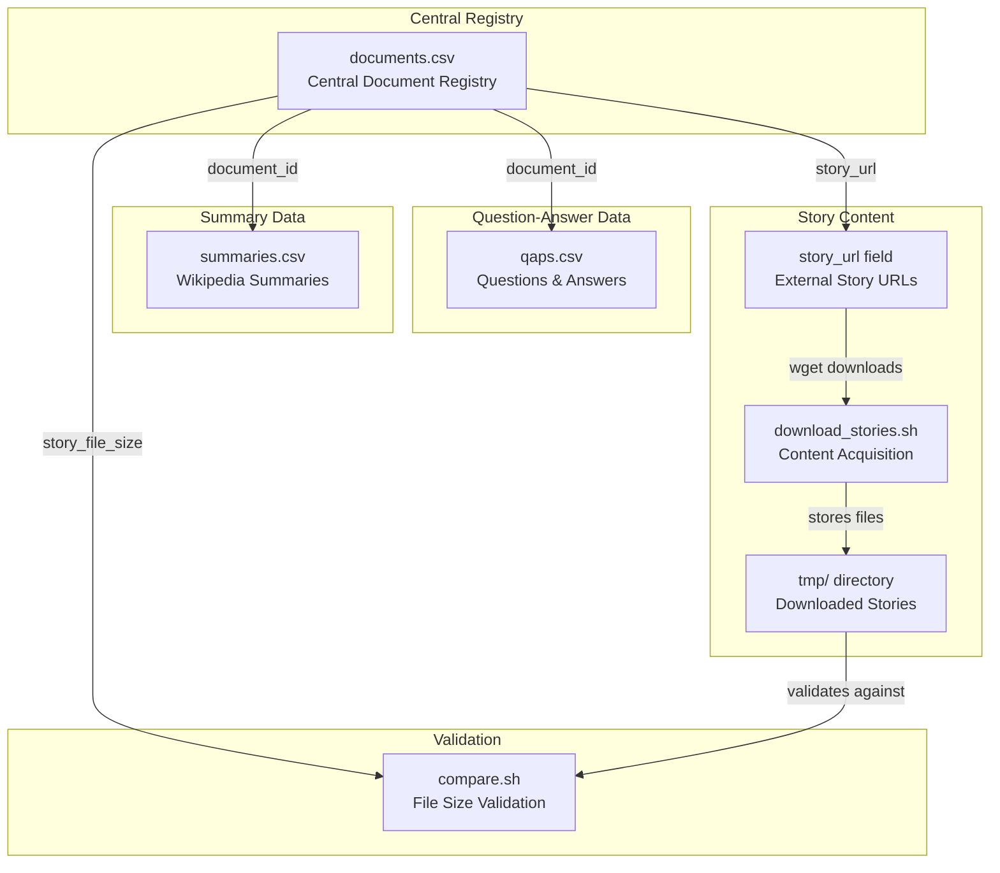
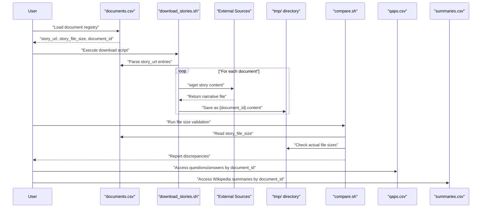
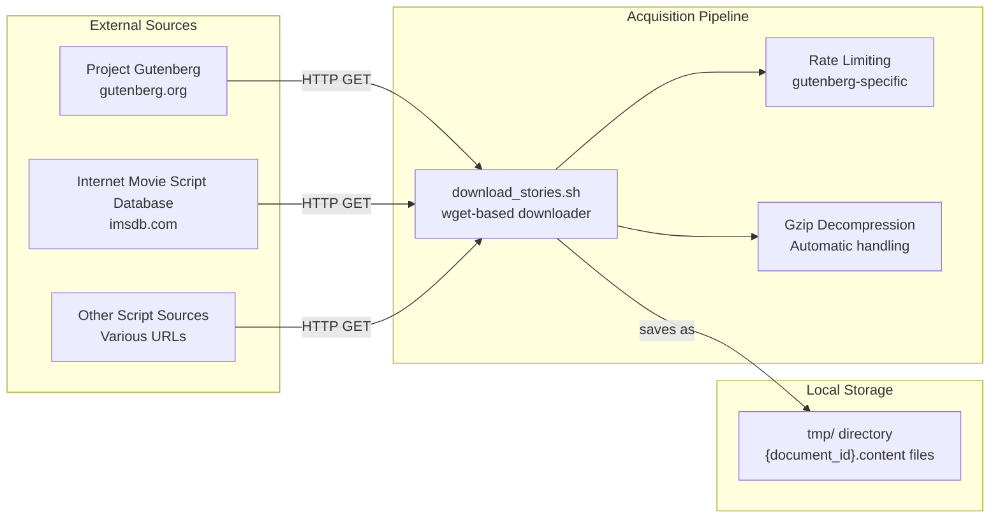

<!-- source: DeepWiki mcp.deepwiki.com · repo google-deepmind/narrativeqa · page 1 Overview · fetched 2026-10-26 -->

# Overview

Relevant source files

The following files were used as context for generating this wiki page:

- [README.md](README.md)
- [documents.csv](documents.csv)

## Purpose and Scope

The NarrativeQA Reading Comprehension Challenge Dataset is a research dataset designed for training and evaluating machine learning models on long-form narrative understanding. The system provides a comprehensive framework for reading comprehension tasks that span full-length stories, including novels, movie scripts, and other narrative content, paired with questions and answers derived from both the complete narratives and Wikipedia summaries.

This document covers the overall system architecture, data flow, and key components of the dataset repository. For detailed information about individual data files and their schemas, see [Dataset Reference](#3). For step-by-step setup instructions, see [Getting Started](#2). For legal and licensing requirements, see [Legal and Licensing](#5).

## System Architecture

The NarrativeQA system follows a hub-and-spoke architecture with `documents.csv` serving as the central registry that links all dataset components through `document_id` identifiers.

**Sources:** [documents.csv:1-1548](), [README.md:15-21]()

## Data Flow and Processing Pipeline

The system operates through a sequential data acquisition and validation pipeline that transforms external narrative content into a structured research dataset.

**Sources:** [download_stories.sh:1](), [compare.sh:1](), [documents.csv:1](), [qaps.csv:1](), [third_party/wikipedia/summaries.csv:1]()

## Core Components

### Document Registry (`documents.csv`)

The central registry containing metadata for all narrative documents in the dataset. Each record includes:

| Field | Purpose |
|-------|---------|
| `document_id` | Unique identifier linking all dataset components |
| `set` | Dataset partition (`train`, `valid`, `test`) |
| `kind` | Source type (`gutenberg`, `movie`) |
| `story_url` | External URL for full narrative content |
| `story_file_size` | Expected file size for validation |
| `wiki_url` | Wikipedia article URL |
| `story_word_count` | Approximate word count after tokenization |

**Sources:** [documents.csv:1](), [README.md:15-17]()

### Content Acquisition System

The `download_stories.sh` script implements a robust content acquisition pipeline with rate limiting and error handling for external story sources including Project Gutenberg and movie script databases.

**Sources:** [download_stories.sh:1](), [documents.csv:3-4]()

### Validation Framework

The `compare.sh` utility validates data integrity by comparing downloaded file sizes against expected values stored in `documents.csv`.

**Sources:** [compare.sh:1](), [README.md:23-25]()

## Dataset Partitioning

The dataset implements a three-way split across all components using the `set` field:

| Partition | Purpose | Access Pattern |
|-----------|---------|----------------|
| `train` | Model training | Bulk access to all components |
| `valid` | Hyperparameter tuning | Periodic evaluation access |
| `test` | Final evaluation | Single-use evaluation access |

Each partition maintains consistent `document_id` linking across `documents.csv`, `qaps.csv`, and `summaries.csv`.

**Sources:** [documents.csv:1](), [qaps.csv:1](), [third_party/wikipedia/summaries.csv:1]()

## Research Applications

The system supports reading comprehension research through two primary evaluation modes:

1. **Full Story Comprehension**: Questions answered using complete narrative content from `tmp/` directory
2. **Summary-based Comprehension**: Questions answered using Wikipedia summaries from `summaries.csv`

Both modes use identical question-answer pairs from `qaps.csv`, enabling comparative analysis of model performance on different input lengths and content types.

**Sources:** [README.md:7-10](), [qaps.csv:1](), [third_party/wikipedia/summaries.csv:1]()

---

