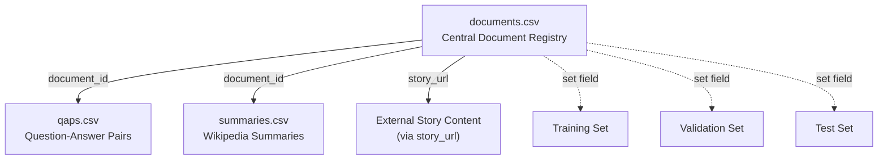
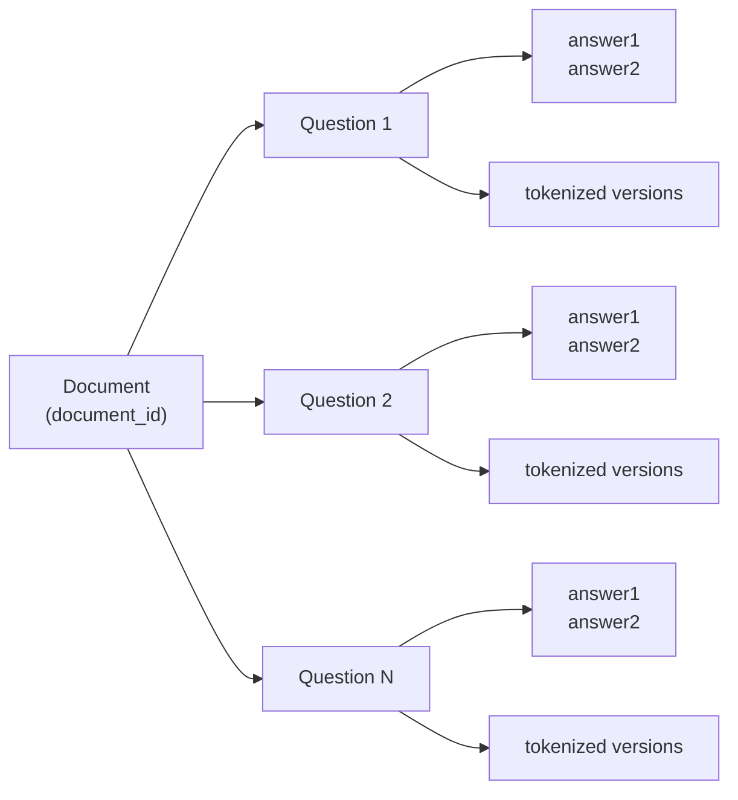
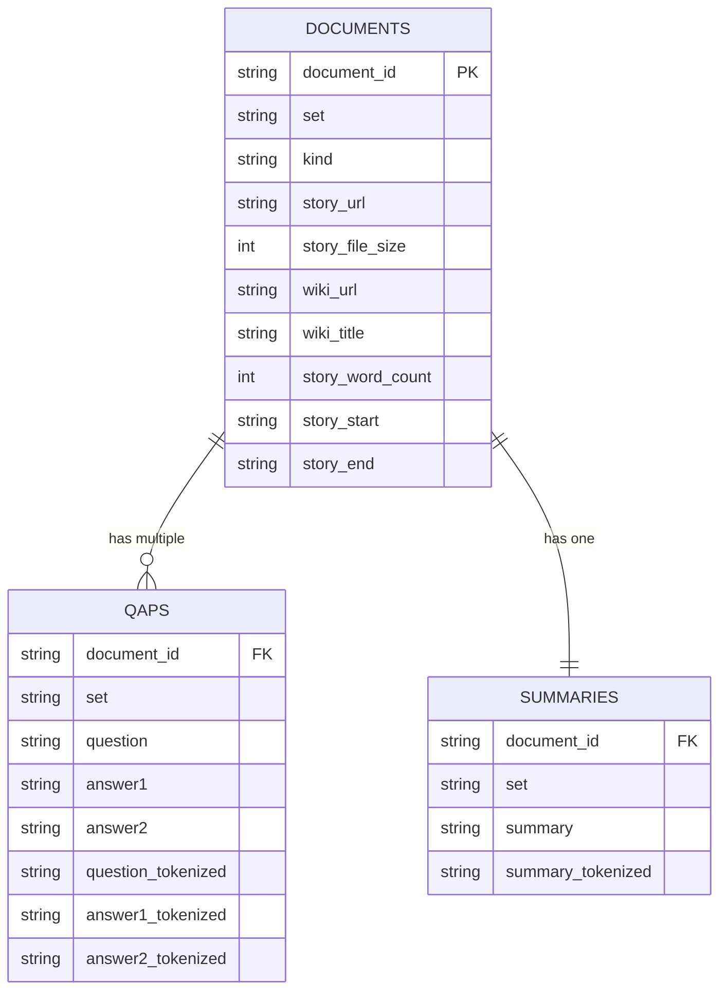
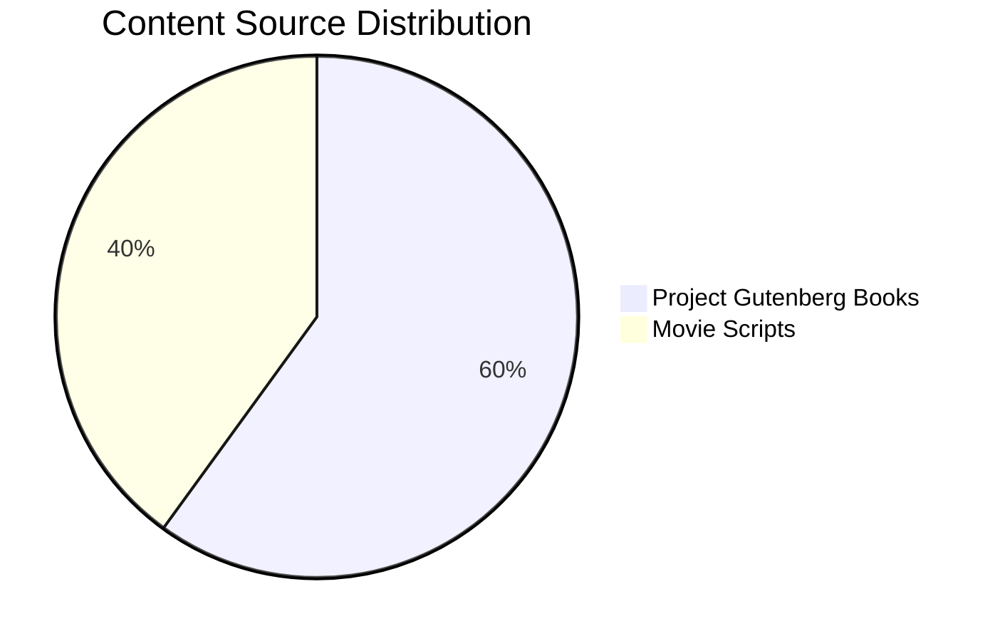

<!-- source: DeepWiki mcp.deepwiki.com · repo google-deepmind/narrativeqa · page 1.1 Dataset Components · fetched 2026-10-26 -->

# Dataset Components

Relevant source files

The following files were used as context for generating this wiki page:

- [documents.csv](documents.csv)
- [qaps.csv](qaps.csv)
- [third_party/wikipedia/summaries.csv](third_party/wikipedia/summaries.csv)

This document provides a comprehensive overview of the core data files that comprise the NarrativeQA Reading Comprehension Challenge Dataset and how they interconnect to form a complete machine learning dataset. For information about downloading and validating the content referenced by these files, see [Getting Started](#2).

The NarrativeQA dataset consists of three primary CSV files that work together to provide questions, answers, and contextual information for long-form narrative texts. Each component serves a specific purpose in enabling reading comprehension tasks on full-length stories and movie scripts.

## Core Data File Structure

The dataset is built around three interconnected CSV files that share a common `document_id` linking mechanism:

**Dataset File Relationships**

Sources: [documents.csv:1-2](), [qaps.csv:1-2](), [third_party/wikipedia/summaries.csv:1-2]()

## Document Registry (documents.csv)

The central registry serves as the authoritative source for all document metadata and external content references. Each row represents a unique narrative document with the following key fields:

| Field | Purpose | Example Values |
|-------|---------|----------------|
| `document_id` | Unique SHA-1 hash identifier | `0025577043f5090cd603c6aea60f26e236195594` |
| `set` | Dataset split assignment | `train`, `valid`, `test` |
| `kind` | Source type classification | `movie`, `gutenberg` |
| `story_url` | External content location | `http://www.gutenberg.org/ebooks/21572.txt.utf-8` |
| `story_file_size` | Expected download size in bytes | `814507` |
| `wiki_url` | Wikipedia article URL | `http://en.wikipedia.org/wiki/Percival_Keene` |
| `story_word_count` | Full narrative word count | `173334` |

The registry contains **1,572 total documents** distributed across content sources and dataset splits, with each document uniquely identified by a SHA-1 hash of its content.

Sources: [documents.csv:1-10]()

## Question-Answer Pairs (qaps.csv)

The question-answer component provides the core supervised learning data, with multiple questions per document and dual answer formulations:

**Question-Answer Structure per Document**

Each question entry includes:
- **Raw text versions**: `question`, `answer1`, `answer2`
- **Tokenized versions**: `question_tokenized`, `answer1_tokenized`, `answer2_tokenized`
- **Dataset split consistency**: `set` field matches the parent document

The dual answer approach (`answer1` and `answer2`) provides alternative formulations of the same factual information, supporting robust evaluation metrics.

Sources: [qaps.csv:1-10]()

## Wikipedia Summaries (summaries.csv)

The Wikipedia component provides condensed narrative summaries that serve as intermediate-length context between full stories and question-answer pairs:

| Field | Content Type | Processing |
|-------|--------------|------------|
| `summary` | Raw Wikipedia article text | Direct extraction from Wikipedia articles |
| `summary_tokenized` | Processed text | Tokenized using consistent methodology |

These summaries typically range from several hundred to a few thousand words, providing a middle ground between the full narrative content (often 50,000+ words) and the brief question-answer pairs.

Sources: [third_party/wikipedia/summaries.csv:1-6]()

## Data Linkage and Integrity

The dataset maintains referential integrity through the `document_id` field, which serves as a foreign key across all three files:

**Entity Relationship Structure**

The `set` field in all three files ensures consistent train/validation/test splits across the entire dataset, preventing data leakage between evaluation phases.

Sources: [documents.csv:1-2](), [qaps.csv:1-2](), [third_party/wikipedia/summaries.csv:1-2]()

## Content Type Distribution

The dataset encompasses two primary narrative source types, each with distinct characteristics:

**Source Type Characteristics**

- **Gutenberg content** (`kind=gutenberg`): Classic literature and historical texts, typically longer narratives
- **Movie scripts** (`kind=movie`): Contemporary screenplays from various film databases, structured dialogue format

This dual-source approach provides diversity in narrative style, length, and complexity for comprehensive reading comprehension evaluation.

Sources: [documents.csv:3-7]()

---

