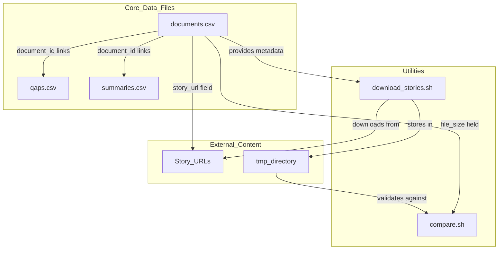
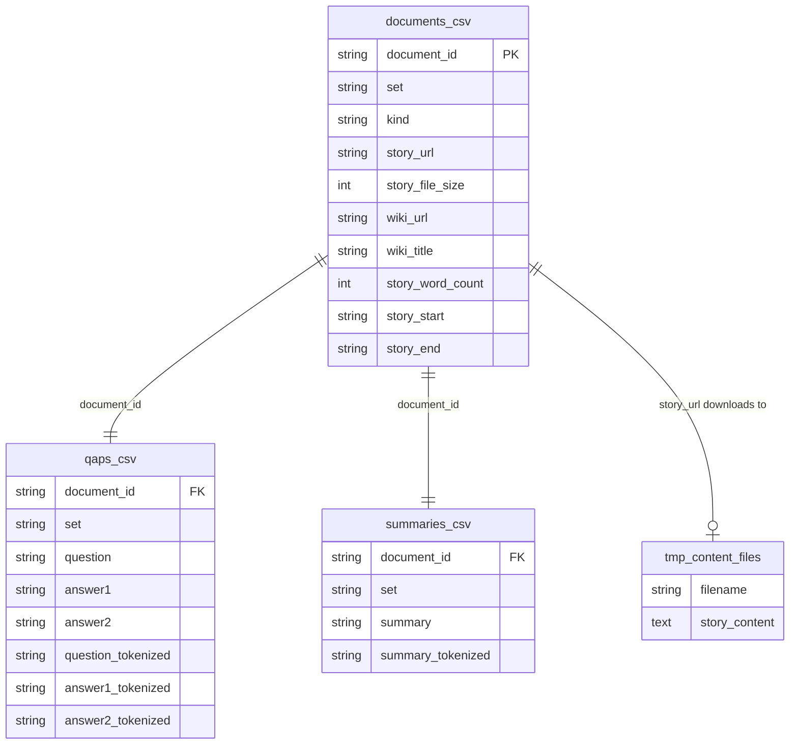
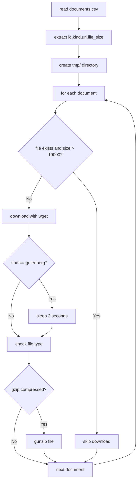

<!-- source: DeepWiki mcp.deepwiki.com · repo google-deepmind/narrativeqa · page 2 Getting Started · fetched 2026-10-26 -->

# Getting Started

<details>
<summary>Relevant source files</summary>

The following files were used as context for generating this wiki page:

- [README.md](README.md)
- [download_stories.sh](download_stories.sh)

</details>


This page provides step-by-step instructions for setting up and using the NarrativeQA Reading Comprehension Challenge Dataset. It covers the essential workflow from initial repository access through data acquisition and basic usage patterns.

For detailed instructions on the download process, see [Downloading Story Content](#2.1). For data validation procedures, see [Validating Data Integrity](#2.2). For complete data file specifications, see [Dataset Reference](#3).

## Prerequisites

The NarrativeQA dataset requires a Unix-like environment with the following tools:

| Tool | Purpose | Required For |
|------|---------|--------------|
| `bash` | Script execution | Running `download_stories.sh` |
| `wget` | Content download | Fetching stories from external URLs |
| `gunzip` | Decompression | Handling gzipped content |
| `file` | Type detection | Identifying compressed files |

Approximately 2GB of disk space is needed for the complete downloaded story content in the `tmp/` directory.

Sources: [download_stories.sh:1-50](), [README.md:22-25]()

## Dataset Overview

The NarrativeQA dataset consists of three core data files that work together to provide reading comprehension challenges:



**Core Data Flow Between CSV Files**

Sources: [README.md:15-21](), [documents.csv structure referenced]

## Quick Start Workflow

### Step 1: Repository Access

Clone or download the repository to access the three core CSV files:
- `documents.csv` - Document metadata and story URLs
- `qaps.csv` - Question-answer pairs 
- `third_party/wikipedia/summaries.csv` - Wikipedia summaries

### Step 2: Download Story Content

Execute the download script to acquire full story text:

```bash
./download_stories.sh
```

This script reads `documents.csv`, extracts story URLs, and downloads content to `tmp/{document_id}.content` files.

### Step 3: Validate Downloads

Verify download integrity using the validation script:

```bash
./compare.sh
```

This compares downloaded file sizes against expected sizes in `documents.csv`.

Sources: [README.md:22-25](), [download_stories.sh:16-49]()

## Data Structure and Relationships

The dataset uses `document_id` as the primary key linking all components:



**Dataset Partitioning**

All files use a `set` field with three values:
- `train` - Training data
- `valid` - Validation data  
- `test` - Test data

Sources: [README.md:15-21](), [documents.csv field structure]

## Download Process Details

The `download_stories.sh` script implements the following logic:



**Key Implementation Details:**
- Files stored as `tmp/{document_id}.content` [download_stories.sh:26]()
- Rate limiting for Gutenberg sources [download_stories.sh:37-39]()
- Automatic gzip decompression [download_stories.sh:42-48]()
- Minimum file size threshold of 19,000 bytes [download_stories.sh:35]()

Sources: [download_stories.sh:18-49]()

## Basic Usage Patterns

### Loading Documents

Read the document registry to understand available content:

```bash
# View document metadata structure
head -n 5 documents.csv

# Count documents by type
cut -d',' -f3 documents.csv | sort | uniq -c
```

### Accessing Questions and Answers

The `qaps.csv` file contains both raw and tokenized versions:

```bash
# View question-answer structure  
head -n 3 qaps.csv

# Filter by dataset split
grep ",train," qaps.csv | head -n 5
```

### Working with Downloaded Stories

After running `download_stories.sh`, story content is available in the `tmp/` directory:

```bash
# Check download status
ls tmp/ | wc -l

# View story content for specific document
cat tmp/23jncj2n3.content | head -n 20
```

Sources: [README.md:15-21](), [download_stories.sh:26]()

## Next Steps

Once you have completed the basic setup:

1. **Download Story Content**: Follow the detailed guide in [Downloading Story Content](#2.1) for advanced download options and troubleshooting
2. **Validate Data Integrity**: Use [Validating Data Integrity](#2.2) to ensure your downloads are complete and correct
3. **Explore Data Structure**: Review [Dataset Reference](#3) for complete schema documentation
4. **Understand Licensing**: Check [Legal and Licensing](#5) for usage requirements

The dataset is now ready for use in reading comprehension and question-answering research applications.

Sources: [README.md:1-41](), [table of contents structure]

---

