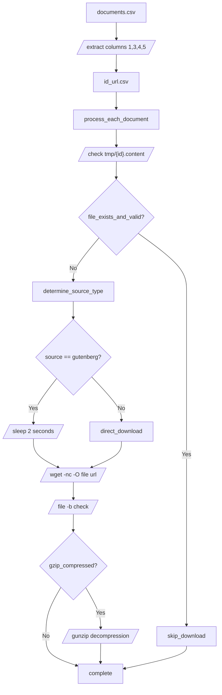
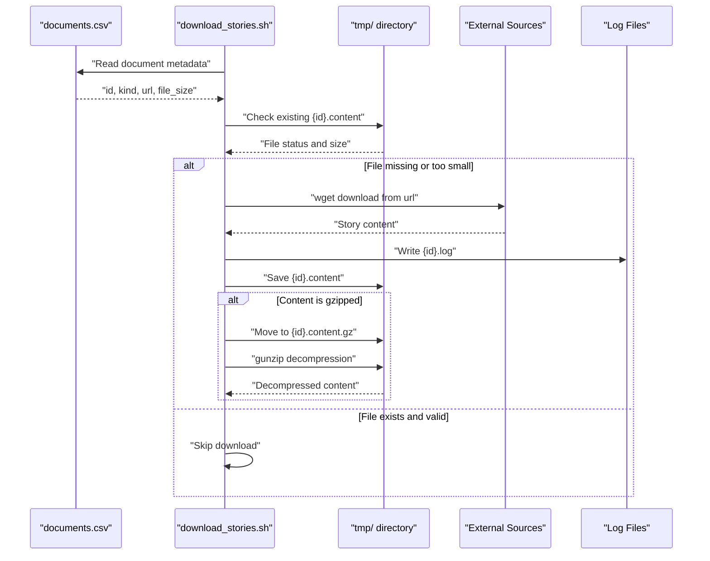
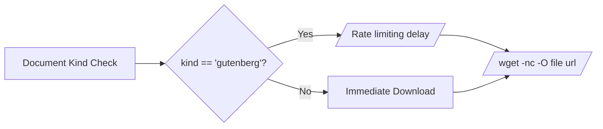
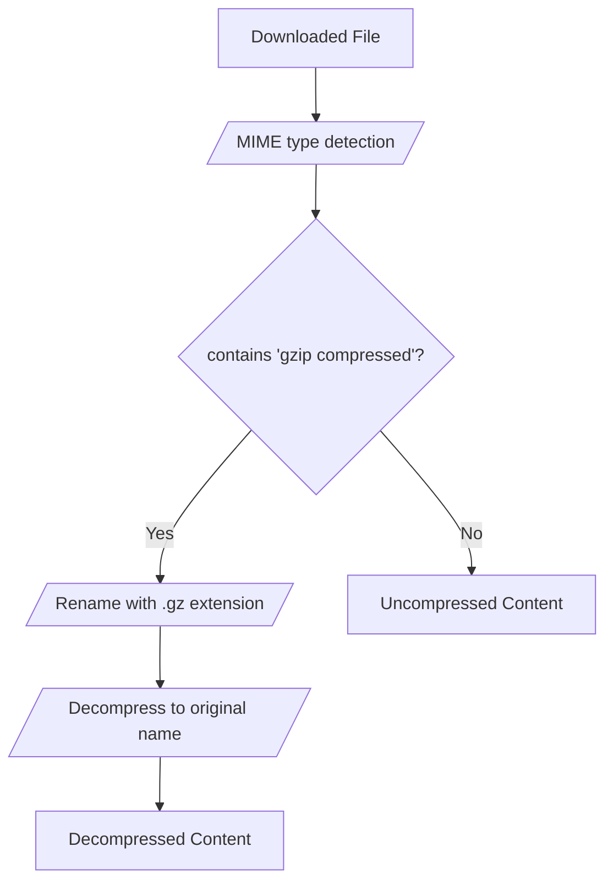
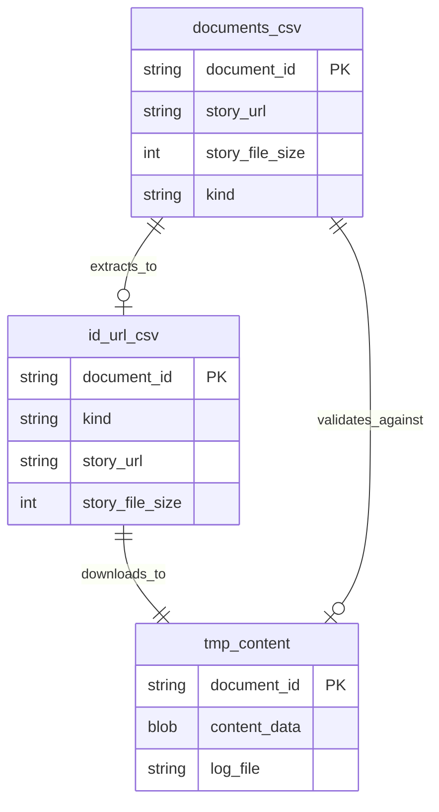

<!-- source: DeepWiki mcp.deepwiki.com · repo google-deepmind/narrativeqa · page 2.1 Downloading Story Content · fetched 2026-10-26 -->

# Downloading Story Content

<details>
<summary>Relevant source files</summary>

The following files were used as context for generating this wiki page:

- [documents.csv](documents.csv)
- [download_stories.sh](download_stories.sh)

</details>


This page provides comprehensive documentation for acquiring the full story content referenced in the NarrativeQA dataset. The download process transforms URL references in the document registry into locally stored story files that can be used for reading comprehension tasks.

For information about validating downloaded content, see [Validating Data Integrity](#2.2). For details about the document registry structure, see [Document Registry (documents.csv)](#3.1).

## Purpose and Scope

The story download system retrieves the complete narrative content from external sources referenced in `documents.csv`. This process is essential because the core dataset files contain only metadata and question-answer pairs—the actual story content must be downloaded separately from various online repositories including Project Gutenberg, movie script databases, and other public sources.

The download system handles diverse content sources with different access requirements, file formats, and rate limiting needs while maintaining data integrity through size validation and error logging.

Sources: [download_stories.sh:16-17](), [documents.csv:1-10]()

## Download Process Overview

The download process follows a structured workflow that reads document metadata, validates existing downloads, and retrieves missing or incomplete content while respecting source-specific requirements.

### Download Workflow



Sources: [download_stories.sh:21](), [download_stories.sh:24-49]()

### File Processing Pipeline



Sources: [download_stories.sh:24-31](), [download_stories.sh:35-48]()

## Technical Implementation

### Metadata Extraction

The script begins by extracting essential columns from `documents.csv` to create a streamlined processing file:

The extraction process uses standard Unix tools to create `id_url.csv` containing only the necessary fields for download operations:

```bash
cat ${base}/documents.csv | cut -d',' -f 1,3,4,5 | tail -n 1572 > ${base}/id_url.csv
```

This creates a working file with columns: `document_id`, `kind`, `story_url`, `story_file_size`.

Sources: [download_stories.sh:21]()

### Download Logic and Validation

The core download loop implements several validation and retry mechanisms:

| Validation Type | Threshold | Action |
|-----------------|-----------|---------|
| File existence | N/A | Download if missing |
| File size | ≤ 19,000 bytes | Re-download if too small |
| Content type | gzip detection | Auto-decompress if compressed |

The size threshold of 19,000 bytes serves as a minimum viable content size, ensuring that downloads contain substantial story content rather than error pages or incomplete transfers.

Sources: [download_stories.sh:28-41]()

### Source-Specific Handling

Different content sources require specialized handling approaches:

#### Project Gutenberg Rate Limiting



Project Gutenberg downloads include a 2-second delay to respect the service's rate limiting requirements and avoid overwhelming their servers.

Sources: [download_stories.sh:37-39]()

#### Compression Detection and Handling

The script automatically detects and handles gzipped content:



This handling is particularly important for Project Gutenberg texts, which are often served in compressed format to reduce bandwidth usage.

Sources: [download_stories.sh:43-48]()

## File Organization

### Directory Structure

The download system creates and manages files in a structured hierarchy:

```
repository/
├── documents.csv          # Source metadata
├── download_stories.sh    # Download script
├── tmp/                   # Download destination
│   ├── {id}.content      # Story content files
│   ├── {id}.log          # Download logs
│   └── id_url.csv        # Extracted metadata
```

### Naming Conventions

| File Type | Pattern | Example | Purpose |
|-----------|---------|---------|---------|
| Story Content | `{document_id}.content` | `0025577043f5090cd603c6aea60f26e236195594.content` | Main story text |
| Download Logs | `{document_id}.log` | `0025577043f5090cd603c6aea60f26e236195594.log` | wget output and errors |
| Working Data | `id_url.csv` | `id_url.csv` | Extracted metadata for processing |

The document ID serves as a unique identifier linking the downloaded content back to entries in `documents.csv` and corresponding questions in `qaps.csv`.

Sources: [download_stories.sh:20](), [download_stories.sh:26](), [download_stories.sh:40]()

## Error Handling and Logging

### Download Logging

Each download operation generates a detailed log file capturing wget output and error conditions:

```bash
wget -nc -O $file -o ${base}/tmp/${id}.log "$url"
```

The `-o` flag redirects wget's output to individual log files, enabling post-download analysis of any issues or failures.

### File Validation Strategy

The script implements a multi-layered validation approach:

1. **Existence Check**: Verifies file presence before attempting download
2. **Size Validation**: Ensures downloaded files exceed minimum size threshold
3. **Type Detection**: Identifies and handles compressed content automatically
4. **Retry Logic**: Re-downloads files that fail validation criteria

This strategy ensures robust handling of network issues, incomplete transfers, and format variations across different content sources.

Sources: [download_stories.sh:27-31](), [download_stories.sh:35-36](), [download_stories.sh:40]()

## Integration with Dataset Components

### Relationship to Document Registry



The download system serves as the bridge between URL references in the document registry and the actual story content required for reading comprehension tasks.

Sources: [documents.csv:1-10](), [download_stories.sh:21](), [download_stories.sh:26]()

---

