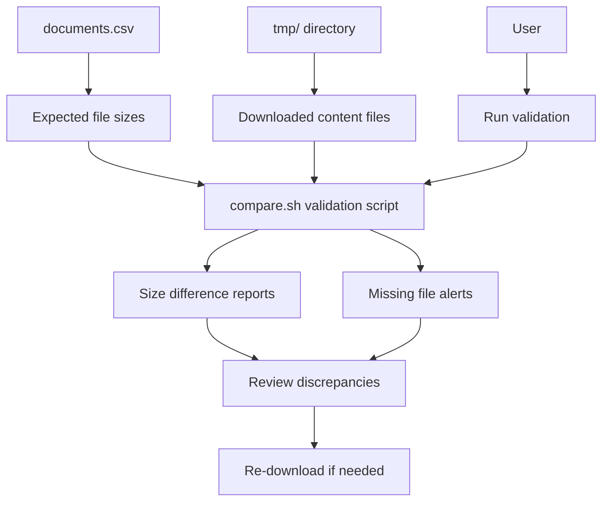
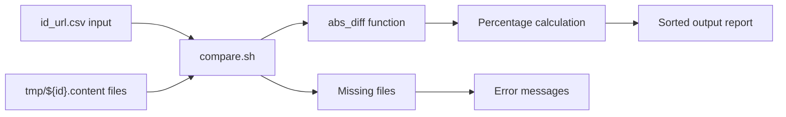
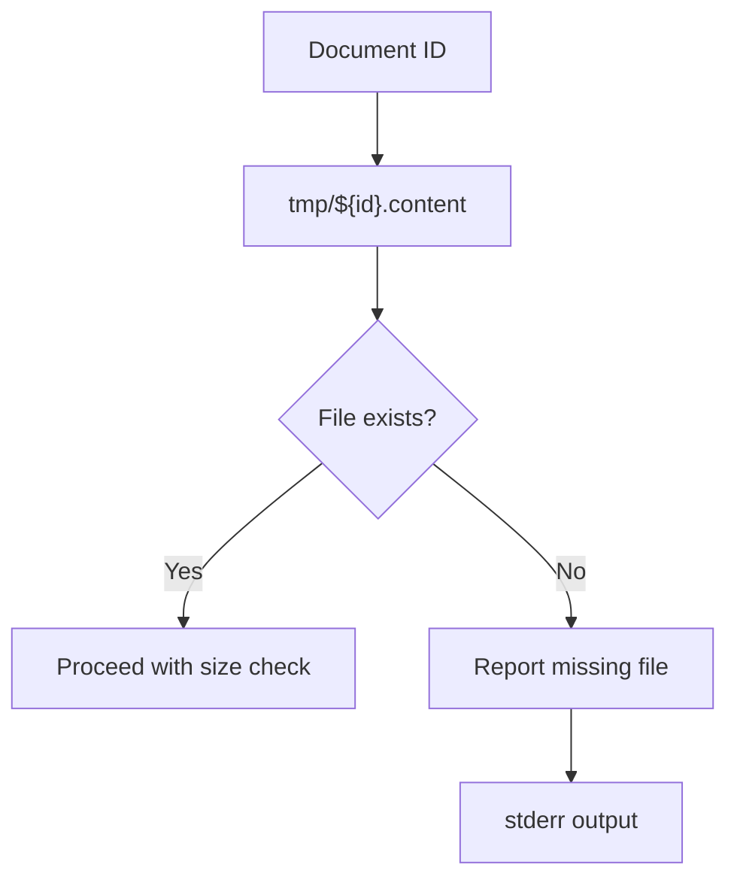

<!-- source: DeepWiki mcp.deepwiki.com · repo google-deepmind/narrativeqa · page 2.2 Validating Data Integrity · fetched 2026-10-26 -->

# Validating Data Integrity

<details>
<summary>Relevant source files</summary>

The following files were used as context for generating this wiki page:

- [compare.sh](compare.sh)
- [documents.csv](documents.csv)

</details>


This document explains how to verify that downloaded story content matches expected file sizes and is complete. Data integrity validation ensures that files downloaded using the story download process have been retrieved correctly and completely from external sources.

For information about downloading story content, see [Downloading Story Content](#2.1). For technical details about the validation script implementation, see [Validation Script (compare.sh)](#4.2).

## Validation Process Overview

The NarrativeQA dataset includes integrity validation to detect incomplete downloads, network interruptions, or content changes at source URLs. The validation process compares actual downloaded file sizes against expected sizes stored in the document registry.



**Validation Workflow**

Sources: [compare.sh:1-44](), [documents.csv:1-1551]()

## File Size Validation

The primary validation mechanism compares downloaded file sizes with expected sizes from the document registry. Each document entry includes a `story_file_size` field representing the expected size in bytes.

### Validation Script Usage

The validation script `compare.sh` performs automated size comparison:

```bash
./compare.sh
```

The script processes files by:
1. Reading document metadata from CSV format
2. Checking for corresponding downloaded files in `tmp/` directory  
3. Calculating size differences between expected and actual files
4. Reporting discrepancies above zero bytes



**Script Processing Flow**

Sources: [compare.sh:26-43]()

### Understanding Validation Output

The validation script produces output in this format:

```
size_diff_percent: PERCENT_DIFF ID DIFF SIZE_DOWNLOADED SIZE
```

Where:
- `PERCENT_DIFF`: Percentage difference between expected and actual size
- `ID`: Document identifier from the registry
- `DIFF`: Absolute size difference in bytes  
- `SIZE_DOWNLOADED`: Actual downloaded file size
- `SIZE`: Expected file size from registry

Results are sorted numerically by percentage difference, showing the most significant discrepancies first.

Sources: [compare.sh:26,41-42]()

## Validation Components

### File Existence Checking

The script first verifies that expected files exist in the download directory:



**File Existence Validation**

Missing files generate error messages to stderr, allowing users to identify incomplete downloads that require re-processing.

Sources: [compare.sh:29-33]()

### Size Difference Calculation

The `abs_diff` function calculates absolute differences between file sizes:

| Operation | Purpose |
|-----------|---------|
| `$1 - $2` | Calculate raw difference |
| Negative check | Handle cases where downloaded > expected |
| Absolute value | Ensure positive difference for reporting |

The percentage calculation uses `bc` for floating-point arithmetic: `absdiff / size2 * 100`

Sources: [compare.sh:18-24,39-41]()

## Common Validation Issues

### Size Discrepancies

Size differences can indicate:

- **Partial downloads**: Network interruptions during retrieval
- **Content changes**: Source material modified since registry creation  
- **Encoding differences**: Character encoding variations affecting byte counts
- **Compression handling**: Gzip decompression issues in download process

### Missing Files

Files may be missing due to:

- **Download failures**: Network errors or invalid URLs
- **Rate limiting**: Exceeded request limits for external sources
- **File system issues**: Insufficient disk space or permissions

Sources: [compare.sh:30-32]()

## Manual Validation Methods

### Direct Size Comparison

Users can manually verify individual files:

```bash
# Check actual file size
wc -c < tmp/DOCUMENT_ID.content

# Compare with expected size from documents.csv
grep DOCUMENT_ID documents.csv | cut -d, -f5
```

### Batch Validation

For custom validation scenarios, users can extract file size data:

```bash
# Extract all expected sizes
cut -d, -f1,5 documents.csv > expected_sizes.txt

# Generate actual sizes
for f in tmp/*.content; do
    id=$(basename "$f" .content)
    size=$(wc -c < "$f")
    echo "$id,$size"
done > actual_sizes.txt
```

Sources: [documents.csv:1](), [compare.sh:36-38]()

## Integration with Download Process

Validation should be performed after completing the download process documented in [Downloading Story Content](#2.1). The validation process relies on:

- Proper CSV formatting in the document registry
- Consistent file naming in the `tmp/` directory  
- Accurate `story_file_size` values in the metadata

Regular validation helps maintain dataset quality and identifies issues requiring attention before using the dataset for research purposes.

Sources: [compare.sh:28-29](), [documents.csv:1]()

---

