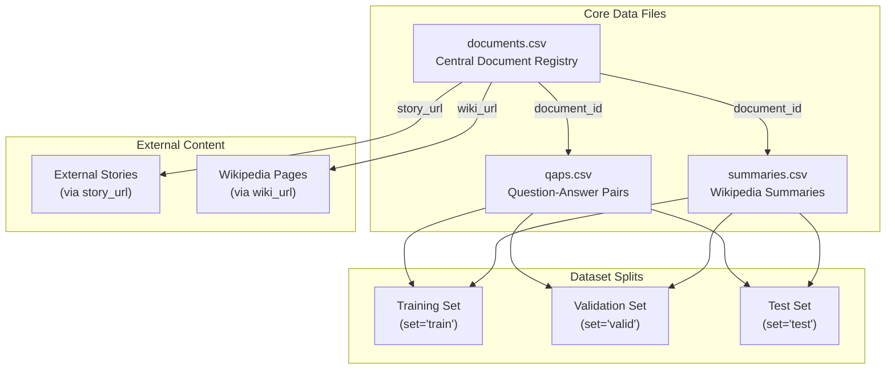
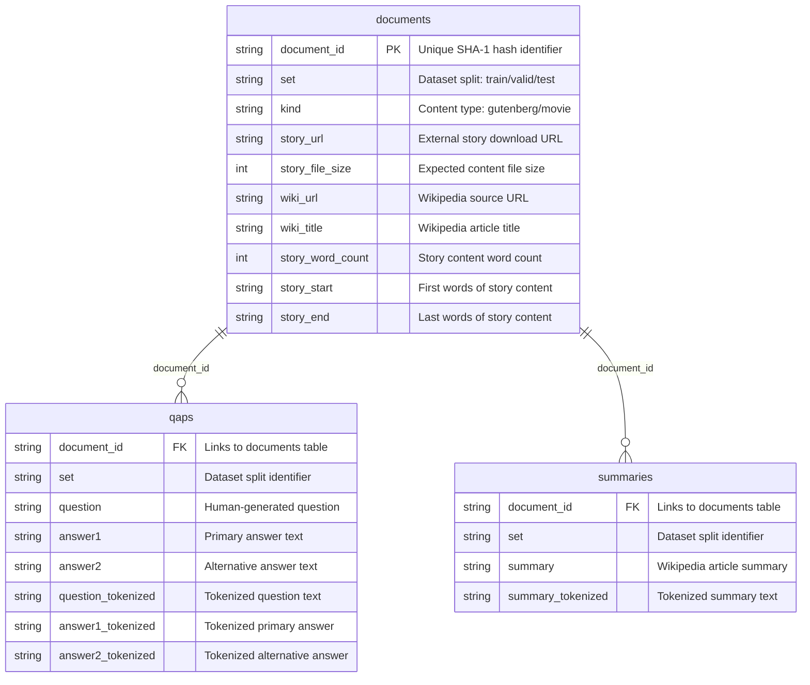
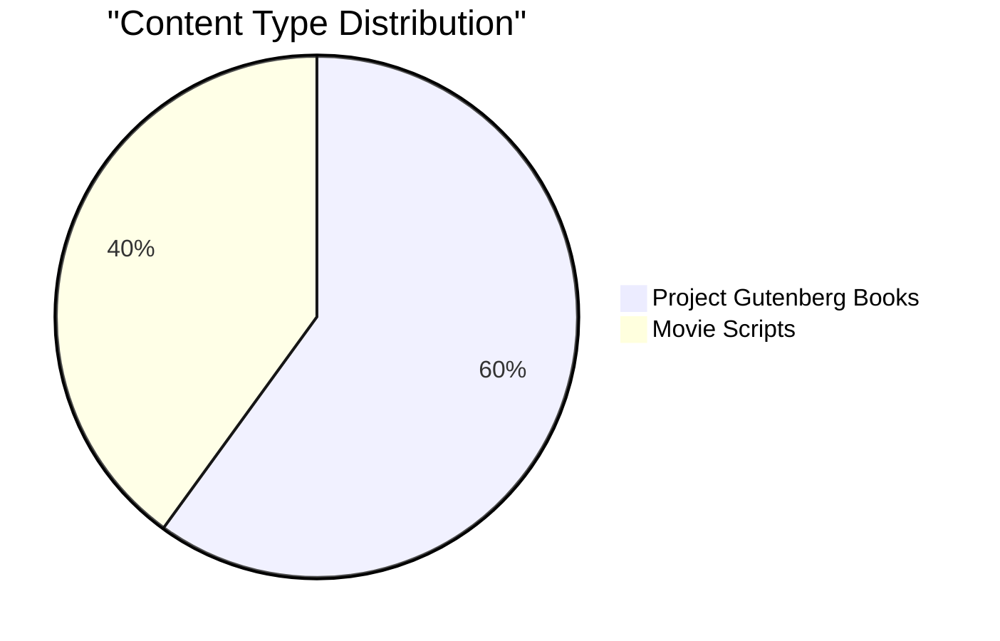

<!-- source: DeepWiki mcp.deepwiki.com · repo google-deepmind/narrativeqa · page 3 Dataset Reference · fetched 2026-10-26 -->

# Dataset Reference

Relevant source files

The following files were used as context for generating this wiki page:

- [documents.csv](documents.csv)
- [qaps.csv](qaps.csv)
- [third_party/wikipedia/summaries.csv](third_party/wikipedia/summaries.csv)

This document provides comprehensive documentation of all data files in the NarrativeQA Reading Comprehension Challenge Dataset, including their schemas, relationships, and data structure. This reference covers the three core CSV files that form the complete dataset.

For information about downloading and setting up the dataset, see [Getting Started](#2). For details about the utility scripts, see [Utilities and Tools](#4).

## Dataset Architecture Overview

The NarrativeQA dataset follows a hub-and-spoke architecture with `documents.csv` serving as the central registry that links all components together through a common `document_id` field.

Sources: [documents.csv:1-1](), [qaps.csv:1-1](), [third_party/wikipedia/summaries.csv:1-1]()

## Data Linking Schema

The relationship between the three core data files is established through primary and foreign key relationships, with additional metadata fields providing content validation and categorization.

Sources: [documents.csv:1-300](), [qaps.csv:1-300](), [third_party/wikipedia/summaries.csv:1-60]()

## Field Specifications and Data Types

| Field | Data Type | Length | Nullable | Description |
|-------|-----------|--------|----------|-------------|
| `document_id` | String (SHA-1) | 40 chars | No | Primary key across all files |
| `set` | Enum | 5-6 chars | No | Values: 'train', 'valid', 'test' |
| `kind` | Enum | 9-10 chars | No | Values: 'gutenberg', 'movie' |
| `story_url` | URL | Variable | No | HTTP/HTTPS external content link |
| `story_file_size` | Integer | Variable | No | Expected download size in bytes |
| `wiki_url` | URL | Variable | No | Wikipedia article URL |
| `wiki_title` | String | Variable | No | Human-readable Wikipedia title |
| `story_word_count` | Integer | Variable | No | Total words in story content |
| `story_start` | String | Variable | No | Content validation prefix |
| `story_end` | String | Variable | No | Content validation suffix |
| `question` | Text | Variable | No | Natural language question |
| `answer1` | Text | Variable | No | Primary answer response |
| `answer2` | Text | Variable | No | Alternative answer response |
| `*_tokenized` | Text | Variable | No | Space-separated tokenized version |
| `summary` | Text | Variable | No | Wikipedia article summary text |

Sources: [documents.csv:1-300](), [qaps.csv:1-300](), [third_party/wikipedia/summaries.csv:1-60]()

## Content Type Distribution

The dataset contains two primary content types identified by the `kind` field in `documents.csv`:

- **gutenberg**: Public domain literature from Project Gutenberg
- **movie**: Film screenplays from various online script databases

Sources: [documents.csv:3-300]()

## Dataset Split Statistics

The dataset is partitioned into three splits using the `set` field across all data files:

| Split | Purpose | Approximate Size |
|-------|---------|------------------|
| `train` | Model training | ~70% of total data |
| `valid` | Hyperparameter tuning | ~15% of total data |
| `test` | Final evaluation | ~15% of total data |

The same `document_id` values appear in corresponding rows across all three CSV files, ensuring consistent splits.

Sources: [documents.csv:2-300](), [qaps.csv:2-300](), [third_party/wikipedia/summaries.csv:2-60]()

## Data Validation Fields

The `documents.csv` file includes several fields specifically designed for content validation:

- `story_file_size`: Expected size in bytes for downloaded content validation
- `story_word_count`: Total word count for content completeness verification  
- `story_start`: First few words to verify correct content beginning
- `story_end`: Last few words to verify correct content ending

These fields work in conjunction with the validation utilities documented in [Validation Script (compare.sh)](#4.2).

Sources: [documents.csv:1-10]()

## Tokenization Schema

All text fields containing natural language have corresponding `*_tokenized` versions that follow a consistent tokenization scheme:

- Space-separated tokens
- Punctuation separated from words
- Contractions split (e.g., "don't" → "do n't")
- Consistent handling of special characters

Example from `qaps.csv`:
- `question`: "Who is Mark Hunter?"
- `question_tokenized`: "Who is Mark Hunter ?"

Sources: [qaps.csv:2-10](), [third_party/wikipedia/summaries.csv:2-10]()

---

