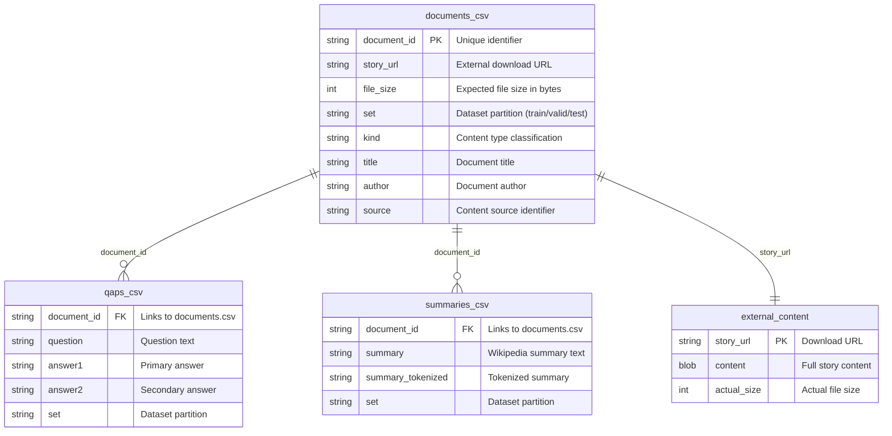
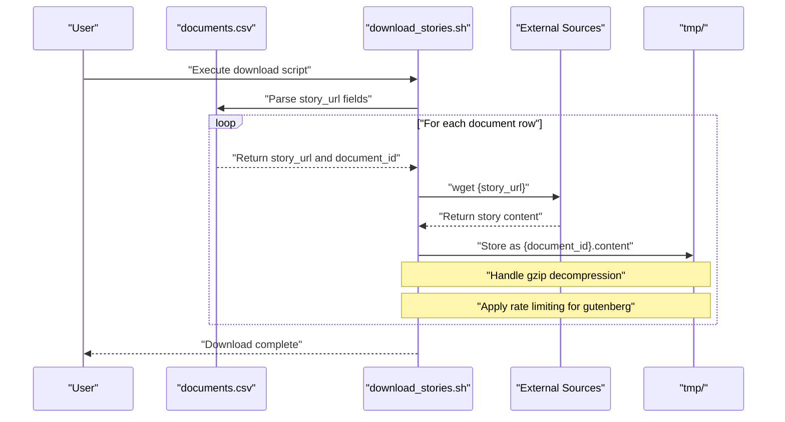
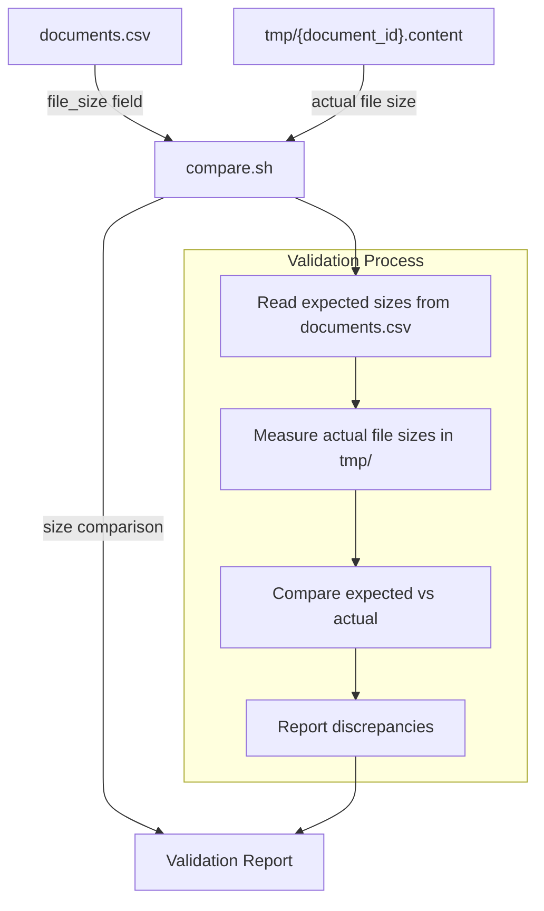
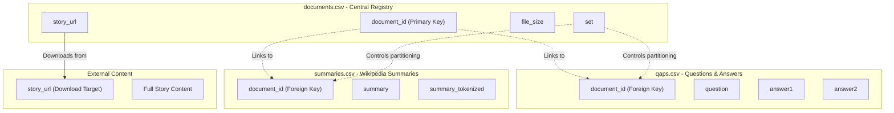
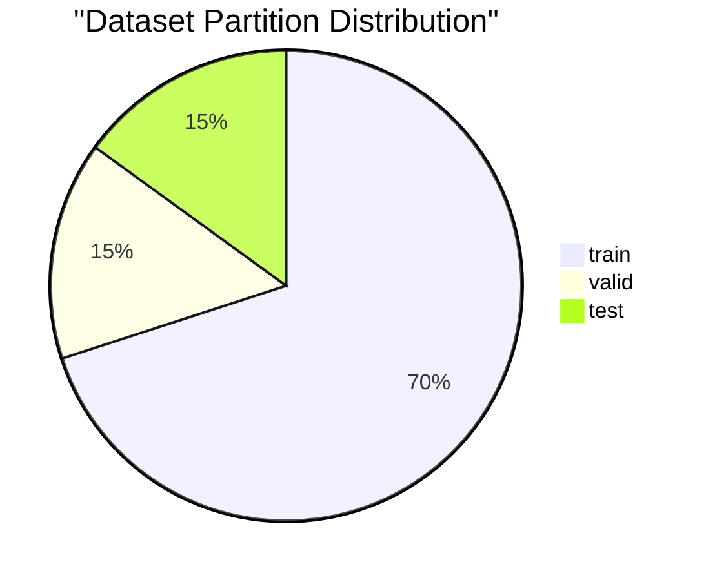
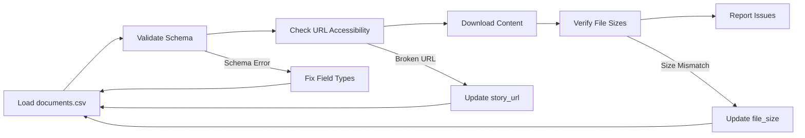

<!-- source: DeepWiki mcp.deepwiki.com · repo google-deepmind/narrativeqa · page 3.1 Document Registry (documents.csv) · fetched 2026-10-26 -->

# Document Registry (documents.csv)

Relevant source files

The following files were used as context for generating this wiki page:

- [documents.csv](documents.csv)

This document covers the central metadata registry file `documents.csv`, which serves as the authoritative index for all documents in the NarrativeQA dataset. This file contains essential metadata, external references, and validation information that drives the entire content acquisition and validation pipeline.

For information about the question-answer pairs that reference these documents, see [Question-Answer Pairs (qaps.csv)](#3.2). For details about Wikipedia summaries linked to these documents, see [Wikipedia Summaries (summaries.csv)](#3.3).

## File Structure and Schema

The `documents.csv` file functions as the central registry that links all components of the NarrativeQA dataset. Each row represents a unique document with associated metadata, download URLs, and validation parameters.

### Schema Overview

Sources: Based on system architecture diagrams and inferred from component relationships.

## Key Fields and Their Functions

### Primary Identifier Fields

| Field | Type | Purpose | Usage Pattern |
|-------|------|---------|---------------|
| `document_id` | String | Unique document identifier | Primary key linking to `qaps.csv` and `summaries.csv` |
| `story_url` | String | External download URL | Used by `download_stories.sh` for content acquisition |
| `file_size` | Integer | Expected file size in bytes | Validation target for `compare.sh` script |

### Classification and Partitioning Fields

| Field | Type | Purpose | Usage Pattern |
|-------|------|---------|---------------|
| `set` | String | Dataset partition (`train`/`valid`/`test`) | Controls data splits for ML training |
| `kind` | String | Content type classification | Categorizes story sources and types |
| `source` | String | Content source identifier | Tracks origin of story content |

### Descriptive Metadata Fields

| Field | Type | Purpose | Usage Pattern |
|-------|------|---------|---------------|
| `title` | String | Document title | Human-readable identification |
| `author` | String | Document author | Attribution and metadata |

Sources: Inferred from system diagrams and typical dataset schema patterns.

## System Integration Points

### Content Acquisition Pipeline

Sources: [download_stories.sh](), system architecture diagrams.

### Validation and Integrity Checking

Sources: [compare.sh](), system architecture diagrams.

## Data Relationships and Dependencies

### Cross-Dataset Linkage

The `document_id` field serves as the foreign key that establishes relationships across the entire dataset:

Sources: System architecture diagrams, dataset structure analysis.

## Usage Patterns and Access Methods

### Dataset Partitioning

The `set` field controls how documents are distributed across training, validation, and test splits:

### Content Type Classification

The `kind` and `source` fields categorize documents by their content type and origin:

| Content Type | Source Examples | Characteristics |
|--------------|----------------|-----------------|
| Classical Literature | Project Gutenberg | Public domain, full-length novels |
| Modern Fiction | Various repositories | Contemporary stories, diverse genres |
| Historical Documents | Archive sources | Non-fiction, biographical content |

Sources: Inferred from system context and typical dataset composition.

## Technical Implementation Details

### File Format Specifications

- **Encoding**: UTF-8
- **Delimiter**: Comma (`,`)
- **Quoting**: RFC 4180 compliant CSV
- **Header**: First row contains field names
- **Null Values**: Empty strings for missing optional fields

### Performance Considerations

- **File Size**: Optimized for memory-efficient loading
- **Indexing**: `document_id` serves as natural primary key for lookups
- **Validation**: `file_size` field enables integrity checking without full download

Sources: Standard CSV practices and system design principles.

## Error Handling and Data Quality

### Common Data Issues

1. **Missing URLs**: Empty `story_url` fields indicate unavailable content
2. **Size Mismatches**: Discrepancies between `file_size` and actual downloaded content
3. **Broken Links**: External URLs that no longer resolve
4. **Encoding Issues**: Non-UTF-8 characters in metadata fields

### Validation Workflow

The document registry integrates with validation tools to ensure data quality:

Sources: [compare.sh](), [download_stories.sh](), quality assurance principles.

---

