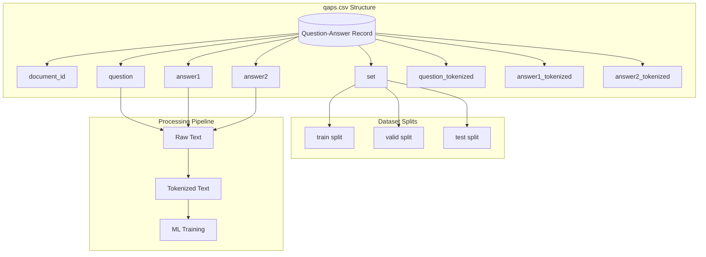
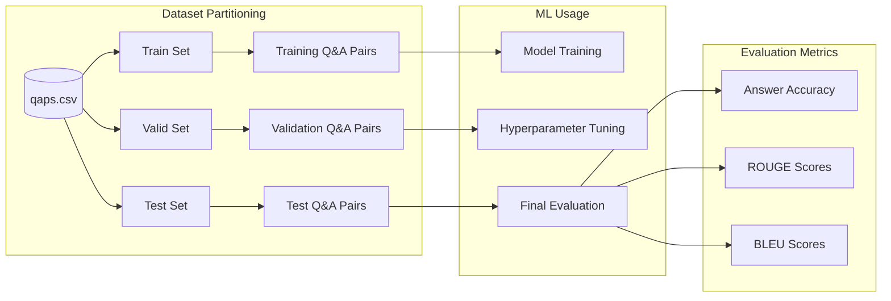
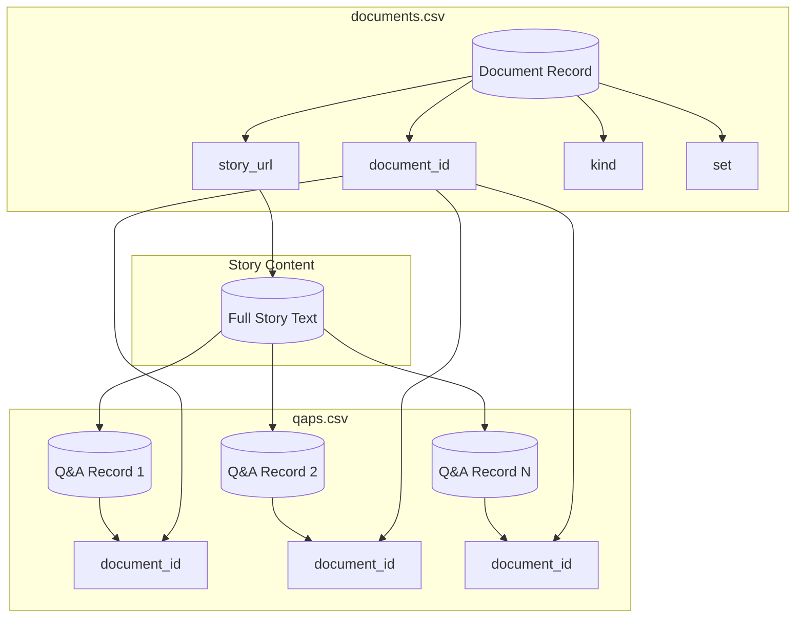
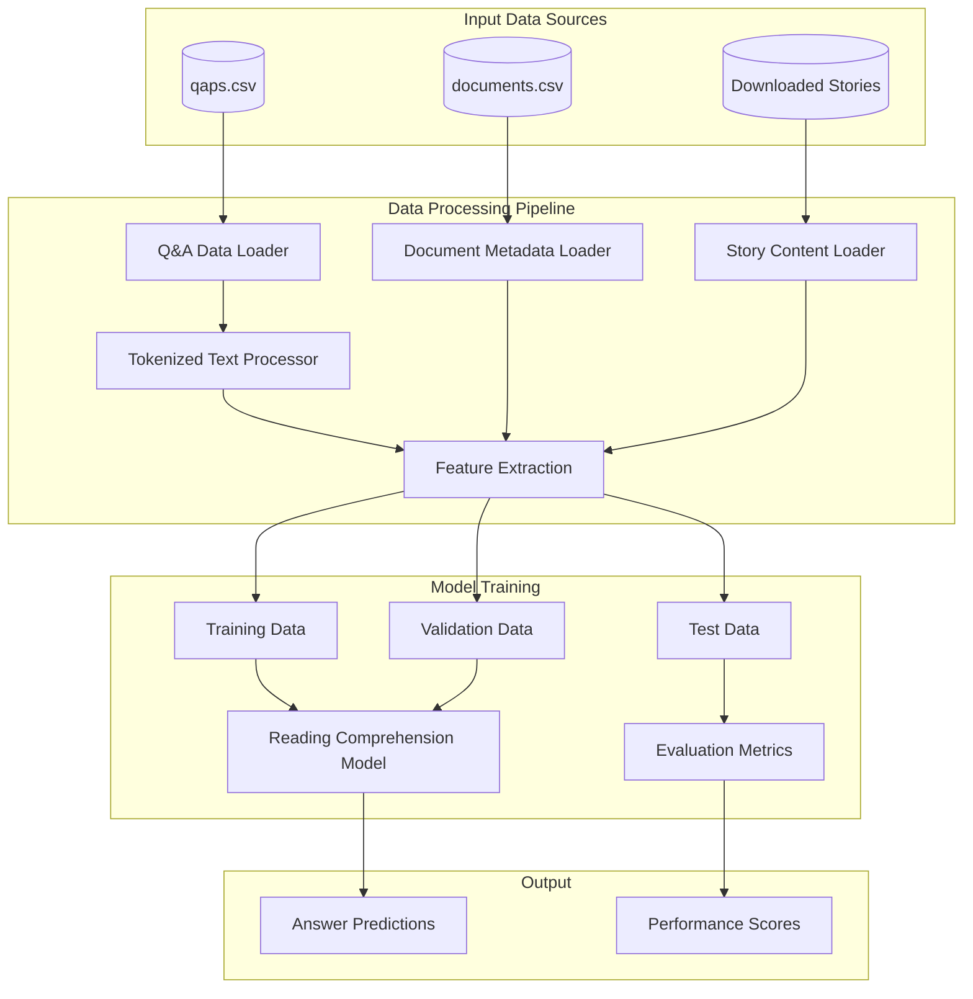

<!-- source: DeepWiki mcp.deepwiki.com · repo google-deepmind/narrativeqa · page 3.2 Question-Answer Pairs (qaps.csv) · fetched 2026-10-26 -->

# Question-Answer Pairs (qaps.csv)

Relevant source files

The following files were used as context for generating this wiki page:

- [qaps.csv](qaps.csv)

This page documents the question-answer pairs dataset file, which contains the core reading comprehension challenge data for the NarrativeQA dataset. This file provides questions about narrative content along with human-generated answers, organized into training, validation, and test splits for machine learning applications.

For information about the document metadata that these questions reference, see [Document Registry (documents.csv)](#3.1). For details about the Wikipedia summary content, see [Wikipedia Summaries (summaries.csv)](#3.3).

## File Structure and Schema

The `qaps.csv` file contains 8 columns with both raw text and tokenized versions of questions and answers:

| Column | Type | Description |
|--------|------|-------------|
| `document_id` | String | Foreign key linking to documents.csv |
| `set` | String | Dataset split: "train", "valid", or "test" |
| `question` | String | Raw question text about the narrative |
| `answer1` | String | First human-generated answer |
| `answer2` | String | Second human-generated answer |
| `question_tokenized` | String | Space-separated tokenized question |
| `answer1_tokenized` | String | Space-separated tokenized first answer |
| `answer2_tokenized` | String | Space-separated tokenized second answer |

Sources: [qaps.csv:1-1]()

## Question-Answer Data Schema

Sources: [qaps.csv:1-1000]()

## Data Characteristics

### Question Types
The questions in the dataset focus on narrative comprehension and cover various aspects of storytelling:

- **Character identification**: "Who is Mark Hunter?", "Who does Sophia elope with?"
- **Plot events**: "What happens when the radio show causes trouble?", "How does Percival escape?"
- **Setting and location**: "Where does this radio station take place?", "What year was the story set in?"
- **Causal relationships**: "Why does Minna pretend to be penniless?", "What caused Emily's mother to die?"

### Answer Variants
Each question includes two human-generated answers (`answer1` and `answer2`) that may vary in:
- **Level of detail**: "Malcolm." vs "Malcolm commits suicide."
- **Phrasing**: "Phoenix, Arizona" vs "Phoenix, Arizona."
- **Perspective**: "He is a high school student" vs "A loner and outsider student"

Sources: [qaps.csv:2-50]()

## Dataset Splits Distribution

Sources: [qaps.csv:1-1000]()

## Relationship to Document Registry

The `document_id` field creates a many-to-one relationship between questions and source documents:

Sources: [qaps.csv:1-50](), [documents.csv:1-1]()

## Tokenization Processing

The dataset includes both raw and tokenized versions of all text fields:

### Tokenization Examples
- **Raw**: "Who is Mark Hunter?"
- **Tokenized**: "Who is Mark Hunter ?"

- **Raw**: "Phoenix, Arizona"  
- **Tokenized**: "Phoenix , Arizona"

- **Raw**: "He's a captain"
- **Tokenized**: "He s a captain"

The tokenization process:
1. Separates punctuation with spaces
2. Splits contractions (e.g., "He's" → "He s")
3. Maintains word boundaries
4. Preserves sentence structure

Sources: [qaps.csv:2-10]()

## Machine Learning Pipeline Integration

Sources: [qaps.csv:1-1000]()

## Data Quality and Validation

### Multiple Answer Validation
The presence of `answer1` and `answer2` enables:
- **Inter-annotator agreement** measurement
- **Answer diversity** analysis  
- **Model robustness** testing against multiple valid responses

### Dataset Split Integrity
The `set` field ensures proper train/validation/test separation for:
- **Preventing data leakage** during model training
- **Reproducible evaluation** across different research efforts
- **Fair comparison** of model performance

### Document Linkage Validation
The `document_id` foreign key relationship ensures:
- **Referential integrity** with the document registry
- **Traceability** from questions back to source narratives
- **Consistent dataset splits** across related files

Sources: [qaps.csv:1-1000]()

## Usage Patterns

### Research Applications
1. **Reading Comprehension Models**: Training neural networks to answer questions about long-form narratives
2. **Question Generation**: Using existing Q&A pairs to train models that generate new questions
3. **Answer Evaluation**: Developing metrics to assess answer quality against human references

### Implementation Considerations
- Use `document_id` to join with document metadata and story content
- Leverage both raw and tokenized versions based on model requirements  
- Respect dataset splits to ensure valid experimental design
- Consider both answer variants when evaluating model performance

Sources: [qaps.csv:1-1000]()

---

