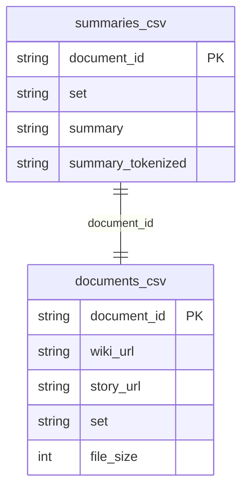
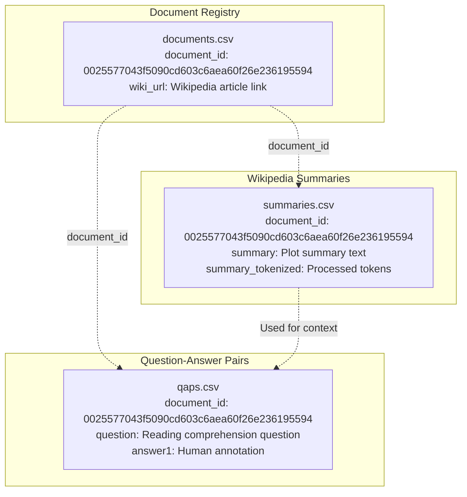
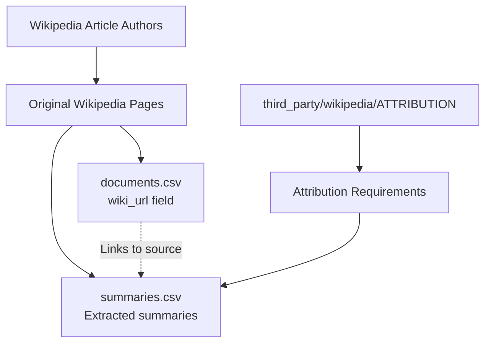
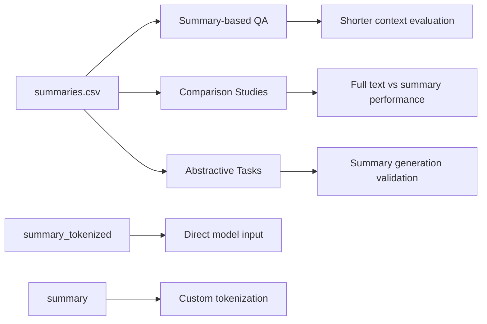

<!-- source: DeepWiki mcp.deepwiki.com · repo google-deepmind/narrativeqa · page 3.3 Wikipedia Summaries (summaries.csv) · fetched 2026-10-26 -->

# Wikipedia Summaries (summaries.csv)

<details>
<summary>Relevant source files</summary>

The following files were used as context for generating this wiki page:

- [third_party/wikipedia/ATTRIBUTION](third_party/wikipedia/ATTRIBUTION)
- [third_party/wikipedia/summaries.csv](third_party/wikipedia/summaries.csv)

</details>


This document covers the Wikipedia summary data file located at `third_party/wikipedia/summaries.csv`, which provides processed Wikipedia article summaries for each document in the NarrativeQA dataset. These summaries serve as alternative shorter texts for reading comprehension tasks when the full narrative content is not required.

For information about the main document registry that links to these summaries, see [Document Registry (documents.csv)](#3.1). For details about the question-answer pairs that reference these summaries, see [Question-Answer Pairs (qaps.csv)](#3.2).

## File Structure and Schema

The `summaries.csv` file contains processed Wikipedia summaries with both raw and tokenized versions for machine learning applications.

### CSV Schema

| Field | Type | Description |
|-------|------|-------------|
| `document_id` | String | Unique hexadecimal identifier linking to `documents.csv` |
| `set` | String | Dataset partition: `train`, `valid`, or `test` |
| `summary` | String | Raw Wikipedia summary text with original formatting |
| `summary_tokenized` | String | Space-tokenized version for NLP processing |

**Schema Visualization**



Sources: [third_party/wikipedia/summaries.csv:1-1]()

## Data Processing and Format

### Tokenization Strategy

The file provides two versions of each summary:
- **Raw text** (`summary`): Preserves original Wikipedia formatting, punctuation, and character encoding
- **Tokenized text** (`summary_tokenized`): Space-separated tokens with simplified punctuation handling

**Tokenization Example**

```mermaid
flowchart LR
    A["Raw: \"Mark Hunter (Slater), a high school student\""] --> B["Tokenized: \"Mark Hunter ( Slater ) , a high school student\""]
    
    C["Raw: \"can't\""] --> D["Tokenized: \"ca n't\""]
    
    E["Raw: \"don't\""] --> F["Tokenized: \"do n't\""]
```

Sources: [third_party/wikipedia/summaries.csv:2-10]()

### Content Characteristics

Wikipedia summaries in the dataset typically include:
- Plot summaries for films and books
- Character descriptions and relationships  
- Major story events and outcomes
- Production or publication context

The summaries vary significantly in length, from brief paragraph-length descriptions to multi-paragraph detailed plot summaries.

Sources: [third_party/wikipedia/summaries.csv:2-210]()

## Integration with Dataset Architecture

### Document Linking

Each summary links to the main document registry through the `document_id` field, establishing the relationship between Wikipedia content and full narrative sources.



Sources: [third_party/wikipedia/summaries.csv:1-1](), [third_party/wikipedia/ATTRIBUTION:2-2]()

### Dataset Partitioning

The `set` field maintains consistency with other dataset files for proper train/validation/test splits.

| Split | Purpose | Typical Usage |
|-------|---------|---------------|
| `train` | Model training | Learning to answer questions from summaries |
| `valid` | Hyperparameter tuning | Validation during training |
| `test` | Final evaluation | Performance assessment |

Sources: [third_party/wikipedia/summaries.csv:2-210]()

## Attribution and Licensing Requirements

### Wikipedia Content Attribution

Per the attribution requirements, all Wikipedia summaries maintain provenance to their original Wikipedia authors.



The original Wikipedia URLs are preserved in the `wiki_url` column of `documents.csv` to maintain proper attribution chains.

Sources: [third_party/wikipedia/ATTRIBUTION:1-3]()

### Licensing Compliance

Wikipedia-derived content is governed by Creative Commons Attribution-ShareAlike 3.0 license, separate from the main repository's Apache 2.0 license.

For complete licensing details, see [Wikipedia Content Licensing](#5.2).

Sources: [third_party/wikipedia/ATTRIBUTION:1-3]()

## Machine Learning Usage Patterns

### Reading Comprehension Applications

The processed summaries enable multiple types of reading comprehension research:



### Integration with Processing Pipelines

The dual format (raw + tokenized) supports different preprocessing approaches:
- **Pre-tokenized**: Direct use of `summary_tokenized` for models expecting space-separated tokens
- **Custom tokenization**: Processing `summary` field with domain-specific tokenizers
- **Comparative analysis**: Evaluating model performance on both full narratives and condensed summaries

Sources: [third_party/wikipedia/summaries.csv:1-4]()

---

