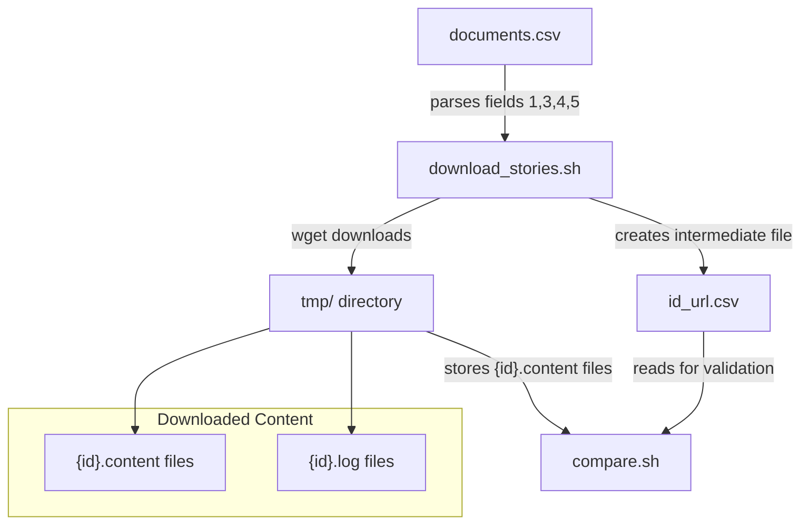
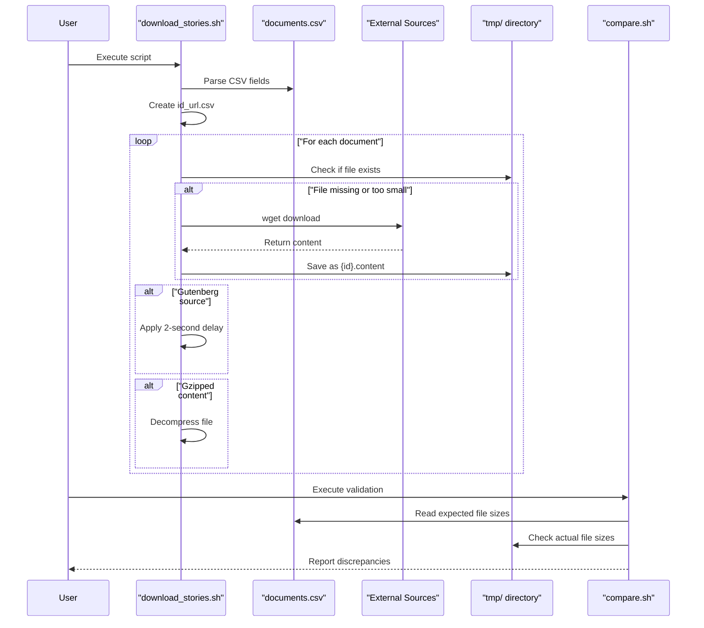
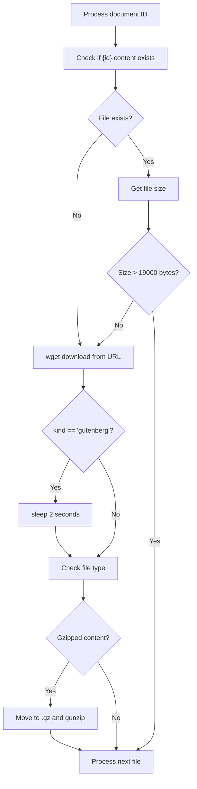
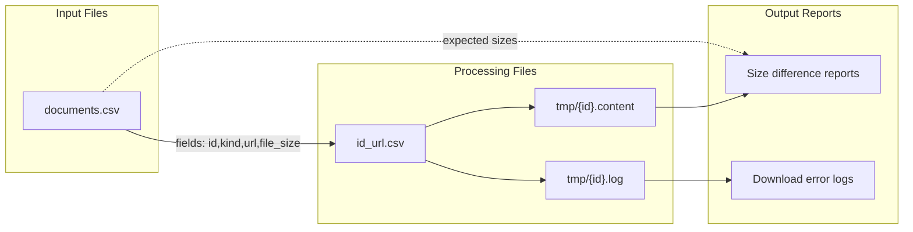

<!-- source: DeepWiki mcp.deepwiki.com · repo google-deepmind/narrativeqa · page 4 Utilities and Tools · fetched 2026-10-26 -->

# Utilities and Tools

Relevant source files

The following files were used as context for generating this wiki page:

- [compare.sh](compare.sh)
- [download_stories.sh](download_stories.sh)

This page documents the scripts and utilities provided for dataset management and validation in the NarrativeQA repository. These tools handle the acquisition of story content from external sources and verification of data integrity.

The utilities are designed to be run as standalone bash scripts and handle the operational aspects of working with the dataset. For detailed technical documentation of individual scripts, see [Content Download Script](#4.1) and [Validation Script](#4.2). For information about the data files these utilities work with, see [Dataset Reference](#3).

## Overview

The NarrativeQA repository provides two primary utility scripts for dataset management:

| Script | Purpose | Input | Output |
|--------|---------|-------|--------|
| `download_stories.sh` | Downloads story content from external URLs | `documents.csv` | Downloaded files in `tmp/` directory |
| `compare.sh` | Validates downloaded file sizes | `documents.csv`, `tmp/` files | Size difference reports |

## Utility Architecture

**Utility Data Flow Pipeline**

Sources: [download_stories.sh:20-21](), [download_stories.sh:26](), [compare.sh:29]()

## Script Execution Flow

**Typical Usage Sequence**

Sources: [download_stories.sh:24-49](), [compare.sh:28-43]()

## File Processing Logic

**Download Script Decision Tree**

Sources: [download_stories.sh:27-48]()

## Error Handling and Recovery

The utilities implement several error handling mechanisms:

### Download Script Recovery
- **File existence check**: Verifies files exist before processing [download_stories.sh:27-31]()
- **Size validation**: Re-downloads files smaller than 19,000 bytes [download_stories.sh:35]()
- **Rate limiting**: Applies 2-second delays for Project Gutenberg sources [download_stories.sh:37-39]()
- **Automatic decompression**: Detects and handles gzipped content [download_stories.sh:43-48]()

### Validation Script Output
- **Missing file detection**: Reports files that should exist but don't [compare.sh:30-33]()
- **Size difference calculation**: Computes absolute and percentage differences [compare.sh:39-42]()
- **Sorted reporting**: Orders results by percentage difference for easy review [compare.sh:43]()

## Data Dependencies

**Script Input/Output Relationships**

Sources: [download_stories.sh:21](), [download_stories.sh:26](), [download_stories.sh:40](), [compare.sh:28-43]()

## Operational Characteristics

### Performance Considerations
- **Sequential processing**: Downloads are processed one at a time to respect rate limits
- **Resume capability**: Script can be re-run safely, only downloading missing or incomplete files
- **Memory efficient**: Processes files individually without loading entire dataset into memory

### Resource Requirements
- **Network access**: Required for downloading external story content
- **Disk space**: Temporary storage needed for ~1,500+ story files
- **Processing time**: Variable depending on network speed and number of missing files

Sources: [download_stories.sh:24-49](), [compare.sh:28-43]()

---

