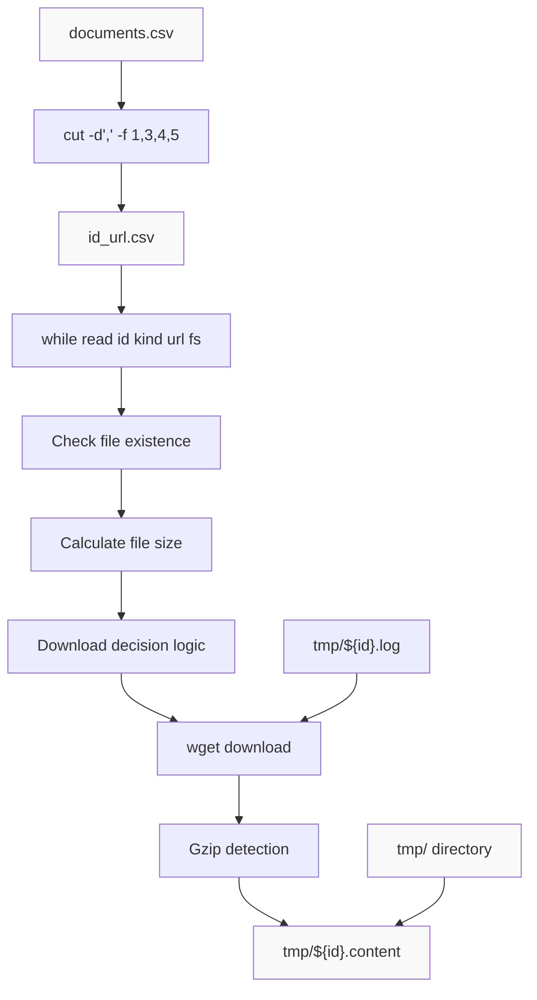
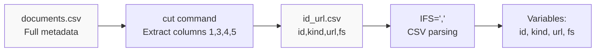
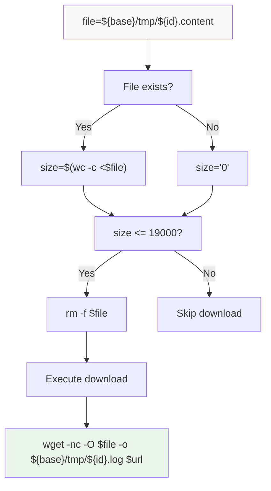
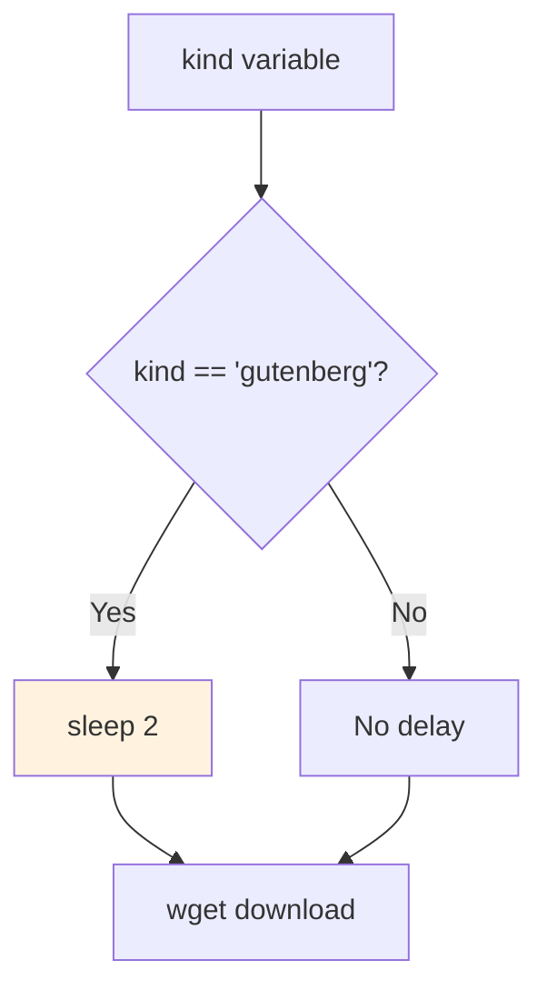
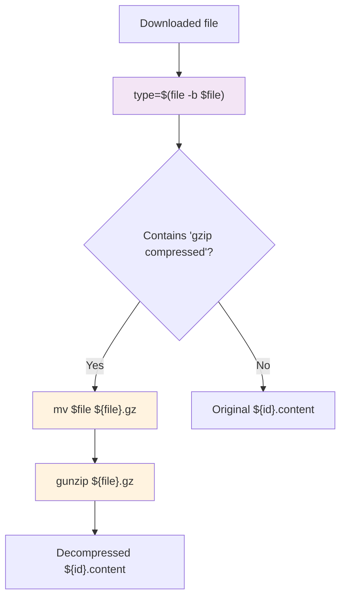

<!-- source: DeepWiki mcp.deepwiki.com · repo google-deepmind/narrativeqa · page 4.1 Content Download Script (download_stories.sh) · fetched 2026-10-26 -->

# Content Download Script (download_stories.sh)

Relevant source files

The following files were used as context for generating this wiki page:

- [download_stories.sh](download_stories.sh)

This document provides technical documentation for the story content download utility, covering its architecture, data processing pipeline, and operational patterns. The script serves as the primary mechanism for acquiring full-text story content from external sources referenced in the dataset.

For information about validating downloaded content integrity, see [Validation Script (compare.sh)](#4.2). For details about the document metadata structure that drives this script, see [Document Registry (documents.csv)](#3.1).

## Script Architecture

The `download_stories.sh` script implements a sequential download pipeline that processes document metadata to acquire story content from external URLs. The script operates as a standalone utility that transforms URL references into local content files.

### Core Processing Flow

**Sources:** [download_stories.sh:18-49]()

The script establishes a `tmp/` directory structure and processes document metadata to create individual content files named using the pattern `${id}.content`, where `id` corresponds to the document identifier from `documents.csv`.

### Data Extraction Pipeline

**Sources:** [download_stories.sh:21-24]()

The script extracts four specific columns from `documents.csv`: document ID (column 1), content type (column 3), source URL (column 4), and expected file size (column 5). The `tail -n 1572` command excludes the CSV header row.

## Download Logic and Decision Making

### File Existence and Size Validation

The script implements a robust download decision mechanism based on file existence and size thresholds:

**Sources:** [download_stories.sh:26-41]()

The 19,000-byte threshold serves as a minimum content size filter, ensuring that incomplete or failed downloads are retried. Files below this threshold are removed and re-downloaded.

### Rate Limiting for External Sources

**Sources:** [download_stories.sh:37-39]()

Project Gutenberg sources receive special handling with a 2-second delay between requests to comply with their rate limiting policies. This prevents the script from overwhelming external servers.

## File Format Processing

### Gzip Decompression Handler

The script automatically detects and processes compressed content:

**Sources:** [download_stories.sh:42-48]()

The `file` command determines content type, and gzip-compressed files are automatically renamed with a `.gz` extension and decompressed using `gunzip`. This ensures all final content files are in plain text format.

## File System Operations

### Directory Structure and Naming Conventions

| File Type | Location Pattern | Purpose |
|-----------|------------------|---------|
| Content files | `tmp/${id}.content` | Story text content |
| Download logs | `tmp/${id}.log` | wget operation logs |
| Metadata extract | `id_url.csv` | Processed document URLs |
| Source data | `documents.csv` | Original document registry |

**Sources:** [download_stories.sh:20-21,26,40]()

### Wget Configuration

The script uses specific `wget` parameters for reliable downloads:

- `-nc`: No-clobber mode prevents re-downloading existing files
- `-O $file`: Specifies output filename explicitly  
- `-o ${base}/tmp/${id}.log`: Redirects wget logs to individual log files
- `"$url"`: Downloads from the extracted URL

**Sources:** [download_stories.sh:40]()

## Error Handling and Recovery

The script implements several error recovery mechanisms:

1. **File size validation**: Files under 19,000 bytes trigger automatic re-download
2. **Existence checking**: Missing files are detected and downloaded
3. **Removal before retry**: Failed downloads are cleaned up using `rm -f "$file"`
4. **Compression handling**: Unexpected gzip compression is automatically resolved

**Sources:** [download_stories.sh:27-31,35-36,42-48]()

## Usage Patterns

### Typical Execution Sequence

1. Execute `./download_stories.sh` from repository root
2. Script creates `tmp/` directory if it doesn't exist
3. Processes all 1,572 documents from `documents.csv`
4. Downloads missing or incomplete content files
5. Decompresses any gzip-formatted downloads
6. Generates individual log files for troubleshooting

**Sources:** [download_stories.sh:20-21]()

### Integration with Dataset Workflow

The download script serves as a prerequisite for the complete dataset workflow. After execution, users typically run the validation script to verify download integrity before proceeding with machine learning applications.

**Sources:** [download_stories.sh:16]()

---

