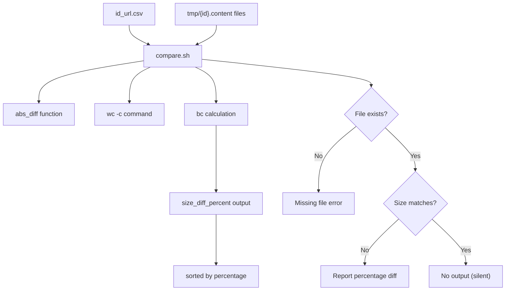
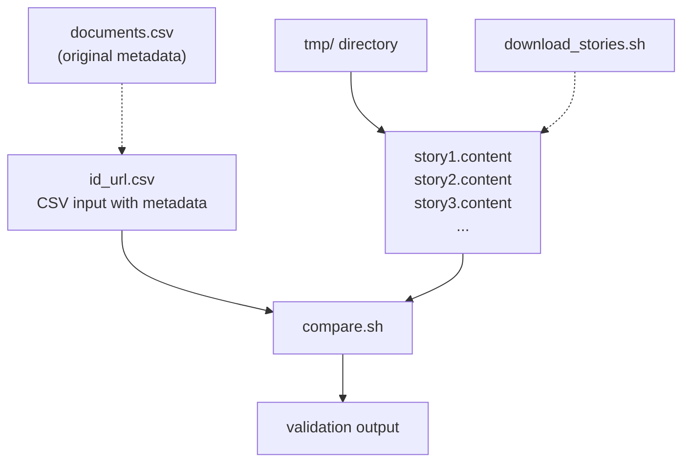
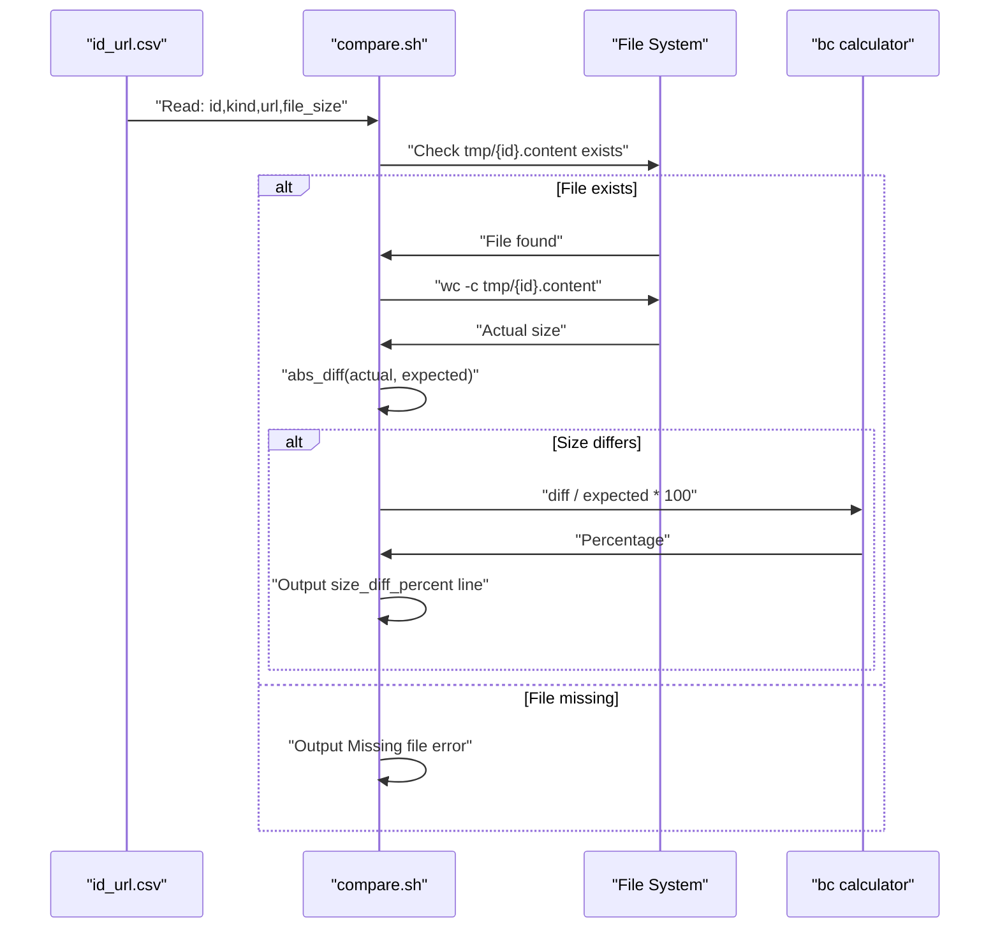
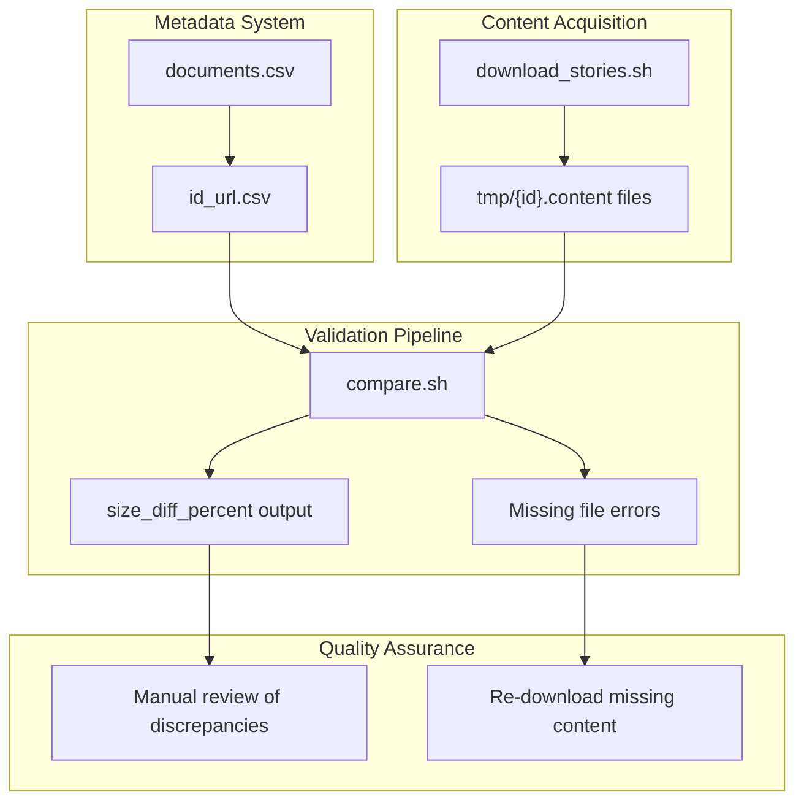

<!-- source: DeepWiki mcp.deepwiki.com · repo google-deepmind/narrativeqa · page 4.2 Validation Script (compare.sh) · fetched 2026-10-26 -->

# Validation Script (compare.sh)

<details>
<summary>Relevant source files</summary>

The following files were used as context for generating this wiki page:

- [compare.sh](compare.sh)

</details>


This document covers the file size validation utility that verifies the integrity of downloaded story content. The script compares actual downloaded file sizes against expected sizes to detect potential download issues, corruption, or incomplete transfers.

For information about downloading story content, see [Content Download Script (download_stories.sh)](#4.1). For details about the document metadata that drives validation, see [Document Registry (documents.csv)](#3.1).

## Purpose and Functionality

The `compare.sh` script serves as a quality assurance tool for the content acquisition pipeline. It validates that story files downloaded by `download_stories.sh` match their expected file sizes as recorded in the document metadata. This validation step is critical for ensuring data integrity before using the dataset for machine learning applications.

**Validation Workflow**



Sources: [compare.sh:1-44]()

## Input Requirements

The script expects two primary inputs:

### CSV Input Format
The script reads from `id_url.csv` with the following comma-separated structure:
- **Field 1**: Document ID (used to construct file path)
- **Field 2**: Document kind/type 
- **Field 3**: Source URL
- **Field 4**: Expected file size in bytes

### Downloaded Content Files
Downloaded story files must be present in the `tmp/` directory with the naming convention `{id}.content`, where `{id}` corresponds to the document ID from the CSV input.

**File System Layout**



Sources: [compare.sh:28-29](), [compare.sh:43]()

## Output Format and Interpretation

### Standard Output Format
The script produces output in the following format when size discrepancies are detected:

```
size_diff_percent: PERCENT_DIFF ID DIFF SIZE_DOWNLOADED SIZE
```

**Output Fields:**
- `PERCENT_DIFF`: Percentage difference between expected and actual size
- `ID`: Document identifier
- `DIFF`: Absolute difference in bytes  
- `SIZE_DOWNLOADED`: Actual downloaded file size in bytes
- `SIZE`: Expected file size from metadata

### Error Handling
Missing files generate error messages to stderr:
```
Missing file tmp/{id}.content
```

**Validation Logic Flow**



Sources: [compare.sh:30-42]()

## Technical Implementation

### Core Functions

#### `abs_diff` Function
The script implements absolute difference calculation in bash:

```bash
function abs_diff {
  res=$(($1 - $2));
  if [ $res -lt 0 ]; then
    res=$((-$res))
  fi
  echo $res
}
```

This function handles the mathematical operation needed to calculate size discrepancies regardless of whether files are larger or smaller than expected.

Sources: [compare.sh:18-24]()

#### File Size Comparison Logic
The main validation loop processes each CSV record and performs size validation:

1. **File Path Construction**: `tmp/${id}.content` [compare.sh:29]()
2. **Existence Check**: Verifies file presence [compare.sh:30-33]()
3. **Size Measurement**: Uses `wc -c` for byte count [compare.sh:36]()
4. **Difference Calculation**: Applies `abs_diff` function [compare.sh:39]()
5. **Percentage Calculation**: Uses `bc` for floating-point math [compare.sh:41]()

### Integration Points

**System Integration Architecture**



Sources: [compare.sh:28-43]()

## Usage Patterns

### Typical Workflow
1. **Post-Download Validation**: Run after `download_stories.sh` completes
2. **Batch Processing**: Processes all documents in single execution
3. **Error Detection**: Identifies incomplete or corrupted downloads
4. **Size Monitoring**: Tracks unexpected content variations

### Output Interpretation
- **No output**: All files match expected sizes (successful validation)
- **Percentage differences**: Indicate potential download issues
- **Missing file errors**: Files that failed to download or were deleted

The script sorts output by percentage difference, making it easy to identify the most significant discrepancies first.

Sources: [compare.sh:43]()

## Error Conditions and Troubleshooting

### Common Issues
1. **Missing tmp/ directory**: Ensure download script has run successfully
2. **Missing id_url.csv**: Verify input file exists and has correct format
3. **Permission errors**: Check read access to tmp/ directory and CSV file
4. **bc calculator missing**: Install bc package for percentage calculations

### Expected Behavior
- Silent operation when all files match expected sizes
- Error messages to stderr for missing files
- Sorted output by percentage difference for easy review

Sources: [compare.sh:30-33](), [compare.sh:41]()

---

