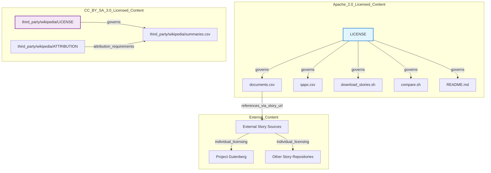
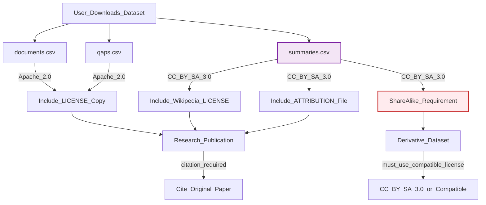
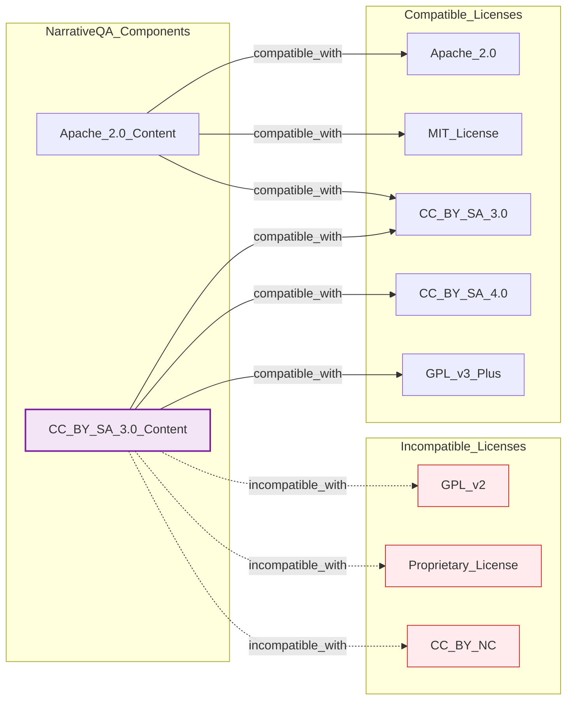

<!-- source: DeepWiki mcp.deepwiki.com · repo google-deepmind/narrativeqa · page 5 Legal and Licensing · fetched 2026-10-26 -->

# Legal and Licensing

Relevant source files

The following files were used as context for generating this wiki page:

- [LICENSE](LICENSE)
- [third_party/wikipedia/LICENSE](third_party/wikipedia/LICENSE)

This document provides comprehensive coverage of all licensing requirements and legal obligations for using the NarrativeQA dataset. The dataset employs a dual licensing structure with different terms governing different components of the system.

For technical documentation on the dataset components themselves, see [Dataset Reference](#3). For information about Wikipedia content structure and processing, see [Wikipedia Summaries (summaries.csv)](#3.3).

## Licensing Overview

The NarrativeQA dataset operates under a dual licensing framework that reflects the diverse origins of its content. The repository uses two distinct licenses to govern different portions of the dataset:

**Dual Licensing Structure**
Sources: [LICENSE:1-203](), [third_party/wikipedia/LICENSE:1-362]()

This licensing architecture ensures compliance with the legal requirements of both the primary dataset infrastructure and the Wikipedia-derived content that forms a crucial component of the reading comprehension challenge.

## Legal Compliance Requirements

The dual licensing structure creates specific obligations depending on how you use the dataset:

| Usage Type | Apache 2.0 Requirements | CC BY-SA 3.0 Requirements |
|------------|-------------------------|---------------------------|
| **Dataset Infrastructure** | Attribution to original authors | Not applicable |
| **Wikipedia Summaries** | Attribution to original authors | Attribution + ShareAlike |
| **Derivative Works** | Include license copy | Must use compatible license |
| **Distribution** | Include license notice | Include attribution + license |

### Attribution Flow Requirements

**Attribution and ShareAlike Requirements**
Sources: [third_party/wikipedia/LICENSE:217-247](), [third_party/wikipedia/LICENSE:189-216]()

### License Compatibility Matrix

When creating derivative works or combining the dataset with other resources, license compatibility becomes critical:

**License Compatibility for Derivative Works**
Sources: [third_party/wikipedia/LICENSE:52-60](), [third_party/wikipedia/LICENSE:189-216]()

## Practical Usage Guidelines

### Research and Academic Use

For academic research and publication:

1. **Citation Requirements**: Include appropriate citations to the original NarrativeQA paper
2. **License Acknowledgment**: Acknowledge both Apache 2.0 and CC BY-SA 3.0 licenses
3. **Attribution**: Provide proper attribution for Wikipedia-derived content per [third_party/wikipedia/ATTRIBUTION]()

### Commercial Use

Commercial applications must comply with both license terms:

- **Apache 2.0 Content**: Permits commercial use with attribution
- **Wikipedia Content**: Requires ShareAlike licensing for any derivatives of `summaries.csv`

### Distribution Requirements

When redistributing any portion of the dataset:

| Component | Required Files | Attribution Method |
|-----------|---------------|-------------------|
| **Core Dataset** | `LICENSE` copy | Include in distribution root |
| **Wikipedia Summaries** | `third_party/wikipedia/LICENSE`, `third_party/wikipedia/ATTRIBUTION` | Include in distribution |
| **Combined Distribution** | Both license files | Clearly identify which content uses which license |

Sources: [LICENSE:90-122](), [third_party/wikipedia/LICENSE:167-188](), [third_party/wikipedia/LICENSE:217-247]()

## External Content Considerations

The dataset references external story content through URLs in `documents.csv`. These external sources maintain their own licensing terms:

- **Project Gutenberg**: Public domain or specific license terms
- **Other Repositories**: Individual licensing requirements
- **User Responsibility**: Verify licensing for downloaded content

Users must independently verify the licensing status of any external content accessed through the `story_url` fields in [documents.csv]().

Sources: [documents.csv (story_url field)]()

---

