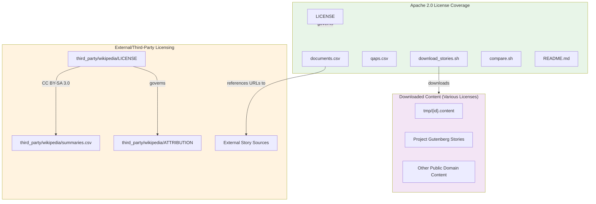
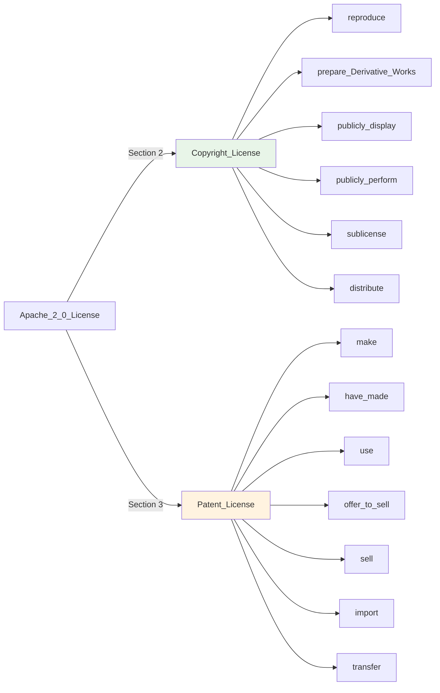
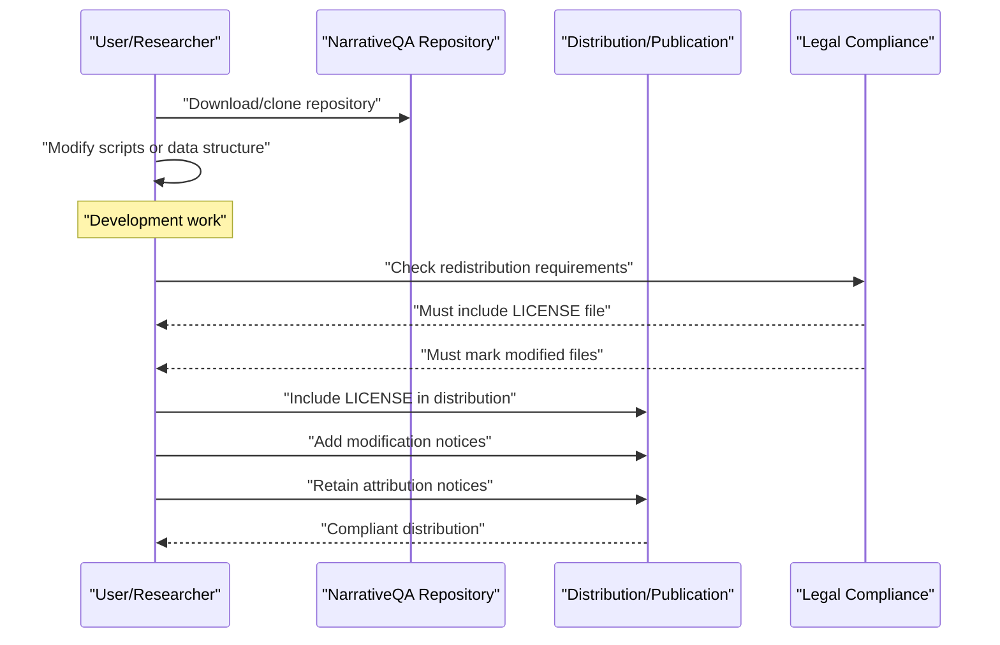
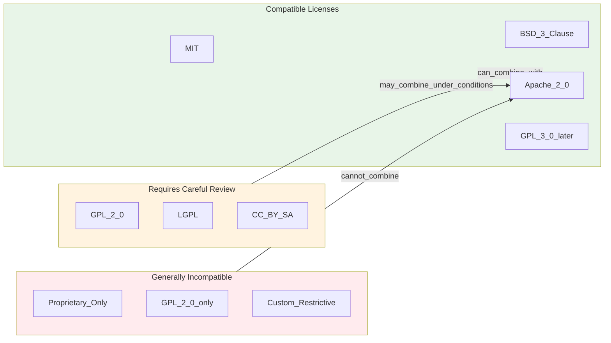
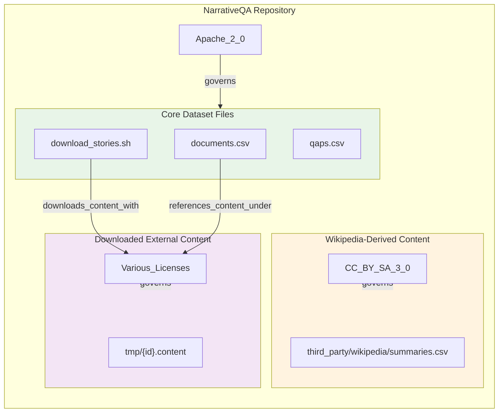

<!-- source: DeepWiki mcp.deepwiki.com · repo google-deepmind/narrativeqa · page 5.1 Repository License (Apache 2.0) · fetched 2026-10-26 -->

# Repository License (Apache 2.0)

Relevant source files

The following files were used as context for generating this wiki page:

- [LICENSE](LICENSE)

This page documents the Apache License 2.0 that governs the main components of the NarrativeQA repository. This license covers the dataset metadata files, utility scripts, and documentation, providing broad permissions for research and commercial use. For information about the specific licensing requirements for Wikipedia-derived content, see [Wikipedia Content Licensing](#5.2).

## License Scope and Coverage

The Apache 2.0 license applies to the core repository components developed and maintained by the NarrativeQA project. This includes all files except those in the `third_party/wikipedia/` directory, which are governed by separate Creative Commons licensing.

### Components Under Apache 2.0

| Component | File Path | Description |
|-----------|-----------|-------------|
| Document Registry | `documents.csv` | Central metadata file linking all dataset components |
| Question-Answer Pairs | `qaps.csv` | Core Q&A dataset with train/validation/test splits |
| Download Utility | `download_stories.sh` | Script for acquiring external story content |
| Validation Utility | `compare.sh` | File integrity validation script |
| Documentation | `README.md` | Dataset documentation and usage instructions |

### License Coverage Architecture

**Sources:** [LICENSE:1-203]()

## Key Permissions and Rights

The Apache 2.0 license grants users comprehensive rights to use, modify, and distribute the dataset components. These permissions are designed to support both research and commercial applications.

### Granted Permissions

| Permission | Scope | Practical Meaning |
|------------|-------|-------------------|
| **Use** | Any purpose | Run scripts, load data, train models |
| **Reproduction** | Full or partial | Copy files, include in other projects |
| **Distribution** | With or without modification | Share dataset, publish research, deploy applications |
| **Modification** | Create derivative works | Modify scripts, extend dataset structure |
| **Sublicensing** | Incorporate into larger works | Include in proprietary software or services |
| **Patent Rights** | Contributor patent grants | Protection from patent litigation by contributors |

### License Grant Structure

**Sources:** [LICENSE:67-88]()

## User Obligations and Requirements

While the Apache 2.0 license is permissive, it does impose certain obligations on users who redistribute or modify the licensed content.

### Redistribution Requirements

When redistributing any Apache 2.0 licensed components, users must:

1. **Include License Copy**: Provide a copy of the Apache 2.0 license text
2. **Attribution Notices**: Retain all copyright, patent, trademark, and attribution notices
3. **Modification Notices**: Mark any changes made to the original files
4. **NOTICE File**: Include any NOTICE file contents if present

### Compliance Workflow

**Sources:** [LICENSE:90-129]()

## Practical Use Cases and Compliance

The Apache 2.0 license supports various usage patterns common in machine learning and research contexts.

### Research Use Cases

| Use Case | Compliance Requirements | Additional Considerations |
|----------|------------------------|--------------------------|
| **Academic Research** | Include license in paper supplements | Cite dataset properly |
| **Model Training** | No additional requirements for training | Consider output licensing |
| **Benchmarking** | Include license with benchmark code | Document any modifications |
| **Derivative Datasets** | Mark changes, include license | May need additional attribution |

### Commercial Use Cases

| Use Case | Compliance Requirements | Additional Considerations |
|----------|------------------------|--------------------------|
| **Product Development** | Include license in product distribution | Consider end-user licensing |
| **Service Deployment** | Include license with service documentation | May not need user-facing attribution |
| **Consulting/Services** | Include license with deliverables | Client agreements may impose additional terms |
| **Resale/Redistribution** | Full compliance with redistribution terms | Cannot impose additional restrictions |

### License Compatibility Matrix

**Sources:** [LICENSE:124-129](), [LICENSE:131-137]()

## Disclaimer and Limitations

The Apache 2.0 license includes important disclaimers that limit liability and warranty coverage.

### Key Disclaimers

- **No Warranty**: The dataset is provided "AS IS" without warranties of any kind
- **Limitation of Liability**: Contributors are not liable for damages arising from use
- **No Trademark Rights**: License does not grant permission to use contributor trademarks

### Risk Management

Users should be aware that:

1. **Data Quality**: No guarantees about dataset accuracy or completeness
2. **External Content**: Downloaded stories may have separate licensing requirements
3. **Patent Rights**: Patent license terminates if user initiates patent litigation
4. **Compliance Responsibility**: Users are solely responsible for legal compliance

**Sources:** [LICENSE:144-165](), [LICENSE:166-176]()

## Integration with Other Repository Licenses

The Apache 2.0 license works alongside other licensing requirements in the repository ecosystem.

### Multi-License Architecture

**Sources:** [LICENSE:1-203](), [documents.csv](), [third_party/wikipedia/LICENSE]()

For detailed information about Wikipedia content licensing requirements, including attribution obligations and share-alike terms, see [Wikipedia Content Licensing](#5.2).

---

