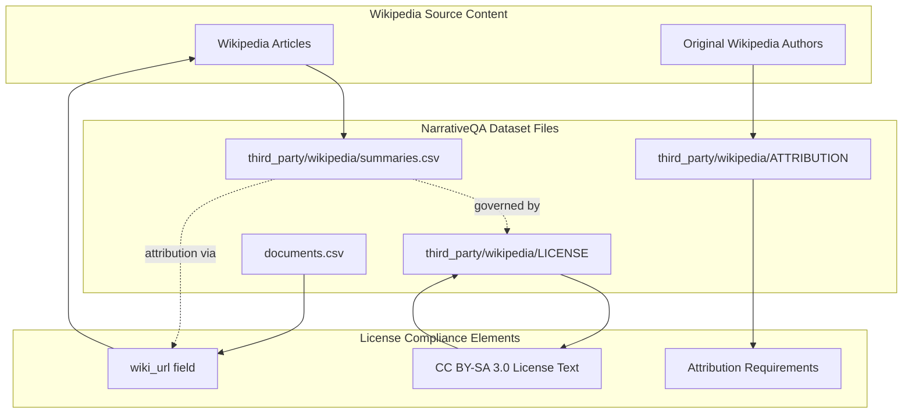
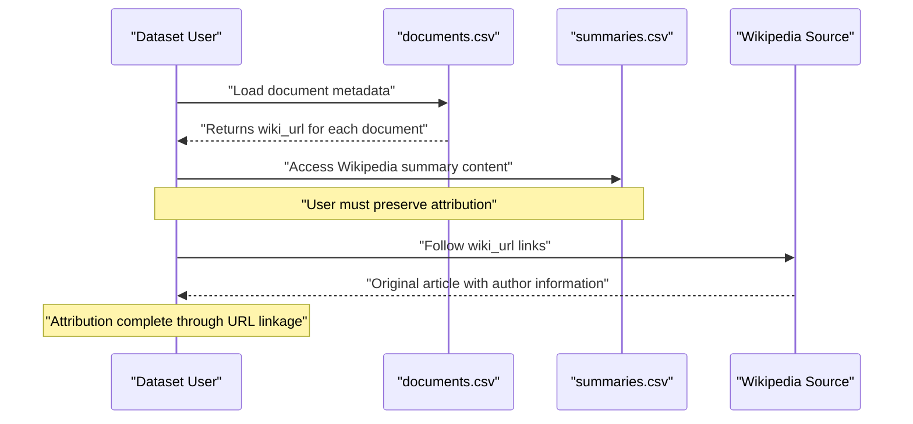

<!-- source: DeepWiki mcp.deepwiki.com · repo google-deepmind/narrativeqa · page 5.2 Wikipedia Content Licensing · fetched 2026-10-26 -->

# Wikipedia Content Licensing

<details>
<summary>Relevant source files</summary>

The following files were used as context for generating this wiki page:

- [third_party/wikipedia/ATTRIBUTION](third_party/wikipedia/ATTRIBUTION)
- [third_party/wikipedia/LICENSE](third_party/wikipedia/LICENSE)

</details>


This document covers the specific licensing requirements and legal obligations for Wikipedia-derived content within the NarrativeQA dataset. This content is subject to different licensing terms than the main repository code and data. For information about the primary repository license terms, see [Repository License (Apache 2.0)](#5.1).

## License Overview

The Wikipedia content in this dataset is licensed under the Creative Commons Attribution-ShareAlike 3.0 Unported (CC BY-SA 3.0) license, as specified in [third_party/wikipedia/LICENSE:1-361](). This is a copyleft license that requires attribution of original authors and mandates that any derivative works be released under the same or compatible license terms.

### Key License Requirements

| Requirement | Description | Implementation |
|-------------|-------------|----------------|
| **Attribution** | Must credit original Wikipedia authors | Links provided in `wiki_url` column |
| **ShareAlike** | Derivative works must use compatible license | Applies to any adaptations of summaries |
| **Distribution** | Must include license with distributed content | [third_party/wikipedia/LICENSE:1-361]() file included |
| **Notice Preservation** | Cannot remove copyright notices | Original attribution maintained |



**License Structure and File Mapping**

Sources: [third_party/wikipedia/LICENSE:1-361](), [third_party/wikipedia/ATTRIBUTION:1-3]()

## Attribution Requirements

The Wikipedia content requires proper attribution to original authors as specified in [third_party/wikipedia/ATTRIBUTION:1-3](). The attribution mechanism is implemented through the `wiki_url` column in the document registry.

### Attribution Implementation



**Attribution Workflow Through Dataset Structure**

The license requires that users maintain the connection between summary content and original Wikipedia articles through the provided URLs.

Sources: [third_party/wikipedia/ATTRIBUTION:1-3]()

## Content Coverage and Scope

This licensing applies specifically to content derived from Wikipedia articles, which is contained in the Wikipedia summaries portion of the dataset.

### Affected Dataset Components

| Component | License Status | File Location |
|-----------|---------------|---------------|
| Wikipedia Summaries | CC BY-SA 3.0 | `third_party/wikipedia/summaries.csv` |
| Attribution Data | CC BY-SA 3.0 | `third_party/wikipedia/ATTRIBUTION` |
| License Text | Public Domain | `third_party/wikipedia/LICENSE` |
| Story Content | Various | External sources via `story_url` |
| Q&A Pairs | Apache 2.0 | `qaps.csv` |

```mermaid
graph TB
    subgraph "CC_BY_SA_3_Content"["CC BY-SA 3.0 Licensed Content"]
        WIKI_SUMM["summaries.csv<br/>Wikipedia article summaries"]
        WIKI_ATTR["ATTRIBUTION<br/>Author credit requirements"]
    end
    
    subgraph "Apache_2_Content"["Apache 2.0 Licensed Content"] 
        QAPS["qaps.csv<br/>Question-answer pairs"]
        DOCS_META["documents.csv<br/>Metadata registry"]
    end
    
    subgraph "External_Content"["External Licensed Content"]
        STORIES["Story files<br/>Various licenses via story_url"]
    end
    
    DOCS_META -->|"wiki_url links"| WIKI_SUMM
    DOCS_META -->|"story_url links"| STORIES
    DOCS_META -.->|"document_id"| QAPS
    
    WIKI_ATTR -->|"governs"| WIKI_SUMM
```

**Content Licensing Boundaries Within Dataset**

Sources: [third_party/wikipedia/LICENSE:1-361](), [third_party/wikipedia/ATTRIBUTION:1-3]()

## ShareAlike Requirements

The CC BY-SA 3.0 license includes a "ShareAlike" provision detailed in [third_party/wikipedia/LICENSE:189-216](). This requires that any adaptations or derivative works based on the Wikipedia summaries be released under the same or compatible license.

### Derivative Work Obligations

- **Adaptations**: Any modifications to Wikipedia summaries must be released under CC BY-SA 3.0 or compatible license
- **Collections**: Including summaries in larger works may require ShareAlike compliance for the entire collection
- **Translations**: Language translations of summaries are considered adaptations subject to ShareAlike
- **Extracts**: Substantial portions used in other works trigger ShareAlike requirements

The license text specifies in [third_party/wikipedia/LICENSE:131-139]() that users may create adaptations provided they clearly label changes and comply with ShareAlike terms.

Sources: [third_party/wikipedia/LICENSE:189-216](), [third_party/wikipedia/LICENSE:131-139]()

## Compliance Guidelines

### For Dataset Users

1. **Preserve Attribution Links**: Maintain the `wiki_url` references when using Wikipedia summaries
2. **Include License Text**: Distribute [third_party/wikipedia/LICENSE:1-361]() with any redistribution
3. **Mark Modifications**: Clearly identify any changes made to summary content per [third_party/wikipedia/LICENSE:131-136]()
4. **Apply ShareAlike**: Release derivative works under compatible licensing

### For Redistribution

When redistributing portions of the dataset containing Wikipedia content:

- Include the complete [third_party/wikipedia/LICENSE:1-361]() file
- Preserve all `wiki_url` attribution links in `documents.csv`
- Maintain the [third_party/wikipedia/ATTRIBUTION:1-3]() file
- Apply CC BY-SA 3.0 or compatible licensing to any modifications

Sources: [third_party/wikipedia/LICENSE:1-361](), [third_party/wikipedia/ATTRIBUTION:1-3]()

## Legal Disclaimers

The license includes important disclaimers in [third_party/wikipedia/LICENSE:266-273]() stating that content is provided "AS-IS" without warranties. Users should review the complete license text for full terms and conditions, particularly sections regarding liability limitations and termination conditions.

Creative Commons provides additional guidance at the URL referenced in [third_party/wikipedia/LICENSE:361](), though users should consult the included license text as the authoritative source for this dataset.

Sources: [third_party/wikipedia/LICENSE:266-273](), [third_party/wikipedia/LICENSE:361]()