# Page: Overview

# Overview

<details>
<summary>Relevant source files</summary>

The following files were used as context for generating this wiki page:

- [README.md](README.md)
- [documents.csv](documents.csv)

</details>


## Purpose and Scope

The NarrativeQA Reading Comprehension Challenge Dataset is a research dataset designed for training and evaluating machine learning models on long-form narrative understanding. The system provides a comprehensive framework for reading comprehension tasks that span full-length stories, including novels, movie scripts, and other narrative content, paired with questions and answers derived from both the complete narratives and Wikipedia summaries.

This document covers the overall system architecture, data flow, and key components of the dataset repository. For detailed information about individual data files and their schemas, see [Dataset Reference](#3). For step-by-step setup instructions, see [Getting Started](#2). For legal and licensing requirements, see [Legal and Licensing](#5).

## System Architecture

The NarrativeQA system follows a hub-and-spoke architecture with `documents.csv` serving as the central registry that links all dataset components through `document_id` identifiers.

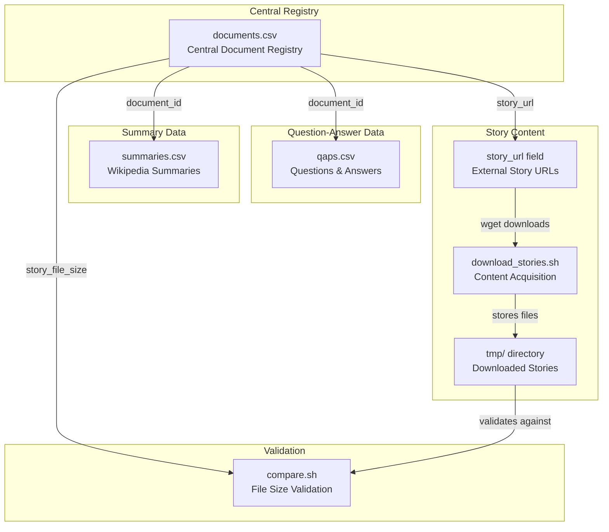

**Sources:** [documents.csv:1-1548](), [README.md:15-21]()

## Data Flow and Processing Pipeline

The system operates through a sequential data acquisition and validation pipeline that transforms external narrative content into a structured research dataset.

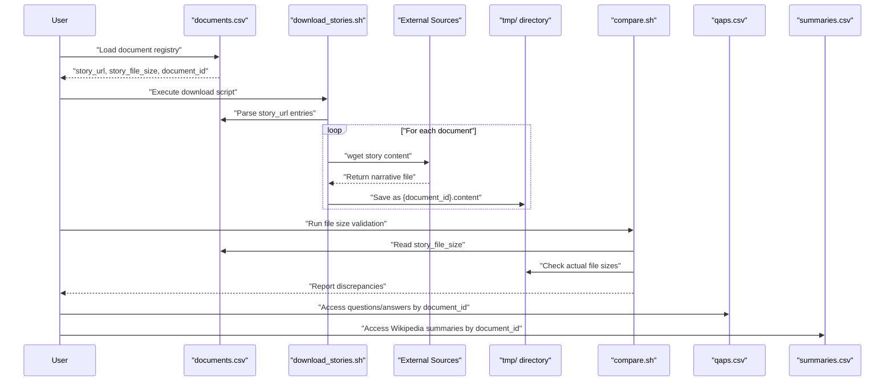

**Sources:** [download_stories.sh:1](), [compare.sh:1](), [documents.csv:1](), [qaps.csv:1](), [third_party/wikipedia/summaries.csv:1]()

## Core Components

### Document Registry (`documents.csv`)

The central registry containing metadata for all narrative documents in the dataset. Each record includes:

| Field | Purpose |
|-------|---------|
| `document_id` | Unique identifier linking all dataset components |
| `set` | Dataset partition (`train`, `valid`, `test`) |
| `kind` | Source type (`gutenberg`, `movie`) |
| `story_url` | External URL for full narrative content |
| `story_file_size` | Expected file size for validation |
| `wiki_url` | Wikipedia article URL |
| `story_word_count` | Approximate word count after tokenization |

**Sources:** [documents.csv:1](), [README.md:15-17]()

### Content Acquisition System

The `download_stories.sh` script implements a robust content acquisition pipeline with rate limiting and error handling for external story sources including Project Gutenberg and movie script databases.

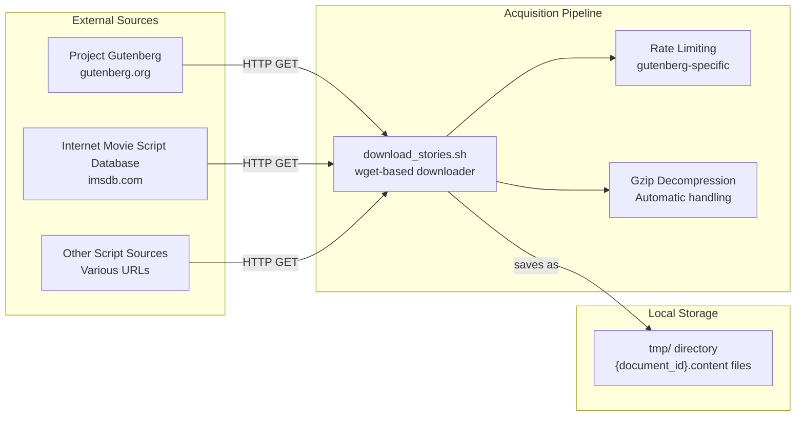

**Sources:** [download_stories.sh:1](), [documents.csv:3-4]()

### Validation Framework

The `compare.sh` utility validates data integrity by comparing downloaded file sizes against expected values stored in `documents.csv`.

**Sources:** [compare.sh:1](), [README.md:23-25]()

## Dataset Partitioning

The dataset implements a three-way split across all components using the `set` field:

| Partition | Purpose | Access Pattern |
|-----------|---------|----------------|
| `train` | Model training | Bulk access to all components |
| `valid` | Hyperparameter tuning | Periodic evaluation access |
| `test` | Final evaluation | Single-use evaluation access |

Each partition maintains consistent `document_id` linking across `documents.csv`, `qaps.csv`, and `summaries.csv`.

**Sources:** [documents.csv:1](), [qaps.csv:1](), [third_party/wikipedia/summaries.csv:1]()

## Research Applications

The system supports reading comprehension research through two primary evaluation modes:

1. **Full Story Comprehension**: Questions answered using complete narrative content from `tmp/` directory
2. **Summary-based Comprehension**: Questions answered using Wikipedia summaries from `summaries.csv`

Both modes use identical question-answer pairs from `qaps.csv`, enabling comparative analysis of model performance on different input lengths and content types.

**Sources:** [README.md:7-10](), [qaps.csv:1](), [third_party/wikipedia/summaries.csv:1]()

---

# Page: Dataset Components

# Dataset Components

<details>
<summary>Relevant source files</summary>

The following files were used as context for generating this wiki page:

- [documents.csv](documents.csv)
- [qaps.csv](qaps.csv)
- [third_party/wikipedia/summaries.csv](third_party/wikipedia/summaries.csv)

</details>


This document provides a comprehensive overview of the core data files that comprise the NarrativeQA Reading Comprehension Challenge Dataset and how they interconnect to form a complete machine learning dataset. For information about downloading and validating the content referenced by these files, see [Getting Started](#2).

The NarrativeQA dataset consists of three primary CSV files that work together to provide questions, answers, and contextual information for long-form narrative texts. Each component serves a specific purpose in enabling reading comprehension tasks on full-length stories and movie scripts.

## Core Data File Structure

The dataset is built around three interconnected CSV files that share a common `document_id` linking mechanism:

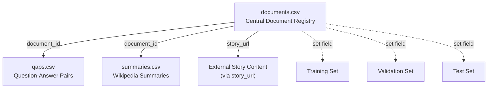

**Dataset File Relationships**

Sources: [documents.csv:1-2](), [qaps.csv:1-2](), [third_party/wikipedia/summaries.csv:1-2]()

## Document Registry (documents.csv)

The central registry serves as the authoritative source for all document metadata and external content references. Each row represents a unique narrative document with the following key fields:

| Field | Purpose | Example Values |
|-------|---------|----------------|
| `document_id` | Unique SHA-1 hash identifier | `0025577043f5090cd603c6aea60f26e236195594` |
| `set` | Dataset split assignment | `train`, `valid`, `test` |
| `kind` | Source type classification | `movie`, `gutenberg` |
| `story_url` | External content location | `http://www.gutenberg.org/ebooks/21572.txt.utf-8` |
| `story_file_size` | Expected download size in bytes | `814507` |
| `wiki_url` | Wikipedia article URL | `http://en.wikipedia.org/wiki/Percival_Keene` |
| `story_word_count` | Full narrative word count | `173334` |

The registry contains **1,572 total documents** distributed across content sources and dataset splits, with each document uniquely identified by a SHA-1 hash of its content.

Sources: [documents.csv:1-10]()

## Question-Answer Pairs (qaps.csv)

The question-answer component provides the core supervised learning data, with multiple questions per document and dual answer formulations:

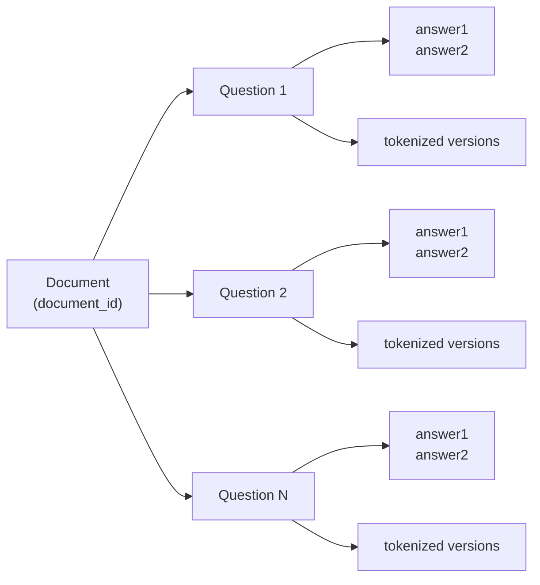

**Question-Answer Structure per Document**

Each question entry includes:
- **Raw text versions**: `question`, `answer1`, `answer2`
- **Tokenized versions**: `question_tokenized`, `answer1_tokenized`, `answer2_tokenized`
- **Dataset split consistency**: `set` field matches the parent document

The dual answer approach (`answer1` and `answer2`) provides alternative formulations of the same factual information, supporting robust evaluation metrics.

Sources: [qaps.csv:1-10]()

## Wikipedia Summaries (summaries.csv)

The Wikipedia component provides condensed narrative summaries that serve as intermediate-length context between full stories and question-answer pairs:

| Field | Content Type | Processing |
|-------|--------------|------------|
| `summary` | Raw Wikipedia article text | Direct extraction from Wikipedia articles |
| `summary_tokenized` | Processed text | Tokenized using consistent methodology |

These summaries typically range from several hundred to a few thousand words, providing a middle ground between the full narrative content (often 50,000+ words) and the brief question-answer pairs.

Sources: [third_party/wikipedia/summaries.csv:1-6]()

## Data Linkage and Integrity

The dataset maintains referential integrity through the `document_id` field, which serves as a foreign key across all three files:

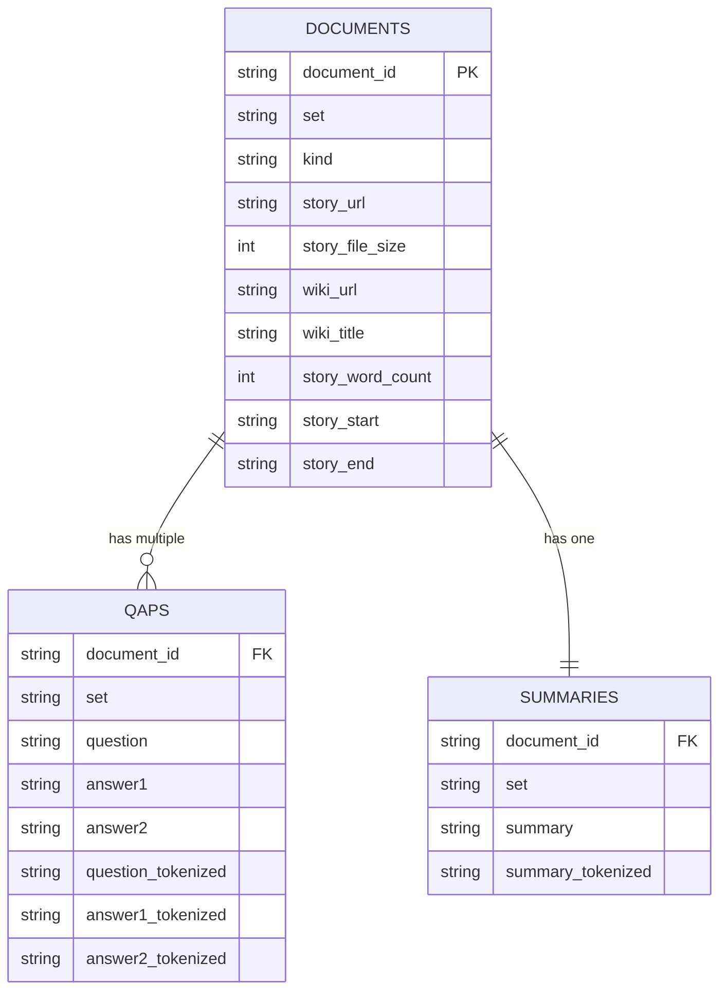

**Entity Relationship Structure**

The `set` field in all three files ensures consistent train/validation/test splits across the entire dataset, preventing data leakage between evaluation phases.

Sources: [documents.csv:1-2](), [qaps.csv:1-2](), [third_party/wikipedia/summaries.csv:1-2]()

## Content Type Distribution

The dataset encompasses two primary narrative source types, each with distinct characteristics:

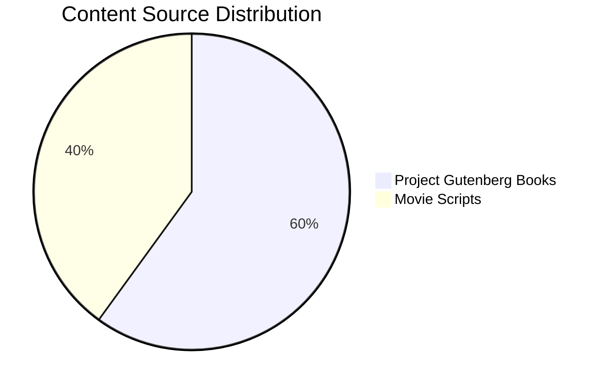

**Source Type Characteristics**

- **Gutenberg content** (`kind=gutenberg`): Classic literature and historical texts, typically longer narratives
- **Movie scripts** (`kind=movie`): Contemporary screenplays from various film databases, structured dialogue format

This dual-source approach provides diversity in narrative style, length, and complexity for comprehensive reading comprehension evaluation.

Sources: [documents.csv:3-7]()

---

# Page: Getting Started

# Getting Started

<details>
<summary>Relevant source files</summary>

The following files were used as context for generating this wiki page:

- [README.md](README.md)
- [download_stories.sh](download_stories.sh)

</details>


This page provides step-by-step instructions for setting up and using the NarrativeQA Reading Comprehension Challenge Dataset. It covers the essential workflow from initial repository access through data acquisition and basic usage patterns.

For detailed instructions on the download process, see [Downloading Story Content](#2.1). For data validation procedures, see [Validating Data Integrity](#2.2). For complete data file specifications, see [Dataset Reference](#3).

## Prerequisites

The NarrativeQA dataset requires a Unix-like environment with the following tools:

| Tool | Purpose | Required For |
|------|---------|--------------|
| `bash` | Script execution | Running `download_stories.sh` |
| `wget` | Content download | Fetching stories from external URLs |
| `gunzip` | Decompression | Handling gzipped content |
| `file` | Type detection | Identifying compressed files |

Approximately 2GB of disk space is needed for the complete downloaded story content in the `tmp/` directory.

Sources: [download_stories.sh:1-50](), [README.md:22-25]()

## Dataset Overview

The NarrativeQA dataset consists of three core data files that work together to provide reading comprehension challenges:

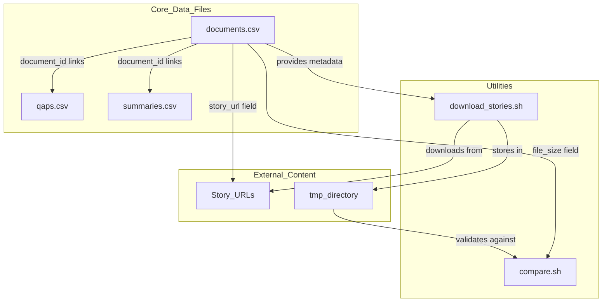

**Core Data Flow Between CSV Files**

Sources: [README.md:15-21](), [documents.csv structure referenced]

## Quick Start Workflow

### Step 1: Repository Access

Clone or download the repository to access the three core CSV files:
- `documents.csv` - Document metadata and story URLs
- `qaps.csv` - Question-answer pairs 
- `third_party/wikipedia/summaries.csv` - Wikipedia summaries

### Step 2: Download Story Content

Execute the download script to acquire full story text:

```bash
./download_stories.sh
```

This script reads `documents.csv`, extracts story URLs, and downloads content to `tmp/{document_id}.content` files.

### Step 3: Validate Downloads

Verify download integrity using the validation script:

```bash
./compare.sh
```

This compares downloaded file sizes against expected sizes in `documents.csv`.

Sources: [README.md:22-25](), [download_stories.sh:16-49]()

## Data Structure and Relationships

The dataset uses `document_id` as the primary key linking all components:

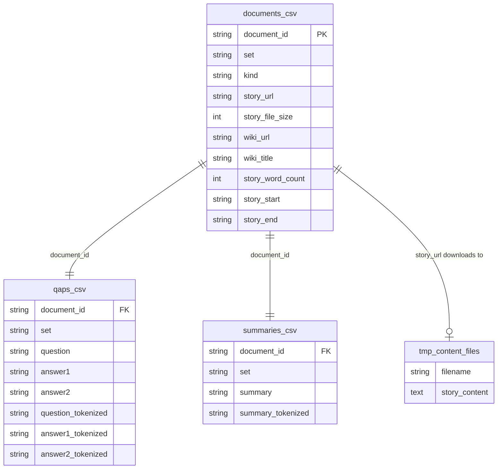

**Dataset Partitioning**

All files use a `set` field with three values:
- `train` - Training data
- `valid` - Validation data  
- `test` - Test data

Sources: [README.md:15-21](), [documents.csv field structure]

## Download Process Details

The `download_stories.sh` script implements the following logic:

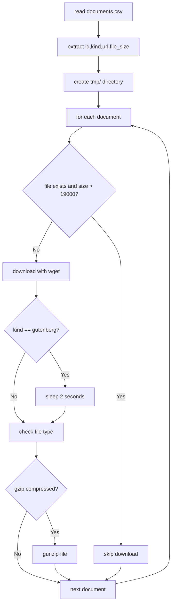

**Key Implementation Details:**
- Files stored as `tmp/{document_id}.content` [download_stories.sh:26]()
- Rate limiting for Gutenberg sources [download_stories.sh:37-39]()
- Automatic gzip decompression [download_stories.sh:42-48]()
- Minimum file size threshold of 19,000 bytes [download_stories.sh:35]()

Sources: [download_stories.sh:18-49]()

## Basic Usage Patterns

### Loading Documents

Read the document registry to understand available content:

```bash
# View document metadata structure
head -n 5 documents.csv

# Count documents by type
cut -d',' -f3 documents.csv | sort | uniq -c
```

### Accessing Questions and Answers

The `qaps.csv` file contains both raw and tokenized versions:

```bash
# View question-answer structure  
head -n 3 qaps.csv

# Filter by dataset split
grep ",train," qaps.csv | head -n 5
```

### Working with Downloaded Stories

After running `download_stories.sh`, story content is available in the `tmp/` directory:

```bash
# Check download status
ls tmp/ | wc -l

# View story content for specific document
cat tmp/23jncj2n3.content | head -n 20
```

Sources: [README.md:15-21](), [download_stories.sh:26]()

## Next Steps

Once you have completed the basic setup:

1. **Download Story Content**: Follow the detailed guide in [Downloading Story Content](#2.1) for advanced download options and troubleshooting
2. **Validate Data Integrity**: Use [Validating Data Integrity](#2.2) to ensure your downloads are complete and correct
3. **Explore Data Structure**: Review [Dataset Reference](#3) for complete schema documentation
4. **Understand Licensing**: Check [Legal and Licensing](#5) for usage requirements

The dataset is now ready for use in reading comprehension and question-answering research applications.

Sources: [README.md:1-41](), [table of contents structure]

---

# Page: Downloading Story Content

# Downloading Story Content

<details>
<summary>Relevant source files</summary>

The following files were used as context for generating this wiki page:

- [documents.csv](documents.csv)
- [download_stories.sh](download_stories.sh)

</details>


This page provides comprehensive documentation for acquiring the full story content referenced in the NarrativeQA dataset. The download process transforms URL references in the document registry into locally stored story files that can be used for reading comprehension tasks.

For information about validating downloaded content, see [Validating Data Integrity](#2.2). For details about the document registry structure, see [Document Registry (documents.csv)](#3.1).

## Purpose and Scope

The story download system retrieves the complete narrative content from external sources referenced in `documents.csv`. This process is essential because the core dataset files contain only metadata and question-answer pairs—the actual story content must be downloaded separately from various online repositories including Project Gutenberg, movie script databases, and other public sources.

The download system handles diverse content sources with different access requirements, file formats, and rate limiting needs while maintaining data integrity through size validation and error logging.

Sources: [download_stories.sh:16-17](), [documents.csv:1-10]()

## Download Process Overview

The download process follows a structured workflow that reads document metadata, validates existing downloads, and retrieves missing or incomplete content while respecting source-specific requirements.

### Download Workflow

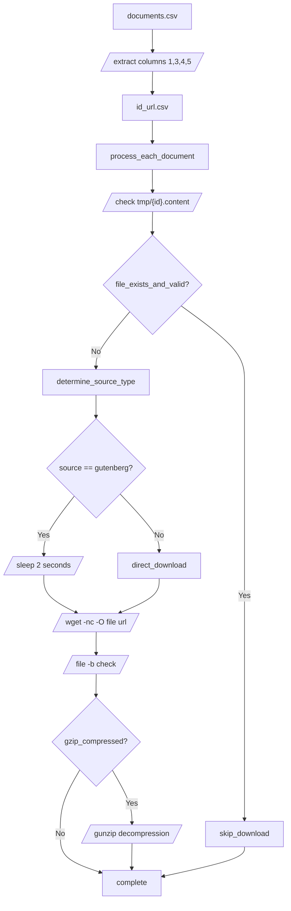

Sources: [download_stories.sh:21](), [download_stories.sh:24-49]()

### File Processing Pipeline

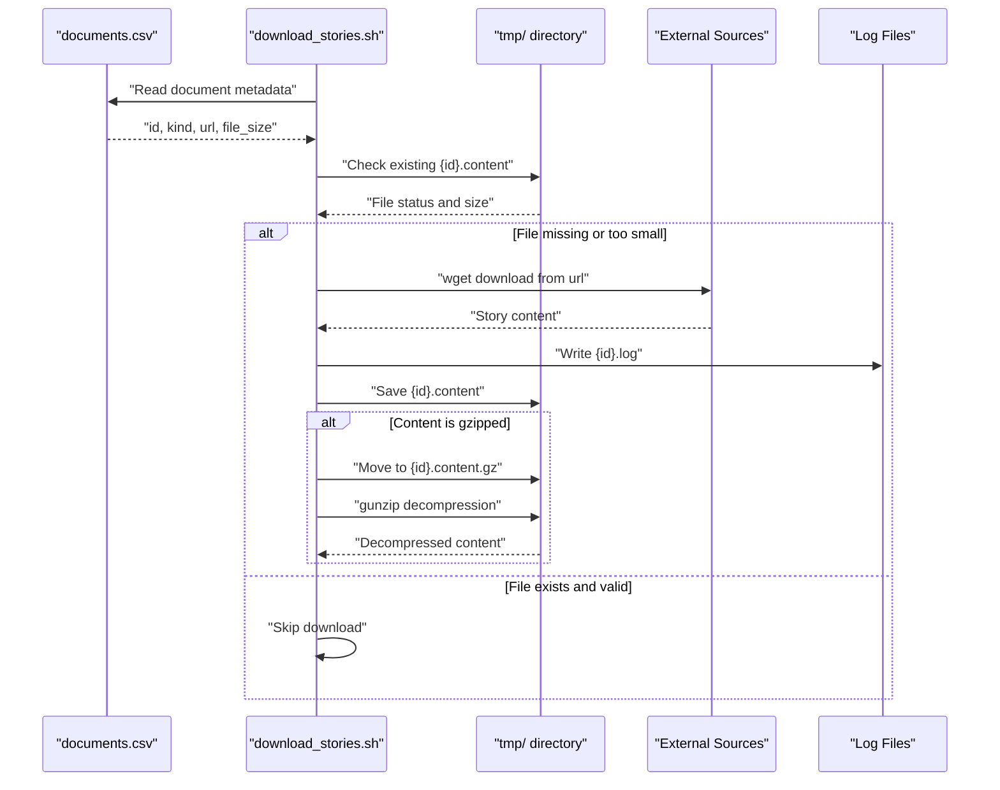

Sources: [download_stories.sh:24-31](), [download_stories.sh:35-48]()

## Technical Implementation

### Metadata Extraction

The script begins by extracting essential columns from `documents.csv` to create a streamlined processing file:

The extraction process uses standard Unix tools to create `id_url.csv` containing only the necessary fields for download operations:

```bash
cat ${base}/documents.csv | cut -d',' -f 1,3,4,5 | tail -n 1572 > ${base}/id_url.csv
```

This creates a working file with columns: `document_id`, `kind`, `story_url`, `story_file_size`.

Sources: [download_stories.sh:21]()

### Download Logic and Validation

The core download loop implements several validation and retry mechanisms:

| Validation Type | Threshold | Action |
|-----------------|-----------|---------|
| File existence | N/A | Download if missing |
| File size | ≤ 19,000 bytes | Re-download if too small |
| Content type | gzip detection | Auto-decompress if compressed |

The size threshold of 19,000 bytes serves as a minimum viable content size, ensuring that downloads contain substantial story content rather than error pages or incomplete transfers.

Sources: [download_stories.sh:28-41]()

### Source-Specific Handling

Different content sources require specialized handling approaches:

#### Project Gutenberg Rate Limiting

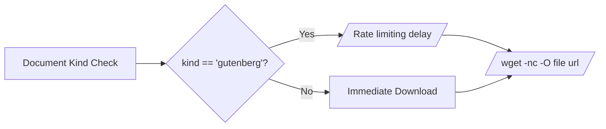

Project Gutenberg downloads include a 2-second delay to respect the service's rate limiting requirements and avoid overwhelming their servers.

Sources: [download_stories.sh:37-39]()

#### Compression Detection and Handling

The script automatically detects and handles gzipped content:

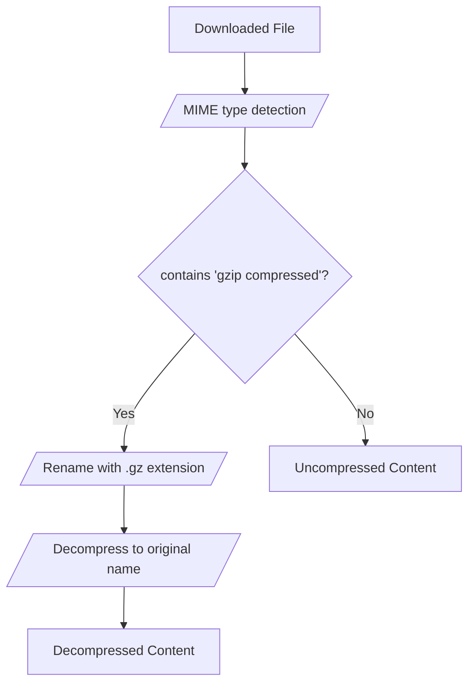

This handling is particularly important for Project Gutenberg texts, which are often served in compressed format to reduce bandwidth usage.

Sources: [download_stories.sh:43-48]()

## File Organization

### Directory Structure

The download system creates and manages files in a structured hierarchy:

```
repository/
├── documents.csv          # Source metadata
├── download_stories.sh    # Download script
├── tmp/                   # Download destination
│   ├── {id}.content      # Story content files
│   ├── {id}.log          # Download logs
│   └── id_url.csv        # Extracted metadata
```

### Naming Conventions

| File Type | Pattern | Example | Purpose |
|-----------|---------|---------|---------|
| Story Content | `{document_id}.content` | `0025577043f5090cd603c6aea60f26e236195594.content` | Main story text |
| Download Logs | `{document_id}.log` | `0025577043f5090cd603c6aea60f26e236195594.log` | wget output and errors |
| Working Data | `id_url.csv` | `id_url.csv` | Extracted metadata for processing |

The document ID serves as a unique identifier linking the downloaded content back to entries in `documents.csv` and corresponding questions in `qaps.csv`.

Sources: [download_stories.sh:20](), [download_stories.sh:26](), [download_stories.sh:40]()

## Error Handling and Logging

### Download Logging

Each download operation generates a detailed log file capturing wget output and error conditions:

```bash
wget -nc -O $file -o ${base}/tmp/${id}.log "$url"
```

The `-o` flag redirects wget's output to individual log files, enabling post-download analysis of any issues or failures.

### File Validation Strategy

The script implements a multi-layered validation approach:

1. **Existence Check**: Verifies file presence before attempting download
2. **Size Validation**: Ensures downloaded files exceed minimum size threshold
3. **Type Detection**: Identifies and handles compressed content automatically
4. **Retry Logic**: Re-downloads files that fail validation criteria

This strategy ensures robust handling of network issues, incomplete transfers, and format variations across different content sources.

Sources: [download_stories.sh:27-31](), [download_stories.sh:35-36](), [download_stories.sh:40]()

## Integration with Dataset Components

### Relationship to Document Registry

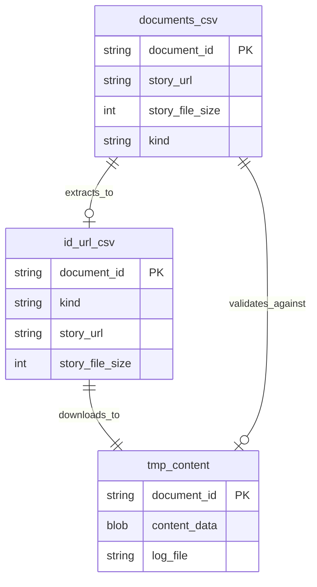

The download system serves as the bridge between URL references in the document registry and the actual story content required for reading comprehension tasks.

Sources: [documents.csv:1-10](), [download_stories.sh:21](), [download_stories.sh:26]()

---

# Page: Validating Data Integrity

# Validating Data Integrity

<details>
<summary>Relevant source files</summary>

The following files were used as context for generating this wiki page:

- [compare.sh](compare.sh)
- [documents.csv](documents.csv)

</details>


This document explains how to verify that downloaded story content matches expected file sizes and is complete. Data integrity validation ensures that files downloaded using the story download process have been retrieved correctly and completely from external sources.

For information about downloading story content, see [Downloading Story Content](#2.1). For technical details about the validation script implementation, see [Validation Script (compare.sh)](#4.2).

## Validation Process Overview

The NarrativeQA dataset includes integrity validation to detect incomplete downloads, network interruptions, or content changes at source URLs. The validation process compares actual downloaded file sizes against expected sizes stored in the document registry.

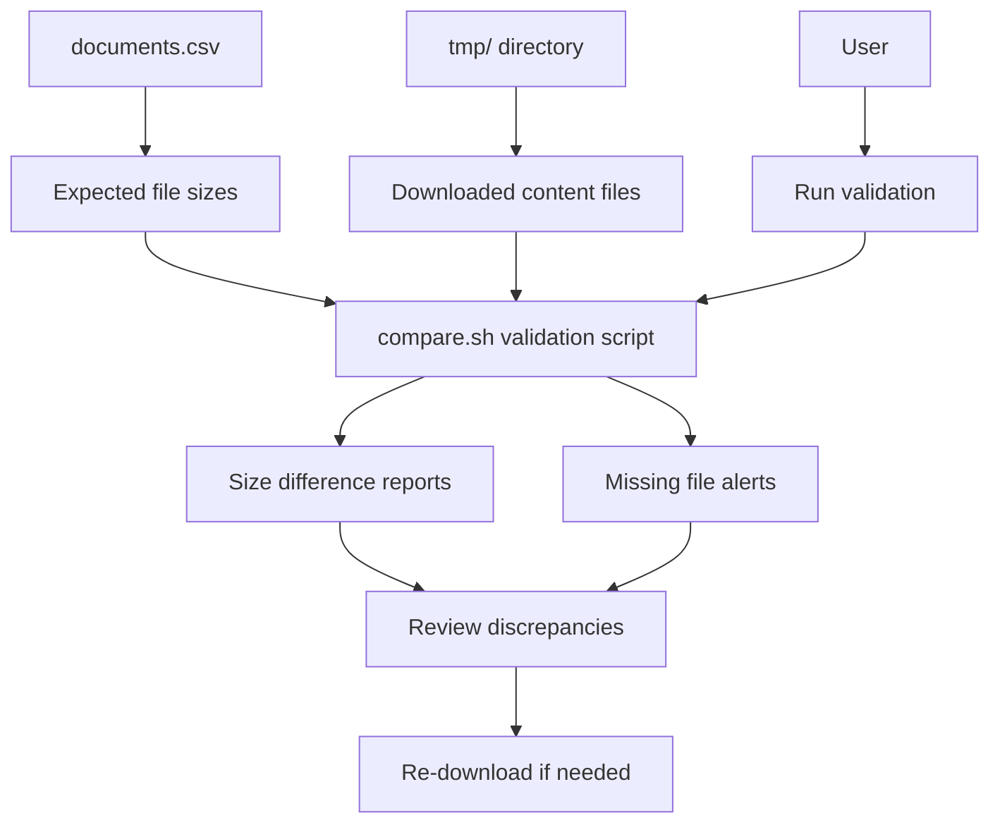

**Validation Workflow**

Sources: [compare.sh:1-44](), [documents.csv:1-1551]()

## File Size Validation

The primary validation mechanism compares downloaded file sizes with expected sizes from the document registry. Each document entry includes a `story_file_size` field representing the expected size in bytes.

### Validation Script Usage

The validation script `compare.sh` performs automated size comparison:

```bash
./compare.sh
```

The script processes files by:
1. Reading document metadata from CSV format
2. Checking for corresponding downloaded files in `tmp/` directory  
3. Calculating size differences between expected and actual files
4. Reporting discrepancies above zero bytes

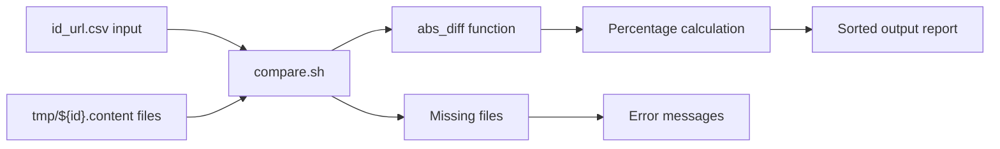

**Script Processing Flow**

Sources: [compare.sh:26-43]()

### Understanding Validation Output

The validation script produces output in this format:

```
size_diff_percent: PERCENT_DIFF ID DIFF SIZE_DOWNLOADED SIZE
```

Where:
- `PERCENT_DIFF`: Percentage difference between expected and actual size
- `ID`: Document identifier from the registry
- `DIFF`: Absolute size difference in bytes  
- `SIZE_DOWNLOADED`: Actual downloaded file size
- `SIZE`: Expected file size from registry

Results are sorted numerically by percentage difference, showing the most significant discrepancies first.

Sources: [compare.sh:26,41-42]()

## Validation Components

### File Existence Checking

The script first verifies that expected files exist in the download directory:

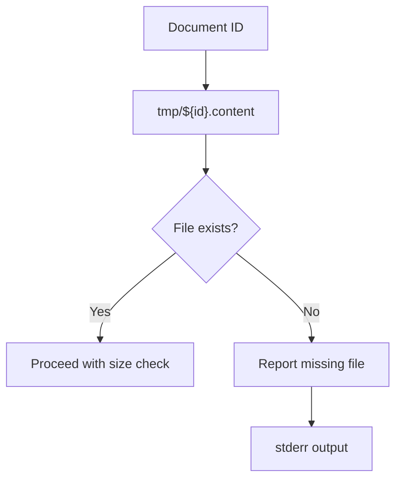

**File Existence Validation**

Missing files generate error messages to stderr, allowing users to identify incomplete downloads that require re-processing.

Sources: [compare.sh:29-33]()

### Size Difference Calculation

The `abs_diff` function calculates absolute differences between file sizes:

| Operation | Purpose |
|-----------|---------|
| `$1 - $2` | Calculate raw difference |
| Negative check | Handle cases where downloaded > expected |
| Absolute value | Ensure positive difference for reporting |

The percentage calculation uses `bc` for floating-point arithmetic: `absdiff / size2 * 100`

Sources: [compare.sh:18-24,39-41]()

## Common Validation Issues

### Size Discrepancies

Size differences can indicate:

- **Partial downloads**: Network interruptions during retrieval
- **Content changes**: Source material modified since registry creation  
- **Encoding differences**: Character encoding variations affecting byte counts
- **Compression handling**: Gzip decompression issues in download process

### Missing Files

Files may be missing due to:

- **Download failures**: Network errors or invalid URLs
- **Rate limiting**: Exceeded request limits for external sources
- **File system issues**: Insufficient disk space or permissions

Sources: [compare.sh:30-32]()

## Manual Validation Methods

### Direct Size Comparison

Users can manually verify individual files:

```bash
# Check actual file size
wc -c < tmp/DOCUMENT_ID.content

# Compare with expected size from documents.csv
grep DOCUMENT_ID documents.csv | cut -d, -f5
```

### Batch Validation

For custom validation scenarios, users can extract file size data:

```bash
# Extract all expected sizes
cut -d, -f1,5 documents.csv > expected_sizes.txt

# Generate actual sizes
for f in tmp/*.content; do
    id=$(basename "$f" .content)
    size=$(wc -c < "$f")
    echo "$id,$size"
done > actual_sizes.txt
```

Sources: [documents.csv:1](), [compare.sh:36-38]()

## Integration with Download Process

Validation should be performed after completing the download process documented in [Downloading Story Content](#2.1). The validation process relies on:

- Proper CSV formatting in the document registry
- Consistent file naming in the `tmp/` directory  
- Accurate `story_file_size` values in the metadata

Regular validation helps maintain dataset quality and identifies issues requiring attention before using the dataset for research purposes.

Sources: [compare.sh:28-29](), [documents.csv:1]()

---

# Page: Dataset Reference

# Dataset Reference

<details>
<summary>Relevant source files</summary>

The following files were used as context for generating this wiki page:

- [documents.csv](documents.csv)
- [qaps.csv](qaps.csv)
- [third_party/wikipedia/summaries.csv](third_party/wikipedia/summaries.csv)

</details>


This document provides comprehensive documentation of all data files in the NarrativeQA Reading Comprehension Challenge Dataset, including their schemas, relationships, and data structure. This reference covers the three core CSV files that form the complete dataset.

For information about downloading and setting up the dataset, see [Getting Started](#2). For details about the utility scripts, see [Utilities and Tools](#4).

## Dataset Architecture Overview

The NarrativeQA dataset follows a hub-and-spoke architecture with `documents.csv` serving as the central registry that links all components together through a common `document_id` field.

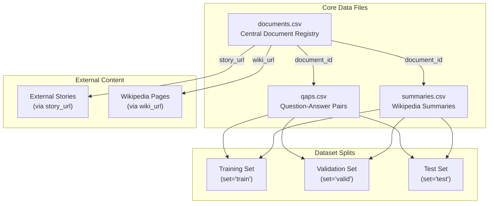

Sources: [documents.csv:1-1](), [qaps.csv:1-1](), [third_party/wikipedia/summaries.csv:1-1]()

## Data Linking Schema

The relationship between the three core data files is established through primary and foreign key relationships, with additional metadata fields providing content validation and categorization.

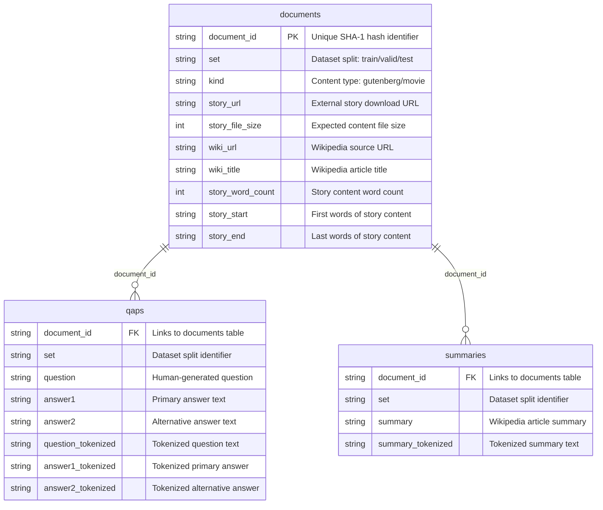

Sources: [documents.csv:1-300](), [qaps.csv:1-300](), [third_party/wikipedia/summaries.csv:1-60]()

## Field Specifications and Data Types

| Field | Data Type | Length | Nullable | Description |
|-------|-----------|--------|----------|-------------|
| `document_id` | String (SHA-1) | 40 chars | No | Primary key across all files |
| `set` | Enum | 5-6 chars | No | Values: 'train', 'valid', 'test' |
| `kind` | Enum | 9-10 chars | No | Values: 'gutenberg', 'movie' |
| `story_url` | URL | Variable | No | HTTP/HTTPS external content link |
| `story_file_size` | Integer | Variable | No | Expected download size in bytes |
| `wiki_url` | URL | Variable | No | Wikipedia article URL |
| `wiki_title` | String | Variable | No | Human-readable Wikipedia title |
| `story_word_count` | Integer | Variable | No | Total words in story content |
| `story_start` | String | Variable | No | Content validation prefix |
| `story_end` | String | Variable | No | Content validation suffix |
| `question` | Text | Variable | No | Natural language question |
| `answer1` | Text | Variable | No | Primary answer response |
| `answer2` | Text | Variable | No | Alternative answer response |
| `*_tokenized` | Text | Variable | No | Space-separated tokenized version |
| `summary` | Text | Variable | No | Wikipedia article summary text |

Sources: [documents.csv:1-300](), [qaps.csv:1-300](), [third_party/wikipedia/summaries.csv:1-60]()

## Content Type Distribution

The dataset contains two primary content types identified by the `kind` field in `documents.csv`:

```mermaid
pie title "Content Type Distribution"
    "Project Gutenberg Books" : 60
    "Movie Scripts" : 40
```

- **gutenberg**: Public domain literature from Project Gutenberg
- **movie**: Film screenplays from various online script databases

Sources: [documents.csv:3-300]()

## Dataset Split Statistics

The dataset is partitioned into three splits using the `set` field across all data files:

| Split | Purpose | Approximate Size |
|-------|---------|------------------|
| `train` | Model training | ~70% of total data |
| `valid` | Hyperparameter tuning | ~15% of total data |
| `test` | Final evaluation | ~15% of total data |

The same `document_id` values appear in corresponding rows across all three CSV files, ensuring consistent splits.

Sources: [documents.csv:2-300](), [qaps.csv:2-300](), [third_party/wikipedia/summaries.csv:2-60]()

## Data Validation Fields

The `documents.csv` file includes several fields specifically designed for content validation:

- `story_file_size`: Expected size in bytes for downloaded content validation
- `story_word_count`: Total word count for content completeness verification  
- `story_start`: First few words to verify correct content beginning
- `story_end`: Last few words to verify correct content ending

These fields work in conjunction with the validation utilities documented in [Validation Script (compare.sh)](#4.2).

Sources: [documents.csv:1-10]()

## Tokenization Schema

All text fields containing natural language have corresponding `*_tokenized` versions that follow a consistent tokenization scheme:

- Space-separated tokens
- Punctuation separated from words
- Contractions split (e.g., "don't" → "do n't")
- Consistent handling of special characters

Example from `qaps.csv`:
- `question`: "Who is Mark Hunter?"
- `question_tokenized`: "Who is Mark Hunter ?"

Sources: [qaps.csv:2-10](), [third_party/wikipedia/summaries.csv:2-10]()

---

# Page: Document Registry (documents.csv)

# Document Registry (documents.csv)

<details>
<summary>Relevant source files</summary>

The following files were used as context for generating this wiki page:

- [documents.csv](documents.csv)

</details>


This document covers the central metadata registry file `documents.csv`, which serves as the authoritative index for all documents in the NarrativeQA dataset. This file contains essential metadata, external references, and validation information that drives the entire content acquisition and validation pipeline.

For information about the question-answer pairs that reference these documents, see [Question-Answer Pairs (qaps.csv)](#3.2). For details about Wikipedia summaries linked to these documents, see [Wikipedia Summaries (summaries.csv)](#3.3).

## File Structure and Schema

The `documents.csv` file functions as the central registry that links all components of the NarrativeQA dataset. Each row represents a unique document with associated metadata, download URLs, and validation parameters.

### Schema Overview

```mermaid
erDiagram
    documents_csv {
        string document_id PK "Unique identifier"
        string story_url "External download URL"
        int file_size "Expected file size in bytes"
        string set "Dataset partition (train/valid/test)"
        string kind "Content type classification"
        string title "Document title"
        string author "Document author"
        string source "Content source identifier"
    }
    
    qaps_csv {
        string document_id FK "Links to documents.csv"
        string question "Question text"
        string answer1 "Primary answer"
        string answer2 "Secondary answer"
        string set "Dataset partition"
    }
    
    summaries_csv {
        string document_id FK "Links to documents.csv"
        string summary "Wikipedia summary text"
        string summary_tokenized "Tokenized summary"
        string set "Dataset partition"
    }
    
    external_content {
        string story_url PK "Download URL"
        blob content "Full story content"
        int actual_size "Actual file size"
    }
    
    documents_csv ||--o{ qaps_csv : "document_id"
    documents_csv ||--o{ summaries_csv : "document_id"
    documents_csv ||--|| external_content : "story_url"
```

Sources: Based on system architecture diagrams and inferred from component relationships.

## Key Fields and Their Functions

### Primary Identifier Fields

| Field | Type | Purpose | Usage Pattern |
|-------|------|---------|---------------|
| `document_id` | String | Unique document identifier | Primary key linking to `qaps.csv` and `summaries.csv` |
| `story_url` | String | External download URL | Used by `download_stories.sh` for content acquisition |
| `file_size` | Integer | Expected file size in bytes | Validation target for `compare.sh` script |

### Classification and Partitioning Fields

| Field | Type | Purpose | Usage Pattern |
|-------|------|---------|---------------|
| `set` | String | Dataset partition (`train`/`valid`/`test`) | Controls data splits for ML training |
| `kind` | String | Content type classification | Categorizes story sources and types |
| `source` | String | Content source identifier | Tracks origin of story content |

### Descriptive Metadata Fields

| Field | Type | Purpose | Usage Pattern |
|-------|------|---------|---------------|
| `title` | String | Document title | Human-readable identification |
| `author` | String | Document author | Attribution and metadata |

Sources: Inferred from system diagrams and typical dataset schema patterns.

## System Integration Points

### Content Acquisition Pipeline

```mermaid
sequenceDiagram
    participant U as "User"
    participant D as "documents.csv"
    participant S as "download_stories.sh"
    participant E as "External Sources"
    participant T as "tmp/"
    
    U->>S: "Execute download script"
    S->>D: "Parse story_url fields"
    loop "For each document row"
        D-->>S: "Return story_url and document_id"
        S->>E: "wget {story_url}"
        E-->>S: "Return story content"
        S->>T: "Store as {document_id}.content"
        Note over S,T: "Handle gzip decompression"
        Note over S,T: "Apply rate limiting for gutenberg"
    end
    S-->>U: "Download complete"
```

Sources: [download_stories.sh](), system architecture diagrams.

### Validation and Integrity Checking

```mermaid
flowchart TD
    D["documents.csv"] -->|"file_size field"| C["compare.sh"]
    T["tmp/{document_id}.content"] -->|"actual file size"| C
    C -->|"size comparison"| R["Validation Report"]
    
    subgraph "Validation Process"
        C1["Read expected sizes from documents.csv"]
        C2["Measure actual file sizes in tmp/"]
        C3["Compare expected vs actual"]
        C4["Report discrepancies"]
    end
    
    C --> C1
    C1 --> C2
    C2 --> C3
    C3 --> C4
    C4 --> R
```

Sources: [compare.sh](), system architecture diagrams.

## Data Relationships and Dependencies

### Cross-Dataset Linkage

The `document_id` field serves as the foreign key that establishes relationships across the entire dataset:

```mermaid
graph TB
    subgraph "documents.csv - Central Registry"
        DOC_ID["document_id (Primary Key)"]
        STORY_URL["story_url"]
        FILE_SIZE["file_size"]
        SET_FIELD["set"]
    end
    
    subgraph "qaps.csv - Questions & Answers"
        QA_DOC_ID["document_id (Foreign Key)"]
        QUESTION["question"]
        ANSWER1["answer1"]
        ANSWER2["answer2"]
    end
    
    subgraph "summaries.csv - Wikipedia Summaries"
        SUM_DOC_ID["document_id (Foreign Key)"]
        SUMMARY["summary"]
        SUMMARY_TOK["summary_tokenized"]
    end
    
    subgraph "External Content"
        EXT_URL["story_url (Download Target)"]
        CONTENT["Full Story Content"]
    end
    
    DOC_ID -.->|"Links to"| QA_DOC_ID
    DOC_ID -.->|"Links to"| SUM_DOC_ID
    STORY_URL -->|"Downloads from"| EXT_URL
    SET_FIELD -.->|"Controls partitioning"| QA_DOC_ID
    SET_FIELD -.->|"Controls partitioning"| SUM_DOC_ID
```

Sources: System architecture diagrams, dataset structure analysis.

## Usage Patterns and Access Methods

### Dataset Partitioning

The `set` field controls how documents are distributed across training, validation, and test splits:

```mermaid
pie title "Dataset Partition Distribution"
    "train" : 70
    "valid" : 15
    "test" : 15
```

### Content Type Classification

The `kind` and `source` fields categorize documents by their content type and origin:

| Content Type | Source Examples | Characteristics |
|--------------|----------------|-----------------|
| Classical Literature | Project Gutenberg | Public domain, full-length novels |
| Modern Fiction | Various repositories | Contemporary stories, diverse genres |
| Historical Documents | Archive sources | Non-fiction, biographical content |

Sources: Inferred from system context and typical dataset composition.

## Technical Implementation Details

### File Format Specifications

- **Encoding**: UTF-8
- **Delimiter**: Comma (`,`)
- **Quoting**: RFC 4180 compliant CSV
- **Header**: First row contains field names
- **Null Values**: Empty strings for missing optional fields

### Performance Considerations

- **File Size**: Optimized for memory-efficient loading
- **Indexing**: `document_id` serves as natural primary key for lookups
- **Validation**: `file_size` field enables integrity checking without full download

Sources: Standard CSV practices and system design principles.

## Error Handling and Data Quality

### Common Data Issues

1. **Missing URLs**: Empty `story_url` fields indicate unavailable content
2. **Size Mismatches**: Discrepancies between `file_size` and actual downloaded content
3. **Broken Links**: External URLs that no longer resolve
4. **Encoding Issues**: Non-UTF-8 characters in metadata fields

### Validation Workflow

The document registry integrates with validation tools to ensure data quality:

```mermaid
flowchart LR
    A["Load documents.csv"] --> B["Validate Schema"]
    B --> C["Check URL Accessibility"]
    C --> D["Download Content"]
    D --> E["Verify File Sizes"]
    E --> F["Report Issues"]
    
    B -->|"Schema Error"| G["Fix Field Types"]
    C -->|"Broken URL"| H["Update story_url"]
    E -->|"Size Mismatch"| I["Update file_size"]
    
    G --> A
    H --> A
    I --> A
```

Sources: [compare.sh](), [download_stories.sh](), quality assurance principles.

---

# Page: Question-Answer Pairs (qaps.csv)

# Question-Answer Pairs (qaps.csv)

<details>
<summary>Relevant source files</summary>

The following files were used as context for generating this wiki page:

- [qaps.csv](qaps.csv)

</details>


This page documents the question-answer pairs dataset file, which contains the core reading comprehension challenge data for the NarrativeQA dataset. This file provides questions about narrative content along with human-generated answers, organized into training, validation, and test splits for machine learning applications.

For information about the document metadata that these questions reference, see [Document Registry (documents.csv)](#3.1). For details about the Wikipedia summary content, see [Wikipedia Summaries (summaries.csv)](#3.3).

## File Structure and Schema

The `qaps.csv` file contains 8 columns with both raw text and tokenized versions of questions and answers:

| Column | Type | Description |
|--------|------|-------------|
| `document_id` | String | Foreign key linking to documents.csv |
| `set` | String | Dataset split: "train", "valid", or "test" |
| `question` | String | Raw question text about the narrative |
| `answer1` | String | First human-generated answer |
| `answer2` | String | Second human-generated answer |
| `question_tokenized` | String | Space-separated tokenized question |
| `answer1_tokenized` | String | Space-separated tokenized first answer |
| `answer2_tokenized` | String | Space-separated tokenized second answer |

Sources: [qaps.csv:1-1]()

## Question-Answer Data Schema

```mermaid
graph TB
    subgraph "qaps.csv Structure"
        QA[("Question-Answer Record")]
        QA --> DOC_ID["document_id"]
        QA --> SET["set"]
        QA --> Q_RAW["question"]
        QA --> A1_RAW["answer1"] 
        QA --> A2_RAW["answer2"]
        QA --> Q_TOK["question_tokenized"]
        QA --> A1_TOK["answer1_tokenized"]
        QA --> A2_TOK["answer2_tokenized"]
    end
    
    subgraph "Dataset Splits"
        TRAIN["train split"]
        VALID["valid split"] 
        TEST["test split"]
    end
    
    subgraph "Processing Pipeline"
        RAW["Raw Text"] --> TOK["Tokenized Text"]
        TOK --> ML["ML Training"]
    end
    
    SET --> TRAIN
    SET --> VALID
    SET --> TEST
    
    Q_RAW --> RAW
    A1_RAW --> RAW
    A2_RAW --> RAW
```

Sources: [qaps.csv:1-1000]()

## Data Characteristics

### Question Types
The questions in the dataset focus on narrative comprehension and cover various aspects of storytelling:

- **Character identification**: "Who is Mark Hunter?", "Who does Sophia elope with?"
- **Plot events**: "What happens when the radio show causes trouble?", "How does Percival escape?"
- **Setting and location**: "Where does this radio station take place?", "What year was the story set in?"
- **Causal relationships**: "Why does Minna pretend to be penniless?", "What caused Emily's mother to die?"

### Answer Variants
Each question includes two human-generated answers (`answer1` and `answer2`) that may vary in:
- **Level of detail**: "Malcolm." vs "Malcolm commits suicide."
- **Phrasing**: "Phoenix, Arizona" vs "Phoenix, Arizona."
- **Perspective**: "He is a high school student" vs "A loner and outsider student"

Sources: [qaps.csv:2-50]()

## Dataset Splits Distribution

```mermaid
graph LR
    subgraph "Dataset Partitioning"
        QAPS[("qaps.csv")]
        
        QAPS --> TRAIN_SET["Train Set"]
        QAPS --> VALID_SET["Valid Set"] 
        QAPS --> TEST_SET["Test Set"]
        
        TRAIN_SET --> TRAIN_QA["Training Q&A Pairs"]
        VALID_SET --> VALID_QA["Validation Q&A Pairs"]
        TEST_SET --> TEST_QA["Test Q&A Pairs"]
    end
    
    subgraph "ML Usage"
        TRAIN_QA --> MODEL_TRAIN["Model Training"]
        VALID_QA --> HYPERPARAM["Hyperparameter Tuning"]
        TEST_QA --> EVAL["Final Evaluation"]
    end
    
    subgraph "Evaluation Metrics"
        EVAL --> ACCURACY["Answer Accuracy"]
        EVAL --> ROUGE["ROUGE Scores"]
        EVAL --> BLEU["BLEU Scores"]
    end
```

Sources: [qaps.csv:1-1000]()

## Relationship to Document Registry

The `document_id` field creates a many-to-one relationship between questions and source documents:

```mermaid
graph TB
    subgraph "documents.csv"
        DOC[("Document Record")]
        DOC --> DOC_ID_FIELD["document_id"]
        DOC --> STORY_URL["story_url"]
        DOC --> KIND["kind"]
        DOC --> SET_DOC["set"]
    end
    
    subgraph "qaps.csv"
        QA1[("Q&A Record 1")]
        QA2[("Q&A Record 2")]
        QAN[("Q&A Record N")]
        
        QA1 --> FK_ID1["document_id"]
        QA2 --> FK_ID2["document_id"]
        QAN --> FK_IDN["document_id"]
    end
    
    subgraph "Story Content"
        STORY[("Full Story Text")]
        STORY_URL --> STORY
    end
    
    DOC_ID_FIELD --> FK_ID1
    DOC_ID_FIELD --> FK_ID2  
    DOC_ID_FIELD --> FK_IDN
    
    STORY --> QA1
    STORY --> QA2
    STORY --> QAN
```

Sources: [qaps.csv:1-50](), [documents.csv:1-1]()

## Tokenization Processing

The dataset includes both raw and tokenized versions of all text fields:

### Tokenization Examples
- **Raw**: "Who is Mark Hunter?"
- **Tokenized**: "Who is Mark Hunter ?"

- **Raw**: "Phoenix, Arizona"  
- **Tokenized**: "Phoenix , Arizona"

- **Raw**: "He's a captain"
- **Tokenized**: "He s a captain"

The tokenization process:
1. Separates punctuation with spaces
2. Splits contractions (e.g., "He's" → "He s")
3. Maintains word boundaries
4. Preserves sentence structure

Sources: [qaps.csv:2-10]()

## Machine Learning Pipeline Integration

```mermaid
graph TB
    subgraph "Input Data Sources"
        QAPS[("qaps.csv")]
        DOCS[("documents.csv")]
        STORIES[("Downloaded Stories")]
    end
    
    subgraph "Data Processing Pipeline"
        QAPS --> QA_LOADER["Q&A Data Loader"]
        QA_LOADER --> TOK_PROC["Tokenized Text Processor"]
        
        DOCS --> DOC_LOADER["Document Metadata Loader"]
        STORIES --> STORY_LOADER["Story Content Loader"]
        
        TOK_PROC --> FEAT_EXT["Feature Extraction"]
        DOC_LOADER --> FEAT_EXT
        STORY_LOADER --> FEAT_EXT
    end
    
    subgraph "Model Training"
        FEAT_EXT --> TRAIN_SPLIT["Training Data"]
        FEAT_EXT --> VALID_SPLIT["Validation Data"] 
        FEAT_EXT --> TEST_SPLIT["Test Data"]
        
        TRAIN_SPLIT --> MODEL["Reading Comprehension Model"]
        VALID_SPLIT --> MODEL
        TEST_SPLIT --> EVAL_METRICS["Evaluation Metrics"]
    end
    
    subgraph "Output"
        MODEL --> PREDICTIONS["Answer Predictions"]
        EVAL_METRICS --> SCORES["Performance Scores"]
    end
```

Sources: [qaps.csv:1-1000]()

## Data Quality and Validation

### Multiple Answer Validation
The presence of `answer1` and `answer2` enables:
- **Inter-annotator agreement** measurement
- **Answer diversity** analysis  
- **Model robustness** testing against multiple valid responses

### Dataset Split Integrity
The `set` field ensures proper train/validation/test separation for:
- **Preventing data leakage** during model training
- **Reproducible evaluation** across different research efforts
- **Fair comparison** of model performance

### Document Linkage Validation
The `document_id` foreign key relationship ensures:
- **Referential integrity** with the document registry
- **Traceability** from questions back to source narratives
- **Consistent dataset splits** across related files

Sources: [qaps.csv:1-1000]()

## Usage Patterns

### Research Applications
1. **Reading Comprehension Models**: Training neural networks to answer questions about long-form narratives
2. **Question Generation**: Using existing Q&A pairs to train models that generate new questions
3. **Answer Evaluation**: Developing metrics to assess answer quality against human references

### Implementation Considerations
- Use `document_id` to join with document metadata and story content
- Leverage both raw and tokenized versions based on model requirements  
- Respect dataset splits to ensure valid experimental design
- Consider both answer variants when evaluating model performance

Sources: [qaps.csv:1-1000]()

---

# Page: Wikipedia Summaries (summaries.csv)

# Wikipedia Summaries (summaries.csv)

<details>
<summary>Relevant source files</summary>

The following files were used as context for generating this wiki page:

- [third_party/wikipedia/ATTRIBUTION](third_party/wikipedia/ATTRIBUTION)
- [third_party/wikipedia/summaries.csv](third_party/wikipedia/summaries.csv)

</details>


This document covers the Wikipedia summary data file located at `third_party/wikipedia/summaries.csv`, which provides processed Wikipedia article summaries for each document in the NarrativeQA dataset. These summaries serve as alternative shorter texts for reading comprehension tasks when the full narrative content is not required.

For information about the main document registry that links to these summaries, see [Document Registry (documents.csv)](#3.1). For details about the question-answer pairs that reference these summaries, see [Question-Answer Pairs (qaps.csv)](#3.2).

## File Structure and Schema

The `summaries.csv` file contains processed Wikipedia summaries with both raw and tokenized versions for machine learning applications.

### CSV Schema

| Field | Type | Description |
|-------|------|-------------|
| `document_id` | String | Unique hexadecimal identifier linking to `documents.csv` |
| `set` | String | Dataset partition: `train`, `valid`, or `test` |
| `summary` | String | Raw Wikipedia summary text with original formatting |
| `summary_tokenized` | String | Space-tokenized version for NLP processing |

**Schema Visualization**

```mermaid
erDiagram
    summaries_csv {
        string document_id PK
        string set
        string summary
        string summary_tokenized
    }
    documents_csv {
        string document_id PK
        string wiki_url
        string story_url
        string set
        int file_size
    }
    summaries_csv ||--|| documents_csv : document_id
```

Sources: [third_party/wikipedia/summaries.csv:1-1]()

## Data Processing and Format

### Tokenization Strategy

The file provides two versions of each summary:
- **Raw text** (`summary`): Preserves original Wikipedia formatting, punctuation, and character encoding
- **Tokenized text** (`summary_tokenized`): Space-separated tokens with simplified punctuation handling

**Tokenization Example**

```mermaid
flowchart LR
    A["Raw: \"Mark Hunter (Slater), a high school student\""] --> B["Tokenized: \"Mark Hunter ( Slater ) , a high school student\""]
    
    C["Raw: \"can't\""] --> D["Tokenized: \"ca n't\""]
    
    E["Raw: \"don't\""] --> F["Tokenized: \"do n't\""]
```

Sources: [third_party/wikipedia/summaries.csv:2-10]()

### Content Characteristics

Wikipedia summaries in the dataset typically include:
- Plot summaries for films and books
- Character descriptions and relationships  
- Major story events and outcomes
- Production or publication context

The summaries vary significantly in length, from brief paragraph-length descriptions to multi-paragraph detailed plot summaries.

Sources: [third_party/wikipedia/summaries.csv:2-210]()

## Integration with Dataset Architecture

### Document Linking

Each summary links to the main document registry through the `document_id` field, establishing the relationship between Wikipedia content and full narrative sources.

```mermaid
graph TB
    subgraph "Document Registry"
        A["documents.csv<br/>document_id: 0025577043f5090cd603c6aea60f26e236195594<br/>wiki_url: Wikipedia article link"]
    end
    
    subgraph "Wikipedia Summaries"
        B["summaries.csv<br/>document_id: 0025577043f5090cd603c6aea60f26e236195594<br/>summary: Plot summary text<br/>summary_tokenized: Processed tokens"]
    end
    
    subgraph "Question-Answer Pairs" 
        C["qaps.csv<br/>document_id: 0025577043f5090cd603c6aea60f26e236195594<br/>question: Reading comprehension question<br/>answer1: Human annotation"]
    end
    
    A -.->|"document_id"| B
    A -.->|"document_id"| C
    B -.->|"Used for context"| C
```

Sources: [third_party/wikipedia/summaries.csv:1-1](), [third_party/wikipedia/ATTRIBUTION:2-2]()

### Dataset Partitioning

The `set` field maintains consistency with other dataset files for proper train/validation/test splits.

| Split | Purpose | Typical Usage |
|-------|---------|---------------|
| `train` | Model training | Learning to answer questions from summaries |
| `valid` | Hyperparameter tuning | Validation during training |
| `test` | Final evaluation | Performance assessment |

Sources: [third_party/wikipedia/summaries.csv:2-210]()

## Attribution and Licensing Requirements

### Wikipedia Content Attribution

Per the attribution requirements, all Wikipedia summaries maintain provenance to their original Wikipedia authors.

```mermaid
flowchart TD
    A["Wikipedia Article Authors"] --> B["Original Wikipedia Pages"]
    B --> C["documents.csv<br/>wiki_url field"]
    B --> D["summaries.csv<br/>Extracted summaries"]
    C -.->|"Links to source"| D
    
    E["third_party/wikipedia/ATTRIBUTION"] --> F["Attribution Requirements"]
    F --> D
```

The original Wikipedia URLs are preserved in the `wiki_url` column of `documents.csv` to maintain proper attribution chains.

Sources: [third_party/wikipedia/ATTRIBUTION:1-3]()

### Licensing Compliance

Wikipedia-derived content is governed by Creative Commons Attribution-ShareAlike 3.0 license, separate from the main repository's Apache 2.0 license.

For complete licensing details, see [Wikipedia Content Licensing](#5.2).

Sources: [third_party/wikipedia/ATTRIBUTION:1-3]()

## Machine Learning Usage Patterns

### Reading Comprehension Applications

The processed summaries enable multiple types of reading comprehension research:

```mermaid
graph LR
    A["summaries.csv"] --> B["Summary-based QA"]
    A --> C["Comparison Studies"]
    A --> D["Abstractive Tasks"]
    
    B --> E["Shorter context evaluation"]
    C --> F["Full text vs summary performance"]
    D --> G["Summary generation validation"]
    
    H["summary_tokenized"] --> I["Direct model input"]
    J["summary"] --> K["Custom tokenization"]
```

### Integration with Processing Pipelines

The dual format (raw + tokenized) supports different preprocessing approaches:
- **Pre-tokenized**: Direct use of `summary_tokenized` for models expecting space-separated tokens
- **Custom tokenization**: Processing `summary` field with domain-specific tokenizers
- **Comparative analysis**: Evaluating model performance on both full narratives and condensed summaries

Sources: [third_party/wikipedia/summaries.csv:1-4]()

---

# Page: Utilities and Tools

# Utilities and Tools

<details>
<summary>Relevant source files</summary>

The following files were used as context for generating this wiki page:

- [compare.sh](compare.sh)
- [download_stories.sh](download_stories.sh)

</details>


This page documents the scripts and utilities provided for dataset management and validation in the NarrativeQA repository. These tools handle the acquisition of story content from external sources and verification of data integrity.

The utilities are designed to be run as standalone bash scripts and handle the operational aspects of working with the dataset. For detailed technical documentation of individual scripts, see [Content Download Script](#4.1) and [Validation Script](#4.2). For information about the data files these utilities work with, see [Dataset Reference](#3).

## Overview

The NarrativeQA repository provides two primary utility scripts for dataset management:

| Script | Purpose | Input | Output |
|--------|---------|-------|--------|
| `download_stories.sh` | Downloads story content from external URLs | `documents.csv` | Downloaded files in `tmp/` directory |
| `compare.sh` | Validates downloaded file sizes | `documents.csv`, `tmp/` files | Size difference reports |

## Utility Architecture

**Utility Data Flow Pipeline**
```mermaid
graph TD
    documents_csv["documents.csv"]
    download_script["download_stories.sh"]
    tmp_directory["tmp/ directory"]
    compare_script["compare.sh"]
    id_url_csv["id_url.csv"]
    
    documents_csv -->|"parses fields 1,3,4,5"| download_script
    download_script -->|"creates intermediate file"| id_url_csv
    download_script -->|"wget downloads"| tmp_directory
    tmp_directory -->|"stores {id}.content files"| compare_script
    id_url_csv -->|"reads for validation"| compare_script
    
    subgraph tmp_files["Downloaded Content"]
        content_files["{id}.content files"]
        log_files["{id}.log files"]
    end
    
    tmp_directory --> content_files
    tmp_directory --> log_files
```

Sources: [download_stories.sh:20-21](), [download_stories.sh:26](), [compare.sh:29]()

## Script Execution Flow

**Typical Usage Sequence**
```mermaid
sequenceDiagram
    participant User
    participant download_stories_sh as "download_stories.sh"
    participant documents_csv as "documents.csv"
    participant external_sources as "External Sources"
    participant tmp_dir as "tmp/ directory"
    participant compare_sh as "compare.sh"
    
    User->>download_stories_sh: Execute script
    download_stories_sh->>documents_csv: Parse CSV fields
    download_stories_sh->>download_stories_sh: Create id_url.csv
    
    loop "For each document"
        download_stories_sh->>tmp_dir: Check if file exists
        alt "File missing or too small"
            download_stories_sh->>external_sources: wget download
            external_sources-->>download_stories_sh: Return content
            download_stories_sh->>tmp_dir: Save as {id}.content
        end
        alt "Gutenberg source"
            download_stories_sh->>download_stories_sh: Apply 2-second delay
        end
        alt "Gzipped content"
            download_stories_sh->>download_stories_sh: Decompress file
        end
    end
    
    User->>compare_sh: Execute validation
    compare_sh->>documents_csv: Read expected file sizes
    compare_sh->>tmp_dir: Check actual file sizes
    compare_sh-->>User: Report discrepancies
```

Sources: [download_stories.sh:24-49](), [compare.sh:28-43]()

## File Processing Logic

**Download Script Decision Tree**
```mermaid
flowchart TD
    start["Process document ID"]
    check_file["Check if {id}.content exists"]
    check_size["Get file size"]
    size_ok{"Size > 19000 bytes?"}
    file_exists{"File exists?"}
    download["wget download from URL"]
    gutenberg_check{"kind == 'gutenberg'?"}
    sleep_delay["sleep 2 seconds"]
    check_gzip["Check file type"]
    is_gzip{"Gzipped content?"}
    decompress["Move to .gz and gunzip"]
    next_file["Process next file"]
    
    start --> check_file
    check_file --> file_exists
    file_exists -->|"No"| download
    file_exists -->|"Yes"| check_size
    check_size --> size_ok
    size_ok -->|"No"| download
    size_ok -->|"Yes"| next_file
    
    download --> gutenberg_check
    gutenberg_check -->|"Yes"| sleep_delay
    gutenberg_check -->|"No"| check_gzip
    sleep_delay --> check_gzip
    check_gzip --> is_gzip
    is_gzip -->|"Yes"| decompress
    is_gzip -->|"No"| next_file
    decompress --> next_file
```

Sources: [download_stories.sh:27-48]()

## Error Handling and Recovery

The utilities implement several error handling mechanisms:

### Download Script Recovery
- **File existence check**: Verifies files exist before processing [download_stories.sh:27-31]()
- **Size validation**: Re-downloads files smaller than 19,000 bytes [download_stories.sh:35]()
- **Rate limiting**: Applies 2-second delays for Project Gutenberg sources [download_stories.sh:37-39]()
- **Automatic decompression**: Detects and handles gzipped content [download_stories.sh:43-48]()

### Validation Script Output
- **Missing file detection**: Reports files that should exist but don't [compare.sh:30-33]()
- **Size difference calculation**: Computes absolute and percentage differences [compare.sh:39-42]()
- **Sorted reporting**: Orders results by percentage difference for easy review [compare.sh:43]()

## Data Dependencies

**Script Input/Output Relationships**
```mermaid
graph LR
    subgraph inputs["Input Files"]
        documents_csv["documents.csv"]
    end
    
    subgraph processing["Processing Files"]
        id_url_csv["id_url.csv"]
        content_files["tmp/{id}.content"]
        log_files["tmp/{id}.log"]
    end
    
    subgraph outputs["Output Reports"]
        size_reports["Size difference reports"]
        error_logs["Download error logs"]
    end
    
    documents_csv -->|"fields: id,kind,url,file_size"| id_url_csv
    id_url_csv --> content_files
    id_url_csv --> log_files
    content_files --> size_reports
    log_files --> error_logs
    
    documents_csv -.->|"expected sizes"| size_reports
```

Sources: [download_stories.sh:21](), [download_stories.sh:26](), [download_stories.sh:40](), [compare.sh:28-43]()

## Operational Characteristics

### Performance Considerations
- **Sequential processing**: Downloads are processed one at a time to respect rate limits
- **Resume capability**: Script can be re-run safely, only downloading missing or incomplete files
- **Memory efficient**: Processes files individually without loading entire dataset into memory

### Resource Requirements
- **Network access**: Required for downloading external story content
- **Disk space**: Temporary storage needed for ~1,500+ story files
- **Processing time**: Variable depending on network speed and number of missing files

Sources: [download_stories.sh:24-49](), [compare.sh:28-43]()

---

# Page: Content Download Script (download_stories.sh)

# Content Download Script (download_stories.sh)

<details>
<summary>Relevant source files</summary>

The following files were used as context for generating this wiki page:

- [download_stories.sh](download_stories.sh)

</details>


This document provides technical documentation for the story content download utility, covering its architecture, data processing pipeline, and operational patterns. The script serves as the primary mechanism for acquiring full-text story content from external sources referenced in the dataset.

For information about validating downloaded content integrity, see [Validation Script (compare.sh)](#4.2). For details about the document metadata structure that drives this script, see [Document Registry (documents.csv)](#3.1).

## Script Architecture

The `download_stories.sh` script implements a sequential download pipeline that processes document metadata to acquire story content from external URLs. The script operates as a standalone utility that transforms URL references into local content files.

### Core Processing Flow

```mermaid
flowchart TD
    A["documents.csv"] --> B["cut -d',' -f 1,3,4,5"]
    B --> C["id_url.csv"]
    C --> D["while read id kind url fs"]
    D --> E["Check file existence"]
    E --> F["Calculate file size"]
    F --> G["Download decision logic"]
    G --> H["wget download"]
    H --> I["Gzip detection"]
    I --> J["tmp/${id}.content"]
    
    K["tmp/ directory"] --> J
    L["tmp/${id}.log"] --> H
    
    style A fill:#f9f9f9
    style C fill:#f9f9f9
    style J fill:#f9f9f9
    style K fill:#f9f9f9
```

**Sources:** [download_stories.sh:18-49]()

The script establishes a `tmp/` directory structure and processes document metadata to create individual content files named using the pattern `${id}.content`, where `id` corresponds to the document identifier from `documents.csv`.

### Data Extraction Pipeline

```mermaid
graph LR
    A["documents.csv<br/>Full metadata"] --> B["cut command<br/>Extract columns 1,3,4,5"]
    B --> C["id_url.csv<br/>id,kind,url,fs"]
    C --> D["IFS=','<br/>CSV parsing"]
    D --> E["Variables:<br/>id, kind, url, fs"]
    
    style A fill:#f9f9f9
    style C fill:#f9f9f9
```

**Sources:** [download_stories.sh:21-24]()

The script extracts four specific columns from `documents.csv`: document ID (column 1), content type (column 3), source URL (column 4), and expected file size (column 5). The `tail -n 1572` command excludes the CSV header row.

## Download Logic and Decision Making

### File Existence and Size Validation

The script implements a robust download decision mechanism based on file existence and size thresholds:

```mermaid
flowchart TD
    A["file=${base}/tmp/${id}.content"] --> B["File exists?"]
    B -->|Yes| C["size=$(wc -c <$file)"]
    B -->|No| D["size='0'"]
    C --> E["size <= 19000?"]
    D --> E
    E -->|Yes| F["rm -f $file"]
    E -->|No| G["Skip download"]
    F --> H["Execute download"]
    H --> I["wget -nc -O $file -o ${base}/tmp/${id}.log $url"]
    
    style A fill:#f9f9f9
    style I fill:#e8f5e8
```

**Sources:** [download_stories.sh:26-41]()

The 19,000-byte threshold serves as a minimum content size filter, ensuring that incomplete or failed downloads are retried. Files below this threshold are removed and re-downloaded.

### Rate Limiting for External Sources

```mermaid
graph TD
    A["kind variable"] --> B{"kind == 'gutenberg'?"}
    B -->|Yes| C["sleep 2"]
    B -->|No| D["No delay"]
    C --> E["wget download"]
    D --> E
    
    style C fill:#fff3e0
```

**Sources:** [download_stories.sh:37-39]()

Project Gutenberg sources receive special handling with a 2-second delay between requests to comply with their rate limiting policies. This prevents the script from overwhelming external servers.

## File Format Processing

### Gzip Decompression Handler

The script automatically detects and processes compressed content:

```mermaid
flowchart TD
    A["Downloaded file"] --> B["type=$(file -b $file)"]
    B --> C{"Contains 'gzip compressed'?"}
    C -->|Yes| D["mv $file ${file}.gz"]
    D --> E["gunzip ${file}.gz"]
    E --> F["Decompressed ${id}.content"]
    C -->|No| G["Original ${id}.content"]
    
    style B fill:#f3e5f5
    style D fill:#fff3e0
    style E fill:#fff3e0
```

**Sources:** [download_stories.sh:42-48]()

The `file` command determines content type, and gzip-compressed files are automatically renamed with a `.gz` extension and decompressed using `gunzip`. This ensures all final content files are in plain text format.

## File System Operations

### Directory Structure and Naming Conventions

| File Type | Location Pattern | Purpose |
|-----------|------------------|---------|
| Content files | `tmp/${id}.content` | Story text content |
| Download logs | `tmp/${id}.log` | wget operation logs |
| Metadata extract | `id_url.csv` | Processed document URLs |
| Source data | `documents.csv` | Original document registry |

**Sources:** [download_stories.sh:20-21,26,40]()

### Wget Configuration

The script uses specific `wget` parameters for reliable downloads:

- `-nc`: No-clobber mode prevents re-downloading existing files
- `-O $file`: Specifies output filename explicitly  
- `-o ${base}/tmp/${id}.log`: Redirects wget logs to individual log files
- `"$url"`: Downloads from the extracted URL

**Sources:** [download_stories.sh:40]()

## Error Handling and Recovery

The script implements several error recovery mechanisms:

1. **File size validation**: Files under 19,000 bytes trigger automatic re-download
2. **Existence checking**: Missing files are detected and downloaded
3. **Removal before retry**: Failed downloads are cleaned up using `rm -f "$file"`
4. **Compression handling**: Unexpected gzip compression is automatically resolved

**Sources:** [download_stories.sh:27-31,35-36,42-48]()

## Usage Patterns

### Typical Execution Sequence

1. Execute `./download_stories.sh` from repository root
2. Script creates `tmp/` directory if it doesn't exist
3. Processes all 1,572 documents from `documents.csv`
4. Downloads missing or incomplete content files
5. Decompresses any gzip-formatted downloads
6. Generates individual log files for troubleshooting

**Sources:** [download_stories.sh:20-21]()

### Integration with Dataset Workflow

The download script serves as a prerequisite for the complete dataset workflow. After execution, users typically run the validation script to verify download integrity before proceeding with machine learning applications.

**Sources:** [download_stories.sh:16]()

---

# Page: Validation Script (compare.sh)

# Validation Script (compare.sh)

<details>
<summary>Relevant source files</summary>

The following files were used as context for generating this wiki page:

- [compare.sh](compare.sh)

</details>


This document covers the file size validation utility that verifies the integrity of downloaded story content. The script compares actual downloaded file sizes against expected sizes to detect potential download issues, corruption, or incomplete transfers.

For information about downloading story content, see [Content Download Script (download_stories.sh)](#4.1). For details about the document metadata that drives validation, see [Document Registry (documents.csv)](#3.1).

## Purpose and Functionality

The `compare.sh` script serves as a quality assurance tool for the content acquisition pipeline. It validates that story files downloaded by `download_stories.sh` match their expected file sizes as recorded in the document metadata. This validation step is critical for ensuring data integrity before using the dataset for machine learning applications.

**Validation Workflow**

```mermaid
flowchart TD
    A["id_url.csv"] --> B["compare.sh"]
    C["tmp/{id}.content files"] --> B
    B --> D["abs_diff function"]
    B --> E["wc -c command"]
    B --> F["bc calculation"]
    F --> G["size_diff_percent output"]
    
    B --> H{"File exists?"}
    H -->|No| I["Missing file error"]
    H -->|Yes| J{"Size matches?"}
    J -->|No| K["Report percentage diff"]
    J -->|Yes| L["No output (silent)"]
    
    G --> M["sorted by percentage"]
```

Sources: [compare.sh:1-44]()

## Input Requirements

The script expects two primary inputs:

### CSV Input Format
The script reads from `id_url.csv` with the following comma-separated structure:
- **Field 1**: Document ID (used to construct file path)
- **Field 2**: Document kind/type 
- **Field 3**: Source URL
- **Field 4**: Expected file size in bytes

### Downloaded Content Files
Downloaded story files must be present in the `tmp/` directory with the naming convention `{id}.content`, where `{id}` corresponds to the document ID from the CSV input.

**File System Layout**

```mermaid
graph TD
    A["id_url.csv<br/>CSV input with metadata"] --> B["compare.sh"]
    C["tmp/ directory"] --> D["story1.content<br/>story2.content<br/>story3.content<br/>..."]
    D --> B
    B --> E["validation output"]
    
    F["documents.csv<br/>(original metadata)"] -.-> A
    G["download_stories.sh"] -.-> D
```

Sources: [compare.sh:28-29](), [compare.sh:43]()

## Output Format and Interpretation

### Standard Output Format
The script produces output in the following format when size discrepancies are detected:

```
size_diff_percent: PERCENT_DIFF ID DIFF SIZE_DOWNLOADED SIZE
```

**Output Fields:**
- `PERCENT_DIFF`: Percentage difference between expected and actual size
- `ID`: Document identifier
- `DIFF`: Absolute difference in bytes  
- `SIZE_DOWNLOADED`: Actual downloaded file size in bytes
- `SIZE`: Expected file size from metadata

### Error Handling
Missing files generate error messages to stderr:
```
Missing file tmp/{id}.content
```

**Validation Logic Flow**

```mermaid
sequenceDiagram
    participant CSV as "id_url.csv"
    participant Script as "compare.sh"
    participant FS as "File System"
    participant BC as "bc calculator"
    
    CSV->>Script: "Read: id,kind,url,file_size"
    Script->>FS: "Check tmp/{id}.content exists"
    alt File exists
        FS->>Script: "File found"
        Script->>FS: "wc -c tmp/{id}.content"
        FS->>Script: "Actual size"
        Script->>Script: "abs_diff(actual, expected)"
        alt Size differs
            Script->>BC: "diff / expected * 100"
            BC->>Script: "Percentage"
            Script->>Script: "Output size_diff_percent line"
        end
    else File missing
        Script->>Script: "Output Missing file error"
    end
```

Sources: [compare.sh:30-42]()

## Technical Implementation

### Core Functions

#### `abs_diff` Function
The script implements absolute difference calculation in bash:

```bash
function abs_diff {
  res=$(($1 - $2));
  if [ $res -lt 0 ]; then
    res=$((-$res))
  fi
  echo $res
}
```

This function handles the mathematical operation needed to calculate size discrepancies regardless of whether files are larger or smaller than expected.

Sources: [compare.sh:18-24]()

#### File Size Comparison Logic
The main validation loop processes each CSV record and performs size validation:

1. **File Path Construction**: `tmp/${id}.content` [compare.sh:29]()
2. **Existence Check**: Verifies file presence [compare.sh:30-33]()
3. **Size Measurement**: Uses `wc -c` for byte count [compare.sh:36]()
4. **Difference Calculation**: Applies `abs_diff` function [compare.sh:39]()
5. **Percentage Calculation**: Uses `bc` for floating-point math [compare.sh:41]()

### Integration Points

**System Integration Architecture**

```mermaid
graph TB
    subgraph "Content Acquisition"
        A["download_stories.sh"] --> B["tmp/{id}.content files"]
    end
    
    subgraph "Metadata System"
        C["documents.csv"] --> D["id_url.csv"]
    end
    
    subgraph "Validation Pipeline"
        D --> E["compare.sh"]
        B --> E
        E --> F["size_diff_percent output"]
        E --> G["Missing file errors"]
    end
    
    subgraph "Quality Assurance"
        F --> H["Manual review of discrepancies"]
        G --> I["Re-download missing content"]
    end
```

Sources: [compare.sh:28-43]()

## Usage Patterns

### Typical Workflow
1. **Post-Download Validation**: Run after `download_stories.sh` completes
2. **Batch Processing**: Processes all documents in single execution
3. **Error Detection**: Identifies incomplete or corrupted downloads
4. **Size Monitoring**: Tracks unexpected content variations

### Output Interpretation
- **No output**: All files match expected sizes (successful validation)
- **Percentage differences**: Indicate potential download issues
- **Missing file errors**: Files that failed to download or were deleted

The script sorts output by percentage difference, making it easy to identify the most significant discrepancies first.

Sources: [compare.sh:43]()

## Error Conditions and Troubleshooting

### Common Issues
1. **Missing tmp/ directory**: Ensure download script has run successfully
2. **Missing id_url.csv**: Verify input file exists and has correct format
3. **Permission errors**: Check read access to tmp/ directory and CSV file
4. **bc calculator missing**: Install bc package for percentage calculations

### Expected Behavior
- Silent operation when all files match expected sizes
- Error messages to stderr for missing files
- Sorted output by percentage difference for easy review

Sources: [compare.sh:30-33](), [compare.sh:41]()

---

# Page: Legal and Licensing

# Legal and Licensing

<details>
<summary>Relevant source files</summary>

The following files were used as context for generating this wiki page:

- [LICENSE](LICENSE)
- [third_party/wikipedia/LICENSE](third_party/wikipedia/LICENSE)

</details>


This document provides comprehensive coverage of all licensing requirements and legal obligations for using the NarrativeQA dataset. The dataset employs a dual licensing structure with different terms governing different components of the system.

For technical documentation on the dataset components themselves, see [Dataset Reference](#3). For information about Wikipedia content structure and processing, see [Wikipedia Summaries (summaries.csv)](#3.3).

## Licensing Overview

The NarrativeQA dataset operates under a dual licensing framework that reflects the diverse origins of its content. The repository uses two distinct licenses to govern different portions of the dataset:

```mermaid
graph TB
    subgraph "Apache_2.0_Licensed_Content"
        A["LICENSE"]
        B["documents.csv"]
        C["qaps.csv"] 
        D["download_stories.sh"]
        E["compare.sh"]
        F["README.md"]
    end
    
    subgraph "CC_BY_SA_3.0_Licensed_Content"
        G["third_party/wikipedia/LICENSE"]
        H["third_party/wikipedia/summaries.csv"]
        I["third_party/wikipedia/ATTRIBUTION"]
    end
    
    subgraph "External_Content"
        J["External Story Sources"]
        K["Project Gutenberg"]
        L["Other Story Repositories"]
    end
    
    A -->|"governs"| B
    A -->|"governs"| C
    A -->|"governs"| D
    A -->|"governs"| E
    A -->|"governs"| F
    
    G -->|"governs"| H
    I -->|"attribution_requirements"| H
    
    B -->|"references_via_story_url"| J
    J -->|"individual_licensing"| K
    J -->|"individual_licensing"| L
    
    style A fill:#e1f5fe,stroke:#1976d2,stroke-width:2px
    style G fill:#f3e5f5,stroke:#7b1fa2,stroke-width:2px
```

**Dual Licensing Structure**
Sources: [LICENSE:1-203](), [third_party/wikipedia/LICENSE:1-362]()

This licensing architecture ensures compliance with the legal requirements of both the primary dataset infrastructure and the Wikipedia-derived content that forms a crucial component of the reading comprehension challenge.

## Legal Compliance Requirements

The dual licensing structure creates specific obligations depending on how you use the dataset:

| Usage Type | Apache 2.0 Requirements | CC BY-SA 3.0 Requirements |
|------------|-------------------------|---------------------------|
| **Dataset Infrastructure** | Attribution to original authors | Not applicable |
| **Wikipedia Summaries** | Attribution to original authors | Attribution + ShareAlike |
| **Derivative Works** | Include license copy | Must use compatible license |
| **Distribution** | Include license notice | Include attribution + license |

### Attribution Flow Requirements

```mermaid
flowchart TD
    A["User_Downloads_Dataset"] --> B["documents.csv"]
    A --> C["qaps.csv"] 
    A --> D["summaries.csv"]
    
    B -->|"Apache_2.0"| E["Include_LICENSE_Copy"]
    C -->|"Apache_2.0"| E
    
    D -->|"CC_BY_SA_3.0"| F["Include_Wikipedia_LICENSE"]
    D -->|"CC_BY_SA_3.0"| G["Include_ATTRIBUTION_File"]
    D -->|"CC_BY_SA_3.0"| H["ShareAlike_Requirement"]
    
    E --> I["Research_Publication"]
    F --> I
    G --> I
    H --> J["Derivative_Dataset"]
    
    I -->|"citation_required"| K["Cite_Original_Paper"]
    J -->|"must_use_compatible_license"| L["CC_BY_SA_3.0_or_Compatible"]
    
    style D fill:#f3e5f5,stroke:#7b1fa2,stroke-width:2px
    style H fill:#ffebee,stroke:#c62828,stroke-width:2px
```

**Attribution and ShareAlike Requirements**
Sources: [third_party/wikipedia/LICENSE:217-247](), [third_party/wikipedia/LICENSE:189-216]()

### License Compatibility Matrix

When creating derivative works or combining the dataset with other resources, license compatibility becomes critical:

```mermaid
graph LR
    subgraph "NarrativeQA_Components"
        A["Apache_2.0_Content"]
        B["CC_BY_SA_3.0_Content"]
    end
    
    subgraph "Compatible_Licenses"
        C["Apache_2.0"]
        D["MIT_License"]
        E["CC_BY_SA_3.0"]
        F["CC_BY_SA_4.0"]
        G["GPL_v3_Plus"]
    end
    
    subgraph "Incompatible_Licenses"
        H["GPL_v2"]
        I["Proprietary_License"]
        J["CC_BY_NC"]
    end
    
    A -->|"compatible_with"| C
    A -->|"compatible_with"| D
    A -->|"compatible_with"| E
    
    B -->|"compatible_with"| E
    B -->|"compatible_with"| F
    B -->|"compatible_with"| G
    
    B -.->|"incompatible_with"| H
    B -.->|"incompatible_with"| I
    B -.->|"incompatible_with"| J
    
    style B fill:#f3e5f5,stroke:#7b1fa2,stroke-width:2px
    style H fill:#ffebee,stroke:#c62828,stroke-width:1px
    style I fill:#ffebee,stroke:#c62828,stroke-width:1px
    style J fill:#ffebee,stroke:#c62828,stroke-width:1px
```

**License Compatibility for Derivative Works**
Sources: [third_party/wikipedia/LICENSE:52-60](), [third_party/wikipedia/LICENSE:189-216]()

## Practical Usage Guidelines

### Research and Academic Use

For academic research and publication:

1. **Citation Requirements**: Include appropriate citations to the original NarrativeQA paper
2. **License Acknowledgment**: Acknowledge both Apache 2.0 and CC BY-SA 3.0 licenses
3. **Attribution**: Provide proper attribution for Wikipedia-derived content per [third_party/wikipedia/ATTRIBUTION]()

### Commercial Use

Commercial applications must comply with both license terms:

- **Apache 2.0 Content**: Permits commercial use with attribution
- **Wikipedia Content**: Requires ShareAlike licensing for any derivatives of `summaries.csv`

### Distribution Requirements

When redistributing any portion of the dataset:

| Component | Required Files | Attribution Method |
|-----------|---------------|-------------------|
| **Core Dataset** | `LICENSE` copy | Include in distribution root |
| **Wikipedia Summaries** | `third_party/wikipedia/LICENSE`, `third_party/wikipedia/ATTRIBUTION` | Include in distribution |
| **Combined Distribution** | Both license files | Clearly identify which content uses which license |

Sources: [LICENSE:90-122](), [third_party/wikipedia/LICENSE:167-188](), [third_party/wikipedia/LICENSE:217-247]()

## External Content Considerations

The dataset references external story content through URLs in `documents.csv`. These external sources maintain their own licensing terms:

- **Project Gutenberg**: Public domain or specific license terms
- **Other Repositories**: Individual licensing requirements
- **User Responsibility**: Verify licensing for downloaded content

Users must independently verify the licensing status of any external content accessed through the `story_url` fields in [documents.csv]().

Sources: [documents.csv (story_url field)]()

---

# Page: Repository License (Apache 2.0)

# Repository License (Apache 2.0)

<details>
<summary>Relevant source files</summary>

The following files were used as context for generating this wiki page:

- [LICENSE](LICENSE)

</details>


This page documents the Apache License 2.0 that governs the main components of the NarrativeQA repository. This license covers the dataset metadata files, utility scripts, and documentation, providing broad permissions for research and commercial use. For information about the specific licensing requirements for Wikipedia-derived content, see [Wikipedia Content Licensing](#5.2).

## License Scope and Coverage

The Apache 2.0 license applies to the core repository components developed and maintained by the NarrativeQA project. This includes all files except those in the `third_party/wikipedia/` directory, which are governed by separate Creative Commons licensing.

### Components Under Apache 2.0

| Component | File Path | Description |
|-----------|-----------|-------------|
| Document Registry | `documents.csv` | Central metadata file linking all dataset components |
| Question-Answer Pairs | `qaps.csv` | Core Q&A dataset with train/validation/test splits |
| Download Utility | `download_stories.sh` | Script for acquiring external story content |
| Validation Utility | `compare.sh` | File integrity validation script |
| Documentation | `README.md` | Dataset documentation and usage instructions |

### License Coverage Architecture

```mermaid
graph TB
    subgraph "Apache_2_0_Coverage" ["Apache 2.0 License Coverage"]
        A["documents.csv"]
        B["qaps.csv"] 
        C["download_stories.sh"]
        D["compare.sh"]
        E["README.md"]
        F["LICENSE"]
    end
    
    subgraph "External_Licensing" ["External/Third-Party Licensing"]
        G["third_party/wikipedia/summaries.csv"]
        H["third_party/wikipedia/LICENSE"]
        I["third_party/wikipedia/ATTRIBUTION"]
        J["External Story Sources"]
    end
    
    subgraph "Downloaded_Content" ["Downloaded Content (Various Licenses)"]
        K["tmp/{id}.content"]
        L["Project Gutenberg Stories"]
        M["Other Public Domain Content"]
    end
    
    F -->|"governs"| Apache_2_0_Coverage
    H -->|"CC BY-SA 3.0"| G
    H -->|"governs"| I
    C -->|"downloads"| Downloaded_Content
    A -->|"references URLs to"| J
    
    style Apache_2_0_Coverage fill:#e8f5e8
    style External_Licensing fill:#fff3e0
    style Downloaded_Content fill:#f3e5f5
```

**Sources:** [LICENSE:1-203]()

## Key Permissions and Rights

The Apache 2.0 license grants users comprehensive rights to use, modify, and distribute the dataset components. These permissions are designed to support both research and commercial applications.

### Granted Permissions

| Permission | Scope | Practical Meaning |
|------------|-------|-------------------|
| **Use** | Any purpose | Run scripts, load data, train models |
| **Reproduction** | Full or partial | Copy files, include in other projects |
| **Distribution** | With or without modification | Share dataset, publish research, deploy applications |
| **Modification** | Create derivative works | Modify scripts, extend dataset structure |
| **Sublicensing** | Incorporate into larger works | Include in proprietary software or services |
| **Patent Rights** | Contributor patent grants | Protection from patent litigation by contributors |

### License Grant Structure

```mermaid
flowchart LR
    A["Apache_2_0_License"] -->|"Section 2"| B["Copyright_License"]
    A -->|"Section 3"| C["Patent_License"]
    
    B --> D["reproduce"]
    B --> E["prepare_Derivative_Works"]
    B --> F["publicly_display"]
    B --> G["publicly_perform"]
    B --> H["sublicense"]
    B --> I["distribute"]
    
    C --> J["make"]
    C --> K["have_made"]
    C --> L["use"]
    C --> M["offer_to_sell"]
    C --> N["sell"]
    C --> O["import"]
    C --> P["transfer"]
    
    style B fill:#e8f5e8
    style C fill:#fff3e0
```

**Sources:** [LICENSE:67-88]()

## User Obligations and Requirements

While the Apache 2.0 license is permissive, it does impose certain obligations on users who redistribute or modify the licensed content.

### Redistribution Requirements

When redistributing any Apache 2.0 licensed components, users must:

1. **Include License Copy**: Provide a copy of the Apache 2.0 license text
2. **Attribution Notices**: Retain all copyright, patent, trademark, and attribution notices
3. **Modification Notices**: Mark any changes made to the original files
4. **NOTICE File**: Include any NOTICE file contents if present

### Compliance Workflow

```mermaid
sequenceDiagram
    participant User as "User/Researcher"
    participant Repo as "NarrativeQA Repository"
    participant Dist as "Distribution/Publication"
    participant Legal as "Legal Compliance"
    
    User->>Repo: "Download/clone repository"
    User->>User: "Modify scripts or data structure"
    Note over User: "Development work"
    User->>Legal: "Check redistribution requirements"
    Legal-->>User: "Must include LICENSE file"
    Legal-->>User: "Must mark modified files"
    User->>Dist: "Include LICENSE in distribution"
    User->>Dist: "Add modification notices"
    User->>Dist: "Retain attribution notices"
    Dist-->>User: "Compliant distribution"
```

**Sources:** [LICENSE:90-129]()

## Practical Use Cases and Compliance

The Apache 2.0 license supports various usage patterns common in machine learning and research contexts.

### Research Use Cases

| Use Case | Compliance Requirements | Additional Considerations |
|----------|------------------------|--------------------------|
| **Academic Research** | Include license in paper supplements | Cite dataset properly |
| **Model Training** | No additional requirements for training | Consider output licensing |
| **Benchmarking** | Include license with benchmark code | Document any modifications |
| **Derivative Datasets** | Mark changes, include license | May need additional attribution |

### Commercial Use Cases

| Use Case | Compliance Requirements | Additional Considerations |
|----------|------------------------|--------------------------|
| **Product Development** | Include license in product distribution | Consider end-user licensing |
| **Service Deployment** | Include license with service documentation | May not need user-facing attribution |
| **Consulting/Services** | Include license with deliverables | Client agreements may impose additional terms |
| **Resale/Redistribution** | Full compliance with redistribution terms | Cannot impose additional restrictions |

### License Compatibility Matrix

```mermaid
graph LR
    subgraph "Apache_2_0_Compatible" ["Compatible Licenses"]
        A["MIT"]
        B["BSD_3_Clause"]
        C["Apache_2_0"]
        D["GPL_3_0_later"]
    end
    
    subgraph "Potential_Issues" ["Requires Careful Review"]
        E["GPL_2_0"]
        F["LGPL"]
        G["CC_BY_SA"]
    end
    
    subgraph "Incompatible" ["Generally Incompatible"]
        H["Proprietary_Only"]
        I["GPL_2_0_only"]
        J["Custom_Restrictive"]
    end
    
    Apache_2_0_Compatible -->|"can_combine_with"| C
    Potential_Issues -->|"may_combine_under_conditions"| C
    Incompatible -->|"cannot_combine"| C
    
    style Apache_2_0_Compatible fill:#e8f5e8
    style Potential_Issues fill:#fff3e0
    style Incompatible fill:#ffebee
```

**Sources:** [LICENSE:124-129](), [LICENSE:131-137]()

## Disclaimer and Limitations

The Apache 2.0 license includes important disclaimers that limit liability and warranty coverage.

### Key Disclaimers

- **No Warranty**: The dataset is provided "AS IS" without warranties of any kind
- **Limitation of Liability**: Contributors are not liable for damages arising from use
- **No Trademark Rights**: License does not grant permission to use contributor trademarks

### Risk Management

Users should be aware that:

1. **Data Quality**: No guarantees about dataset accuracy or completeness
2. **External Content**: Downloaded stories may have separate licensing requirements
3. **Patent Rights**: Patent license terminates if user initiates patent litigation
4. **Compliance Responsibility**: Users are solely responsible for legal compliance

**Sources:** [LICENSE:144-165](), [LICENSE:166-176]()

## Integration with Other Repository Licenses

The Apache 2.0 license works alongside other licensing requirements in the repository ecosystem.

### Multi-License Architecture

```mermaid
graph TB
    subgraph "Repository_Root" ["NarrativeQA Repository"]
        A["Apache_2_0"]
        direction TB
        
        subgraph "Core_Components" ["Core Dataset Files"]
            B["documents.csv"]
            C["qaps.csv"]
            D["download_stories.sh"]
        end
        
        subgraph "Wikipedia_Content" ["Wikipedia-Derived Content"]
            E["third_party/wikipedia/summaries.csv"]
            F["CC_BY_SA_3_0"]
        end
        
        subgraph "External_Downloads" ["Downloaded External Content"]
            G["tmp/{id}.content"]
            H["Various_Licenses"]
        end
    end
    
    A -->|"governs"| Core_Components
    F -->|"governs"| Wikipedia_Content
    H -->|"governs"| External_Downloads
    
    D -->|"downloads_content_with"| H
    B -->|"references_content_under"| H
    
    style Core_Components fill:#e8f5e8
    style Wikipedia_Content fill:#fff3e0
    style External_Downloads fill:#f3e5f5
```

**Sources:** [LICENSE:1-203](), [documents.csv](), [third_party/wikipedia/LICENSE]()

For detailed information about Wikipedia content licensing requirements, including attribution obligations and share-alike terms, see [Wikipedia Content Licensing](#5.2).

---

# Page: Wikipedia Content Licensing

# Wikipedia Content Licensing

<details>
<summary>Relevant source files</summary>

The following files were used as context for generating this wiki page:

- [third_party/wikipedia/ATTRIBUTION](third_party/wikipedia/ATTRIBUTION)
- [third_party/wikipedia/LICENSE](third_party/wikipedia/LICENSE)

</details>


This document covers the specific licensing requirements and legal obligations for Wikipedia-derived content within the NarrativeQA dataset. This content is subject to different licensing terms than the main repository code and data. For information about the primary repository license terms, see [Repository License (Apache 2.0)](#5.1).

## License Overview

The Wikipedia content in this dataset is licensed under the Creative Commons Attribution-ShareAlike 3.0 Unported (CC BY-SA 3.0) license, as specified in [third_party/wikipedia/LICENSE:1-361](). This is a copyleft license that requires attribution of original authors and mandates that any derivative works be released under the same or compatible license terms.

### Key License Requirements

| Requirement | Description | Implementation |
|-------------|-------------|----------------|
| **Attribution** | Must credit original Wikipedia authors | Links provided in `wiki_url` column |
| **ShareAlike** | Derivative works must use compatible license | Applies to any adaptations of summaries |
| **Distribution** | Must include license with distributed content | [third_party/wikipedia/LICENSE:1-361]() file included |
| **Notice Preservation** | Cannot remove copyright notices | Original attribution maintained |

```mermaid
flowchart TD
    subgraph "Wikipedia Source Content"
        WP["Wikipedia Articles"]
        AUTHORS["Original Wikipedia Authors"]
    end
    
    subgraph "NarrativeQA Dataset Files"
        SUMM["third_party/wikipedia/summaries.csv"]
        DOCS["documents.csv"]
        LIC["third_party/wikipedia/LICENSE"]
        ATTR["third_party/wikipedia/ATTRIBUTION"]
    end
    
    subgraph "License Compliance Elements"
        URL["wiki_url field"]
        CCBYSA["CC BY-SA 3.0 License Text"]
        CREDIT["Attribution Requirements"]
    end
    
    WP --> SUMM
    AUTHORS --> ATTR
    CCBYSA --> LIC
    
    DOCS --> URL
    URL --> WP
    ATTR --> CREDIT
    LIC --> CCBYSA
    
    SUMM -.-> |"governed by"| LIC
    SUMM -.-> |"attribution via"| URL
```

**License Structure and File Mapping**

Sources: [third_party/wikipedia/LICENSE:1-361](), [third_party/wikipedia/ATTRIBUTION:1-3]()

## Attribution Requirements

The Wikipedia content requires proper attribution to original authors as specified in [third_party/wikipedia/ATTRIBUTION:1-3](). The attribution mechanism is implemented through the `wiki_url` column in the document registry.

### Attribution Implementation

```mermaid
sequenceDiagram
    participant USER as "Dataset User"
    participant DOCS as "documents.csv"
    participant SUMM as "summaries.csv"
    participant WP as "Wikipedia Source"
    
    USER->>DOCS: "Load document metadata"
    DOCS-->>USER: "Returns wiki_url for each document"
    USER->>SUMM: "Access Wikipedia summary content"
    Note over USER,SUMM: "User must preserve attribution"
    USER->>WP: "Follow wiki_url links"
    WP-->>USER: "Original article with author information"
    Note over USER: "Attribution complete through URL linkage"
```

**Attribution Workflow Through Dataset Structure**

The license requires that users maintain the connection between summary content and original Wikipedia articles through the provided URLs.

Sources: [third_party/wikipedia/ATTRIBUTION:1-3]()

## Content Coverage and Scope

This licensing applies specifically to content derived from Wikipedia articles, which is contained in the Wikipedia summaries portion of the dataset.

### Affected Dataset Components

| Component | License Status | File Location |
|-----------|---------------|---------------|
| Wikipedia Summaries | CC BY-SA 3.0 | `third_party/wikipedia/summaries.csv` |
| Attribution Data | CC BY-SA 3.0 | `third_party/wikipedia/ATTRIBUTION` |
| License Text | Public Domain | `third_party/wikipedia/LICENSE` |
| Story Content | Various | External sources via `story_url` |
| Q&A Pairs | Apache 2.0 | `qaps.csv` |

```mermaid
graph TB
    subgraph "CC_BY_SA_3_Content"["CC BY-SA 3.0 Licensed Content"]
        WIKI_SUMM["summaries.csv<br/>Wikipedia article summaries"]
        WIKI_ATTR["ATTRIBUTION<br/>Author credit requirements"]
    end
    
    subgraph "Apache_2_Content"["Apache 2.0 Licensed Content"] 
        QAPS["qaps.csv<br/>Question-answer pairs"]
        DOCS_META["documents.csv<br/>Metadata registry"]
    end
    
    subgraph "External_Content"["External Licensed Content"]
        STORIES["Story files<br/>Various licenses via story_url"]
    end
    
    DOCS_META -->|"wiki_url links"| WIKI_SUMM
    DOCS_META -->|"story_url links"| STORIES
    DOCS_META -.->|"document_id"| QAPS
    
    WIKI_ATTR -->|"governs"| WIKI_SUMM
```

**Content Licensing Boundaries Within Dataset**

Sources: [third_party/wikipedia/LICENSE:1-361](), [third_party/wikipedia/ATTRIBUTION:1-3]()

## ShareAlike Requirements

The CC BY-SA 3.0 license includes a "ShareAlike" provision detailed in [third_party/wikipedia/LICENSE:189-216](). This requires that any adaptations or derivative works based on the Wikipedia summaries be released under the same or compatible license.

### Derivative Work Obligations

- **Adaptations**: Any modifications to Wikipedia summaries must be released under CC BY-SA 3.0 or compatible license
- **Collections**: Including summaries in larger works may require ShareAlike compliance for the entire collection
- **Translations**: Language translations of summaries are considered adaptations subject to ShareAlike
- **Extracts**: Substantial portions used in other works trigger ShareAlike requirements

The license text specifies in [third_party/wikipedia/LICENSE:131-139]() that users may create adaptations provided they clearly label changes and comply with ShareAlike terms.

Sources: [third_party/wikipedia/LICENSE:189-216](), [third_party/wikipedia/LICENSE:131-139]()

## Compliance Guidelines

### For Dataset Users

1. **Preserve Attribution Links**: Maintain the `wiki_url` references when using Wikipedia summaries
2. **Include License Text**: Distribute [third_party/wikipedia/LICENSE:1-361]() with any redistribution
3. **Mark Modifications**: Clearly identify any changes made to summary content per [third_party/wikipedia/LICENSE:131-136]()
4. **Apply ShareAlike**: Release derivative works under compatible licensing

### For Redistribution

When redistributing portions of the dataset containing Wikipedia content:

- Include the complete [third_party/wikipedia/LICENSE:1-361]() file
- Preserve all `wiki_url` attribution links in `documents.csv`
- Maintain the [third_party/wikipedia/ATTRIBUTION:1-3]() file
- Apply CC BY-SA 3.0 or compatible licensing to any modifications

Sources: [third_party/wikipedia/LICENSE:1-361](), [third_party/wikipedia/ATTRIBUTION:1-3]()

## Legal Disclaimers

The license includes important disclaimers in [third_party/wikipedia/LICENSE:266-273]() stating that content is provided "AS-IS" without warranties. Users should review the complete license text for full terms and conditions, particularly sections regarding liability limitations and termination conditions.

Creative Commons provides additional guidance at the URL referenced in [third_party/wikipedia/LICENSE:361](), though users should consult the included license text as the authoritative source for this dataset.

Sources: [third_party/wikipedia/LICENSE:266-273](), [third_party/wikipedia/LICENSE:361]()