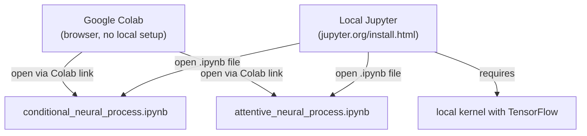
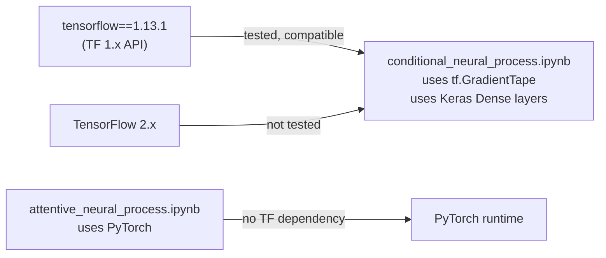

<!-- source: DeepWiki mcp.deepwiki.com · repo google-deepmind/neural-processes · page 1.1 Getting Started · fetched 2026-10-26 -->

# Getting Started

Relevant source files

The following files were used as context for generating this wiki page:

- [README.md](README.md)

This page covers the two execution environments for the notebooks in this repository, the dependency requirements for each, and the TensorFlow 1.x compatibility constraint. For an explanation of what each notebook implements and how the models relate to each other, see the [Overview](#1).

---

## Repository Contents

The repository contains two executable notebooks. Each maps to one or more model variants.

| Notebook | Models Implemented | Framework |
|---|---|---|
| `conditional_neural_process.ipynb` | CNP | TensorFlow 1.x + Keras |
| `attentive_neural_process.ipynb` | NP, ANP | PyTorch |

Sources: [README.md:1-11]()

---

## Execution Environments

**Execution paths — from environment to notebook:**

Sources: [README.md:19-38]()

### Option 1: Google Colab

The simplest execution path. Colab is a hosted Jupyter environment that requires no local installation. The runtime already includes all required dependencies at the tested versions.

- **CNP notebook Colab link** — opens `conditional_neural_process.ipynb` directly in the browser.
- **ANP notebook Colab link** — opens `attentive_neural_process.ipynb` directly in the browser.

Both links are listed in [README.md:24-25]().

### Option 2: Local Jupyter

Open the `.ipynb` files directly in a local Jupyter installation. This requires manually configuring a kernel that includes TensorFlow.

See [README.md:36-38]() for the note on local kernel setup.

---

## Dependencies

All dependencies are shared between both execution environments. The tested versions are:

| Package | Tested Version | Notes |
|---|---|---|
| `numpy` | 1.14.6 | |
| `tensorflow` | 1.13.1 | TF **1.x** only — see compatibility note below |
| `matplotlib` | 2.2.4 | |

Sources: [README.md:28-34]()

---

## TensorFlow 1.x Compatibility

The `conditional_neural_process.ipynb` notebook is written against the TensorFlow 1.x API, specifically tested at version 1.13.1. It uses constructs from TF1 such as `tf.GradientTape` and the `keras` layers available in that version.

**Compatibility constraint — TF version to notebook:**

The `attentive_neural_process.ipynb` notebook uses PyTorch and is not subject to the TF1.x constraint.

Sources: [README.md:28-34]()

---

## Dependency Mapping to Notebook Code

The table below shows which dependency is used by which notebook component.

| Dependency | Used In | Purpose |
|---|---|---|
| `tensorflow` 1.13.1 | `conditional_neural_process.ipynb` | Model layers (`keras`), gradient tape, probability distributions (`tfd`) |
| `numpy` 1.14.6 | Both notebooks | Data generation, array manipulation |
| `matplotlib` 2.2.4 | Both notebooks | Visualization (`plot_predictions`, `plot_functions`) |

Sources: [README.md:28-34]()

---

