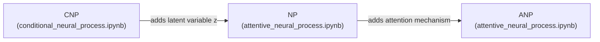
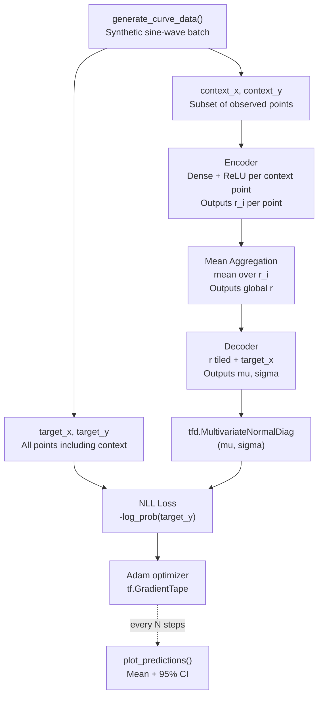
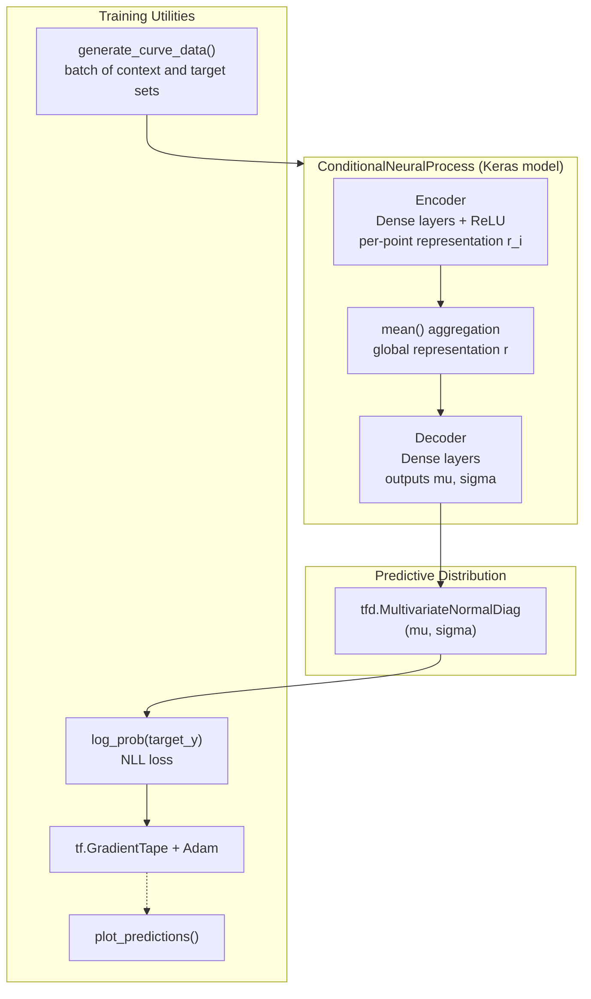

<!-- source: DeepWiki mcp.deepwiki.com · repo google-deepmind/neural-processes · page 2 Conditional Neural Process · fetched 2026-10-26 -->

# Conditional Neural Process

Relevant source files

The following files were used as context for generating this wiki page:

- [README.md](README.md)
- [conditional_neural_process.ipynb](conditional_neural_process.ipynb)

This page introduces the Conditional Neural Process (CNP) model: the problem it addresses, its position in the Neural Process model family, and a structural overview of the `conditional_neural_process.ipynb` notebook. For architecture details, see [CNP Architecture](#2.1). For the training loop and evaluation, see [CNP Training and Evaluation](#2.2). For the Attentive Neural Process (the next model in the family), see [Attentive Neural Process](#3).

---

## What the CNP Does

A Conditional Neural Process is a meta-learning model for function regression. Given a small set of observed input-output pairs (the **context set**), the CNP learns to produce a predictive distribution over outputs at arbitrary new input locations (the **target set**), without retraining on each new function instance.

This is distinct from a standard regression model: the CNP is trained across a *distribution of functions* and at inference time it *conditions* on however many context points are available, ranging from zero to many.

The CNP was introduced in:

> Garnelo M, Rosenbaum D, Maddison CJ, Ramalho T, Saxton D, Shanahan M, Teh YW, Rezende DJ, Eslami SM. *Conditional Neural Processes*. ICML 2018. ([arxiv:1807.01613](https://arxiv.org/pdf/1807.01613.pdf))

---

## Position in the Neural Process Family

The CNP is the foundational member of the Neural Process family. The two later variants extend it in specific ways:

| Model | Key Addition over CNP | Implemented In |
|---|---|---|
| **CNP** | — (baseline) | `conditional_neural_process.ipynb` |
| **NP** | Adds a latent variable `z` for global uncertainty | `attentive_neural_process.ipynb` |
| **ANP** | Adds an attention mechanism over context points | `attentive_neural_process.ipynb` |

The CNP uses a **deterministic path only**: context points are encoded and aggregated into a single fixed representation `r`, then decoded per target point. There is no latent sampling step.

**Diagram: CNP in the Neural Process Family**

Sources: [README.md:1-17]()

---

## Notebook Overview

The implementation lives entirely in `conditional_neural_process.ipynb`. It is a self-contained Keras/TensorFlow 1.x notebook that:

1. Defines the model components (`Encoder`, `Decoder`, `ConditionalNeuralProcess`)
2. Implements synthetic data generation for 1D function regression tasks
3. Runs a training loop using `tf.GradientTape` and Adam
4. Visualizes predictions as a mean curve with a shaded 95% confidence interval

**Diagram: Data and Control Flow in `conditional_neural_process.ipynb`**

Sources: [README.md:9-10]()

---

## Framework and Dependencies

The CNP notebook uses **TensorFlow 1.x** with the Keras API. It does not share a framework with `attentive_neural_process.ipynb`, which is written in PyTorch.

| Dependency | Tested Version |
|---|---|
| NumPy | 1.14.6 |
| TensorFlow | 1.13.1 |
| Matplotlib | 2.2.4 |

The `tfd` module (`tensorflow_probability.distributions`) is used for the `MultivariateNormalDiag` output distribution that provides both the predictive mean and uncertainty estimates.

Sources: [README.md:28-34]()

---

## Key Components at a Glance

**Diagram: Code Entities in `conditional_neural_process.ipynb`**

Sources: [README.md:9-10]()

For a detailed walkthrough of each component, continue to [CNP Architecture](#2.1) and [CNP Training and Evaluation](#2.2).

---

