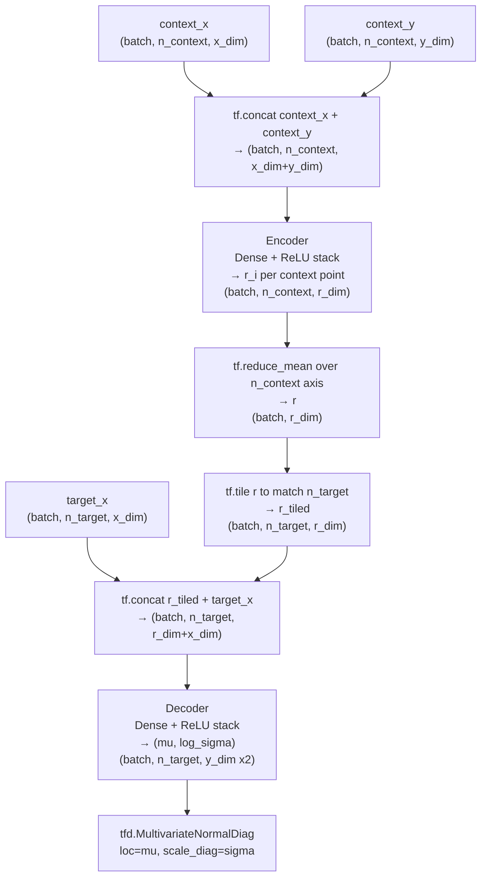
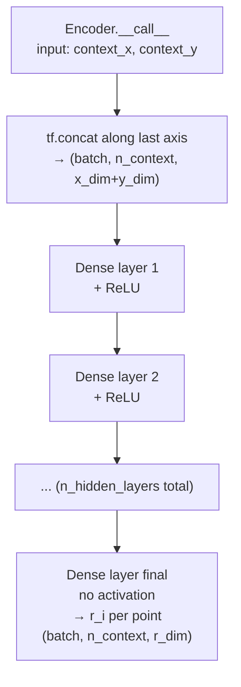
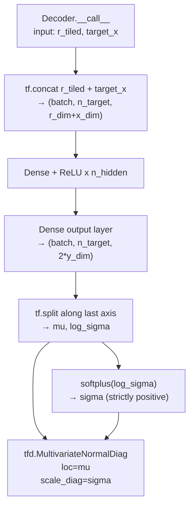
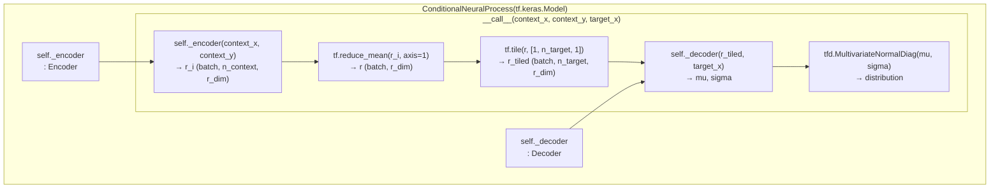

<!-- source: DeepWiki mcp.deepwiki.com · repo google-deepmind/neural-processes · page 2.1 CNP Architecture · fetched 2026-10-26 -->

# CNP Architecture

<details>
<summary>Relevant source files</summary>

The following files were used as context for generating this wiki page:

- [conditional_neural_process.ipynb](conditional_neural_process.ipynb)

</details>


This page covers the internal architecture of the Conditional Neural Process model as implemented in `conditional_neural_process.ipynb`. It describes the three major components — `Encoder`, mean aggregation, and `Decoder` — and how they are composed inside the `ConditionalNeuralProcess` Keras model.

For the training loop, data generation, and evaluation plots that sit around this architecture, see [CNP Training and Evaluation](#2.2). For context on how CNP relates to NP and ANP, see the [Overview](#1).

---

## High-Level Data Flow

The CNP processes context observations into a single global representation `r`, then uses that to predict distributions over target outputs. The key design constraint is that the aggregation step must be **permutation-invariant** with respect to the context set — the model's output cannot depend on the order in which context points are presented.

**Diagram: CNP Forward Pass — Natural Language to Code Entities**



Sources: `conditional_neural_process.ipynb`

---

## Encoder

The `Encoder` class is a standard feedforward network applied **independently to each context point**. Its job is to map a single `(x, y)` pair into a fixed-length representation vector `r_i`.

| Property | Value |
|---|---|
| Input | Concatenation of one context `x` and `y` |
| Layer type | `Dense` + `ReLU` activation |
| Output | Per-point representation `r_i` of dimension `r_dim` |
| Applied to | Each context point independently (no cross-point interaction) |

Because the `Encoder` is applied point-by-point, it has no notion of the set of context points as a whole. This is intentional — the aggregation step handles that.

**Diagram: Encoder Class — Code-Level View**



Sources: `conditional_neural_process.ipynb`

---

## Mean Aggregation

After the `Encoder` produces a representation `r_i` for each of the `n_context` context points, a simple **mean** is taken across the context-point axis:

```
r = mean(r_i for i in 1..n_context)
```

This is implemented as `tf.reduce_mean` over the context dimension. The result `r` has shape `(batch, r_dim)` — a single vector that summarizes all context information.

**Why mean?**
Mean aggregation is:
- **Permutation-invariant**: The order of context points does not affect `r`.
- **Parameter-free**: No learned weights are involved.
- **Simple**: A natural baseline aggregator.

This is the defining structural difference from the ANP, which uses a learned attention mechanism to produce a *per-target* representation instead of one global `r`. See [Attention Mechanisms](#3.2) for the ANP alternative.

Sources: `conditional_neural_process.ipynb`

---

## Decoder

The `Decoder` class takes the global representation `r` (tiled to match the number of target points) concatenated with each `target_x`, and produces the parameters of a Gaussian predictive distribution for each target point.

| Property | Value |
|---|---|
| Input | `tf.concat(r_tiled, target_x)` per target point |
| Layer type | `Dense` + `ReLU` (hidden layers), then `Dense` (output) |
| Output | `(mu, log_sigma)` for each target point |
| Output shape | `(batch, n_target, y_dim)` for each of mu and sigma |

The output layer produces a vector of twice the `y_dim` — the first half is `mu` and the second half becomes `sigma` after applying a softplus (or exp) transformation to ensure positivity.

**Diagram: Decoder Class — Code-Level View**



Sources: `conditional_neural_process.ipynb`

---

## ConditionalNeuralProcess — Composition

The `ConditionalNeuralProcess` class is a Keras `Model` subclass that owns instances of `Encoder` and `Decoder` and wires them together in its `__call__` method.

**Diagram: ConditionalNeuralProcess — Component Ownership and Call Flow**



Sources: `conditional_neural_process.ipynb`

---

## Output Distribution

The final output of the model is a `tfd.MultivariateNormalDiag` from TensorFlow Probability. This represents a **diagonal Gaussian distribution** over the target outputs — each output dimension is treated as conditionally independent given the context.

| Symbol | Source | Shape |
|---|---|---|
| `mu` | Decoder output (first half) | `(batch, n_target, y_dim)` |
| `sigma` | Decoder output (second half, softplus-activated) | `(batch, n_target, y_dim)` |
| Distribution | `tfd.MultivariateNormalDiag(loc=mu, scale_diag=sigma)` | — |

The distribution object is returned from `ConditionalNeuralProcess.__call__`. The `log_prob` method on this object is used directly in the loss computation during training. See [CNP Training and Evaluation](#2.2) for details.

Sources: `conditional_neural_process.ipynb`

---

## Summary Table

| Component | Class | Role |
|---|---|---|
| Encoder | `Encoder` | Dense+ReLU applied per context point → `r_i` |
| Aggregation | `tf.reduce_mean` | Collapses `r_i` set to global `r` (permutation-invariant) |
| Decoder | `Decoder` | Dense+ReLU from `(r, target_x)` → `mu`, `sigma` |
| Model | `ConditionalNeuralProcess` | Keras `Model` composing the above |
| Output | `tfd.MultivariateNormalDiag` | Diagonal Gaussian predictive distribution |

---

