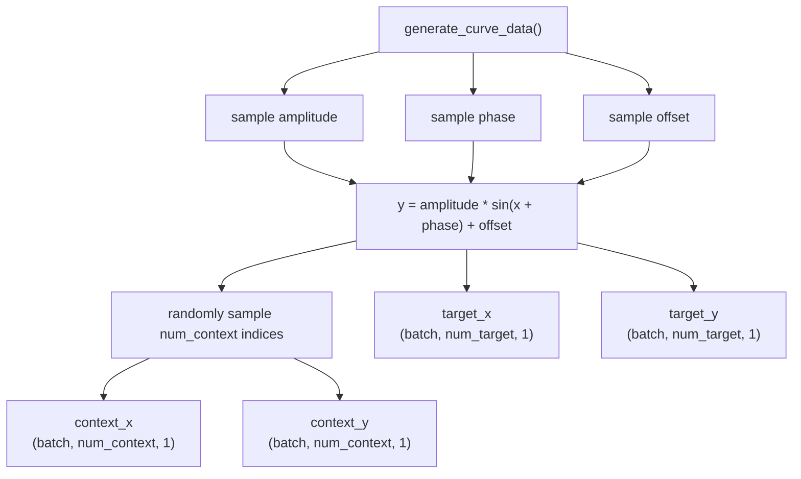
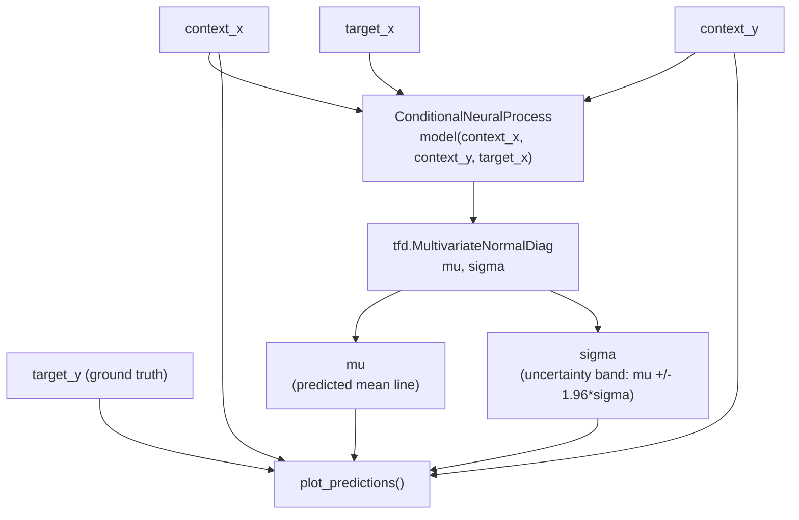

<!-- source: DeepWiki mcp.deepwiki.com · repo google-deepmind/neural-processes · page 2.2 CNP Training and Evaluation · fetched 2026-10-26 -->

# CNP Training and Evaluation

<details>
<summary>Relevant source files</summary>

The following files were used as context for generating this wiki page:

- [conditional_neural_process.ipynb](conditional_neural_process.ipynb)

</details>


This page covers the training pipeline for the Conditional Neural Process (CNP) as implemented in `conditional_neural_process.ipynb`. It describes how synthetic regression tasks are generated, how the model is trained with negative log-likelihood loss using TensorFlow 1.x primitives, and how predictions are visualized during training.

For the model's internal architecture (the `Encoder`, `Decoder`, and `ConditionalNeuralProcess` classes), see the CNP Architecture page [2.1](#2.1). For the analogous training pipeline in the ANP notebook, see ANP Training and Inference [3.3](#3.3).

---

## Synthetic Task Generation

The CNP is trained on synthetic 1-D regression tasks. Each task is a randomly sampled curve drawn from a family of sine waves. This mimics the meta-learning setup from Garnelo et al. (2018): the model must learn to condition on a small context set and predict over a target set.

Each call to `generate_curve_data` produces one batch of tasks with the following structure:

| Tensor | Shape | Description |
|---|---|---|
| `context_x` | `(batch, num_context, 1)` | x-coordinates of context points |
| `context_y` | `(batch, num_context, 1)` | y-values of context points |
| `target_x` | `(batch, num_target, 1)` | x-coordinates of target points |
| `target_y` | `(batch, num_target, 1)` | Ground-truth y-values at target locations |

### Curve Sampling Parameters

Each curve in a batch is independently parameterized by three sampled scalars:

| Parameter | Role |
|---|---|
| amplitude | Controls the vertical scale of the sine wave |
| phase | Horizontal shift of the sine wave |
| offset | Vertical shift (DC offset) |

The context points are a random subset of the target points, so `context_x ⊆ target_x` within each task instance.

**Diagram: `generate_curve_data` output structure**



Sources: `conditional_neural_process.ipynb`

---

## Training Loop

Training follows a standard supervised loop driven by `tf.GradientTape`. Each iteration:

1. Calls `generate_curve_data` to produce a fresh batch of regression tasks.
2. Runs a forward pass through the `ConditionalNeuralProcess` model.
3. Computes the negative log-likelihood (NLL) of `target_y` under the predicted distribution.
4. Computes gradients and applies an Adam update.
5. Periodically calls `plot_predictions` to visualize the model's current behavior.

**Diagram: Training loop code entities**

```mermaid
flowchart LR
    subgraph DataGen["Data Generation"]
        GCD["generate_curve_data()"]
    end

    subgraph Model["ConditionalNeuralProcess"]
        FWD["model(context_x, context_y, target_x)"]
        DIST["tfd.MultivariateNormalDiag\n(mu, sigma)"]
        FWD --> DIST
    end

    subgraph LossComp["Loss"]
        LP["dist.log_prob(target_y)"]
        NLL["loss = -tf.reduce_mean(log_prob)"]
        LP --> NLL
    end

    subgraph Opt["Optimization"]
        TAPE["tf.GradientTape"]
        ADAM["Adam optimizer\noptimizer.apply_gradients()"]
        TAPE --> ADAM
    end

    subgraph Viz["Evaluation"]
        PLOT["plot_predictions()"]
    end

    GCD -->|"context_x, context_y\ntarget_x, target_y"| FWD
    DIST -->|"log_prob(target_y)"| LP
    NLL -->|"tape.gradient(loss, variables)"| TAPE
    ADAM -->|"every N steps"| PLOT
```



Sources: `conditional_neural_process.ipynb`

---

## Loss Function

The CNP decoder outputs a Gaussian distribution over target values using `tfd.MultivariateNormalDiag`, parameterized by a predicted mean `mu` and standard deviation `sigma` for each target point.

The training objective is **negative log-likelihood (NLL)**:

```
loss = -mean( dist.log_prob(target_y) )
```

where `dist` is the `tfd.MultivariateNormalDiag` instance returned by the `ConditionalNeuralProcess` model's forward pass. `log_prob` is called on the ground-truth `target_y` tensor, and the mean is taken across both the batch dimension and the target-point dimension.

This objective encourages `mu` to be close to the true function value at each target point and penalizes overconfident predictions (small `sigma`) when the prediction is wrong.

---

## Gradient Updates

Gradient computation uses `tf.GradientTape`, which is TensorFlow 1.x's mechanism for automatic differentiation in eager/Keras mode. The optimizer is Adam with a fixed learning rate.

**Key code pattern:**

| Step | Code construct |
|---|---|
| Record forward pass | `with tf.GradientTape() as tape:` |
| Compute loss | `loss = -tf.reduce_mean(dist.log_prob(target_y))` |
| Compute gradients | `grads = tape.gradient(loss, model.trainable_variables)` |
| Apply update | `optimizer.apply_gradients(zip(grads, model.trainable_variables))` |

The `ConditionalNeuralProcess` model is a `tf.keras.Model` subclass, so `model.trainable_variables` captures the parameters of both the `Encoder` and `Decoder` networks. All parameters are updated jointly in a single pass.

---

## Evaluation and Visualization

Every `N` training steps, `plot_predictions` is called to visualize the model's behavior on a held-out task. This gives qualitative feedback on how well the model interpolates and extrapolates from the context set.

`plot_predictions` renders:

- **Context points** — the conditioning data shown as scatter points.
- **Predicted mean** — the `mu` output of the decoder at each target x-coordinate, shown as a line.
- **95% confidence interval** — a shaded band drawn as `mu ± 1.96 * sigma` using the predicted standard deviation from the decoder.
- **Ground truth** — the underlying sine curve for comparison.

**Diagram: `plot_predictions` inputs and outputs**



Sources: `conditional_neural_process.ipynb`

---

## Summary of Training Configuration

| Hyperparameter / component | Value / implementation |
|---|---|
| Framework | TensorFlow 1.x with Keras |
| Optimizer | Adam |
| Loss | Negative log-likelihood via `tfd.MultivariateNormalDiag.log_prob` |
| Gradient API | `tf.GradientTape` |
| Data source | `generate_curve_data` (random sine waves) |
| Evaluation | `plot_predictions` (mean + 95% CI) |
| Task type | 1-D function regression (meta-learning) |

---

