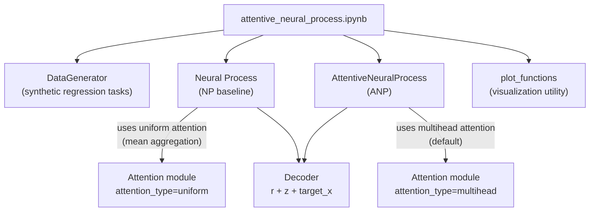
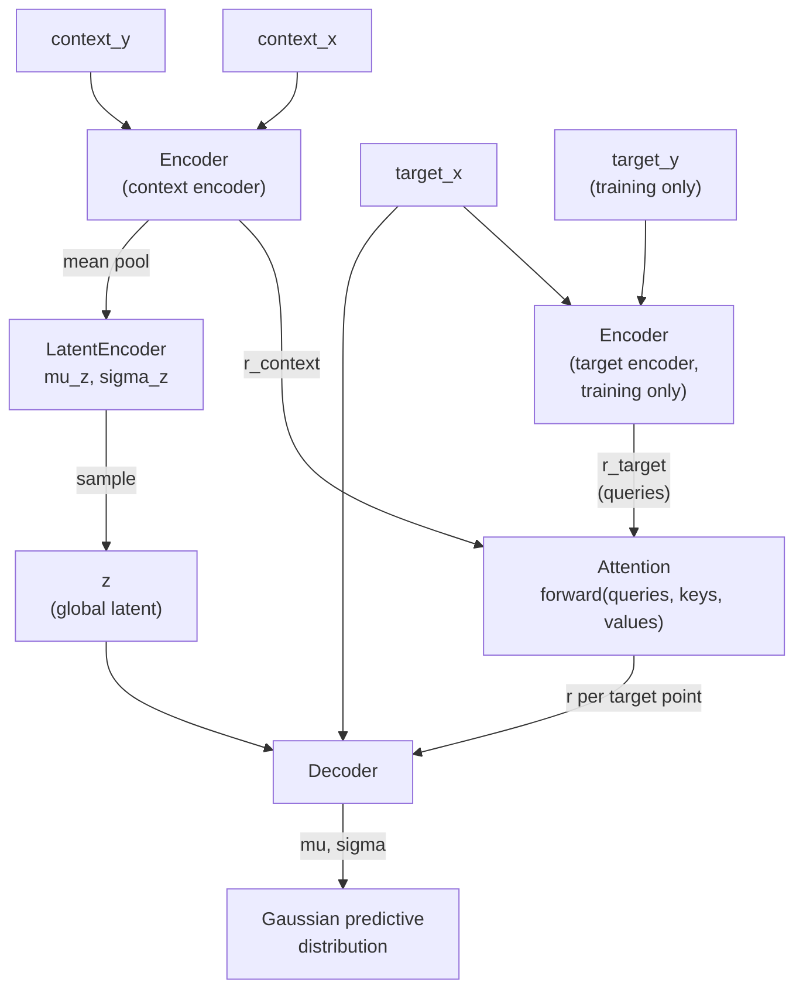

<!-- source: DeepWiki mcp.deepwiki.com · repo google-deepmind/neural-processes · page 3 Attentive Neural Process · fetched 2026-10-26 -->

# Attentive Neural Process

Relevant source files

The following files were used as context for generating this wiki page:

- [README.md](README.md)
- [attentive_neural_process.ipynb](attentive_neural_process.ipynb)

This page introduces the Attentive Neural Process (ANP) model — what problem it solves, how it relates to earlier Neural Process variants, and what `attentive_neural_process.ipynb` contains. Architectural details are covered in [ANP Architecture](#3.1), the attention mechanism variants in [Attention Mechanisms](#3.2), and the training/inference pipeline in [ANP Training and Inference](#3.3). For the simpler CNP model implemented in a separate notebook, see [Conditional Neural Process](#2).

---

## Background and Motivation

The Neural Process (NP) family addresses **meta-learning for regression**: given a small set of observed (context) points, predict a distribution over function values at arbitrary target locations. The three model variants form a chronological lineage:

| Model | Paper | Key Mechanism |
|---|---|---|
| CNP | Garnelo et al., ICML 2018 (`arxiv:1807.01613`) | Deterministic encoder + mean aggregation |
| NP | Garnelo et al., ICML Workshop 2018 (`arxiv:1807.01622`) | Adds latent variable `z` for global uncertainty |
| ANP | Kim et al., ICLR 2019 (`arxiv:1901.05761`) | Adds cross-attention for per-target-point context |

The ANP was introduced to address a limitation of the standard NP: mean-pooling context representations into a single global vector `r` discards the relative positions of context points. When a target point is spatially close to a specific context point, that local information is lost. The ANP replaces global aggregation on the deterministic path with a learned attention mechanism, producing a separate representation `r` for **each target point** by attending over all context points.

[README.md:1-17]()

---

## What `attentive_neural_process.ipynb` Contains

The notebook `attentive_neural_process.ipynb` implements **both** the standard NP and the ANP. The NP serves as a baseline; switching the `Attention` module to `uniform` mode reproduces standard mean-aggregation, making it equivalent to an NP on the deterministic path.

**Diagram: Notebook contents and model relationship**

Sources: [README.md:9-10]()

---

## High-Level Architecture

The ANP has two parallel paths from context to decoder:

- **Deterministic path**: Context and target representations are computed by separate encoders, then the attention module uses target representations as queries and context representations as keys/values, producing one `r` per target point.
- **Latent path**: Context representations are mean-pooled into parameters `mu_z` and `sigma_z`, from which a global latent variable `z` is sampled. This captures global function uncertainty.

Both `r` and `z` are concatenated with `target_x` and passed to the decoder to produce predictive `mu` and `sigma`.

**Diagram: ANP data flow mapped to code components**

Sources: [README.md:9-10]()

---

## Relationship to the CNP

The table below summarizes the structural differences between CNP (in `conditional_neural_process.ipynb`) and ANP (in `attentive_neural_process.ipynb`):

| Property | CNP | NP | ANP |
|---|---|---|---|
| Framework | TensorFlow 1.x / Keras | PyTorch | PyTorch |
| Latent variable `z` | ✗ | ✓ | ✓ |
| Attention mechanism | ✗ | ✗ (mean pool) | ✓ (cross-attention) |
| Per-target-point `r` | ✗ | ✗ | ✓ |
| Dual encoder | ✗ | ✗ | ✓ |
| Context aggregation | Mean over `r_i` | Mean over `r_i` | `Attention` module |

For full architectural details of the ANP, see [ANP Architecture](#3.1). For the CNP, see [CNP Architecture](#2.1).

Sources: [README.md:1-17]()

---

## Academic Reference

> Kim, H., Mnih, A., Schwarz, J., Garnelo, M., Eslami, A., Rosenbaum, D., Vinyals, O. and Teh, Y.W. *Attentive Neural Processes*. In International Conference on Learning Representations 2019.

[README.md:50-51]()

---

