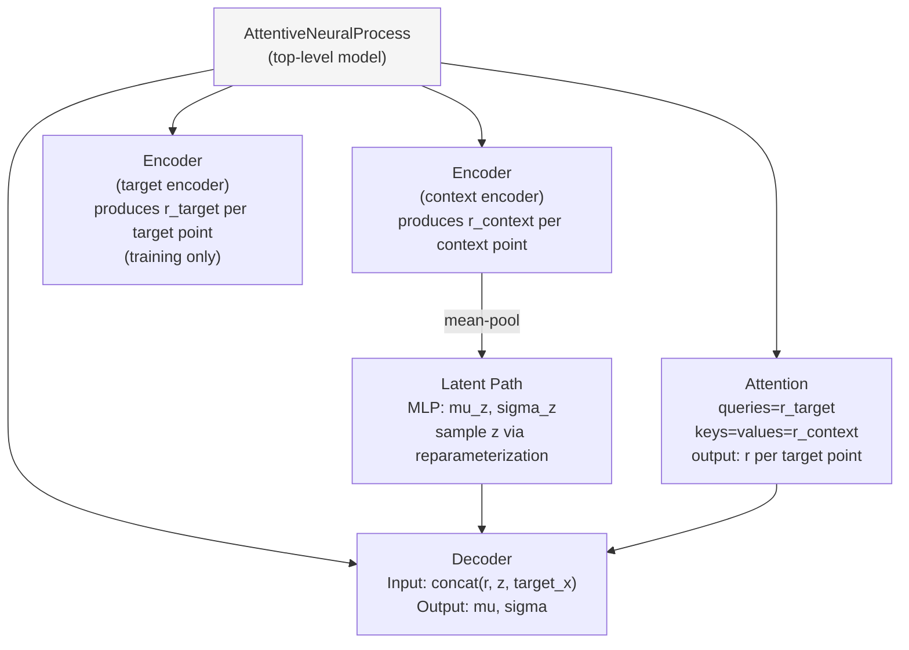
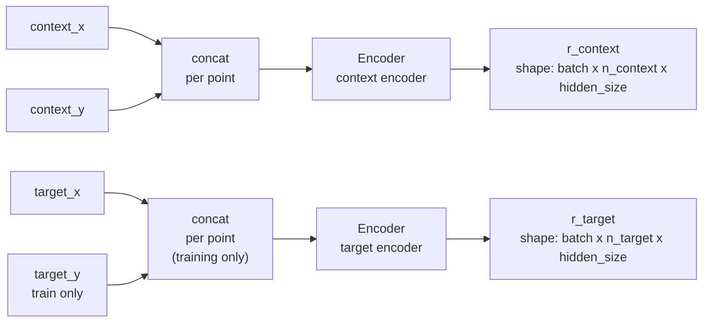
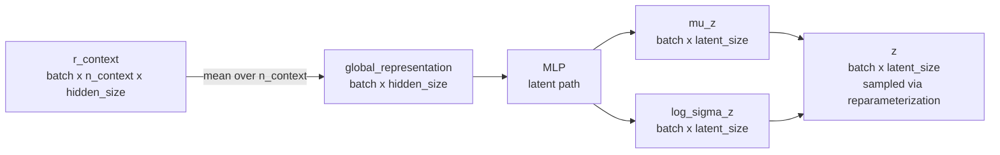
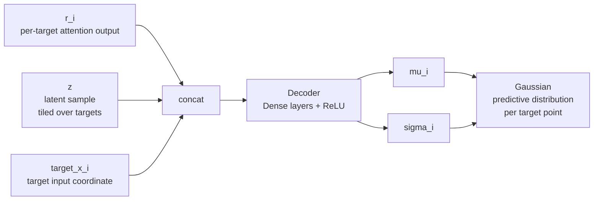
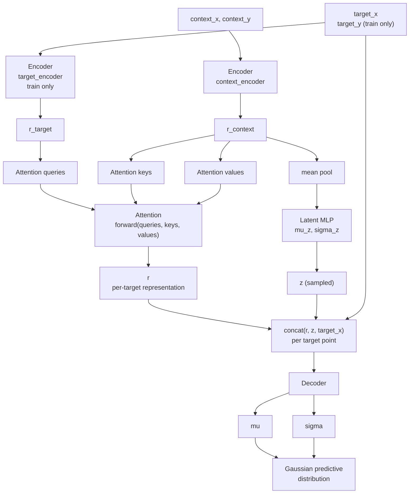

<!-- source: DeepWiki mcp.deepwiki.com · repo google-deepmind/neural-processes · page 3.1 ANP Architecture · fetched 2026-10-26 -->

# ANP Architecture

<details>
<summary>Relevant source files</summary>

The following files were used as context for generating this wiki page:

- [attentive_neural_process.ipynb](attentive_neural_process.ipynb)

</details>


This page describes the internal architecture of the Attentive Neural Process (ANP) as implemented in `attentive_neural_process.ipynb`. It covers the class structure, data flow through the two processing paths (deterministic and latent), and how those paths are combined in the `AttentiveNeuralProcess` model.

For the attention mechanisms in detail, see [Attention Mechanisms](#3.2). For the training loop, inference behavior, and visualization utilities, see [ANP Training and Inference](#3.3). For a description of the simpler CNP architecture, see [CNP Architecture](#2.1).

---

## Architectural Overview

The ANP extends the standard Neural Process by replacing the mean-aggregation step in the deterministic path with a learned attention mechanism. This gives each target point a *distinct* context representation, rather than sharing the same global mean. It also retains the latent variable path from the NP.

The model maintains two separate paths through the network:

| Path | Input | Output | Purpose |
|---|---|---|---|
| **Deterministic** | context points + target queries | `r` per target point | Encodes local context via attention |
| **Latent** | context points only | sampled `z` | Encodes global uncertainty |

Both `r` and `z` are concatenated with `target_x` and passed to the decoder.

---

## Class Structure

**Diagram: Class hierarchy in `attentive_neural_process.ipynb`**



Sources: `attentive_neural_process.ipynb`

---

## Dual Encoder Design

The ANP uses a shared `Encoder` class instantiated twice with the same architecture but trained for two roles:

- **Context encoder**: Applied to each `(context_x, context_y)` pair independently to produce a per-point representation `r_context`. This output feeds both the attention keys/values and the latent path.
- **Target encoder**: Applied to each `(target_x, target_y)` pair to produce `r_target`. This is used only during **training**, as target `y` values are not available at inference time. `r_target` serves as the attention queries.

The encoder applies a stack of dense layers with ReLU activations, producing a fixed-size hidden representation for each input point.

**Diagram: Encoder usage in the two paths**



Sources: `attentive_neural_process.ipynb`

---

## Deterministic Path

The deterministic path routes context and target representations through the `Attention` module to produce a distinct context representation `r` for each target point.

- **Queries**: `r_target` (from target encoder, training) or a projection of `target_x` alone (inference)
- **Keys**: `r_context`
- **Values**: `r_context`

The output `r` has shape `(batch, n_targets, hidden_size)` — one vector per target point. This is what allows the ANP to condition its prediction for each target on a learned, *query-dependent* subset of the context, rather than a single global average.

The default attention type is `multihead`. For details on all four supported types (`uniform`, `dot_product`, `laplace`, `multihead`), see [Attention Mechanisms](#3.2).

---

## Latent Variable Path

The latent path provides a global, stochastic representation of the context. It operates as follows:

1. Mean-pool `r_context` across the context dimension → global vector
2. Apply an MLP to produce `mu_z` and `log_sigma_z`
3. Sample `z` via the reparameterization trick: `z = mu_z + sigma_z * epsilon`, where `epsilon ~ N(0, I)`

**Diagram: Latent path data flow**



Sources: `attentive_neural_process.ipynb`

During **training**, a separate latent distribution is computed from the target encoder outputs (posterior), enabling the ELBO-style loss. During **inference**, only the context (prior) is used. This behavioral split is described in [ANP Training and Inference](#3.3).

---

## Decoder

The `Decoder` takes per-target-point inputs and produces a Gaussian predictive distribution for each.

**Input** to the decoder, for each target point:

```
concat(r_i, z, target_x_i)
```

where:
- `r_i` is the attention output for target point `i` (shape: `hidden_size`)
- `z` is the latent sample, tiled across all target points (shape: `latent_size`)
- `target_x_i` is the input coordinate of target point `i`

**Output**: `mu` and `sigma` for each target point, defining a per-point Gaussian distribution. The loss is the negative log-likelihood of `target_y` under this distribution.

**Diagram: Decoder input composition**



Sources: `attentive_neural_process.ipynb`

---

## `AttentiveNeuralProcess` Orchestration

The top-level `AttentiveNeuralProcess` class wires all of the above together. Its `forward()` method:

1. Passes `(context_x, context_y)` through the context `Encoder` → `r_context`
2. Passes `(target_x, target_y)` through the target `Encoder` → `r_target` *(training only)*
3. Feeds `r_target` (queries) and `r_context` (keys and values) through `Attention` → `r`
4. Mean-pools `r_context` and applies the latent MLP → samples `z`
5. Tiles `z` and concatenates with `r` and `target_x` per target point
6. Passes the concatenated input through `Decoder` → `mu`, `sigma`
7. Returns the predictive distribution

**Diagram: Full `AttentiveNeuralProcess.forward()` data flow**



Sources: `attentive_neural_process.ipynb`

---

## Summary Table

| Component | Class | Input | Output |
|---|---|---|---|
| Context representation | `Encoder` (context) | `context_x, context_y` | `r_context` (per context point) |
| Query representation | `Encoder` (target) | `target_x, target_y` | `r_target` (training only) |
| Deterministic aggregation | `Attention` | queries, keys, values | `r` (per target point) |
| Global uncertainty | Latent MLP | mean-pooled `r_context` | `mu_z`, `sigma_z`, sampled `z` |
| Prediction | `Decoder` | `concat(r, z, target_x)` | `mu`, `sigma` per target point |
| Top-level model | `AttentiveNeuralProcess` | context + target sets | Gaussian predictive distribution |

Sources: `attentive_neural_process.ipynb`

---

