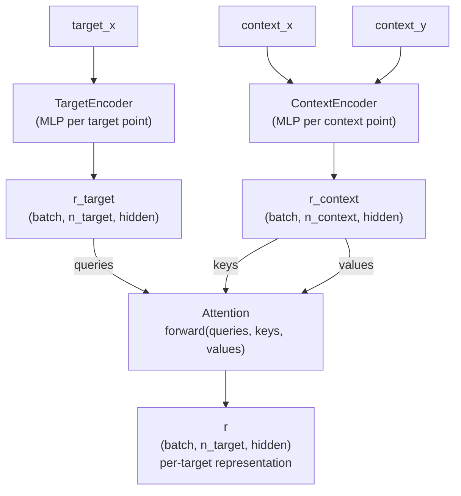
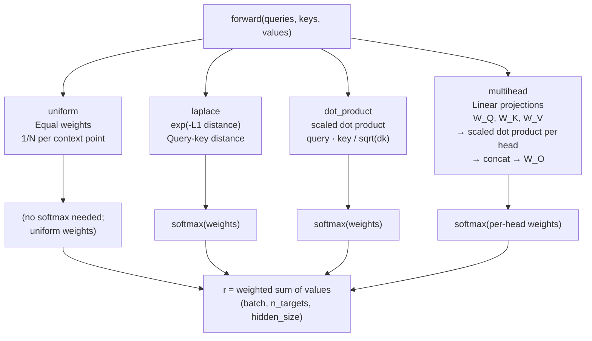
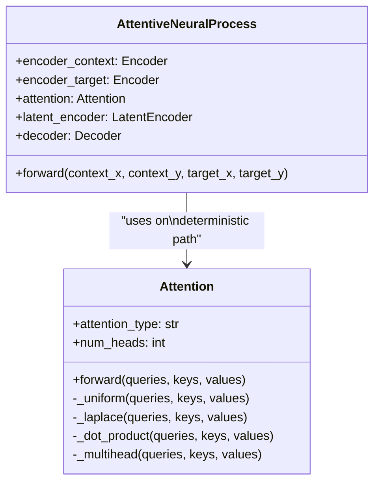

<!-- source: DeepWiki mcp.deepwiki.com · repo google-deepmind/neural-processes · page 3.2 Attention Mechanisms · fetched 2026-10-26 -->

# Attention Mechanisms

<details>
<summary>Relevant source files</summary>

The following files were used as context for generating this wiki page:

- [attentive_neural_process.ipynb](attentive_neural_process.ipynb)

</details>


This page documents the `Attention` class in `attentive_neural_process.ipynb` — specifically, the four attention variants it supports, how each computes context aggregation, and how to configure them. For the broader ANP model architecture that consumes the `Attention` module, see [ANP Architecture (3.1)](#3.1). For the training loop and inference behavior built around this module, see [ANP Training and Inference (3.3)](#3.3).

---

## Role of Attention in the ANP

The standard Neural Process uses **mean aggregation** to collapse per-context-point representations into a single global vector `r`. This is permutation-invariant and simple, but it ignores which target point is being predicted — every target point receives the same `r`.

The Attentive Neural Process replaces mean aggregation with a **query-key-value attention** mechanism on the deterministic path. The attention module receives:

- **Queries**: representations derived from each target point
- **Keys**: representations derived from each context point
- **Values**: representations derived from each context point

For each target point, the module computes a weighted combination of the values, where weights reflect how relevant each context point is to that specific target. The result is a **per-target-point** representation `r`, allowing the model to focus on relevant context depending on where it is predicting.

**Figure: Attention module placement in the ANP forward pass**



Sources: `attentive_neural_process.ipynb`

---

## The `Attention` Class

The `Attention` class is instantiated once inside `AttentiveNeuralProcess`. Its constructor accepts an `attention_type` string argument that selects which of the four variants to use. All variants expose the same interface: a `forward(queries, keys, values)` method that returns `r` with shape `(batch, n_targets, hidden_size)`.

| Constructor Arg | Variant | Learned Params | Locality-Sensitive | Expressiveness |
|---|---|---|---|---|
| `"uniform"` | Uniform / Mean | None | No | Lowest |
| `"laplace"` | Laplace kernel | None | Yes | Low–Medium |
| `"dot_product"` | Scaled dot-product | None | Yes | Medium |
| `"multihead"` | Multi-head attention | Yes (linear projections) | Yes | Highest |

The default is `"multihead"`.

---

## Attention Variants

### Uniform

`uniform` assigns an **equal weight** to every context point, regardless of the query. The output for each target point is therefore the simple mean of the value vectors.

This is mathematically equivalent to standard mean aggregation — i.e., the behavior of the baseline Neural Process (NP) without attention. Using `uniform` within the ANP code allows the model to be run in "NP mode" without architectural changes, which is how the notebook demonstrates the NP baseline alongside the full ANP.

```
weight(q, k_i) = 1 / N_context   for all i
r = (1/N) * sum(values)
```

### Laplace

`laplace` computes attention weights using an **RBF-style distance kernel** between each query and key:

```
weight_i ∝ exp(−|query − key_i|_1)
```

After computing pairwise distances, weights are normalized with softmax. This variant does not introduce any learnable parameters. It encourages the model to attend to context points that are geometrically close to the target in representation space, creating smooth, locality-sensitive aggregation.

### Dot-Product

`dot_product` applies **scaled dot-product attention**:

```
weight_i = softmax(query · key_i / sqrt(d_k))
```

No linear projection layers are applied before the dot product — queries and keys are used directly. The scaling by `sqrt(d_k)` stabilizes gradients when hidden dimensions are large. This is more expressive than `laplace` because it learns directional similarity rather than purely distance-based proximity, but it has no learned projection parameters.

### Multihead (Default)

`multihead` is the full multi-head attention variant and the default for the ANP. It applies **learned linear projections** to the queries, keys, and values before computing scaled dot-product attention across multiple parallel attention heads:

```
MultiHead(Q, K, V) = Concat(head_1, ..., head_h) W_O
where head_i = Attention(Q W_Q^i, K W_K^i, V W_V^i)
```

Each head learns to attend to a different aspect of the context. The per-head outputs are concatenated and linearly projected back to `hidden_size`. The projection matrices `W_Q`, `W_K`, `W_V`, and `W_O` are all learned parameters.

This is the most expressive variant and the one used in the ANP paper (Kim et al., ICLR 2019).

---

## Computational Flow by Variant

**Figure: Internal computation paths for each attention type**



Sources: `attentive_neural_process.ipynb`

---

## Selecting an Attention Type

The `attention_type` argument is passed to the `Attention` constructor, which is called inside `AttentiveNeuralProcess.__init__`. To switch variants, change the string passed at instantiation:

| Goal | `attention_type` value |
|---|---|
| Reproduce standard NP (no attention) | `"uniform"` |
| Non-parametric locality-sensitive attention | `"laplace"` |
| Non-parametric directional attention | `"dot_product"` |
| Full ANP as in Kim et al. 2019 | `"multihead"` |

**Figure: `Attention` class relationships to `AttentiveNeuralProcess`**



Sources: `attentive_neural_process.ipynb`

---

## Expressiveness Trade-offs

The four variants form a spectrum from no learned parameters (uniform, laplace, dot\_product) to fully parametric (multihead). This has practical implications:

- **Fewer parameters**: `uniform`, `laplace`, and `dot_product` add no extra weights, making them faster to train and less prone to overfitting on small tasks. `uniform` eliminates attention entirely.
- **More parameters**: `multihead` introduces four projection matrices per attention layer, allowing the model to learn task-specific notions of relevance between context and target points.
- **Locality**: `laplace` explicitly encodes proximity; `dot_product` and `multihead` learn the notion of relevance from data.

The notebook uses `multihead` as the default to match the ANP paper's configuration. Switching to `"uniform"` effectively reduces the ANP to a standard NP, which is useful for ablation studies.

---

