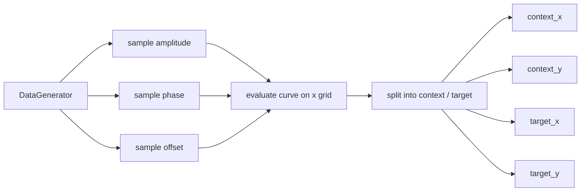
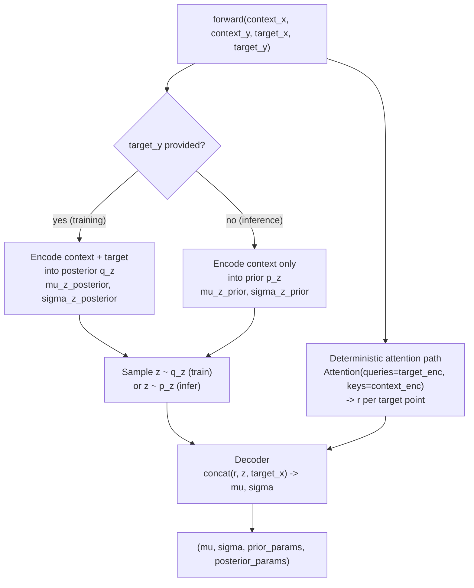
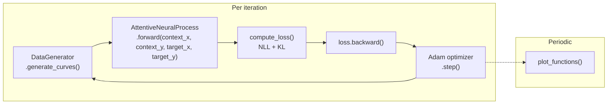
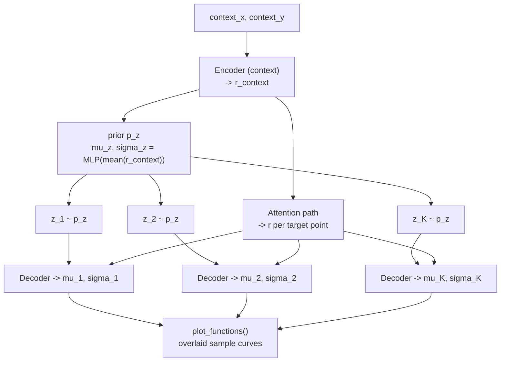

<!-- source: DeepWiki mcp.deepwiki.com · repo google-deepmind/neural-processes · page 3.3 ANP Training and Inference · fetched 2026-10-26 -->

# ANP Training and Inference

<details>
<summary>Relevant source files</summary>

The following files were used as context for generating this wiki page:

- [attentive_neural_process.ipynb](attentive_neural_process.ipynb)

</details>


This page covers the end-to-end training pipeline and inference behavior of the Attentive Neural Process (ANP) as implemented in `attentive_neural_process.ipynb`. It focuses on how batches are constructed, how training and inference differ in terms of latent variable handling, how the loss is computed and minimized, and how predictions are visualized and sampled.

For the model's internal architecture (encoder, decoder, latent path), see [ANP Architecture (3.1)](#3.1). For the attention mechanisms used in the deterministic path, see [Attention Mechanisms (3.2)](#3.2).

---

## Data Generation

Synthetic regression tasks are produced by the `DataGenerator` class. Each call yields a single batch representing one regression task drawn from a distribution over 1D functions.

### What `DataGenerator` produces

| Field | Shape | Description |
|---|---|---|
| `context_x` | `(batch, n_context, x_size)` | Input locations of context points |
| `context_y` | `(batch, n_context, y_size)` | Observed values at context locations |
| `target_x` | `(batch, n_target, x_size)` | Input locations of target points |
| `target_y` | `(batch, n_target, y_size)` | Ground-truth values at target locations |

Context points are a subset of target points — every context point also appears in the target set.

### Function distribution

Each batch samples a 1D curve by drawing random amplitude, phase, and vertical offset, then evaluating on a grid of x values. This creates a distribution over smooth functions resembling random sine waves.

**Diagram: DataGenerator batch structure**



Sources: `attentive_neural_process.ipynb`

---

## Training vs. Inference Mode

The most important behavioral distinction in the ANP is whether `target_y` is supplied to the model's forward pass.

The `AttentiveNeuralProcess` model detects this and switches between two latent paths:

- **Training mode** (`target_y` provided): the latent variable `z` is sampled from the *posterior* distribution `q(z | context + target)`. This requires encoding both context and target observations jointly.
- **Inference mode** (`target_y=None`): the latent variable `z` is sampled from the *prior* distribution `p(z | context)`. Only the context is encoded.

This is the standard ELBO training strategy from the Neural Process family: at training time the posterior encoder has access to ground truth target values, allowing a richer latent representation. At test time this information is unavailable, so the prior is used instead.

**Diagram: Training mode vs. inference mode in `AttentiveNeuralProcess`**



Sources: `attentive_neural_process.ipynb`

---

## Loss Function

The loss combines two terms:

1. **Negative log-likelihood (NLL)** — how well the predicted distribution `p(target_y | mu, sigma)` fits the ground truth. This is a Gaussian log-probability evaluated at `target_y` for each target point.

2. **KL divergence** — the KL between the posterior latent distribution and the prior, `KL(q(z | context, target) || p(z | context))`. This acts as a regularizer, preventing the posterior from deviating too far from the prior.

The full training objective is:

```
loss = -log p(target_y | mu, sigma) + KL(q_posterior || p_prior)
```

This is the standard evidence lower bound (ELBO) negated, identical in form to a VAE objective.

| Term | Role | Available at inference? |
|---|---|---|
| NLL | Fit to observed data | Yes |
| KL divergence | Regularize latent variable | No — requires posterior, which needs `target_y` |

At inference time only the NLL can be evaluated (no `target_y` available), but the KL is not needed for prediction.

Sources: `attentive_neural_process.ipynb`

---

## Training Loop

Training uses PyTorch's standard `autograd` pipeline with the Adam optimizer.

**Diagram: Training loop — code-level entities**



The key steps per iteration:

1. `DataGenerator` produces a batch with context/target split.
2. `AttentiveNeuralProcess.forward()` receives all four tensors (`context_x`, `context_y`, `target_x`, `target_y`), returning predicted `mu`, `sigma`, and the prior/posterior distribution parameters.
3. The loss is computed from the returned values.
4. `loss.backward()` computes gradients through the entire graph, including the reparameterized sample of `z`.
5. The Adam optimizer updates all parameters.
6. Every N steps, `plot_functions()` is called to visualize current predictions.

Sources: `attentive_neural_process.ipynb`

---

## Visualization: `plot_functions`

The `plot_functions` utility is called periodically during training. It runs the model in **inference mode** (no `target_y`), collects the predicted `mu` and `sigma`, and plots:

- The ground-truth curve across the full x range.
- Context points as scatter points.
- The predicted mean as a line.
- A shaded band representing ±1 standard deviation (or a configurable confidence interval).

The function also supports overlaying multiple samples from the model to visualize the stochastic behavior of the latent variable.

Sources: `attentive_neural_process.ipynb`

---

## Sampling Multiple Predictions: `sample()`

Because the ANP has a stochastic latent variable `z`, running the model multiple times on the same context produces different predictions. The `sample()` method (or equivalent repeated forward passes in inference mode) exploits this to draw a distribution of plausible functions.

Each sample proceeds as:

1. Encode context into prior `p(z | context)`.
2. Draw a fresh sample `z ~ p(z | context)`.
3. Run the deterministic attention path to get `r`.
4. Decode `(r, z, target_x)` to get a new `(mu, sigma)` pair.

Repeating this K times yields K mean curves, each conditioned on the same context but with different latent draws. This captures the model's *epistemic uncertainty* about which function generated the context data, as opposed to the per-point `sigma` which captures *aleatoric* (observation noise) uncertainty.

**Diagram: Multiple samples from `AttentiveNeuralProcess` at inference**



Sources: `attentive_neural_process.ipynb`

---

## Summary

| Concept | Training | Inference |
|---|---|---|
| `target_y` passed to model | Yes | No |
| Latent `z` sampled from | Posterior `q(z \| context, target)` | Prior `p(z \| context)` |
| Loss terms | NLL + KL divergence | N/A (no loss computed) |
| Optimizer | Adam via `loss.backward()` | — |
| Typical use | Parameter updates | `plot_functions()`, `sample()` |

The overall training pipeline in `attentive_neural_process.ipynb` is structurally the same as the CNP pipeline (see [CNP Training and Evaluation (2.2)](#2.2)), but differs in that the latent variable `z` requires the ELBO objective and the prior/posterior switching logic described above.

---

