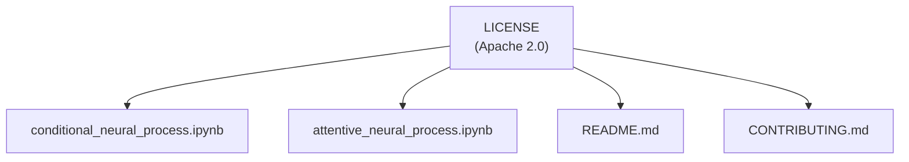

<!-- source: DeepWiki mcp.deepwiki.com · repo google-deepmind/neural-processes · page 5 License · fetched 2026-10-26 -->

# License

Relevant source files

The following files were used as context for generating this wiki page:

- [LICENSE](LICENSE)

This page covers the license terms under which the `neural-processes` repository is distributed. It applies to all files in the repository, including both Jupyter notebooks (`conditional_neural_process.ipynb`, `attentive_neural_process.ipynb`) and all documentation files. For information about contributing code back to the project, see [Contributing](#4).

---

## License Type

The project is distributed under the **Apache License, Version 2.0** (January 2004).

The full license text is located at [LICENSE:1-175]().

| Property | Value |
|---|---|
| License name | Apache License, Version 2.0 |
| License file | `LICENSE` |
| SPDX identifier | `Apache-2.0` |
| Original publication date | January 2004 |
| Canonical URL | `http://www.apache.org/licenses/` |

---

## Rights Granted

The following table summarizes the key permissions, conditions, and limitations defined in [LICENSE:66-174]().

| Category | Detail | License Section |
|---|---|---|
| **Copyright license** | Perpetual, worldwide, non-exclusive, royalty-free right to reproduce, prepare derivative works, publicly display, publicly perform, sublicense, and distribute the Work | Section 2 |
| **Patent license** | Perpetual, worldwide, non-exclusive, royalty-free right to make, use, offer to sell, sell, import, and transfer the Work | Section 3 |
| **Redistribution** | Allowed in any medium, with or without modifications, in Source or Object form | Section 4 |
| **Trademark** | No permission to use trade names, trademarks, or product names of the Licensor | Section 6 |
| **Warranty** | Work provided "AS IS", without warranties of any kind (express or implied) | Section 7 |
| **Liability** | Contributors not liable for direct, indirect, special, incidental, or consequential damages | Section 8 |

---

## Redistribution Conditions

When redistributing the Work or Derivative Works, all four of the following conditions must be met ([LICENSE:89-128]()):

1. Include a copy of this License with the distribution.
2. Modified files must carry prominent notices stating the changes made.
3. Retain all copyright, patent, trademark, and attribution notices from the original Source form.
4. If the Work includes a `NOTICE` file, include a readable copy of its attribution notices in the distribution.

---

## Contribution Submissions

Per [LICENSE:130-136](), any Contribution intentionally submitted for inclusion in the Work is automatically licensed under the same Apache 2.0 terms, unless a separate license agreement has been explicitly executed with the Licensor.

**Diagram: License Scope Over Repository Files**

Sources: [LICENSE:1-175]()

---

## Warranty Disclaimer

The Work is provided **"AS IS"**, without warranties or conditions of any kind — including, without limitation, warranties of `TITLE`, `NON-INFRINGEMENT`, `MERCHANTABILITY`, or `FITNESS FOR A PARTICULAR PURPOSE` ([LICENSE:143-151]()).

Contributors are not liable for any damages arising from use or inability to use the Work, even if advised of the possibility of such damages ([LICENSE:153-163]()).

---

## Patent Termination Clause

If a recipient of the Work institutes patent litigation (including cross-claims or counterclaims) alleging that the Work or any Contribution constitutes patent infringement, all patent licenses granted to that recipient under this License **terminate** as of the date the litigation is filed ([LICENSE:80-87]()).

---

## Key Term Definitions

The Apache 2.0 license defines precise meanings for the following terms used throughout ([LICENSE:7-64]()):

| Term | Definition Summary |
|---|---|
| `License` | The terms and conditions in Sections 1–9 of the LICENSE file |
| `Licensor` | The copyright owner granting the License |
| `You` / `Your` | An individual or Legal Entity exercising permissions under this License |
| `Source` form | Preferred form for making modifications (source code, documentation source, config files) |
| `Object` form | Any form resulting from mechanical transformation of Source form (compiled code, generated docs) |
| `Work` | The work of authorship made available under the License |
| `Derivative Works` | Works based on or derived from the Work, representing an original work of authorship |
| `Contribution` | Any work submitted to the Licensor for inclusion in the Work |
| `Contributor` | The Licensor and any Legal Entity whose Contribution has been incorporated into the Work |

Sources: [LICENSE:7-64]()