# Page: Overview

# Overview

<details>
<summary>Relevant source files</summary>

The following files were used as context for generating this wiki page:

- [README.md](README.md)
- [attentive_neural_process.ipynb](attentive_neural_process.ipynb)
- [conditional_neural_process.ipynb](conditional_neural_process.ipynb)

</details>


This page describes the `google-deepmind/neural-processes` repository: its purpose, the three model variants it implements, their academic origins, and how the two Jupyter notebooks are organized. For environment setup and execution instructions, see [Getting Started](#1.1). For architecture details of each model, see [CNP Architecture](#2.1) and [ANP Architecture](#3.1).

---

## Repository Purpose

This repository provides self-contained, executable implementations of the **Neural Process** family of models, designed for 1D regression tasks. The models learn a distribution over functions from context point observations and predict outputs at target locations — analogous to Gaussian Processes, but with learned, amortized inference via neural networks.

There are two notebooks:

| Notebook | Models | Framework |
|---|---|---|
| `conditional_neural_process.ipynb` | CNP | TensorFlow 1.x + Keras |
| `attentive_neural_process.ipynb` | NP, ANP | TensorFlow 1.x (low-level) |

---

## Model Family and Academic Lineage

The three model variants form a lineage where each extends the previous by adding a key capability.

**Diagram: Model Family — Papers, Models, and Code Classes**

```mermaid
graph LR
  P1["\"Garnelo et al., ICML 2018\narxiv:1807.01613\""]
  P2["\"Garnelo et al., ICML Workshop 2018\narxiv:1807.01622\""]
  P3["\"Kim et al., ICLR 2019\narxiv:1901.05761\""]

  CNP["\"CNP\nConditionalNeuralProcess (Keras)\nconditional_neural_process.ipynb\""]
  NP["\"NP\nLatentModel(use_deterministic_path=True,\nattention=uniform)\nattentive_neural_process.ipynb\""]
  ANP["\"ANP\nLatentModel(use_deterministic_path=True,\nattention=multihead)\nattentive_neural_process.ipynb\""]

  P1 --> CNP
  P2 --> NP
  P3 --> ANP

  CNP -->|"adds LatentEncoder (z)"| NP
  NP -->|"replaces uniform_attention\nwith multihead_attention"| ANP
```

Sources: [README.md:1-17](), [attentive_neural_process.ipynb:583-682]()

| Model | Key Innovation | Notebook | Core Class |
|---|---|---|---|
| CNP | Deterministic encoder + mean aggregation | `conditional_neural_process.ipynb` | `ConditionalNeuralProcess` |
| NP | Adds latent variable `z` via `LatentEncoder` | `attentive_neural_process.ipynb` | `LatentModel` (uniform attention) |
| ANP | Replaces mean aggregation with cross-attention | `attentive_neural_process.ipynb` | `LatentModel` (multihead attention) |

---

## Repository File Map

**Diagram: Files and Their Primary Code Entities**

```mermaid
graph TD
  subgraph NB1["\"conditional_neural_process.ipynb\""]
    E1["\"Encoder\""]
    D1["\"Decoder\""]
    M1["\"ConditionalNeuralProcess\""]
    E1 --> M1
    D1 --> M1
  end

  subgraph NB2["\"attentive_neural_process.ipynb\""]
    GC["\"GPCurvesReader\n.generate_curves()\""]
    DE["\"DeterministicEncoder\""]
    LE["\"LatentEncoder\""]
    ATT["\"Attention\n(uniform/laplace/dot_product/multihead)\""]
    DEC["\"Decoder\""]
    LM["\"LatentModel\""]
    PF["\"plot_functions()\""]
    DE --> LM
    LE --> LM
    ATT --> DE
    DEC --> LM
  end

  README["\"README.md\""]
  CONTRIB["\"CONTRIBUTING.md\""]
  LICENSE["\"LICENSE (Apache 2.0)\""]
```

Sources: [README.md:1-59](), [attentive_neural_process.ipynb:101-103](), [attentive_neural_process.ipynb:375-418](), [attentive_neural_process.ipynb:439-492](), [attentive_neural_process.ipynb:513-562](), [attentive_neural_process.ipynb:583-682](), [attentive_neural_process.ipynb:821-890]()

---

## Notebook Summaries

### `conditional_neural_process.ipynb` — CNP

Implements the Conditional Neural Process using TensorFlow 1.x and Keras. Data is generated from random sine waves. The model encodes context points with a shared MLP (`Encoder`), mean-aggregates the representations into a global context vector `r`, then decodes at target locations with `Decoder`.

The output is a `tfd.MultivariateNormalDiag` distribution parameterized by predicted `mu` and `sigma`. Training uses negative log-likelihood via `log_prob` and `tf.GradientTape` with Adam.

For full architecture detail, see [CNP Architecture](#2.1). For the training loop, see [CNP Training and Evaluation](#2.2).

---

### `attentive_neural_process.ipynb` — NP and ANP

Implements both the Neural Process and Attentive Neural Process in a single notebook using TensorFlow 1.x. The key class is `LatentModel`, which is configured at construction time to select between NP and ANP behavior via the `attention` argument.

**Data generation** uses `GPCurvesReader.generate_curves()`, which samples from a Gaussian Process with a squared-exponential kernel. Each call returns an `NPRegressionDescription` namedtuple:

| Field | Description |
|---|---|
| `query` | Tuple of `((context_x, context_y), target_x)` |
| `target_y` | Ground truth y at target locations |
| `num_total_points` | Total number of data points |
| `num_context_points` | Number of context points |

Sources: [attentive_neural_process.ipynb:90-103](), [attentive_neural_process.ipynb:106-270]()

**NP mode** uses `Attention(rep='identity', att_type='uniform')` — equivalent to mean aggregation over context representations.

**ANP mode** uses `Attention(rep='mlp', att_type='multihead')` — full cross-attention with learned projections.

The `use_deterministic_path` constructor flag on `LatentModel` controls whether the deterministic encoder path is active alongside the latent path.

For full architecture detail, see [ANP Architecture](#3.1). For attention types, see [Attention Mechanisms](#3.2). For training details, see [ANP Training and Inference](#3.3).

---

## Shared Training Paradigm

Both notebooks follow the same conceptual training loop despite differing frameworks and model architectures.

**Diagram: Shared Training Loop — Mapping to Code**

```mermaid
flowchart LR
  DG["\"Data Generation\nGPCurvesReader.generate_curves()\nor generate_curve_data()\""]
  FWD["\"Forward Pass\nLatentModel.__call__(query, num_targets, target_y)\nor ConditionalNeuralProcess(context, query)\""]
  LOSS["\"Loss\n-log_prob(target_y)\n(NP/ANP: ELBO = log_p - KL/num_targets)\""]
  OPT["\"Optimizer\ntf.train.AdamOptimizer(1e-4)\nor tf.GradientTape + Adam\""]
  VIZ["\"Visualization\nplot_functions(target_x, target_y,\ncontext_x, context_y, pred_y, std)\nor plot_predictions()\""]

  DG --> FWD --> LOSS --> OPT
  OPT -->|"next step"| DG
  OPT -.->|"every PLOT_AFTER steps"| VIZ
```

Sources: [attentive_neural_process.ipynb:911-1085](), [attentive_neural_process.ipynb:912-948]()

Key training hyperparameters shared across both notebooks:

| Parameter | Typical Value | Purpose |
|---|---|---|
| `TRAINING_ITERATIONS` | 100,000 | Total gradient steps |
| `MAX_CONTEXT_POINTS` | 50 | Upper bound on context and target size |
| `PLOT_AFTER` | 10,000 | Interval between visualization outputs |
| `HIDDEN_SIZE` | 128 | Hidden layer size for all MLPs and latent dim |

Sources: [attentive_neural_process.ipynb:1011-1017]()

---

## Key Differences Between Notebooks

| Aspect | `conditional_neural_process.ipynb` | `attentive_neural_process.ipynb` |
|---|---|---|
| Models | CNP only | NP and ANP |
| Framework style | Keras `Model` subclass | Plain Python classes (`__call__`) |
| Data source | Random sine waves | GP with squared-exponential kernel |
| Latent variable | None | `LatentEncoder` → `z` |
| Context aggregation | Fixed mean pooling | `Attention` module (configurable) |
| Loss | NLL: `-log_prob(target_y)` | ELBO: `log_p - KL / num_targets` |
| Training | `tf.GradientTape` + Adam | `tf.train.AdamOptimizer` + session |

Sources: [README.md:9-17](), [attentive_neural_process.ipynb:38-42]()

---

# Page: Getting Started

# Getting Started

<details>
<summary>Relevant source files</summary>

The following files were used as context for generating this wiki page:

- [README.md](README.md)

</details>


This page covers the two execution environments for the notebooks in this repository, the dependency requirements for each, and the TensorFlow 1.x compatibility constraint. For an explanation of what each notebook implements and how the models relate to each other, see the [Overview](#1).

---

## Repository Contents

The repository contains two executable notebooks. Each maps to one or more model variants.

| Notebook | Models Implemented | Framework |
|---|---|---|
| `conditional_neural_process.ipynb` | CNP | TensorFlow 1.x + Keras |
| `attentive_neural_process.ipynb` | NP, ANP | PyTorch |

Sources: [README.md:1-11]()

---

## Execution Environments

**Execution paths — from environment to notebook:**

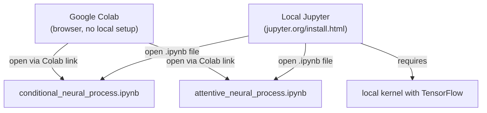

Sources: [README.md:19-38]()

### Option 1: Google Colab

The simplest execution path. Colab is a hosted Jupyter environment that requires no local installation. The runtime already includes all required dependencies at the tested versions.

- **CNP notebook Colab link** — opens `conditional_neural_process.ipynb` directly in the browser.
- **ANP notebook Colab link** — opens `attentive_neural_process.ipynb` directly in the browser.

Both links are listed in [README.md:24-25]().

### Option 2: Local Jupyter

Open the `.ipynb` files directly in a local Jupyter installation. This requires manually configuring a kernel that includes TensorFlow.

See [README.md:36-38]() for the note on local kernel setup.

---

## Dependencies

All dependencies are shared between both execution environments. The tested versions are:

| Package | Tested Version | Notes |
|---|---|---|
| `numpy` | 1.14.6 | |
| `tensorflow` | 1.13.1 | TF **1.x** only — see compatibility note below |
| `matplotlib` | 2.2.4 | |

Sources: [README.md:28-34]()

---

## TensorFlow 1.x Compatibility

The `conditional_neural_process.ipynb` notebook is written against the TensorFlow 1.x API, specifically tested at version 1.13.1. It uses constructs from TF1 such as `tf.GradientTape` and the `keras` layers available in that version.

**Compatibility constraint — TF version to notebook:**

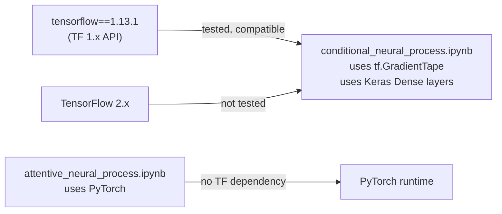

The `attentive_neural_process.ipynb` notebook uses PyTorch and is not subject to the TF1.x constraint.

Sources: [README.md:28-34]()

---

## Dependency Mapping to Notebook Code

The table below shows which dependency is used by which notebook component.

| Dependency | Used In | Purpose |
|---|---|---|
| `tensorflow` 1.13.1 | `conditional_neural_process.ipynb` | Model layers (`keras`), gradient tape, probability distributions (`tfd`) |
| `numpy` 1.14.6 | Both notebooks | Data generation, array manipulation |
| `matplotlib` 2.2.4 | Both notebooks | Visualization (`plot_predictions`, `plot_functions`) |

Sources: [README.md:28-34]()

---

# Page: Conditional Neural Process

# Conditional Neural Process

<details>
<summary>Relevant source files</summary>

The following files were used as context for generating this wiki page:

- [README.md](README.md)
- [conditional_neural_process.ipynb](conditional_neural_process.ipynb)

</details>


This page introduces the Conditional Neural Process (CNP) model: the problem it addresses, its position in the Neural Process model family, and a structural overview of the `conditional_neural_process.ipynb` notebook. For architecture details, see [CNP Architecture](#2.1). For the training loop and evaluation, see [CNP Training and Evaluation](#2.2). For the Attentive Neural Process (the next model in the family), see [Attentive Neural Process](#3).

---

## What the CNP Does

A Conditional Neural Process is a meta-learning model for function regression. Given a small set of observed input-output pairs (the **context set**), the CNP learns to produce a predictive distribution over outputs at arbitrary new input locations (the **target set**), without retraining on each new function instance.

This is distinct from a standard regression model: the CNP is trained across a *distribution of functions* and at inference time it *conditions* on however many context points are available, ranging from zero to many.

The CNP was introduced in:

> Garnelo M, Rosenbaum D, Maddison CJ, Ramalho T, Saxton D, Shanahan M, Teh YW, Rezende DJ, Eslami SM. *Conditional Neural Processes*. ICML 2018. ([arxiv:1807.01613](https://arxiv.org/pdf/1807.01613.pdf))

---

## Position in the Neural Process Family

The CNP is the foundational member of the Neural Process family. The two later variants extend it in specific ways:

| Model | Key Addition over CNP | Implemented In |
|---|---|---|
| **CNP** | — (baseline) | `conditional_neural_process.ipynb` |
| **NP** | Adds a latent variable `z` for global uncertainty | `attentive_neural_process.ipynb` |
| **ANP** | Adds an attention mechanism over context points | `attentive_neural_process.ipynb` |

The CNP uses a **deterministic path only**: context points are encoded and aggregated into a single fixed representation `r`, then decoded per target point. There is no latent sampling step.

**Diagram: CNP in the Neural Process Family**

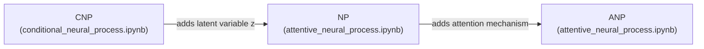

Sources: [README.md:1-17]()

---

## Notebook Overview

The implementation lives entirely in `conditional_neural_process.ipynb`. It is a self-contained Keras/TensorFlow 1.x notebook that:

1. Defines the model components (`Encoder`, `Decoder`, `ConditionalNeuralProcess`)
2. Implements synthetic data generation for 1D function regression tasks
3. Runs a training loop using `tf.GradientTape` and Adam
4. Visualizes predictions as a mean curve with a shaded 95% confidence interval

**Diagram: Data and Control Flow in `conditional_neural_process.ipynb`**

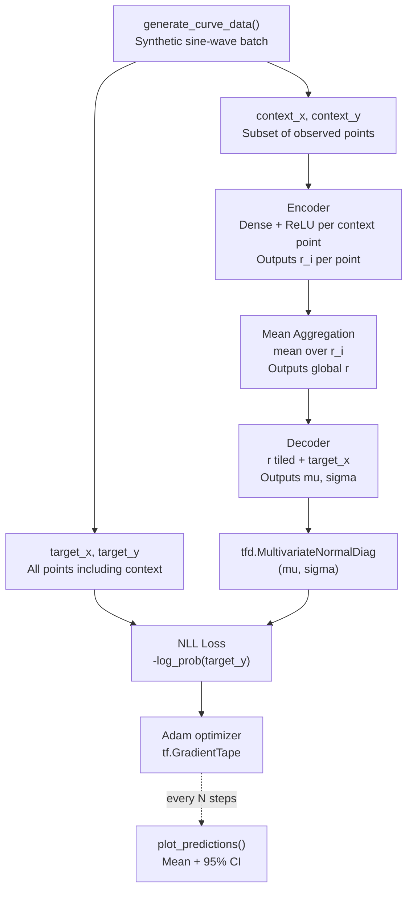

Sources: [README.md:9-10]()

---

## Framework and Dependencies

The CNP notebook uses **TensorFlow 1.x** with the Keras API. It does not share a framework with `attentive_neural_process.ipynb`, which is written in PyTorch.

| Dependency | Tested Version |
|---|---|
| NumPy | 1.14.6 |
| TensorFlow | 1.13.1 |
| Matplotlib | 2.2.4 |

The `tfd` module (`tensorflow_probability.distributions`) is used for the `MultivariateNormalDiag` output distribution that provides both the predictive mean and uncertainty estimates.

Sources: [README.md:28-34]()

---

## Key Components at a Glance

**Diagram: Code Entities in `conditional_neural_process.ipynb`**

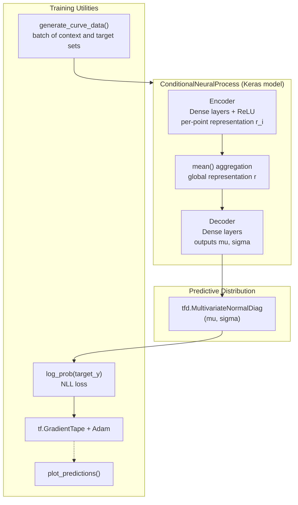

Sources: [README.md:9-10]()

For a detailed walkthrough of each component, continue to [CNP Architecture](#2.1) and [CNP Training and Evaluation](#2.2).

---

# Page: CNP Architecture

# CNP Architecture

<details>
<summary>Relevant source files</summary>

The following files were used as context for generating this wiki page:

- [conditional_neural_process.ipynb](conditional_neural_process.ipynb)

</details>


This page covers the internal architecture of the Conditional Neural Process model as implemented in `conditional_neural_process.ipynb`. It describes the three major components — `Encoder`, mean aggregation, and `Decoder` — and how they are composed inside the `ConditionalNeuralProcess` Keras model.

For the training loop, data generation, and evaluation plots that sit around this architecture, see [CNP Training and Evaluation](#2.2). For context on how CNP relates to NP and ANP, see the [Overview](#1).

---

## High-Level Data Flow

The CNP processes context observations into a single global representation `r`, then uses that to predict distributions over target outputs. The key design constraint is that the aggregation step must be **permutation-invariant** with respect to the context set — the model's output cannot depend on the order in which context points are presented.

**Diagram: CNP Forward Pass — Natural Language to Code Entities**

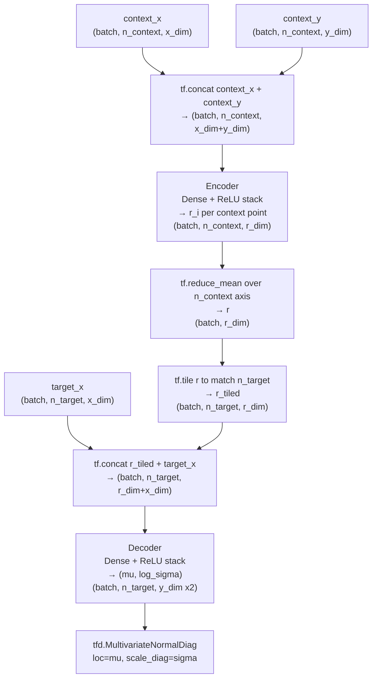

Sources: `conditional_neural_process.ipynb`

---

## Encoder

The `Encoder` class is a standard feedforward network applied **independently to each context point**. Its job is to map a single `(x, y)` pair into a fixed-length representation vector `r_i`.

| Property | Value |
|---|---|
| Input | Concatenation of one context `x` and `y` |
| Layer type | `Dense` + `ReLU` activation |
| Output | Per-point representation `r_i` of dimension `r_dim` |
| Applied to | Each context point independently (no cross-point interaction) |

Because the `Encoder` is applied point-by-point, it has no notion of the set of context points as a whole. This is intentional — the aggregation step handles that.

**Diagram: Encoder Class — Code-Level View**

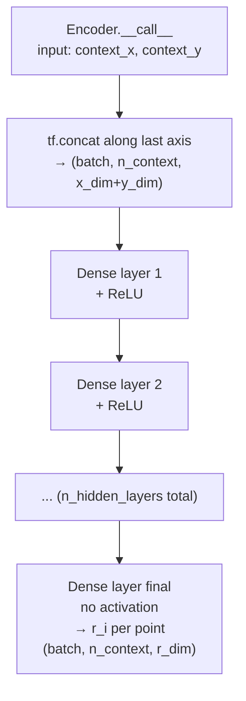

Sources: `conditional_neural_process.ipynb`

---

## Mean Aggregation

After the `Encoder` produces a representation `r_i` for each of the `n_context` context points, a simple **mean** is taken across the context-point axis:

```
r = mean(r_i for i in 1..n_context)
```

This is implemented as `tf.reduce_mean` over the context dimension. The result `r` has shape `(batch, r_dim)` — a single vector that summarizes all context information.

**Why mean?**
Mean aggregation is:
- **Permutation-invariant**: The order of context points does not affect `r`.
- **Parameter-free**: No learned weights are involved.
- **Simple**: A natural baseline aggregator.

This is the defining structural difference from the ANP, which uses a learned attention mechanism to produce a *per-target* representation instead of one global `r`. See [Attention Mechanisms](#3.2) for the ANP alternative.

Sources: `conditional_neural_process.ipynb`

---

## Decoder

The `Decoder` class takes the global representation `r` (tiled to match the number of target points) concatenated with each `target_x`, and produces the parameters of a Gaussian predictive distribution for each target point.

| Property | Value |
|---|---|
| Input | `tf.concat(r_tiled, target_x)` per target point |
| Layer type | `Dense` + `ReLU` (hidden layers), then `Dense` (output) |
| Output | `(mu, log_sigma)` for each target point |
| Output shape | `(batch, n_target, y_dim)` for each of mu and sigma |

The output layer produces a vector of twice the `y_dim` — the first half is `mu` and the second half becomes `sigma` after applying a softplus (or exp) transformation to ensure positivity.

**Diagram: Decoder Class — Code-Level View**

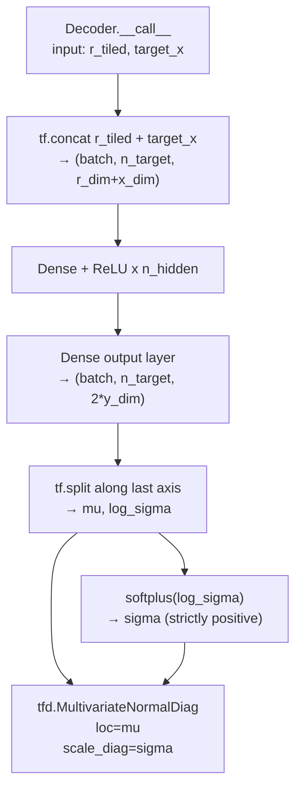

Sources: `conditional_neural_process.ipynb`

---

## ConditionalNeuralProcess — Composition

The `ConditionalNeuralProcess` class is a Keras `Model` subclass that owns instances of `Encoder` and `Decoder` and wires them together in its `__call__` method.

**Diagram: ConditionalNeuralProcess — Component Ownership and Call Flow**

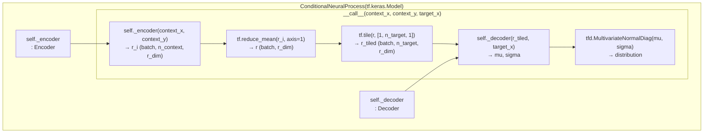

Sources: `conditional_neural_process.ipynb`

---

## Output Distribution

The final output of the model is a `tfd.MultivariateNormalDiag` from TensorFlow Probability. This represents a **diagonal Gaussian distribution** over the target outputs — each output dimension is treated as conditionally independent given the context.

| Symbol | Source | Shape |
|---|---|---|
| `mu` | Decoder output (first half) | `(batch, n_target, y_dim)` |
| `sigma` | Decoder output (second half, softplus-activated) | `(batch, n_target, y_dim)` |
| Distribution | `tfd.MultivariateNormalDiag(loc=mu, scale_diag=sigma)` | — |

The distribution object is returned from `ConditionalNeuralProcess.__call__`. The `log_prob` method on this object is used directly in the loss computation during training. See [CNP Training and Evaluation](#2.2) for details.

Sources: `conditional_neural_process.ipynb`

---

## Summary Table

| Component | Class | Role |
|---|---|---|
| Encoder | `Encoder` | Dense+ReLU applied per context point → `r_i` |
| Aggregation | `tf.reduce_mean` | Collapses `r_i` set to global `r` (permutation-invariant) |
| Decoder | `Decoder` | Dense+ReLU from `(r, target_x)` → `mu`, `sigma` |
| Model | `ConditionalNeuralProcess` | Keras `Model` composing the above |
| Output | `tfd.MultivariateNormalDiag` | Diagonal Gaussian predictive distribution |

---

# Page: CNP Training and Evaluation

# CNP Training and Evaluation

<details>
<summary>Relevant source files</summary>

The following files were used as context for generating this wiki page:

- [conditional_neural_process.ipynb](conditional_neural_process.ipynb)

</details>


This page covers the training pipeline for the Conditional Neural Process (CNP) as implemented in `conditional_neural_process.ipynb`. It describes how synthetic regression tasks are generated, how the model is trained with negative log-likelihood loss using TensorFlow 1.x primitives, and how predictions are visualized during training.

For the model's internal architecture (the `Encoder`, `Decoder`, and `ConditionalNeuralProcess` classes), see the CNP Architecture page [2.1](#2.1). For the analogous training pipeline in the ANP notebook, see ANP Training and Inference [3.3](#3.3).

---

## Synthetic Task Generation

The CNP is trained on synthetic 1-D regression tasks. Each task is a randomly sampled curve drawn from a family of sine waves. This mimics the meta-learning setup from Garnelo et al. (2018): the model must learn to condition on a small context set and predict over a target set.

Each call to `generate_curve_data` produces one batch of tasks with the following structure:

| Tensor | Shape | Description |
|---|---|---|
| `context_x` | `(batch, num_context, 1)` | x-coordinates of context points |
| `context_y` | `(batch, num_context, 1)` | y-values of context points |
| `target_x` | `(batch, num_target, 1)` | x-coordinates of target points |
| `target_y` | `(batch, num_target, 1)` | Ground-truth y-values at target locations |

### Curve Sampling Parameters

Each curve in a batch is independently parameterized by three sampled scalars:

| Parameter | Role |
|---|---|
| amplitude | Controls the vertical scale of the sine wave |
| phase | Horizontal shift of the sine wave |
| offset | Vertical shift (DC offset) |

The context points are a random subset of the target points, so `context_x ⊆ target_x` within each task instance.

**Diagram: `generate_curve_data` output structure**

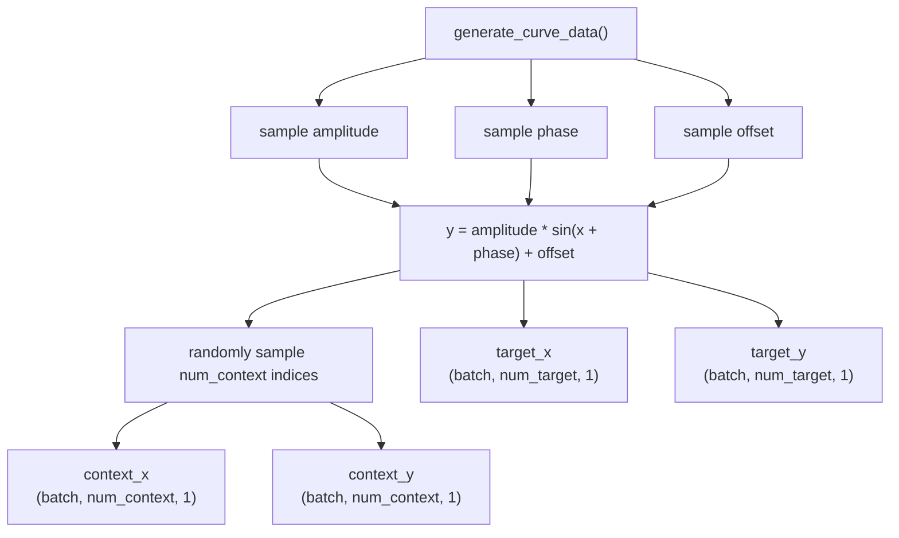

Sources: `conditional_neural_process.ipynb`

---

## Training Loop

Training follows a standard supervised loop driven by `tf.GradientTape`. Each iteration:

1. Calls `generate_curve_data` to produce a fresh batch of regression tasks.
2. Runs a forward pass through the `ConditionalNeuralProcess` model.
3. Computes the negative log-likelihood (NLL) of `target_y` under the predicted distribution.
4. Computes gradients and applies an Adam update.
5. Periodically calls `plot_predictions` to visualize the model's current behavior.

**Diagram: Training loop code entities**

```mermaid
flowchart LR
    subgraph DataGen["Data Generation"]
        GCD["generate_curve_data()"]
    end

    subgraph Model["ConditionalNeuralProcess"]
        FWD["model(context_x, context_y, target_x)"]
        DIST["tfd.MultivariateNormalDiag\n(mu, sigma)"]
        FWD --> DIST
    end

    subgraph LossComp["Loss"]
        LP["dist.log_prob(target_y)"]
        NLL["loss = -tf.reduce_mean(log_prob)"]
        LP --> NLL
    end

    subgraph Opt["Optimization"]
        TAPE["tf.GradientTape"]
        ADAM["Adam optimizer\noptimizer.apply_gradients()"]
        TAPE --> ADAM
    end

    subgraph Viz["Evaluation"]
        PLOT["plot_predictions()"]
    end

    GCD -->|"context_x, context_y\ntarget_x, target_y"| FWD
    DIST -->|"log_prob(target_y)"| LP
    NLL -->|"tape.gradient(loss, variables)"| TAPE
    ADAM -->|"every N steps"| PLOT
```

Sources: `conditional_neural_process.ipynb`

---

## Loss Function

The CNP decoder outputs a Gaussian distribution over target values using `tfd.MultivariateNormalDiag`, parameterized by a predicted mean `mu` and standard deviation `sigma` for each target point.

The training objective is **negative log-likelihood (NLL)**:

```
loss = -mean( dist.log_prob(target_y) )
```

where `dist` is the `tfd.MultivariateNormalDiag` instance returned by the `ConditionalNeuralProcess` model's forward pass. `log_prob` is called on the ground-truth `target_y` tensor, and the mean is taken across both the batch dimension and the target-point dimension.

This objective encourages `mu` to be close to the true function value at each target point and penalizes overconfident predictions (small `sigma`) when the prediction is wrong.

---

## Gradient Updates

Gradient computation uses `tf.GradientTape`, which is TensorFlow 1.x's mechanism for automatic differentiation in eager/Keras mode. The optimizer is Adam with a fixed learning rate.

**Key code pattern:**

| Step | Code construct |
|---|---|
| Record forward pass | `with tf.GradientTape() as tape:` |
| Compute loss | `loss = -tf.reduce_mean(dist.log_prob(target_y))` |
| Compute gradients | `grads = tape.gradient(loss, model.trainable_variables)` |
| Apply update | `optimizer.apply_gradients(zip(grads, model.trainable_variables))` |

The `ConditionalNeuralProcess` model is a `tf.keras.Model` subclass, so `model.trainable_variables` captures the parameters of both the `Encoder` and `Decoder` networks. All parameters are updated jointly in a single pass.

---

## Evaluation and Visualization

Every `N` training steps, `plot_predictions` is called to visualize the model's behavior on a held-out task. This gives qualitative feedback on how well the model interpolates and extrapolates from the context set.

`plot_predictions` renders:

- **Context points** — the conditioning data shown as scatter points.
- **Predicted mean** — the `mu` output of the decoder at each target x-coordinate, shown as a line.
- **95% confidence interval** — a shaded band drawn as `mu ± 1.96 * sigma` using the predicted standard deviation from the decoder.
- **Ground truth** — the underlying sine curve for comparison.

**Diagram: `plot_predictions` inputs and outputs**

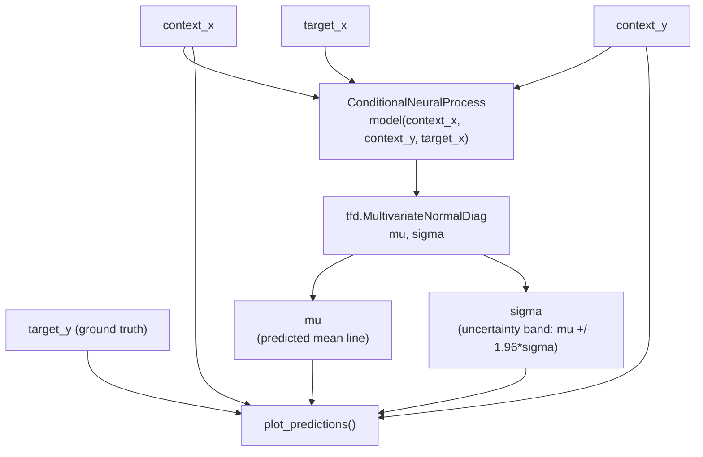

Sources: `conditional_neural_process.ipynb`

---

## Summary of Training Configuration

| Hyperparameter / component | Value / implementation |
|---|---|
| Framework | TensorFlow 1.x with Keras |
| Optimizer | Adam |
| Loss | Negative log-likelihood via `tfd.MultivariateNormalDiag.log_prob` |
| Gradient API | `tf.GradientTape` |
| Data source | `generate_curve_data` (random sine waves) |
| Evaluation | `plot_predictions` (mean + 95% CI) |
| Task type | 1-D function regression (meta-learning) |

---

# Page: Attentive Neural Process

# Attentive Neural Process

<details>
<summary>Relevant source files</summary>

The following files were used as context for generating this wiki page:

- [README.md](README.md)
- [attentive_neural_process.ipynb](attentive_neural_process.ipynb)

</details>


This page introduces the Attentive Neural Process (ANP) model — what problem it solves, how it relates to earlier Neural Process variants, and what `attentive_neural_process.ipynb` contains. Architectural details are covered in [ANP Architecture](#3.1), the attention mechanism variants in [Attention Mechanisms](#3.2), and the training/inference pipeline in [ANP Training and Inference](#3.3). For the simpler CNP model implemented in a separate notebook, see [Conditional Neural Process](#2).

---

## Background and Motivation

The Neural Process (NP) family addresses **meta-learning for regression**: given a small set of observed (context) points, predict a distribution over function values at arbitrary target locations. The three model variants form a chronological lineage:

| Model | Paper | Key Mechanism |
|---|---|---|
| CNP | Garnelo et al., ICML 2018 (`arxiv:1807.01613`) | Deterministic encoder + mean aggregation |
| NP | Garnelo et al., ICML Workshop 2018 (`arxiv:1807.01622`) | Adds latent variable `z` for global uncertainty |
| ANP | Kim et al., ICLR 2019 (`arxiv:1901.05761`) | Adds cross-attention for per-target-point context |

The ANP was introduced to address a limitation of the standard NP: mean-pooling context representations into a single global vector `r` discards the relative positions of context points. When a target point is spatially close to a specific context point, that local information is lost. The ANP replaces global aggregation on the deterministic path with a learned attention mechanism, producing a separate representation `r` for **each target point** by attending over all context points.

[README.md:1-17]()

---

## What `attentive_neural_process.ipynb` Contains

The notebook `attentive_neural_process.ipynb` implements **both** the standard NP and the ANP. The NP serves as a baseline; switching the `Attention` module to `uniform` mode reproduces standard mean-aggregation, making it equivalent to an NP on the deterministic path.

**Diagram: Notebook contents and model relationship**

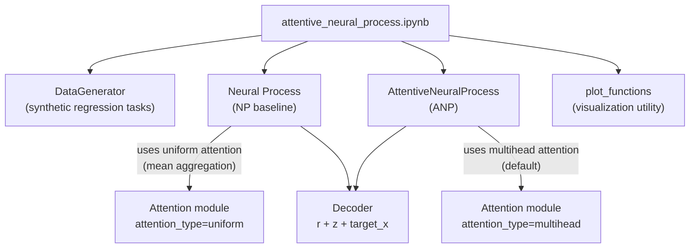

Sources: [README.md:9-10]()

---

## High-Level Architecture

The ANP has two parallel paths from context to decoder:

- **Deterministic path**: Context and target representations are computed by separate encoders, then the attention module uses target representations as queries and context representations as keys/values, producing one `r` per target point.
- **Latent path**: Context representations are mean-pooled into parameters `mu_z` and `sigma_z`, from which a global latent variable `z` is sampled. This captures global function uncertainty.

Both `r` and `z` are concatenated with `target_x` and passed to the decoder to produce predictive `mu` and `sigma`.

**Diagram: ANP data flow mapped to code components**

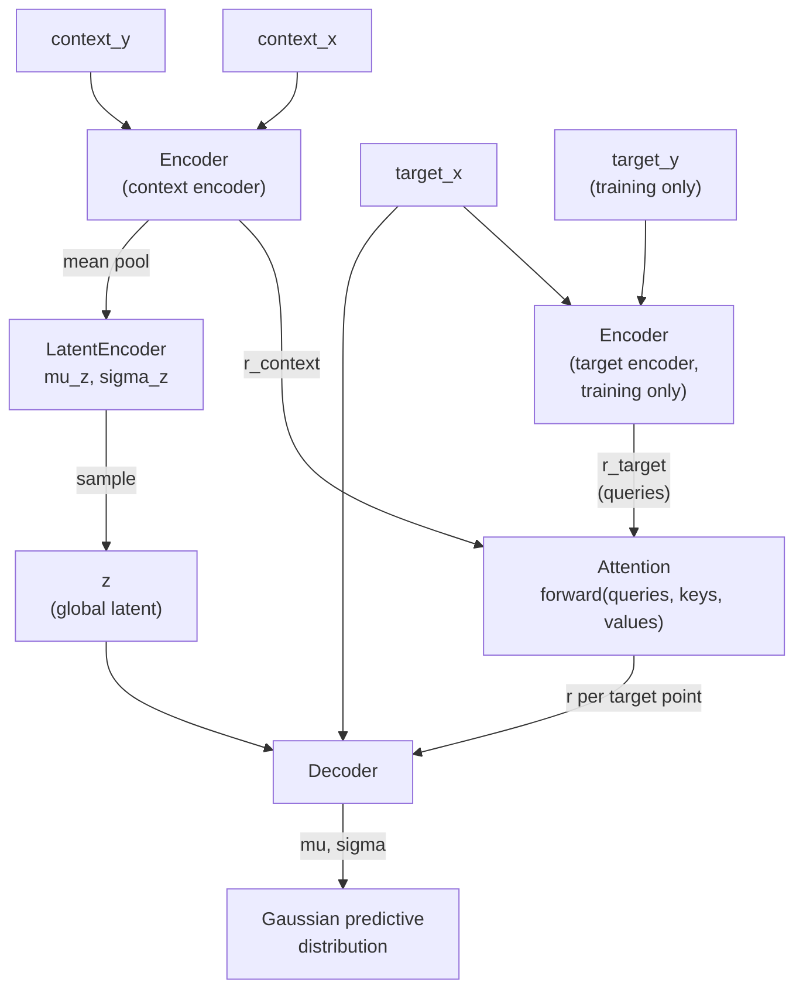

Sources: [README.md:9-10]()

---

## Relationship to the CNP

The table below summarizes the structural differences between CNP (in `conditional_neural_process.ipynb`) and ANP (in `attentive_neural_process.ipynb`):

| Property | CNP | NP | ANP |
|---|---|---|---|
| Framework | TensorFlow 1.x / Keras | PyTorch | PyTorch |
| Latent variable `z` | ✗ | ✓ | ✓ |
| Attention mechanism | ✗ | ✗ (mean pool) | ✓ (cross-attention) |
| Per-target-point `r` | ✗ | ✗ | ✓ |
| Dual encoder | ✗ | ✗ | ✓ |
| Context aggregation | Mean over `r_i` | Mean over `r_i` | `Attention` module |

For full architectural details of the ANP, see [ANP Architecture](#3.1). For the CNP, see [CNP Architecture](#2.1).

Sources: [README.md:1-17]()

---

## Academic Reference

> Kim, H., Mnih, A., Schwarz, J., Garnelo, M., Eslami, A., Rosenbaum, D., Vinyals, O. and Teh, Y.W. *Attentive Neural Processes*. In International Conference on Learning Representations 2019.

[README.md:50-51]()

---

# Page: ANP Architecture

# ANP Architecture

<details>
<summary>Relevant source files</summary>

The following files were used as context for generating this wiki page:

- [attentive_neural_process.ipynb](attentive_neural_process.ipynb)

</details>


This page describes the internal architecture of the Attentive Neural Process (ANP) as implemented in `attentive_neural_process.ipynb`. It covers the class structure, data flow through the two processing paths (deterministic and latent), and how those paths are combined in the `AttentiveNeuralProcess` model.

For the attention mechanisms in detail, see [Attention Mechanisms](#3.2). For the training loop, inference behavior, and visualization utilities, see [ANP Training and Inference](#3.3). For a description of the simpler CNP architecture, see [CNP Architecture](#2.1).

---

## Architectural Overview

The ANP extends the standard Neural Process by replacing the mean-aggregation step in the deterministic path with a learned attention mechanism. This gives each target point a *distinct* context representation, rather than sharing the same global mean. It also retains the latent variable path from the NP.

The model maintains two separate paths through the network:

| Path | Input | Output | Purpose |
|---|---|---|---|
| **Deterministic** | context points + target queries | `r` per target point | Encodes local context via attention |
| **Latent** | context points only | sampled `z` | Encodes global uncertainty |

Both `r` and `z` are concatenated with `target_x` and passed to the decoder.

---

## Class Structure

**Diagram: Class hierarchy in `attentive_neural_process.ipynb`**

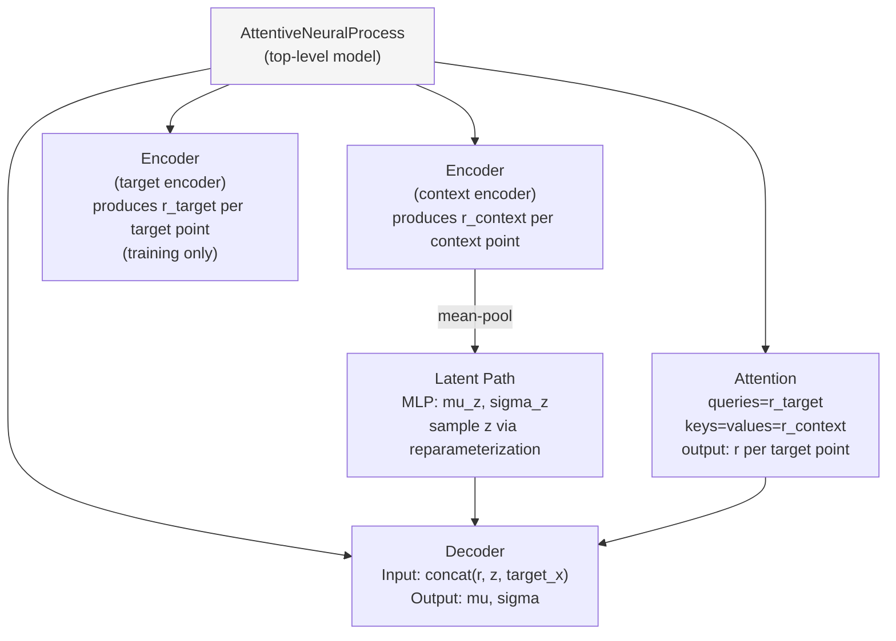

Sources: `attentive_neural_process.ipynb`

---

## Dual Encoder Design

The ANP uses a shared `Encoder` class instantiated twice with the same architecture but trained for two roles:

- **Context encoder**: Applied to each `(context_x, context_y)` pair independently to produce a per-point representation `r_context`. This output feeds both the attention keys/values and the latent path.
- **Target encoder**: Applied to each `(target_x, target_y)` pair to produce `r_target`. This is used only during **training**, as target `y` values are not available at inference time. `r_target` serves as the attention queries.

The encoder applies a stack of dense layers with ReLU activations, producing a fixed-size hidden representation for each input point.

**Diagram: Encoder usage in the two paths**

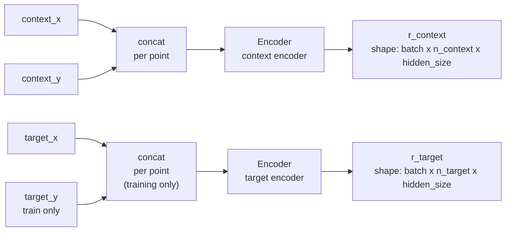

Sources: `attentive_neural_process.ipynb`

---

## Deterministic Path

The deterministic path routes context and target representations through the `Attention` module to produce a distinct context representation `r` for each target point.

- **Queries**: `r_target` (from target encoder, training) or a projection of `target_x` alone (inference)
- **Keys**: `r_context`
- **Values**: `r_context`

The output `r` has shape `(batch, n_targets, hidden_size)` — one vector per target point. This is what allows the ANP to condition its prediction for each target on a learned, *query-dependent* subset of the context, rather than a single global average.

The default attention type is `multihead`. For details on all four supported types (`uniform`, `dot_product`, `laplace`, `multihead`), see [Attention Mechanisms](#3.2).

---

## Latent Variable Path

The latent path provides a global, stochastic representation of the context. It operates as follows:

1. Mean-pool `r_context` across the context dimension → global vector
2. Apply an MLP to produce `mu_z` and `log_sigma_z`
3. Sample `z` via the reparameterization trick: `z = mu_z + sigma_z * epsilon`, where `epsilon ~ N(0, I)`

**Diagram: Latent path data flow**

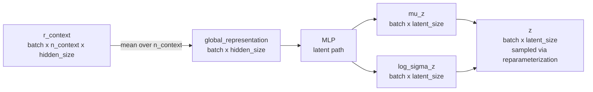

Sources: `attentive_neural_process.ipynb`

During **training**, a separate latent distribution is computed from the target encoder outputs (posterior), enabling the ELBO-style loss. During **inference**, only the context (prior) is used. This behavioral split is described in [ANP Training and Inference](#3.3).

---

## Decoder

The `Decoder` takes per-target-point inputs and produces a Gaussian predictive distribution for each.

**Input** to the decoder, for each target point:

```
concat(r_i, z, target_x_i)
```

where:
- `r_i` is the attention output for target point `i` (shape: `hidden_size`)
- `z` is the latent sample, tiled across all target points (shape: `latent_size`)
- `target_x_i` is the input coordinate of target point `i`

**Output**: `mu` and `sigma` for each target point, defining a per-point Gaussian distribution. The loss is the negative log-likelihood of `target_y` under this distribution.

**Diagram: Decoder input composition**

```mermaid
flowchart LR
    RI["r_i\nper-target attention output"]
    Z["z\nlatent sample\ntiled over targets"]
    TXI["target_x_i\ntarget input coordinate"]

    RI --> CAT["concat"]
    Z --> CAT
    TXI --> CAT

    CAT --> DEC["Decoder\nDense layers + ReLU"]
    DEC --> MU["mu_i"]
    DEC --> SIG["sigma_i"]
    MU --> DIST["Gaussian\npredictive distribution\nper target point"]
    SIG --> DIST
```

Sources: `attentive_neural_process.ipynb`

---

## `AttentiveNeuralProcess` Orchestration

The top-level `AttentiveNeuralProcess` class wires all of the above together. Its `forward()` method:

1. Passes `(context_x, context_y)` through the context `Encoder` → `r_context`
2. Passes `(target_x, target_y)` through the target `Encoder` → `r_target` *(training only)*
3. Feeds `r_target` (queries) and `r_context` (keys and values) through `Attention` → `r`
4. Mean-pools `r_context` and applies the latent MLP → samples `z`
5. Tiles `z` and concatenates with `r` and `target_x` per target point
6. Passes the concatenated input through `Decoder` → `mu`, `sigma`
7. Returns the predictive distribution

**Diagram: Full `AttentiveNeuralProcess.forward()` data flow**

```mermaid
flowchart TD
    CTX["context_x, context_y"]
    TGT["target_x\ntarget_y (train only)"]

    CTX --> EncCtx["Encoder\ncontext_encoder"]
    TGT --> EncTgt["Encoder\ntarget_encoder\ntrain only"]

    EncCtx --> RC["r_context"]
    EncTgt --> RT["r_target"]

    RC --> AttK["Attention keys"]
    RC --> AttV["Attention values"]
    RT --> AttQ["Attention queries"]

    AttQ --> Att["Attention\nforward(queries, keys, values)"]
    AttK --> Att
    AttV --> Att
    Att --> R["r\nper-target representation"]

    RC --> MeanPool["mean pool"]
    MeanPool --> LatMLP["Latent MLP\nmu_z, sigma_z"]
    LatMLP --> Z["z (sampled)"]

    R --> Concat["concat(r, z, target_x)\nper target point"]
    Z --> Concat
    TGT --> Concat

    Concat --> Dec["Decoder"]
    Dec --> MU["mu"]
    Dec --> SIG["sigma"]
    MU --> OUT["Gaussian predictive\ndistribution"]
    SIG --> OUT
```

Sources: `attentive_neural_process.ipynb`

---

## Summary Table

| Component | Class | Input | Output |
|---|---|---|---|
| Context representation | `Encoder` (context) | `context_x, context_y` | `r_context` (per context point) |
| Query representation | `Encoder` (target) | `target_x, target_y` | `r_target` (training only) |
| Deterministic aggregation | `Attention` | queries, keys, values | `r` (per target point) |
| Global uncertainty | Latent MLP | mean-pooled `r_context` | `mu_z`, `sigma_z`, sampled `z` |
| Prediction | `Decoder` | `concat(r, z, target_x)` | `mu`, `sigma` per target point |
| Top-level model | `AttentiveNeuralProcess` | context + target sets | Gaussian predictive distribution |

Sources: `attentive_neural_process.ipynb`

---

# Page: Attention Mechanisms

# Attention Mechanisms

<details>
<summary>Relevant source files</summary>

The following files were used as context for generating this wiki page:

- [attentive_neural_process.ipynb](attentive_neural_process.ipynb)

</details>


This page documents the `Attention` class in `attentive_neural_process.ipynb` — specifically, the four attention variants it supports, how each computes context aggregation, and how to configure them. For the broader ANP model architecture that consumes the `Attention` module, see [ANP Architecture (3.1)](#3.1). For the training loop and inference behavior built around this module, see [ANP Training and Inference (3.3)](#3.3).

---

## Role of Attention in the ANP

The standard Neural Process uses **mean aggregation** to collapse per-context-point representations into a single global vector `r`. This is permutation-invariant and simple, but it ignores which target point is being predicted — every target point receives the same `r`.

The Attentive Neural Process replaces mean aggregation with a **query-key-value attention** mechanism on the deterministic path. The attention module receives:

- **Queries**: representations derived from each target point
- **Keys**: representations derived from each context point
- **Values**: representations derived from each context point

For each target point, the module computes a weighted combination of the values, where weights reflect how relevant each context point is to that specific target. The result is a **per-target-point** representation `r`, allowing the model to focus on relevant context depending on where it is predicting.

**Figure: Attention module placement in the ANP forward pass**

```mermaid
flowchart TD
    context_x["context_x"]
    context_y["context_y"]
    target_x["target_x"]

    ContextEnc["ContextEncoder\n(MLP per context point)"]
    TargetEnc["TargetEncoder\n(MLP per target point)"]

    r_context["r_context\n(batch, n_context, hidden)"]
    r_target["r_target\n(batch, n_target, hidden)"]

    AttClass["Attention\nforward(queries, keys, values)"]

    r_out["r\n(batch, n_target, hidden)\nper-target representation"]

    context_x --> ContextEnc
    context_y --> ContextEnc
    target_x --> TargetEnc

    ContextEnc --> r_context
    TargetEnc --> r_target

    r_target --> |"queries"| AttClass
    r_context --> |"keys"| AttClass
    r_context --> |"values"| AttClass

    AttClass --> r_out
```

Sources: `attentive_neural_process.ipynb`

---

## The `Attention` Class

The `Attention` class is instantiated once inside `AttentiveNeuralProcess`. Its constructor accepts an `attention_type` string argument that selects which of the four variants to use. All variants expose the same interface: a `forward(queries, keys, values)` method that returns `r` with shape `(batch, n_targets, hidden_size)`.

| Constructor Arg | Variant | Learned Params | Locality-Sensitive | Expressiveness |
|---|---|---|---|---|
| `"uniform"` | Uniform / Mean | None | No | Lowest |
| `"laplace"` | Laplace kernel | None | Yes | Low–Medium |
| `"dot_product"` | Scaled dot-product | None | Yes | Medium |
| `"multihead"` | Multi-head attention | Yes (linear projections) | Yes | Highest |

The default is `"multihead"`.

---

## Attention Variants

### Uniform

`uniform` assigns an **equal weight** to every context point, regardless of the query. The output for each target point is therefore the simple mean of the value vectors.

This is mathematically equivalent to standard mean aggregation — i.e., the behavior of the baseline Neural Process (NP) without attention. Using `uniform` within the ANP code allows the model to be run in "NP mode" without architectural changes, which is how the notebook demonstrates the NP baseline alongside the full ANP.

```
weight(q, k_i) = 1 / N_context   for all i
r = (1/N) * sum(values)
```

### Laplace

`laplace` computes attention weights using an **RBF-style distance kernel** between each query and key:

```
weight_i ∝ exp(−|query − key_i|_1)
```

After computing pairwise distances, weights are normalized with softmax. This variant does not introduce any learnable parameters. It encourages the model to attend to context points that are geometrically close to the target in representation space, creating smooth, locality-sensitive aggregation.

### Dot-Product

`dot_product` applies **scaled dot-product attention**:

```
weight_i = softmax(query · key_i / sqrt(d_k))
```

No linear projection layers are applied before the dot product — queries and keys are used directly. The scaling by `sqrt(d_k)` stabilizes gradients when hidden dimensions are large. This is more expressive than `laplace` because it learns directional similarity rather than purely distance-based proximity, but it has no learned projection parameters.

### Multihead (Default)

`multihead` is the full multi-head attention variant and the default for the ANP. It applies **learned linear projections** to the queries, keys, and values before computing scaled dot-product attention across multiple parallel attention heads:

```
MultiHead(Q, K, V) = Concat(head_1, ..., head_h) W_O
where head_i = Attention(Q W_Q^i, K W_K^i, V W_V^i)
```

Each head learns to attend to a different aspect of the context. The per-head outputs are concatenated and linearly projected back to `hidden_size`. The projection matrices `W_Q`, `W_K`, `W_V`, and `W_O` are all learned parameters.

This is the most expressive variant and the one used in the ANP paper (Kim et al., ICLR 2019).

---

## Computational Flow by Variant

**Figure: Internal computation paths for each attention type**

```mermaid
flowchart TD
    Input["forward(queries, keys, values)"]

    Input --> Uniform["uniform\nEqual weights\n1/N per context point"]
    Input --> Laplace["laplace\nexp(-L1 distance)\nQuery-key distance"]
    Input --> DotProd["dot_product\nscaled dot product\nquery · key / sqrt(dk)"]
    Input --> Multihead["multihead\nLinear projections\nW_Q, W_K, W_V\n→ scaled dot product per head\n→ concat → W_O"]

    Uniform --> Softmax1["(no softmax needed;\nuniform weights)"]
    Laplace --> Softmax2["softmax(weights)"]
    DotProd --> Softmax3["softmax(weights)"]
    Multihead --> Softmax4["softmax(per-head weights)"]

    Softmax1 --> Out["r = weighted sum of values\n(batch, n_targets, hidden_size)"]
    Softmax2 --> Out
    Softmax3 --> Out
    Softmax4 --> Out
```

Sources: `attentive_neural_process.ipynb`

---

## Selecting an Attention Type

The `attention_type` argument is passed to the `Attention` constructor, which is called inside `AttentiveNeuralProcess.__init__`. To switch variants, change the string passed at instantiation:

| Goal | `attention_type` value |
|---|---|
| Reproduce standard NP (no attention) | `"uniform"` |
| Non-parametric locality-sensitive attention | `"laplace"` |
| Non-parametric directional attention | `"dot_product"` |
| Full ANP as in Kim et al. 2019 | `"multihead"` |

**Figure: `Attention` class relationships to `AttentiveNeuralProcess`**

```mermaid
classDiagram
    class AttentiveNeuralProcess {
        +encoder_context: Encoder
        +encoder_target: Encoder
        +attention: Attention
        +latent_encoder: LatentEncoder
        +decoder: Decoder
        +forward(context_x, context_y, target_x, target_y)
    }

    class Attention {
        +attention_type: str
        +num_heads: int
        +forward(queries, keys, values)
        -_uniform(queries, keys, values)
        -_laplace(queries, keys, values)
        -_dot_product(queries, keys, values)
        -_multihead(queries, keys, values)
    }

    AttentiveNeuralProcess --> Attention : "uses on\ndeterministic path"
```

Sources: `attentive_neural_process.ipynb`

---

## Expressiveness Trade-offs

The four variants form a spectrum from no learned parameters (uniform, laplace, dot\_product) to fully parametric (multihead). This has practical implications:

- **Fewer parameters**: `uniform`, `laplace`, and `dot_product` add no extra weights, making them faster to train and less prone to overfitting on small tasks. `uniform` eliminates attention entirely.
- **More parameters**: `multihead` introduces four projection matrices per attention layer, allowing the model to learn task-specific notions of relevance between context and target points.
- **Locality**: `laplace` explicitly encodes proximity; `dot_product` and `multihead` learn the notion of relevance from data.

The notebook uses `multihead` as the default to match the ANP paper's configuration. Switching to `"uniform"` effectively reduces the ANP to a standard NP, which is useful for ablation studies.

---

# Page: ANP Training and Inference

# ANP Training and Inference

<details>
<summary>Relevant source files</summary>

The following files were used as context for generating this wiki page:

- [attentive_neural_process.ipynb](attentive_neural_process.ipynb)

</details>


This page covers the end-to-end training pipeline and inference behavior of the Attentive Neural Process (ANP) as implemented in `attentive_neural_process.ipynb`. It focuses on how batches are constructed, how training and inference differ in terms of latent variable handling, how the loss is computed and minimized, and how predictions are visualized and sampled.

For the model's internal architecture (encoder, decoder, latent path), see [ANP Architecture (3.1)](#3.1). For the attention mechanisms used in the deterministic path, see [Attention Mechanisms (3.2)](#3.2).

---

## Data Generation

Synthetic regression tasks are produced by the `DataGenerator` class. Each call yields a single batch representing one regression task drawn from a distribution over 1D functions.

### What `DataGenerator` produces

| Field | Shape | Description |
|---|---|---|
| `context_x` | `(batch, n_context, x_size)` | Input locations of context points |
| `context_y` | `(batch, n_context, y_size)` | Observed values at context locations |
| `target_x` | `(batch, n_target, x_size)` | Input locations of target points |
| `target_y` | `(batch, n_target, y_size)` | Ground-truth values at target locations |

Context points are a subset of target points — every context point also appears in the target set.

### Function distribution

Each batch samples a 1D curve by drawing random amplitude, phase, and vertical offset, then evaluating on a grid of x values. This creates a distribution over smooth functions resembling random sine waves.

**Diagram: DataGenerator batch structure**

```mermaid
flowchart LR
    DG["DataGenerator"]
    DG --> amp["sample amplitude"]
    DG --> phase["sample phase"]
    DG --> offset["sample offset"]
    amp & phase & offset --> curve["evaluate curve on x grid"]
    curve --> split["split into context / target"]
    split --> cx["context_x"]
    split --> cy["context_y"]
    split --> tx["target_x"]
    split --> ty["target_y"]
```

Sources: `attentive_neural_process.ipynb`

---

## Training vs. Inference Mode

The most important behavioral distinction in the ANP is whether `target_y` is supplied to the model's forward pass.

The `AttentiveNeuralProcess` model detects this and switches between two latent paths:

- **Training mode** (`target_y` provided): the latent variable `z` is sampled from the *posterior* distribution `q(z | context + target)`. This requires encoding both context and target observations jointly.
- **Inference mode** (`target_y=None`): the latent variable `z` is sampled from the *prior* distribution `p(z | context)`. Only the context is encoded.

This is the standard ELBO training strategy from the Neural Process family: at training time the posterior encoder has access to ground truth target values, allowing a richer latent representation. At test time this information is unavailable, so the prior is used instead.

**Diagram: Training mode vs. inference mode in `AttentiveNeuralProcess`**

```mermaid
flowchart TD
    INPUT["forward(context_x, context_y, target_x, target_y)"]
    CHECK{"target_y provided?"}
    TRAIN_PATH["Encode context + target\ninto posterior q_z\nmu_z_posterior, sigma_z_posterior"]
    INFER_PATH["Encode context only\ninto prior p_z\nmu_z_prior, sigma_z_prior"]
    SAMPLE_Z["Sample z ~ q_z (train)\nor z ~ p_z (infer)"]
    ATT_PATH["Deterministic attention path\nAttention(queries=target_enc, keys=context_enc)\n-> r per target point"]
    DEC["Decoder\nconcat(r, z, target_x) -> mu, sigma"]
    OUT["(mu, sigma, prior_params, posterior_params)"]

    INPUT --> CHECK
    CHECK -- "yes (training)" --> TRAIN_PATH
    CHECK -- "no (inference)" --> INFER_PATH
    TRAIN_PATH --> SAMPLE_Z
    INFER_PATH --> SAMPLE_Z
    SAMPLE_Z --> DEC
    INPUT --> ATT_PATH --> DEC
    DEC --> OUT
```

Sources: `attentive_neural_process.ipynb`

---

## Loss Function

The loss combines two terms:

1. **Negative log-likelihood (NLL)** — how well the predicted distribution `p(target_y | mu, sigma)` fits the ground truth. This is a Gaussian log-probability evaluated at `target_y` for each target point.

2. **KL divergence** — the KL between the posterior latent distribution and the prior, `KL(q(z | context, target) || p(z | context))`. This acts as a regularizer, preventing the posterior from deviating too far from the prior.

The full training objective is:

```
loss = -log p(target_y | mu, sigma) + KL(q_posterior || p_prior)
```

This is the standard evidence lower bound (ELBO) negated, identical in form to a VAE objective.

| Term | Role | Available at inference? |
|---|---|---|
| NLL | Fit to observed data | Yes |
| KL divergence | Regularize latent variable | No — requires posterior, which needs `target_y` |

At inference time only the NLL can be evaluated (no `target_y` available), but the KL is not needed for prediction.

Sources: `attentive_neural_process.ipynb`

---

## Training Loop

Training uses PyTorch's standard `autograd` pipeline with the Adam optimizer.

**Diagram: Training loop — code-level entities**

```mermaid
flowchart LR
    subgraph "Per iteration"
        DG["DataGenerator\n.generate_curves()"]
        FWD["AttentiveNeuralProcess\n.forward(context_x, context_y, target_x, target_y)"]
        LOSS["compute_loss()\nNLL + KL"]
        BWD["loss.backward()"]
        OPT["Adam optimizer\n.step()"]
        DG --> FWD --> LOSS --> BWD --> OPT --> DG
    end
    subgraph "Periodic"
        EVAL["plot_functions()"]
        OPT -.-> EVAL
    end
```

The key steps per iteration:

1. `DataGenerator` produces a batch with context/target split.
2. `AttentiveNeuralProcess.forward()` receives all four tensors (`context_x`, `context_y`, `target_x`, `target_y`), returning predicted `mu`, `sigma`, and the prior/posterior distribution parameters.
3. The loss is computed from the returned values.
4. `loss.backward()` computes gradients through the entire graph, including the reparameterized sample of `z`.
5. The Adam optimizer updates all parameters.
6. Every N steps, `plot_functions()` is called to visualize current predictions.

Sources: `attentive_neural_process.ipynb`

---

## Visualization: `plot_functions`

The `plot_functions` utility is called periodically during training. It runs the model in **inference mode** (no `target_y`), collects the predicted `mu` and `sigma`, and plots:

- The ground-truth curve across the full x range.
- Context points as scatter points.
- The predicted mean as a line.
- A shaded band representing ±1 standard deviation (or a configurable confidence interval).

The function also supports overlaying multiple samples from the model to visualize the stochastic behavior of the latent variable.

Sources: `attentive_neural_process.ipynb`

---

## Sampling Multiple Predictions: `sample()`

Because the ANP has a stochastic latent variable `z`, running the model multiple times on the same context produces different predictions. The `sample()` method (or equivalent repeated forward passes in inference mode) exploits this to draw a distribution of plausible functions.

Each sample proceeds as:

1. Encode context into prior `p(z | context)`.
2. Draw a fresh sample `z ~ p(z | context)`.
3. Run the deterministic attention path to get `r`.
4. Decode `(r, z, target_x)` to get a new `(mu, sigma)` pair.

Repeating this K times yields K mean curves, each conditioned on the same context but with different latent draws. This captures the model's *epistemic uncertainty* about which function generated the context data, as opposed to the per-point `sigma` which captures *aleatoric* (observation noise) uncertainty.

**Diagram: Multiple samples from `AttentiveNeuralProcess` at inference**

```mermaid
flowchart TD
    CTX["context_x, context_y"]
    ENC["Encoder (context)\n-> r_context"]
    PRIOR["prior p_z\nmu_z, sigma_z = MLP(mean(r_context))"]
    CTX --> ENC --> PRIOR

    PRIOR --> Z1["z_1 ~ p_z"]
    PRIOR --> Z2["z_2 ~ p_z"]
    PRIOR --> ZK["z_K ~ p_z"]

    ATT["Attention path\n-> r per target point"]
    ENC --> ATT

    Z1 & ATT --> DEC1["Decoder -> mu_1, sigma_1"]
    Z2 & ATT --> DEC2["Decoder -> mu_2, sigma_2"]
    ZK & ATT --> DECK["Decoder -> mu_K, sigma_K"]

    DEC1 & DEC2 & DECK --> PLOT["plot_functions()\noverlaid sample curves"]
```

Sources: `attentive_neural_process.ipynb`

---

## Summary

| Concept | Training | Inference |
|---|---|---|
| `target_y` passed to model | Yes | No |
| Latent `z` sampled from | Posterior `q(z \| context, target)` | Prior `p(z \| context)` |
| Loss terms | NLL + KL divergence | N/A (no loss computed) |
| Optimizer | Adam via `loss.backward()` | — |
| Typical use | Parameter updates | `plot_functions()`, `sample()` |

The overall training pipeline in `attentive_neural_process.ipynb` is structurally the same as the CNP pipeline (see [CNP Training and Evaluation (2.2)](#2.2)), but differs in that the latent variable `z` requires the ELBO objective and the prior/posterior switching logic described above.

---

# Page: Contributing

# Contributing

<details>
<summary>Relevant source files</summary>

The following files were used as context for generating this wiki page:

- [CONTRIBUTING.md](CONTRIBUTING.md)

</details>


This page describes the process for contributing changes to the `neural-processes` repository. It covers the Contributor License Agreement (CLA) requirement, the pull request and code review workflow, and the community conduct guidelines. For information about the project itself, see page [1](#1). For licensing terms, see page [5](#5).

---

## Overview

The contribution workflow has three mandatory components:

```mermaid
flowchart LR
    CLA["CLA Signed\n(one-time, per contributor)"]
    PR["Pull Request\nsubmitted via GitHub"]
    REVIEW["Code Review\n(required for all submitters,\nincluding project members)"]
    MERGE["Merged"]
    CONDUCT["Community Guidelines\n(Google Open Source Conduct)"]

    CLA --> PR --> REVIEW --> MERGE
    CONDUCT -.->|"governs all interactions"| PR
    CONDUCT -.->|"governs all interactions"| REVIEW
```

**Sources:** [CONTRIBUTING.md:1-29]()

---

## Contributor License Agreement

Before a contribution can be accepted, a Contributor License Agreement must be on file. The CLA grants the project permission to use and redistribute the contribution; copyright remains with the contributor or their employer.

| Situation | Action Required |
|---|---|
| First-time contributor to any Google project | Sign a new CLA |
| Already signed a CLA for another Google project | No action needed |
| Contributor employed by a company | Company may need to sign a corporate CLA |

The CLA is a one-time requirement per contributor, not per pull request or per repository.

**Sources:** [CONTRIBUTING.md:7-16]()

---

## Pull Requests and Code Review

All changes — including those from project members — must go through a GitHub pull request and receive a review before merging. There are no exceptions for maintainers or committers.

```mermaid
flowchart TD
    FORK["Fork or branch\nthe repository"]
    CHANGE["Make changes\nto notebook files or docs"]
    PR["Open a Pull Request\non GitHub"]
    REVIEW["Review by project member\n(mandatory for all submitters)"]
    APPROVED["Approved"]
    MERGED["Merged into main branch"]

    FORK --> CHANGE --> PR --> REVIEW
    REVIEW -->|"revisions requested"| CHANGE
    REVIEW --> APPROVED --> MERGED
```

The files most likely to be changed in a contribution are:

| File | Description |
|---|---|
| `conditional_neural_process.ipynb` | CNP implementation (TensorFlow/Keras) |
| `attentive_neural_process.ipynb` | NP and ANP implementation (PyTorch) |
| `README.md` | Project overview and citations |

**Sources:** [CONTRIBUTING.md:18-23]()

---

## Community Guidelines

All participants in the project — contributors, reviewers, and maintainers — are expected to follow [Google's Open Source Community Guidelines](https://opensource.google.com/conduct/). This applies to pull request discussions, issue comments, and all other project interactions.

**Sources:** [CONTRIBUTING.md:25-29]()

---

# Page: License

# License

<details>
<summary>Relevant source files</summary>

The following files were used as context for generating this wiki page:

- [LICENSE](LICENSE)

</details>


This page covers the license terms under which the `neural-processes` repository is distributed. It applies to all files in the repository, including both Jupyter notebooks (`conditional_neural_process.ipynb`, `attentive_neural_process.ipynb`) and all documentation files. For information about contributing code back to the project, see [Contributing](#4).

---

## License Type

The project is distributed under the **Apache License, Version 2.0** (January 2004).

The full license text is located at [LICENSE:1-175]().

| Property | Value |
|---|---|
| License name | Apache License, Version 2.0 |
| License file | `LICENSE` |
| SPDX identifier | `Apache-2.0` |
| Original publication date | January 2004 |
| Canonical URL | `http://www.apache.org/licenses/` |

---

## Rights Granted

The following table summarizes the key permissions, conditions, and limitations defined in [LICENSE:66-174]().

| Category | Detail | License Section |
|---|---|---|
| **Copyright license** | Perpetual, worldwide, non-exclusive, royalty-free right to reproduce, prepare derivative works, publicly display, publicly perform, sublicense, and distribute the Work | Section 2 |
| **Patent license** | Perpetual, worldwide, non-exclusive, royalty-free right to make, use, offer to sell, sell, import, and transfer the Work | Section 3 |
| **Redistribution** | Allowed in any medium, with or without modifications, in Source or Object form | Section 4 |
| **Trademark** | No permission to use trade names, trademarks, or product names of the Licensor | Section 6 |
| **Warranty** | Work provided "AS IS", without warranties of any kind (express or implied) | Section 7 |
| **Liability** | Contributors not liable for direct, indirect, special, incidental, or consequential damages | Section 8 |

---

## Redistribution Conditions

When redistributing the Work or Derivative Works, all four of the following conditions must be met ([LICENSE:89-128]()):

1. Include a copy of this License with the distribution.
2. Modified files must carry prominent notices stating the changes made.
3. Retain all copyright, patent, trademark, and attribution notices from the original Source form.
4. If the Work includes a `NOTICE` file, include a readable copy of its attribution notices in the distribution.

---

## Contribution Submissions

Per [LICENSE:130-136](), any Contribution intentionally submitted for inclusion in the Work is automatically licensed under the same Apache 2.0 terms, unless a separate license agreement has been explicitly executed with the Licensor.

**Diagram: License Scope Over Repository Files**

```mermaid
graph TD
    LIC["LICENSE\n(Apache 2.0)"]
    LIC --> NB1["conditional_neural_process.ipynb"]
    LIC --> NB2["attentive_neural_process.ipynb"]
    LIC --> README["README.md"]
    LIC --> CONTRIB["CONTRIBUTING.md"]
```

Sources: [LICENSE:1-175]()

---

## Warranty Disclaimer

The Work is provided **"AS IS"**, without warranties or conditions of any kind — including, without limitation, warranties of `TITLE`, `NON-INFRINGEMENT`, `MERCHANTABILITY`, or `FITNESS FOR A PARTICULAR PURPOSE` ([LICENSE:143-151]()).

Contributors are not liable for any damages arising from use or inability to use the Work, even if advised of the possibility of such damages ([LICENSE:153-163]()).

---

## Patent Termination Clause

If a recipient of the Work institutes patent litigation (including cross-claims or counterclaims) alleging that the Work or any Contribution constitutes patent infringement, all patent licenses granted to that recipient under this License **terminate** as of the date the litigation is filed ([LICENSE:80-87]()).

---

## Key Term Definitions

The Apache 2.0 license defines precise meanings for the following terms used throughout ([LICENSE:7-64]()):

| Term | Definition Summary |
|---|---|
| `License` | The terms and conditions in Sections 1–9 of the LICENSE file |
| `Licensor` | The copyright owner granting the License |
| `You` / `Your` | An individual or Legal Entity exercising permissions under this License |
| `Source` form | Preferred form for making modifications (source code, documentation source, config files) |
| `Object` form | Any form resulting from mechanical transformation of Source form (compiled code, generated docs) |
| `Work` | The work of authorship made available under the License |
| `Derivative Works` | Works based on or derived from the Work, representing an original work of authorship |
| `Contribution` | Any work submitted to the Licensor for inclusion in the Work |
| `Contributor` | The Licensor and any Legal Entity whose Contribution has been incorporated into the Work |

Sources: [LICENSE:7-64]()