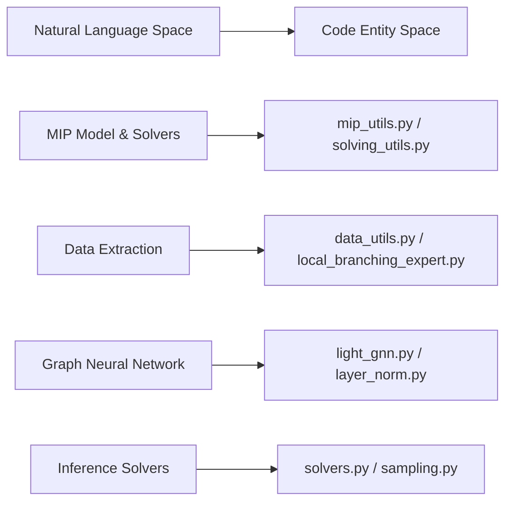

<!-- source: DeepWiki mcp.deepwiki.com · repo google-deepmind/neural_lns · page 1 Overview · fetched 2026-10-26 -->

# Overview

<details>
<summary>Relevant source files</summary>

The following files were used as context for generating this wiki page:

- [README.md](README.md)
- [solvers.py](solvers.py)
- [train.py](train.py)

</details>


## Purpose and Scope

Neural Large Neighborhood Search (Neural LNS) and Neural Diving are machine learning frameworks designed to accelerate the solution of Mixed Integer Programs (MIPs) [README.md:1-7]. Developed by DeepMind, the codebase integrates Graph Neural Networks (GNNs) with exact mathematical programming solvers (such as SCIP) to predict promising variable assignments or variable neighborhoods, effectively guiding combinatorial search. This parent page outlines the end-to-end pipeline—spanning imitation data generation, GNN training, and inference orchestration—and links to child pages for detailed configuration, execution instructions, and repository conventions [README.md:1-10].

Sources: `README.md:1-10`, `solvers.py:35-45`

---

## End-to-End Pipeline and Architecture

The workflow implemented across the repository is divided into three primary phases: data generation, model training, and solver deployment. 

1. **Data Generation**: Expert heuristics (`local_branching_expert.py`) explore MIP instances to generate high-quality imitation trajectories and variable labels, serialized into TFRecord datasets (`data_utils.py`) [README.md:16-22, README.md:31].
2. **Training**: The training script (`train.py`) coordinates distributed training loops using TensorFlow and Sonnet, optimizing the LightGNN architecture (`light_gnn.py`) against binary cross-entropy loss and tracking validation accuracy/AUC [train.py:40-78].
3. **Inference and Solving**: Solvers (`solvers.py`) leverage trained models via sampling modules (`sampling.py`) to execute **Neural Diving** or **Neural Neighbourhood Selection (Neural LNS)**, iteratively repairing or shrinking neighborhoods to find optimal or near-optimal solutions [solvers.py:35-104].

```mermaid
graph TD
  sub_mip["MIP Instances"] -->| "Expert Trajectories" | datagen["Data Generation\n(local_branching_expert.py)"]
  datagen -->| "TFRecords" | ds["Dataset Pipeline\n(data_utils.py)"]
  ds -->| "DatasetTuple" | train["Training Loop\n(train.py)"]
  train -->| "Model Weights" | model["LightGNN Model\n(light_gnn.py)"]
  model -->| "Probabilities" | sampler["Sampling Engine\n(sampling.py)"]
  sampler -->| "Sub-MIPs" | solver["Solver Agents\n(solvers.py)"]
  solver -->| "Incumbent Solutions" | final["Optimized Solution"]
```
Sources: `README.md:14-31`, `train.py:40-78`, `solvers.py:35-104`

---

## Repository Layout and Module Interactions

The codebase is structured around clear separation of concerns between MIP domain utilities, data pipelines, model definitions, and solver agent loops. 


Sources: `README.md:14-30`

---

## Child Pages

For further technical details, implementation steps, and contribution guidelines, refer to the following child pages:

- **[Getting Started](#1.1)** — Installation guides, environment setup (`requirements.txt`), dependency management (TensorFlow, Sonnet, graph_nets, ml_collections, SCIP), working with example TFRecords in `data/example.tfrecord`, and instructions for implementing abstract interfaces.
- **[Repository Conventions and Contributing](#1.2)** — Licensing terms (Apache 2.0), code style policies, pull request workflows, and interface design patterns.

Sources: `README.md:33-72`

---

