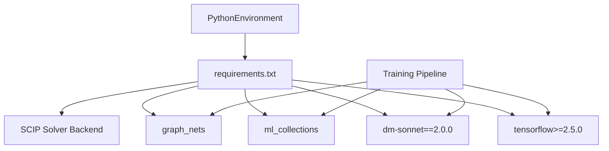
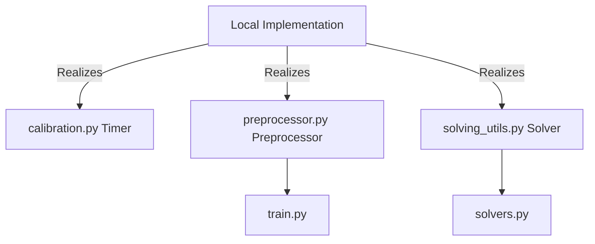

<!-- source: DeepWiki mcp.deepwiki.com · repo google-deepmind/neural_lns · page 1.1 Getting Started · fetched 2026-10-26 -->

# Getting Started

<details>
<summary>Relevant source files</summary>

The following files were used as context for generating this wiki page:

- [README.md](README.md)
- [config_train.py](config_train.py)
- [data/example.tfrecord](data/example.tfrecord)
- [requirements.txt](requirements.txt)

</details>


## Purpose and Scope

This page covers the initial setup and configuration required to run the `neural_lns` codebase. It details the virtual environment installation, external package requirements (including TensorFlow, Sonnet, `graph_nets`, `ml_collections`, and SCIP), local implementation requirements for stubbed abstract classes, the structure of the example dataset located at `data/example.tfrecord`, and how to launch the training pipeline.

Sources: [README.md:1-32](), [config_train.py:1-57](), [requirements.txt:1-9]()

---

## Installation and Virtual Environment

To isolate dependencies, the repository recommends creating a Python virtual environment, upgrading `pip`, and installing the packages specified in `requirements.txt`.

```bash
python3 -m venv /tmp/neural_lns_venv
source /tmp/neural_lns_venv/bin/activate
pip install -U pip
pip install -r requirements.txt
```

Sources: [README.md:33-43]()

---

## Dependencies and Solver Requirements

The project relies on several core machine learning and graph neural network frameworks, alongside a Mixed-Integer Programming (MIP) solver backend. 

*   `absl-py`: Abseil Python common libraries [requirements.txt:2]().
*   `ml_collections`: Configuration management used in `config_train.py` [requirements.txt:3]().
*   `numpy`: Numerical computations [requirements.txt:4]().
*   `dm-sonnet`: DeepMind's neural network library (`dm-sonnet==2.0.0`) [requirements.txt:5]().
*   `tensorflow`: Deep learning backend (`tensorflow>=2.5.0`) [requirements.txt:6]().
*   `tensorflow_probability`: Probabilistic reasoning layers [requirements.txt:7]().
*   `graph_nets`: DeepMind's graph neural network library pinned to a specific commit [requirements.txt:8-9]().
*   `SCIP`: An underlying MIP solver required by the solver wrappers and branching routines.


*Diagram 1: Dependency mapping from configuration to libraries.*

Sources: [requirements.txt:1-9]()

---

## Local Implementation Requirements (Stubbed Classes)

Before deploying the codebase for full inference or custom data generation, users must implement specific abstract interfaces left stubbed in the release:
1.  **Timer Abstraction**: Implemented via `calibration.py` to handle real versus calibrated execution time [README.md:14,47-49]().
2.  **Preprocessor Interface**: Implemented via `preprocessor.py` for MIP presolving and mapping solutions back to original problem spaces [README.md:24,47-49]().
3.  **Solver Wrapper**: Implemented via `solving_utils.py` to handle model loading, solving, and solution injection (`load_model`, `solve`, `add_solution`, `extract_lp_features_at_root`) [README.md:29,47-49]().


*Diagram 2: Bridging abstract interfaces to local code implementations.*

Sources: [README.md:14-29](), [README.md:45-49]()

---

## Example Dataset

The repository provides an example TFRecord dataset located at `data/example.tfrecord` [README.md:31](). This file is a derivative of the open-sourced Neural MIP Verification Dataset and is referenced directly in the default training configuration (`config_train.py`) for validation and training steps [config_train.py:49-55]().

Sources: [README.md:31](), [config_train.py:34-57]()

---

## Running Training

Training parameters and dataset bindings are defined in `config_train.py`. The configuration exposes hyperparameters like learning rate (`1e-2`), decay steps (`300`), layer dimensions, and dataset paths [config_train.py:34-57]().

To start the training loop after configuring dataset paths:

```bash
cd <parent-directory-of-neural_lns>
python3 -m neural_lns.train
```

Sources: [README.md:45-57](), [config_train.py:34-57]()

---

