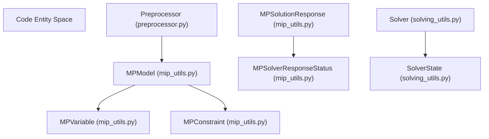

<!-- source: DeepWiki mcp.deepwiki.com · repo google-deepmind/neural_lns · page 2 MIP Domain Model and Solver Abstractions · fetched 2026-10-26 -->

# MIP Domain Model and Solver Abstractions

Relevant source files

The following files were used as context for generating this wiki page:

- [mip_utils.py](mip_utils.py)
- [preprocessor.py](preprocessor.py)
- [solving_utils.py](solving_utils.py)

The purpose of this page is to provide a high-level overview of how mixed-integer programming (MIP) problems, solutions, solver backends, preprocessing steps, and logging utilities are represented within the `neural_lns` repository. 

For detailed information, refer to the child pages:
- [MIP Data Structures (mip_utils.py)](#2.1)
- [Solver Wrapper and Presolving Interfaces](#2.2)
- [Timing and Solution Logging](#2.3)

---

## MIP Domain Model and Solver Abstractions Overview

The core domain model centers around representing MIP instances, variables, constraints, and solver responses in Python data classes [mip_utils.py:43-103](). Solvers interact with these models through an abstract solver API [solving_utils.py:32-61]() and preprocessors [preprocessor.py:23-54]().

*Sources: [mip_utils.py:29-103](), [preprocessor.py:23-54](), [solving_utils.py:26-61]()*

---

## 2.1 MIP Data Structures (`mip_utils.py`)

Mixed-integer linear programs are represented via `MPModel`, which collects lists of `MPVariable` and `MPConstraint` objects alongside objective parameters [mip_utils.py:73-86](). Solver outputs are encapsulated in `MPSolutionResponse` using status enums defined by `MPSolverResponseStatus` [mip_utils.py:29-102](). 

Additionally, `mip_utils.py` provides core helper functions for tightening variable bounds in place (`tighten_variable_bounds`), checking integrality and binary conditions (`is_var_binary`), adding weighted binary invalid cuts (`add_binary_invalid_cut`), and constructing sub-MIP neighborhoods (`make_sub_mip`) [mip_utils.py:104-198]().

For details, see [MIP Data Structures (mip_utils.py)](#2.1).

*Sources: [mip_utils.py:29-198]*

---

## 2.2 Solver Wrapper and Presolving Interfaces

Interactions with external classical MIP solvers (such as SCIP) are standardized via the abstract `Solver` interface defined in `solving_utils.py` [solving_utils.py:32-61]() and the `Preprocessor` interface in `preprocessor.py` [preprocessor.py:23-54](). 

The `Solver` API manages model loading (`load_model`), execution (`solve`), solution injection (`add_solution`), solution retrieval (`get_best_solution`), and root node LP feature extraction (`extract_lp_features_at_root`) tracked via `SolverState` [solving_utils.py:26-61](). The `Preprocessor` class provides a contract for transforming an `MPModel` via `presolve` and mapping solutions back to the original space via `get_original_solution` [preprocessor.py:23-54]().

For details, see [Solver Wrapper and Presolving Interfaces](#2.2).

*Sources: [preprocessor.py:23-54](), [solving_utils.py:26-62]*

---

## 2.3 Timing and Solution Logging

Execution monitoring and objective tracking during solve routines are managed through specialized timer and logging abstractions. The `calibration.Timer` class handles wall-clock versus calibrated time measurements, while the `solution_data` module (`BaseSolutionData`, `SolutionData`, and `SolutionDataWrapper`) records primal bound improvements and trajectory progression over time.

For details, see [Timing and Solution Logging](#2.3).

*Sources: [mip_utils.py:15-27]*

---

