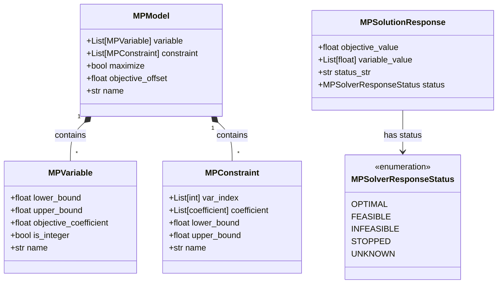
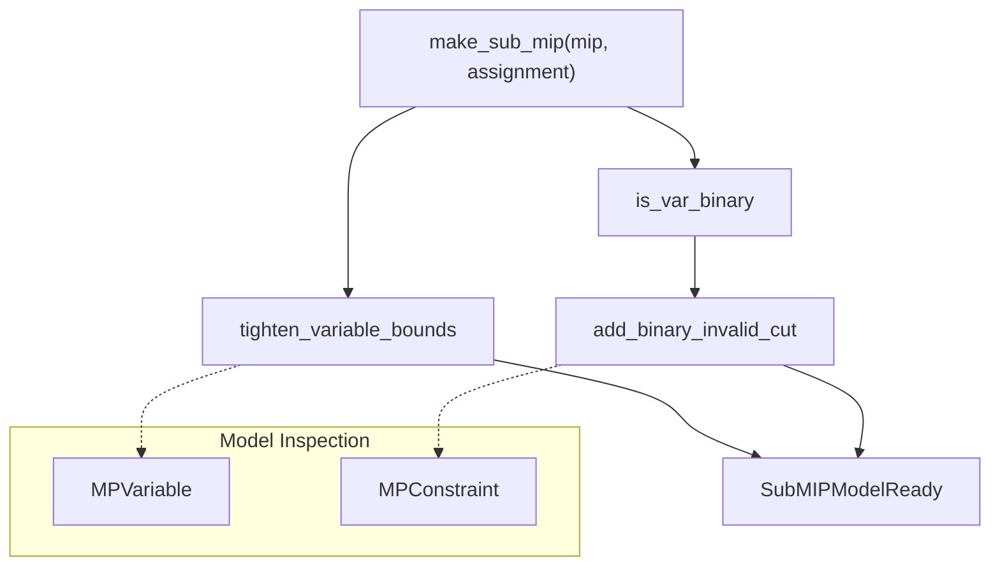

<!-- source: DeepWiki mcp.deepwiki.com · repo google-deepmind/neural_lns · page 2.1 MIP Data Structures (mip_utils.py) · fetched 2026-10-26 -->

# MIP Data Structures (mip_utils.py)

Relevant source files

The following files were used as context for generating this wiki page:

- [mip_utils.py](mip_utils.py)

## Purpose and Scope
The `mip_utils.py` module defines the core data structures and manipulation utilities for Mixed-Integer Linear Programming (MIP) models within the Neural LNS framework. It provides lightweight Python dataclasses (`MPModel`, `MPVariable`, `MPConstraint`, `MPSolutionResponse`) to represent optimization problems and solver responses independently of specific solver backends (such as SCIP), alongside utility functions for bound tightening, variable inspection, invalid cut generation, and sub-MIP creation used in Large Neighborhood Search (LNS) and Neural Diving.

Sources: `[mip_utils.py:1-202]()`

---

## Core Data Structures

The module abstracts MIP components into Python dataclasses, facilitating memory efficiency and straightforward inspection or serialization.

### MPSolverResponseStatus
An enumeration (`[mip_utils.py:29-41]`) representing the outcome status of a solver run. 
* `OPTIMAL` (0): Proven optimal solution found.
* `FEASIBLE` (1): Feasible solution found, but optimality not proven.
* `NOT_SOLVED` (2): Problem has not been solved.
* `INFEASIBLE` (3): Problem is proven infeasible.
* `UNBOUNDED` (4): Problem is proven unbounded.
* `INFEASIBLE_OR_UNBOUNDED` (5): Problem is either infeasible or unbounded.
* `STOPPED` (6): Solver stopped (e.g., due to limits).
* `UNKNOWN` (7): Status unknown.
* `FAILED` (8): Solver failed.
* `BESTSOLLIMIT` (9): Best solution limit reached.

### MPVariable
Represents a single decision variable in a MIP model (`[mip_utils.py:43-55]()`).
* `lower_bound` (`float`): Lower bound of the variable (default: `-math.inf`).
* `upper_bound` (`float`): Upper bound of the variable (default: `math.inf`).
* `objective_coefficient` (`float`): Coefficient of the variable in the linear objective function (default: `0.0`).
* `is_integer` (`bool`): Flag indicating if the variable is constrained to take integer values (default: `True`).
* `name` (`str`): Identifier string for the variable.

### MPConstraint
Represents a linear constraint in a MIP model (`[mip_utils.py:57-70]()`).
* `var_index` (`List[int]`): Indices of variables with non-zero coefficients in this constraint, referencing `MPModel.variable`.
* `coefficient` (`List[float]`): Numerical coefficients corresponding to `var_index`.
* `lower_bound` (`float`): Lower bound of the linear expression (default: `-math.inf`).
* `upper_bound` (`float`): Upper bound of the linear expression (default: `math.inf`).
* `name` (`str`): Identifier string for the constraint.

### MPModel
Encapsulates an entire Mixed-Integer Linear Programming model (`[mip_utils.py:73-86]()`).
* `variable` (`List[MPVariable]`): Collection of all variables in the model.
* `constraint` (`List[MPConstraint]`): Collection of all constraints in the model.
* `maximize` (`bool`): `True` if the optimization objective is maximization; `False` for minimization (default: `False`).
* `objective_offset` (`float`): Constant offset added to the objective value (default: `0.0`).
* `name` (`str`): Name of the model instance.

### MPSolutionResponse
Encodes the solution returned by a solver backend (`[mip_utils.py:88-102]()`).
* `objective_value` (`float`): Evaluated objective value including offsets and coefficients.
* `variable_value` (`List[float]`): Dense list of primal variable values aligned with `MPModel.variable`. Populated only when status is `OPTIMAL` or `FEASIBLE`.
* `status_str` (`str`): Human-readable status message.
* `status` (`MPSolverResponseStatus`): Structured solver status enum.

*Sources: `[mip_utils.py:29-102]()`*

---

## MIP Manipulation and Sub-MIP Construction

`mip_utils.py` supplies helper functions to manipulate models in-place, validate variable types, generate invalid cuts, and construct sub-MIPs for neighborhood search algorithms.

### Bound Tightening and Binary Checking
* `tighten_variable_bounds(mip, names, lbs, ubs)` (`[mip_utils.py:104-135]()`): Updates variable bounds in `mip` in-place. It maps input names to lower and upper bounds, ensuring bounds only tighten (`max(lb, current_lb)` and `min(ub, current_ub)`).
* `is_var_binary(variable)` (`[mip_utils.py:137-142]()`): Returns `True` if `variable` is integer-constrained with a lower bound close to `0` and an upper bound close to `1` (`np.isclose`).

### Weighted Binary Invalid Cuts
* `add_binary_invalid_cut(mip, names, values, weights, depth)` (`[mip_utils.py:144-196]()`): Adds a cut constraint to restrict the search space around a predicted binary assignment. Given predicted values $v_i \in \{0, 1\}$ and penalties $w_i$, it constructs a linear constraint enforcing that the weighted Hamming distance from the predicted assignment does not exceed `depth`:

$$\sum_{i \in Z} w_i x_i + \sum_{j \in O} w_j (1 - x_j) \le \text{depth}$$

where $Z$ are variables predicted as $0$ and $O$ are variables predicted as $1$.

### Sub-MIP Generation
* `make_sub_mip(mip, assignment)` (`[mip_utils.py:197-198]()`): Takes an input `mip` and a `sampling.Assignment` object to construct a restricted sub-MIP via variable domain tightening and cut application.

*Sources: `[mip_utils.py:104-198]()`*

---

