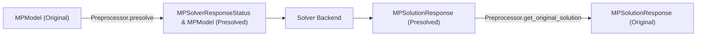
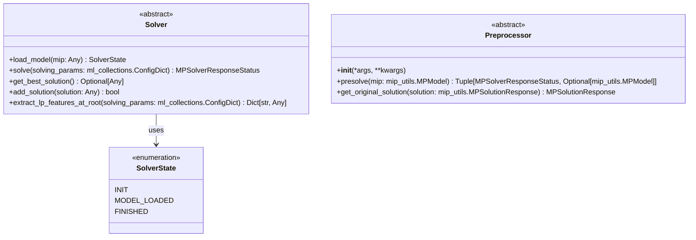

<!-- source: DeepWiki mcp.deepwiki.com · repo google-deepmind/neural_lns · page 2.2 Solver Wrapper and Presolving Interfaces · fetched 2026-10-26 -->

# Solver Wrapper and Preresolving Interfaces

<details>
<summary>Relevant source files</summary>

The following files were used as context for generating this wiki page:

- [preprocessor.py](preprocessor.py)
- [solving_utils.py](solving_utils.py)

</details>


This page details the abstract interfaces used to interact with classical Mixed-Integer Programming (MIP) solvers and presolvers within the Neural Large Neighborhood Search (`neural_lns`) framework. By defining decoupled abstract classes (`Solver` and `Preprocessor`), the codebase insulates high-level neural network operations, sampling strategies, and search orchestration from backend-specific solver implementations (such as SCIP).

---

## 1. The Solver Abstraction (`solving_utils.py`)

The `Solver` abstract base class defines the standard protocol for loading, modifying, solving, and inspecting a MIP model [solving_utils.py:32-37](). It manages the state machine of the underlying solver via the `SolverState` enumeration [solving_utils.py:26-30]().

### SolverState Lifecycle
The lifecycle of a solver interaction is tracked using the `SolverState` enum:
- `INIT` (`0`): The solver instance has been instantiated, but no model is loaded [solving_utils.py:27]().
- `MODEL_LOADED` (`1`): A MIP model (`MPModel`) has been successfully ingested by the backend [solving_utils.py:28]().
- `FINISHED` (`2`): The solve procedure has terminated (either optimally, via time limit, or node limit) [solving_utils.py:29]().

### The `Solver` Interface Contract
Subclasses must implement the following core methods:
- `load_model(mip: Any) -> SolverState`: Ingests a problem model (typically an `MPModel`) into the backend solver, transitioning the state to `MODEL_LOADED` [solving_utils.py:39-42]().
- `solve(solving_params: ml_collections.ConfigDict) -> mip_utils.MPSolverResponseStatus`: Executes the optimization routine using configuration parameters defined via `ml_collections` [solving_utils.py:43-47]().
- `get_best_solution() -> Optional[Any]`: Retrieves the best primal solution discovered during the most recent `solve` call [solving_utils.py:49-51]().
- `add_solution(solution: Any) -> bool`: Injects an externally computed solution (such as one generated via Neural Diving or a local branching step) into the solver's pool, returning a boolean indicating acceptance [solving_utils.py:53-55]().
- `extract_lp_features_at_root(solving_params: ml_collections.ConfigDict) -> Dict[str, Any]`: Solves the root Linear Programming (LP) relaxation and extracts feature dictionaries required for GNN feature extraction [solving_utils.py:57-61]().

```mermaid
graph TD
    A["SolverState.INIT"] -->|load_model| B["SolverState.MODEL_LOADED"]
    B -->|solve| C["SolverState.FINISHED"]
    C -->|load_model (new sub-MIP)| B
    
    sub:Solver["Solver Abstract API"]
    sub -.->|load_model| B
    sub -.->|solve| C
    sub -.->|add_solution| B
    sub -.->|extract_lp_features_at_root| C
```
*Sources: [solving_utils.py:26-61]()*

---

## 2. The Preprocessor Contract (`preprocessor.py`)

Many large-scale MIP instances contain redundancies, fixed variables, and tight bound implications that can be simplified prior to solving. The `Preprocessor` abstract base class provides the interface for model presolving [preprocessor.py:23-31]().

### Preprocessor Methods
- `presolve(mip: mip_utils.MPModel) -> Tuple[mip_utils.MPSolverResponseStatus, Optional[mip_utils.MPModel]]`: Accepts an original `MPModel` instance, applies presolving reductions, and returns the presolved status alongside a reduced `MPModel` [preprocessor.py:36-48]().
- `get_original_solution(solution: mip_utils.MPSolutionResponse) -> mip_utils.MPSolutionResponse`: Maps a solution obtained on the presolved (reduced) model back to the variable space and domain of the original problem [preprocessor.py:50-54]().


*Sources: [preprocessor.py:23-54]()*

---

## 3. Integrated Solver and Presolver Architecture

When combining the `Preprocessor` contract with the `Solver` API, the system handles transformations between the raw problem space and the solved problem space seamlessly.


*Sources: [preprocessor.py:23-54](), [solving_utils.py:26-61]()*

---

