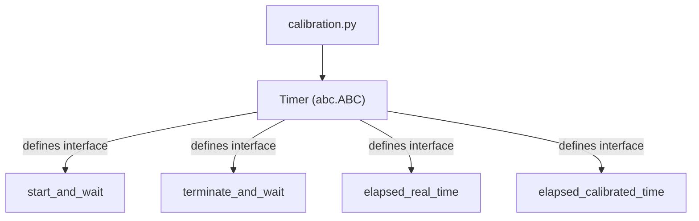
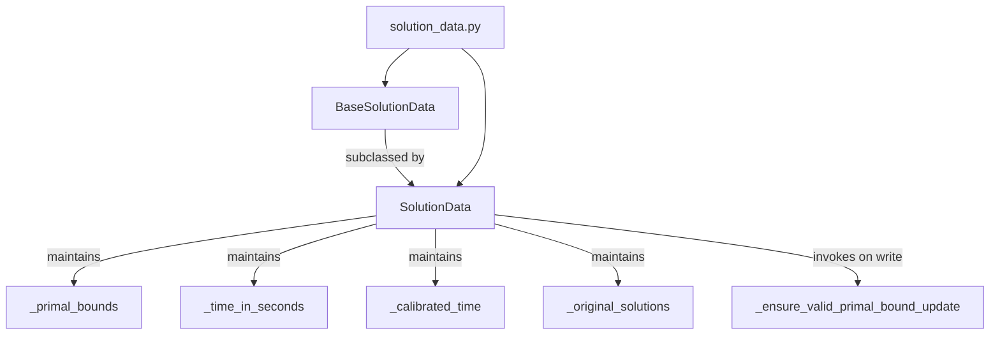
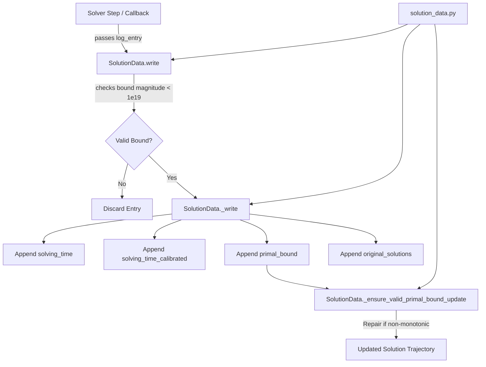

<!-- source: DeepWiki mcp.deepwiki.com · repo google-deepmind/neural_lns · page 2.3 Timing and Solution Logging · fetched 2026-10-26 -->

# Timing and Solution Logging

Relevant source files

The following files were used as context for generating this wiki page:

- [calibration.py](calibration.py)
- [solution_data.py](solution_data.py)

## Purpose and Scope
This page covers the technical implementation of timing and solution tracking within the Neural LNS codebase. Specifically, it details the `Timer` abstraction defined in [calibration.py:21-49]() for measuring solving duration (supporting both wall-clock real time and machine-calibrated time), and the solution logging infrastructure in [solution_data.py:24-177](), which tracks primal bound improvements, intermediate solutions, and incumbent trajectories via `BaseSolutionData` and `SolutionData`.

---

## 1. The `Timer` Abstraction

The MIP solving process requires precise duration tracking to enforce time limits and benchmark performance across different hardware environments. The `Timer` abstract base class defines the expected lifecycle and query interface for timers used by solvers [calibration.py:21-35]().

### Key Methods of `Timer`
* **`start_and_wait(self)`**: Starts the timer instance and blocks or waits for further interaction [calibration.py:27-38]().
* **`terminate_and_wait(self)`**: Terminates the active timing session and waits for subsequent commands [calibration.py:28-41]().
* **`elapsed_real_time(self) -> float`**: Returns the wall-clock time elapsed in seconds since the timer was started [calibration.py:30-45]().
* **`elapsed_calibrated_time(self) -> Optional[float]`**: Returns a machine-speed calibrated version of elapsed time to ensure fair benchmarking across disparate hardware [calibration.py:33-49]().

*Sources: [calibration.py:21-49]()*

---

## 2. Solution Data Logging Architecture

To monitor search progress, record incumbent updates, and evaluate performance, the repository uses an abstract logging interface (`BaseSolutionData`) and a concrete implementation (`SolutionData`).

### `BaseSolutionData` Contract
`BaseSolutionData` is an abstract base class encapsulating the state recorded during the solving process [solution_data.py:24-30](). It defines properties for tracking objective evaluation functions, primal bound trajectories, calibrated and uncalibrated timestamps, original solutions, and elapsed times [solution_data.py:32-68](). 

It also implements a protective wrapper method `write(log_entry, force_save_sol)` which filters out invalid or trivial bounds (e.g., bounds greater than or equal to $10^{19}$) before delegating to the internal `_write` method [solution_data.py:70-78]().

### `SolutionData` Implementation
`SolutionData` inherits from `BaseSolutionData` and provides concrete storage and maintenance for solution metrics [solution_data.py:80-177](). 

* **Monotonicity Enforcement**: Because primal bounds should monotonically improve during minimization or maximization, `_ensure_valid_primal_bound_update()` checks the sequence of recorded bounds against the configured `objective_type` [solution_data.py:102-113](). If a violation exceeds a relative or absolute tolerance of `1e-5`, a warning is logged via `absl.logging`, and the bound is repaired [solution_data.py:108-112]().
* **Intermediate Solution Handling**: Depending on whether `write_intermediate_sols` is enabled, intermediate solutions are either preserved in `_original_solutions` or discarded (except when `force_save_sol` is set to `True` for final results) [solution_data.py:91-96](), [solution_data.py:171-176]().

*Sources: [solution_data.py:24-177]()*

---

## Data Flow: Solution Logging Pipeline

The following diagram illustrates how solver log entries flow into `SolutionData`, pass through validity filters, undergo monotonicity verification, and update internal metrics.

*Sources: [solution_data.py:73-177]()*

---

