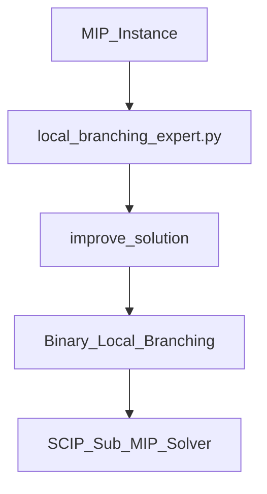
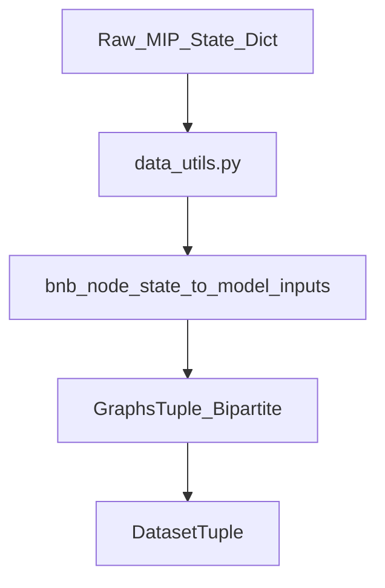

<!-- source: DeepWiki mcp.deepwiki.com · repo google-deepmind/neural_lns · page 3 Data Generation and Feature Extraction · fetched 2026-10-26 -->

# Data Generation and Feature Extraction

Relevant source files

The following files were used as context for generating this wiki page:

- [data_utils.py](data_utils.py)
- [local_branching_data_generation.py](local_branching_data_generation.py)

The purpose of this page is to provide a high-level overview of how training data is produced from Mixed-Integer Programming (MIP) instances within the `neural_lns` codebase. This entails generating expert imitation labels via local branching and extracting bipartite graph features suitable for Graph Neural Networks (GNNs). 

This is a parent page. For deep technical details, refer to the child pages:
- [Local Branching Expert](#3.1)
- [Imitation Data Generation Pipeline](#3.2)
- [Feature Extraction and tf.data Pipeline](#3.3)

---

## 3.1 Local Branching Expert

The local branching expert acts as an oracle that iteratively improves incumbent solutions for a MIP instance by restricting the search space to a neighborhood defined by a Hamming distance bound. The expert constructs sub-MIPs where binary variables are constrained to remain close to a known incumbent solution, solves the resulting restricted MIP using SCIP, and returns improved solutions and expert labels.

For details on binary and general local branching sub-MIP construction, LP relaxation solving, and the `improve_solution` implementation, see [Local Branching Expert](#3.1).

*Figure 1: Conceptual mapping from the local branching sub-MIP generation logic to `local_branching_expert.py`.*

Sources: `local_branching_expert.py`

---

## 3.2 Imitation Data Generation Pipeline

The imitation data generation pipeline automates the collection of training sequences across MIP instances. Driven by `generate_data_for_instance` [local_branching_data_generation.py:152-181](), the pipeline loads initial solutions via `get_incumbent` [local_branching_data_generation.py:43-57](), invokes the local branching expert iteratively, determines binary variable flips using `get_flipped_vars` [local_branching_data_generation.py:60-84](), and enriches root node representations via `enhance_root_features` [local_branching_data_generation.py:87-149]() to capture past incumbents and LP relaxation solutions.

For details on the sequence generation loop, configuration parameters, and SCIP integration, see [Imitation Data Generation Pipeline](#3.2).

Sources: `local_branching_data_generation.py`

---

## 3.3 Feature Extraction and tf.data Pipeline

To feed graph neural networks, raw MIP states and branching decisions must be transformed into structured tensor formats. The module `data_utils.py` handles TFRecord decoding, bipartite graph representation construction via `bnb_node_state_to_model_inputs` [data_utils.py:89-147](), minimization problem conversions via `convert_to_minimization` [data_utils.py:150-174](), and batching through `DatasetTuple` [data_utils.py:59-65]().

For details on the TFRecord schema, feature scaling, bipartite `GraphsTuple` construction, and `get_dataset`, see [Feature Extraction and tf.data Pipeline](#3.3).

*Figure 2: Feature extraction data flow from raw state dictionaries to `DatasetTuple` instances managed by `data_utils.py`.*

Sources: `data_utils.py`

---

