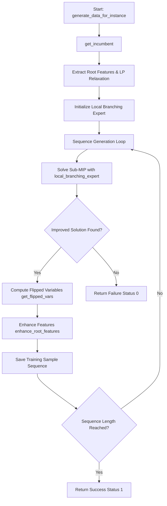
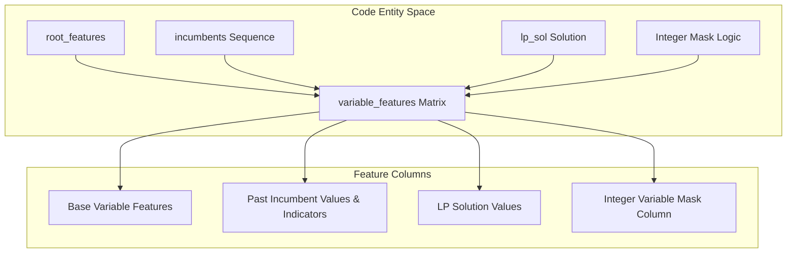

<!-- source: DeepWiki mcp.deepwiki.com · repo google-deepmind/neural_lns · page 3.2 Imitation Data Generation Pipeline · fetched 2026-10-26 -->

# Imitation Data Generation Pipeline

<details>
<summary>Relevant source files</summary>

The following files were used as context for generating this wiki page:

- [local_branching_data_generation.py](local_branching_data_generation.py)

</details>


The purpose of this section is to detail the imitation data generation pipeline implemented in `local_branching_data_generation.py`. This pipeline produces training data for Neural Large Neighborhood Search (Neural LNS) by running a local branching expert over MIP instances, tracking incumbent solutions, identifying flipped binary variables as target labels, and enhancing root node features with historical context and LP relaxation solutions.

---

## 1. Constants and Configuration

The data generation process relies on predefined solver configurations and time limits to ensure sufficient root node processing and search depth.

* `MIN_SOLVE_TIME`: Set to `1800` seconds to allow full root node processing during LP feature extraction [local_branching_data_generation.py:33-33]().
* `SCIP_SOLVING_PARAMS`: An `ml_collections.ConfigDict` containing default solver parameters including a `seed` of `42`, a `time_limit_seconds` of `1800`, and a `relative_gap` of `0` [local_branching_data_generation.py:36-40]().

```
Sources: [local_branching_data_generation.py:33-40]()
```

---

## 2. Incumbent Retrieval

The function `get_incumbent` is responsible for loading pre-computed or initial feasible solutions for a given MIP instance from a dataset pickle file.

```python
def get_incumbent(
    instance_name: Text,
    dataset: Text,
    solution_index: int) -> Optional[mip_utils.MPSolutionResponse]:
```
It constructs the instance path using `os.path.join`, loads the solution list via `pickle.load`, and validates that the requested `solution_index` exists before returning the `mip_utils.MPSolutionResponse` [local_branching_data_generation.py:43-57]().

```
Sources: [local_branching_data_generation.py:43-57]()
```

---

## 3. Flipped-Variable Label Generation

To train the Neural LNS model to imitate the local branching expert, target labels must indicate which binary variables changed values between an incumbent solution and an improved solution found by the expert.

The function `get_flipped_vars` performs this comparison:
* It iterates over all variables in the MIP model (`mip.variable`) [local_branching_data_generation.py:68-68]().
* For binary variables (verified via `mip_utils.is_var_binary`), it checks if rounded values differ between `incumbent` and `improved` [local_branching_data_generation.py:69-70]().
* If they differ, the label is set to `1.0`; otherwise `0.0` [local_branching_data_generation.py:71-73]().
* Non-binary variables are assigned `0.0` [local_branching_data_generation.py:67-67]().
* The resulting array is reordered to match the variable order expected by the feature extractor, masking out any constant variables [local_branching_data_generation.py:75-84]().

```
Sources: [local_branching_data_generation.py:60-84]()
```

---

## 4. Root Feature Enhancement

Root features extracted from the base MIP model are enriched with historical context using `enhance_root_features`. This function injects past incumbent solutions, LP relaxation solutions, and an integer variable mask into the variable feature matrix.

```python
def enhance_root_features(
    root_features: Dict[str, Any],
    incumbents: Sequence[Any],
    lp_sol: Optional[Any] = None
    ) -> Dict[str, Any]:
```

### Feature Matrix Layout Modification
1. **Past Incumbents**: For each incumbent in `incumbents` (ordered from most recent to least, up to `NUM_PAST_INCUMBENTS`), two columns are added:
   - Variable values from the incumbent [local_branching_data_generation.py:115-123]().
   - An all-ones presence indicator column [local_branching_data_generation.py:125-127]().
2. **LP Relaxation Solution**: If provided, `lp_sol` values are inserted into the designated feature column [local_branching_data_generation.py:129-139]().
3. **Integer Mask**: The final column acts as a binary mask where integer-constrained variables are marked `1.0` and continuous variables are marked `0.0` [local_branching_data_generation.py:140-147]().

```
Sources: [local_branching_data_generation.py:87-149]()
```

---

## 5. Main Generation Loop: `generate_data_for_instance`

The `generate_data_for_instance` function orchestrates the end-to-end imitation data generation loop for a single MIP instance.

```python
def generate_data_for_instance(
    instance_name: Text,
    dataset: Text,
    neighbourhood_size: int = 20,
    percentage: bool = False,
    sequence_length: int = 10,
    add_incumbent_to_scip: bool = True,
    solution_index: int = 0,
    scip_params: ml_collections.ConfigDict = SCIP_SOLVING_PARAMS,
    num_var_features: int = data_utils.NUM_VARIABLE_FEATURES) -> int:
```

### Pipeline Execution Flow


*Diagram 1: Data Generation Pipeline Flow bridging system concepts to `generate_data_for_instance` and `local_branching_expert`.*

```
Sources: [local_branching_data_generation.py:152-181]()
```

---

## 6. Feature Enrichment Architecture


*Diagram 2: Feature Matrix Expansion mapping `enhance_root_features` variables to matrix columns.*

```
Sources: [local_branching_data_generation.py:87-149]()
```

---

