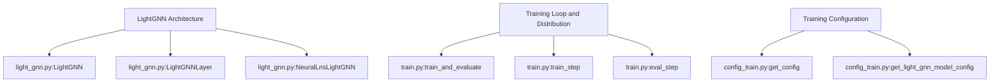
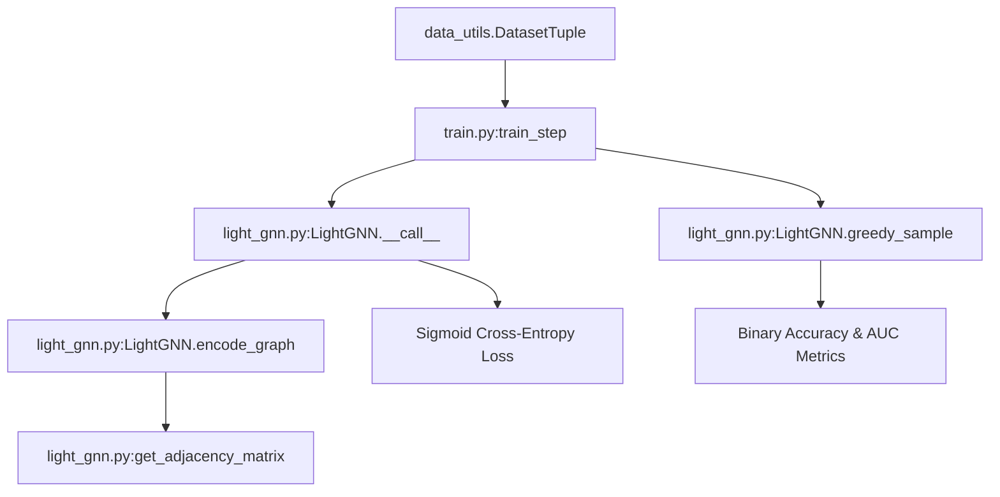

<!-- source: DeepWiki mcp.deepwiki.com · repo google-deepmind/neural_lns · page 4 Model and Training · fetched 2026-10-26 -->

# Model and Training

Relevant source files

The following files were used as context for generating this wiki page:

- [light_gnn.py](light_gnn.py)
- [train.py](train.py)

This page provides a high-level overview of the Graph Neural Network (GNN) model architecture, the training and evaluation loop, and training configurations used in Neural LNS. The neural network parameterizes variable selection probabilities over the bipartite constraint-variable graph of Mixed-Integer Programs (MIPs).

For deeper technical details, refer to the child pages:
- **LightGNN Architecture**: See [LightGNN Architecture](#4.1).
- **Training Loop and Distribution**: See [Training Loop and Distribution](#4.2).
- **Training Configuration**: See [Training Configuration](#4.3).

Sources: `light_gnn.py:15-34`, `train.py:15-48`

---

### System to Code Entity Mapping

The following diagram maps the high-level architectural components of the model and training pipeline to their corresponding code entities in the repository.

Sources: `light_gnn.py:48-190`, `train.py:40-175`

---

## 4.1. LightGNN Architecture

The core model architecture is a lightweight Graph Neural Network called `LightGNN` [light_gnn.py:72-158]() and its subclass `NeuralLnsLightGNN` [light_gnn.py:160-190](). It operates on bipartite `GraphsTuple` instances representing MIP constraints and variables, defined by the input signature `GT_SPEC` [light_gnn.py:26-33](). 

Key responsibilities include constructing sparse adjacency matrices from graph senders/receivers via `get_adjacency_matrix` [light_gnn.py:36-45](), stacking `LightGNNLayer` modules combined with residual dropout wrappers [light_gnn.py:93-99](), and providing evaluation signatures such as `greedy_sample` and `predict_logits` [light_gnn.py:132-152]().

For detailed specifications, see [LightGNN Architecture](#4.1).

Sources: `light_gnn.py:26-190`

---

## 4.2. Training Loop and Distribution

Training is orchestrated through `train_and_evaluate` in `train.py` [train.py:40-48](). It supports multi-device distribution via `tf.distribute.Strategy`, samples training and validation datasets using `tf.data.Dataset.sample_from_datasets` [train.py:53-63](), and tracks metrics such as binary accuracy and area under the ROC curve (`AUC`) [train.py:74-77]().

The training loop processes `DatasetTuple` inputs [train.py:83](), computes sigmoid cross-entropy loss [train.py:92-94](), performs gradient clipping [train.py:116-117](), and applies updates via an Adam optimizer [train.py:73,120]().

For detailed specifications, see [Training Loop and Distribution](#4.2).

Sources: `train.py:40-175`

---

## 4.3. Training Configuration

Hyperparameters, network dimensions, learning rate schedules, and dataset path bindings are managed centrally via configuration functions defined in `config_train.py`. These configurations supply dictionary structures (`ml_collections.ConfigDict`) that parameterize both model instantiation and dataset generation paths.

For detailed specifications, see [Training Configuration](#4.3).

Sources: `train.py:23-34`, `config_train.py`

---

### Data and Training Execution Flow

The following diagram illustrates how incoming graph datasets flow into the training and evaluation execution pipeline.

Sources: `light_gnn.py:36-141`, `train.py:79-164`

---

