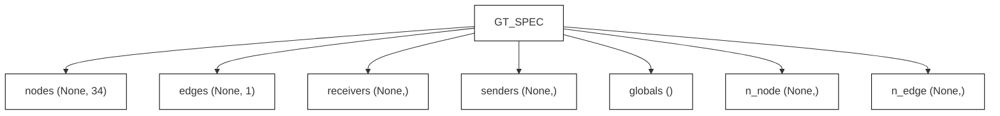
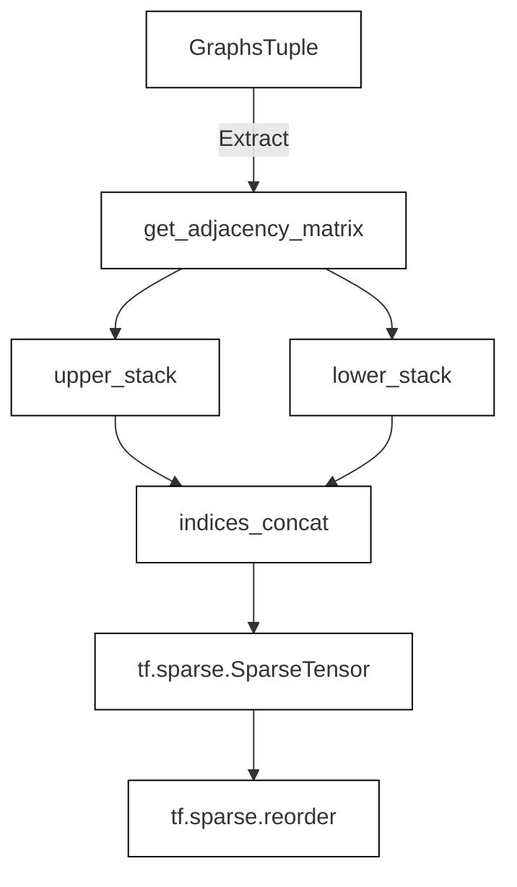
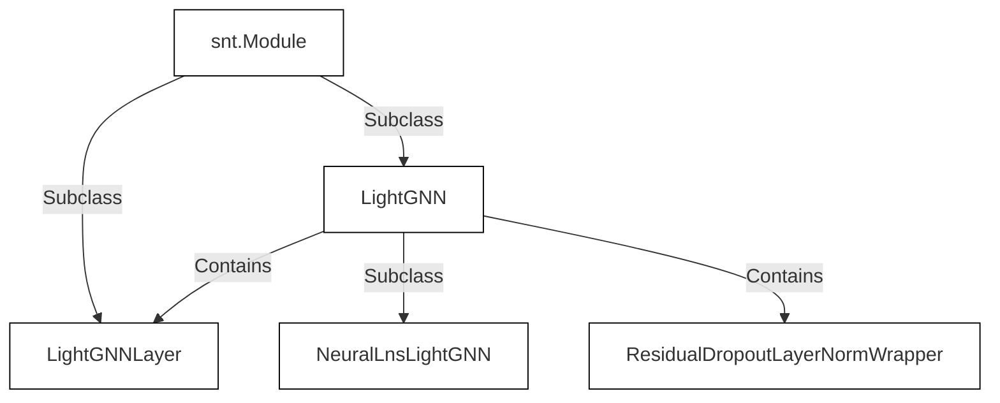

<!-- source: DeepWiki mcp.deepwiki.com · repo google-deepmind/neural_lns · page 4.1 LightGNN Architecture · fetched 2026-10-26 -->

# LightGNN Architecture

Relevant source files

The following files were used as context for generating this wiki page:

- [light_gnn.py](light_gnn.py)

## Purpose and Scope

Section 4.1 outlines the Graph Neural Network (GNN) architecture utilized across the Neural LNS codebase to process bipartite constraint-variable graphs. Defined primarily in `light_gnn.py`, the architecture comprises graph specification signatures (`GT_SPEC`), sparse adjacency construction utilities, individual message-passing layers (`LightGNNLayer`), and stack-level models (`LightGNN` and `NeuralLnsLightGNN`) [light_gnn.py:1-190]().

As a parent page, this document provides a high-level overview of the tensor specifications, graph convolution modules, and export mechanisms. For low-level details regarding residual addition, conditional dropout, and integration with Sonnet layer normalization, see [Residual Dropout and Layer Norm Wrapper](#4.1.1).

Sources: `light_gnn.py` [light_gnn.py:1-190]()

---

## Graph Specification (`GT_SPEC`)

The model expects inputs structured as `graph_nets.graphs.GraphsTuple` objects. `GT_SPEC` formally defines the `tf.TensorSpec` signatures for feeding data through compiled TensorFlow functions. It specifies 34-dimensional node features, scalar edge weights, sender and receiver indices, global context features, and graph boundary counts (`n_node`, `n_edge`) [light_gnn.py:26-33]().

*Figure 1: `GT_SPEC` Tensor Signature Schema.*

Sources: `light_gnn.py` [light_gnn.py:26-33]()

---

## Adjacency Matrix Construction

To perform graph convolutions over the bipartite graph without relying on heavy message-passing frameworks for every operation, `light_gnn.py` extracts a sparse adjacency tensor from the `GraphsTuple` representation. 

The `get_adjacency_matrix` function constructs upper and lower index stacks from `graph.senders` and `graph.receivers`, concatenates edge features, builds a symmetric `tf.SparseTensor`, and reorders the indices to ensure compatibility with sparse-dense matrix multiplication `[light_gnn.py:36-45]()`.

*Figure 2: Adjacency Matrix Extraction Pipeline.*

Sources: `light_gnn.py` [light_gnn.py:36-45]()

---

## Component Hierarchy: LightGNNLayer, LightGNN, and NeuralLnsLightGNN

The GNN architecture is modularly organized into Sonnet modules (`snt.Module`). 

*   **`LightGNNLayer`**: Represents a single graph convolution layer. It applies an MLP (`_node_model_hidden_sizes`) to node features and performs a sparse-dense matrix multiplication with the adjacency matrix `[light_gnn.py:48-69]()`.
*   **`LightGNN`**: A stack of `LightGNNLayer` instances wrapped with residual connections and layer normalization, paired with an input linear embedding and an output MLP model `[light_gnn.py:72-158]()`.
*   **`NeuralLnsLightGNN`**: A specialized subclass of `LightGNN` tailored for Neural Large Neighborhood Search inference routines [light_gnn.py:160-190]().

*Figure 3: Model Class Hierarchy.*

Sources: `light_gnn.py` [light_gnn.py:48-190]()

---

## Inference Signatures and SavedModel Export

Both `LightGNN` and `NeuralLnsLightGNN` expose tf.function-decorated methods for inference and deployment:

*   **`greedy_sample`**: Encodes the graph, computes logits via `output_model`, applies a sigmoid activation on gathered `node_indices`, and rounds probabilities to generate discrete assignments `[light_gnn.py:132-141](), [light_gnn.py:174-184]()`.
*   **`predict_logits`**: Evaluates model logits given graph inputs, node indices, and label targets `[light_gnn.py:143-152](), [light_gnn.py:185-190]()`.
*   **`save_model`**: Exports the TensorFlow model to disk using `tf.saved_model.save`, binding the `greedy_sample` signature `[light_gnn.py:154-158]()`.

For details on the normalization and dropout wrapper applied within these layers, refer to [Residual Dropout and Layer Norm Wrapper](#4.1.1).

Sources: `light_gnn.py` [light_gnn.py:132-190]()

---

