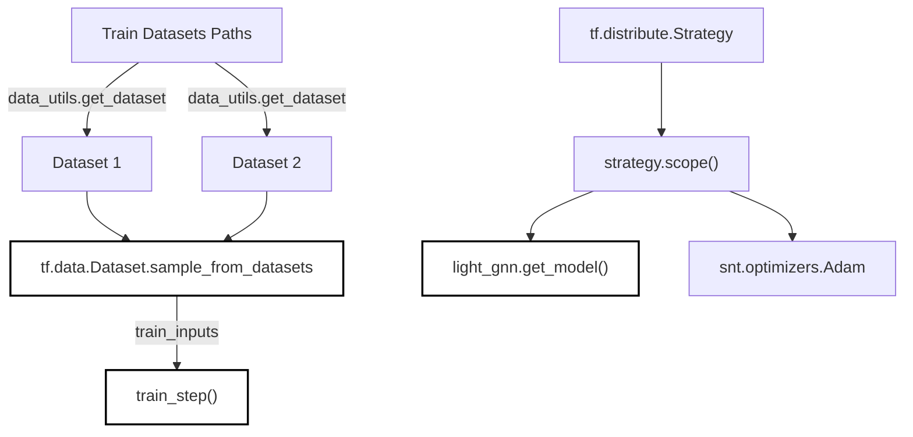
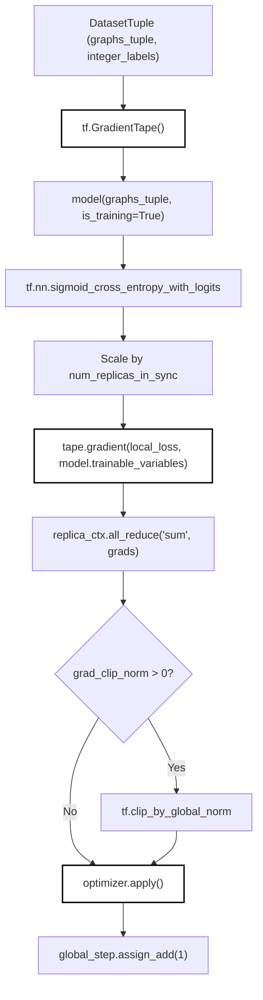

<!-- source: DeepWiki mcp.deepwiki.com · repo google-deepmind/neural_lns · page 4.2 Training Loop and Distribution · fetched 2026-10-26 -->

# Training Loop and Distribution

Relevant source files

The following files were used as context for generating this wiki page:

- [train.py](train.py)

## Purpose and Scope

This page covers the implementation of the core training and evaluation infrastructure for Neural Large Neighborhood Search (Neural LNS) located in `train.py`. The module handles TensorFlow distribution strategies (`tf.distribute.Strategy`), multi-dataset sampling via `tf.data`, loss computation using binary cross-entropy, tracking metrics (Binary Accuracy and AUC via greedy sampling), gradient clipping, exponential learning rate decay, and the execution of training and evaluation steps across replicas.

Sources: `[train.py:1-255]()`

---

## 1. Strategy Selection and Dataset Sampling

The training entry point is `train_and_evaluate`, which accepts a `tf.distribute.Strategy` (such as `MirroredStrategy` or `TPUStrategy`) to enable distributed training across multiple devices [train.py:40-47](). 

To train on diverse problem distributions, multiple TFRecord datasets are loaded via `data_utils.get_dataset(path)` and combined using `tf.data.Dataset.sample_from_datasets` [train.py:53-63](). This applies similarly to both training and validation datasets.

*Figure 1: Dataset Sampling and Strategy Initialization Architecture.*

Sources: `[train.py:40-64]()`, `[neural_lns/data_utils.py]()`

---

## 2. Optimizer, Metrics, and Model Initialization

Within the `strategy.scope()` context, the model and optimization primitives are instantiated [train.py:65-65]():
- **Model Construction**: `light_gnn.get_model(**model_config.params)` builds the graph neural network [train.py:66-66]().
- **Global Step**: A non-trainable `tf.Variable` tracking the global optimization step [train.py:67-68]().
- **Learning Rate Schedule**: `tf.optimizers.schedules.ExponentialDecay` with a specified decay rate and steps, bounded below by `MIN_LEARNING_RATE` (`1e-5`) [train.py:37-37](), [train.py:69-72]().
- **Optimizer**: `snt.optimizers.Adam` from Sonnet [train.py:73-73]().
- **Metrics**: `tf.keras.metrics.BinaryAccuracy` (with threshold 0.5) and `tf.keras.metrics.AUC()` maintained separately for training and validation splits [train.py:74-77]().

Sources: `[train.py:37-78](), [neural_lns/light_gnn.py]()`

---

## 3. Training Step and Gradient Computation

The `train_step` function executes a configurable number of run steps (`num_train_run_steps`) [train.py:125-125](). For each step, `strategy.run` executes `step_fn` across all replicas [train.py:126-127]().

Inside `step_fn`:
1. **Forward Pass & Loss**: The `graphs_tuple` is passed through the `model` to produce logits, which are compared against `integer_labels` using `tf.nn.sigmoid_cross_entropy_with_logits` [train.py:86-94]().
2. **Loss Scaling**: The loss is summed over the node dimension, averaged across batch dimensions, and scaled by `strategy.num_replicas_in_sync` for distributed gradient accumulation [train.py:97-99]().
3. **Metric Updates**: Greedy samples are obtained via `model.greedy_sample(...)` and compared against the best labels to update accuracy and AUC metrics [train.py:103-111]().
4. **Gradient All-Reduce and Clipping**: Gradients are computed via `tf.GradientTape()`, aggregated across replicas using `replica_ctx.all_reduce('sum', grads)`, and optionally clipped using `tf.clip_by_global_norm` based on `grad_clip_norm` [train.py:113-117]().
5. **Parameter Update**: The learning rate is updated from the schedule, and `optimizer.apply` updates the trainable variables while `global_step` increments [train.py:118-121]().

*Figure 2: Distributed Gradient Computation and Update Pipeline (`train_step`).*

Sources: `[train.py:79-134]()`

---

## 4. Evaluation Loop

The evaluation step (`eval_step`) mirrors the forward pass of training but omits gradient tape recording, backpropagation, and weight updates [train.py:135-175](). It computes validation loss and updates validation accuracy and AUC metrics across `eval_steps` batches [train.py:165-174](). If `use_tf_function` is enabled, `train_step` is compiled using `tf.function` for performance optimization [train.py:176-177]().

Sources: `[train.py:135-177]()`

---

